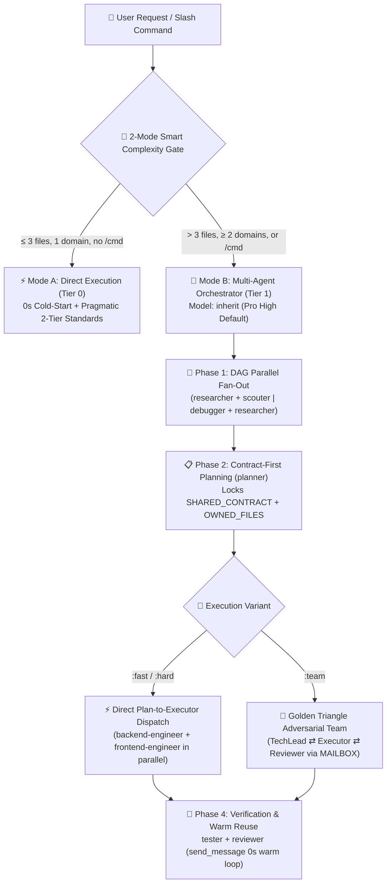
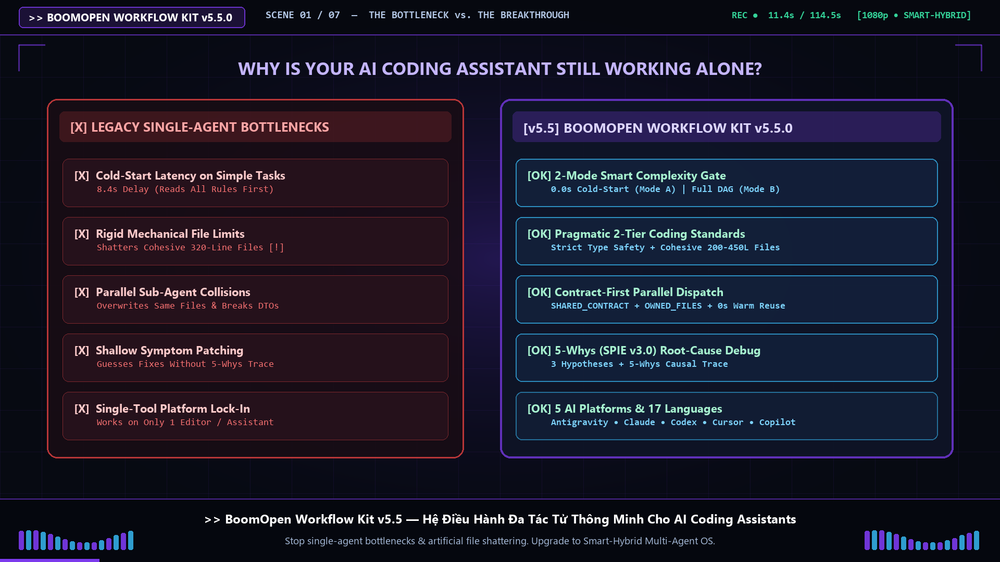

<div align="center">
  <h1>⚡ BoomOpen Workflow Kit v5.5.0</h1>
  <p><strong>Multi-Platform Smart-Hybrid AI Workforce Operating System & Multi-Agent Orchestration Framework</strong></p>

  [](https://github.com/Kennyboom/BoomOpen-Workflow-Kit/releases)
  [](#💻-supported-ai-platforms)
  [](#🤖-21-specialist-agents--17-golden-triangle-teams)
  [](#🧠-6-core-pillars-of-v55)
  [](https://nodejs.org/)
  [](./LICENSE)

  <p>
    **🇬🇧 English** • [🇻🇳 Tiếng Việt](./i18n/README.vi.md) • [🇨🇳 简体中文](./i18n/README.zh-CN.md) • [🇹🇼 繁體中文](./i18n/README.zh-TW.md) • [🇯🇵 日本語](./i18n/README.ja.md) • [🇰🇷 한국어](./i18n/README.ko.md) • [🇪🇸 Español](./i18n/README.es.md) • [🇫🇷 Français](./i18n/README.fr.md) • [🇩🇪 Deutsch](./i18n/README.de.md)<br/>
    [🇧🇷 Português](./i18n/README.pt-BR.md) • [🇷🇺 Русский](./i18n/README.ru.md) • [🇮🇳 हिन्दी](./i18n/README.hi.md) • [🇸🇦 العربية](./i18n/README.ar.md) • [🇮🇩 Bahasa Indonesia](./i18n/README.id.md) • [🇹🇭 ไทย](./i18n/README.th.md) • [🇹🇷 Türkçe](./i18n/README.tr.md) • [🇮🇹 Italiano](./i18n/README.it.md)
  </p>
  <p>
    <a href="#🇬🇧-english-documentation"><b>🇬🇧 English Documentation</b></a> •
    <a href="#🚀-quick-start--installation"><b>🚀 Quick Start</b></a> •
    <a href="#🎛️-unified-settings--mode-selection-settings"><b>🎛️ Mode & Settings</b></a> •
    <a href="#🎯-slash-commands-reference"><b>🎯 Slash Commands</b></a> •
    <a href="./i18n/README.vi.md"><b>🇻🇳 Tài Liệu Tiếng Việt (Full)</b></a>
  </p>
</div>

---

## 🇬🇧 English Documentation

### 🎬 Official Launch Trailer (English — Full HD 1080p)

<div align="center">
  <a href="https://github.com/Kennyboom/BoomOpen-Workflow-Kit/raw/main/assets/media/boomopen_v55_trailer_en.mp4">
    
  </a>
  <p>
    ▶️ <a href="https://github.com/Kennyboom/BoomOpen-Workflow-Kit/raw/main/assets/media/boomopen_v55_trailer_en.mp4"><b>Click Here to Watch / Stream the Full HD English Launch Trailer (MP4 with Studio Voiceover)</b></a>
    &nbsp;|&nbsp;
    🇻🇳 <a href="https://github.com/Kennyboom/BoomOpen-Workflow-Kit/raw/main/assets/media/boomopen_v55_trailer_vi.mp4"><b>Xem Video Bản Tiếng Việt</b></a>
  </p>
</div>

### 🌟 What is BoomOpen Workflow Kit?

**BoomOpen Workflow Kit v5.5 (Multi-Platform Unified & Smart-Hybrid Edition)** is an open-source multi-agent operating system that transforms a single AI coding assistant into an orchestrated engineering organization of **21 specialist agents**, **17 adversarial Golden Triangle teams**, **48 Core Skills**, and **1,430+ Niche Library Skills**.

Unlike rigid single-prompt templates or heavyweight agent wrappers that add cold-start latency to every trivial question, BoomOpen v5.5 introduces a **2-Mode Smart Complexity Threshold Gate**:
- **⚡ Mode A — Direct Execution (0s Cold-Start)**: Simple Q&A, code explanations, and localized changes (`≤ 3 files`, single domain, no `/cmd`) execute directly in the primary agent while enforcing **Pragmatic 2-Tier Coding Standards** and **Persistent Testing & Bug Fixing**.
- **🎻 Mode B — Strict Multi-Agent Orchestration**: Complex features (`> 3 files` or `≥ 2 domains`) or explicit `/cmd` workflows activate full multi-agent orchestration with **DAG Parallel Fan-Out**, **Direct Plan-to-Executor Dispatch**, **Contract-First File Locks (`SHARED_CONTRACT` + `OWNED_FILES`)**, and **Stateful Warm Sub-agent Reuse (`send_message`)**.

---

### 🏗️ Smart-Hybrid Architecture (v5.5)



---

### 🧠 6 Core Pillars of v5.5

1. **🌐 5-Platform Unified Parity (`platforms/*`)**:
   - First-class native installation for **Google Antigravity 2.0 (Gemini)**, **Claude Code**, **OpenAI Codex**, **Cursor**, and **GitHub Copilot** from a single unified architecture.
2. **📏 Pragmatic 2-Tier Coding Standards (Anti-Fragmentation)**:
   - **Tier 1 — Strict Quality & Safety (Zero Tolerance)**: Single Responsibility, **NO explicit `any`**, **NO leftover debug `console.log`** in production apps, mandatory `try/catch` + typed error handling on async/API boundaries, `SCREAMING_SNAKE_CASE` constants, DRY (`≥ 3`), and clean sorted imports.
   - **Tier 2 — Flexible Structural Guidelines (Cohesion First)**: Cohesive files target `~200–350 lines` with a `~400–450 line` soft ceiling (`>500 lines` hard split; tests/types/CLI/docs exempt). Functions target `~20–40 lines` (`~40–80 lines` for UI/Handlers) — preventing artificial file shattering.
3. **🎯 Direct Plan-to-Executor Dispatch & Warm Sub-agent Reuse (`send_message`)**:
   - Once `PLAN-{feature}.md` exists, the Orchestrator dispatches tasks **directly** to domain engineers (`backend-engineer`, `frontend-engineer`, `database-architect`, etc.) without a redundant `tech-lead` middleman hop.
   - Active sub-agents are tracked in an **Active Session Registry (`Role → conversationId`)** and reused via `send_message` with **0s cold-start latency** and **100% retained file context**.
4. **🤝 Contract-First Parallel Dispatch (`SHARED_CONTRACT` + `OWNED_FILES`)**:
   - Multi-domain plans lock API endpoints, DTO schemas, and disjoint file ownership (`OWNED_FILES` vs. `READ_ONLY_FILES`) before launching parallel engineers, eliminating write collisions and integration mismatches.
5. **🔍 5-Whys (SPIE v3.0) Root-Cause Debugging & Clean Git Tree**:
   - `debugger` traces every bug through 3 ranked hypotheses and a 5-Whys causal chain (`Why 1 Symptom` → `Why 5 Systemic Root Cause`). Transient artifacts (`PLAN`, `DEBUG`, `TEST`, `REVIEW`, `MAILBOX`) route to `<appDataDir>\brain\<conversation-id>\` first so your Git working tree stays 100% clean.
6. **🩺 Built-In CLI Diagnostics (`doctor` & `check`) & O(1) Skill Index**:
   - `npm run doctor` validates all 5 platform bundles, 21 agents, 51 team files, 72 commands, and `matrix-skills/compact-index.json` (`1,430+` indexed skills). `npm run check <dir>` deterministically audits Tier 1 & Tier 2 coding standards.

---

### 💻 Supported AI Platforms

| Platform | Support Level | Global Entrypoint | Framework Install Path |
|----------|:-------------:|-------------------|------------------------|
| **Antigravity (Gemini)** | ✅ Native v5.5 | `~/.gemini/GEMINI.md` | `~/.gemini/config/skills/boomopen-workflow-kit/` |
| **Claude Code** | ✅ Native v5.5 | `~/.claude/CLAUDE.md` | `~/.claude/skills/boomopen-workflow-kit/` |
| **OpenAI Codex** | ✅ Native v5.5 | `~/.codex/CODEX.md` & `AGENTS.md` | `~/.codex/skills/boomopen-workflow-kit/` |
| **Cursor** | ✅ Native v5.5 | `~/.cursor/rules/boomopen-workflow-kit.mdc` | `~/.cursor/skills/boomopen-workflow-kit/` |
| **GitHub Copilot** | ✅ Native v5.5 | `~/.copilot/COPILOT.md` | `~/.copilot/skills/boomopen-workflow-kit/` |

---

### 🚀 Quick Start & Installation

```bash
# 1. Clone the repository
git clone https://github.com/Kennyboom/BoomOpen-Workflow-Kit.git
cd BoomOpen-Workflow-Kit

# 2. Install for your AI coding assistant (choose one or --all)
npm run install:antigravity   # Google Antigravity 2.0 (Gemini)
npm run install:claude        # Anthropic Claude Code
npm run install:codex         # OpenAI Codex CLI
npm run install:cursor        # Cursor AI Editor
npm run install:copilot       # GitHub Copilot (VS Code)
npm run install:all           # Install across all 5 platforms

# 3. Verify installation health, Pragmatic 2-Tier code standards & test suite
npm run doctor                # Diagnose entrypoints, 5 platforms, agents, commands & skill index
npm run check ./cli           # Audit source code against Pragmatic 2-Tier Coding Standards
npm test                      # Run the 17-suite automated regression test runner
```

---

### 🎛️ Unified Settings & Mode Selection (`/settings`)

BoomOpen v5.5 includes a **Zero-Latency Unified Control Center** that lets you switch execution modes (`Auto`, `Mode A`, `Mode B`, `Golden Triangle Team`), research triggers, model policies, and coding standards across all **5 platforms** in `< 10ms` with **0ms Turn-1 latency** (via AOT `<!-- BOOMOPEN-SETTINGS-START -->` injection into `GEMINI.md`, `CLAUDE.md`, `CODEX.md`, `CURSOR.md`, and `COPILOT.md`).

#### 1️⃣ Four One-Click Preset Profiles & Execution Modes

| Preset Profile | Execution Mode (`execution.mode`) | Default `/cmd` Variant | Natural-Language Research (`naturalLanguageResearchTrigger`) | Coding Standards | Best Used For |
|:---------------|:----------------------------------|:----------------------:|:------------------------------------------------------------:|:----------------:|:--------------|
| **⚡ `smart-hybrid`** *(Default Recommended)* | **`auto`** (`≤ 3 files` → Mode A Direct; `> 3 files` or `/cmd` → Mode B) | `auto` | **`auto_team`** *(Auto-routes NL research/ideation to `/brainstorm:team` Golden Triangle)* | `pragmatic` (`400/500` lines) | Daily full-stack engineering — fast on small tasks, deep on complex architectures |
| **🚀 `solo-fast`** | **`mode_a`** *(Force Direct Solo Execution, 0s sub-agent latency)* | `fast` | `off` *(Direct chat reply unless `/brainstorm` is typed)* | `relaxed` (`600/800` lines) | Urgent hotfixes, rapid prototyping, scripts & minimal token usage |
| **🧠 `deep-architect`** | **`mode_b`** *(Force Strict Multi-Agent Orchestrator on every task)* | `hard` | `auto_hard` *(Auto-routes NL research to `/brainstorm:hard` 5-Lens)* | `strict` (`300/400` lines) | Complex system architecture, greenfield design & multi-domain refactors |
| **🔺 `adversarial-team`** | **`team`** *(Force 3-Agent Golden Triangle `:team` on all workflows)* | `team` | **`auto_team`** *(3-Agent adversarial ideation & review)* | `strict` (`300/400` lines) | Mission-critical production code, security audits & zero-defect releases |

#### 2️⃣ Three Ways to Switch Modes & Customize Settings

- **💬 Surface 1 — In-Chat `/settings` Command (Interactive UI Widget or One-Liner)**:
  ```text
  /settings                                     # Open interactive clickable menu (via native ask_question UI)
  /settings preset smart-hybrid                 # Switch to Smart-Hybrid default (Recommended)
  /settings preset solo-fast                    # Switch to Mode A Solo Fast mode
  /settings preset deep-architect               # Switch to Mode B Multi-Agent Architect mode
  /settings preset adversarial-team             # Switch to Golden Triangle 3-Agent Team mode
  /settings mode auto | mode_a | mode_b | team  # Directly override execution.mode
  /settings set workflows.naturalLanguageResearchTrigger auto_team
  /settings ui                                  # Launch the Local Web Control Center in your browser
  ```
- **🌐 Surface 2 — Local Web Control Center Dashboard (`--ui` at `http://127.0.0.1:4567`)**:
  ```bash
  npm run settings:ui
  # Or directly from anywhere:
  node ~/.gemini/config/skills/boomopen-workflow-kit/cli/install.js settings --ui
  ```
- **⌨️ Surface 3 — Terminal CLI (Global `~/.boomopen/settings.json` & Project `./.boomopen.json`)**:
  ```bash
  npm run settings -- status                                  # View all 12 active settings & platform sync status
  npm run settings -- preset adversarial-team                 # Apply a preset globally & hot-sync all 5 IDEs
  npm run settings -- set execution.mode mode_a --project     # Override mode for the current project workspace only
  npm run settings -- reset                                   # Restore recommended v5.5 defaults
  ```

---

### 🎯 Slash Commands Reference

| Command | Variants | Primary Purpose |
|---------|----------|-----------------|
| **`/cook`** | `:fast`, `:hard`, `:team` | End-to-end feature development (Research/Scout → Plan → Parallel Code → Test → Review) |
| **`/code`** | `:fast`, `:hard`, `:team` | Execute implementation directly from an existing `PLAN-{feature}.md` |
| **`/plan`** | `:fast`, `:hard`, `:team` | Create implementation blueprints with `SHARED_CONTRACT`, `OWNED_FILES` & Given/When/Then criteria |
| **`/fix`** | `:fast`, `:hard`, `:team` | Root-cause bug resolution with mandatory regression test verification |
| **`/debug`** | `:fast`, `:hard`, `:team` | 3-Hypothesis + **5-Whys (SPIE v3.0)** causal root-cause investigation (`DEBUG-{issue}.md`) |
| **`/test`** | `:fast`, `:hard`, `:team` | DAG Parallel Fan-Out test suite execution + uncovered edge-case scouting (`tester` + `scouter`) |
| **`/review`** | `:fast`, `:hard`, `:team` | 4-way parallel audit (Architecture, Code Quality, Security OWASP, Performance) |
| **`/design`** | `:fast`, `:hard`, `:team` | System architecture, database schema, and UI/UX specification (`DESIGN.md`) |
| **`/docs`** | `:core`, `:business`, `:audit` | Generate or synchronize structured 2-tier architecture & business documentation (`./documents/`) |
| **`/deploy`** | `:check`, `:preview`, `:production`, `:rollback` | Pre-deployment readiness gates, preview environments, production rollout & safe rollback |
| **`/brainstorm`** | `:fast`, `:hard`, `:team` | Socratic requirements discovery, trade-off analysis & ideation |
| **`/report`** | `:fast`, `:hard`, `:team` | Executive & technical synthesis reports with metrics and diagrams |
| **`/orchestrate`** | — | Custom multi-agent pipeline orchestration across multiple domains |
| **`/settings` / `/config`** | `preset`, `mode`, `set`, `ui` | Unified Control Center: switch `Auto` / `Mode A` / `Mode B` / `Team`, presets, or open Web UI (`--ui`) |
| **`/save` / `/recap`** | — | Persist session state (`SESSION-HANDOVER.md`) and restore full context in `< 5s` |

---

### 🤖 21 Specialist Agents & 17 Golden Triangle Teams

| Category | Specialist Agents (`agents/*.md`) | Golden Triangle Teams (`agents/teams/*-team/`) |
|----------|-----------------------------------|------------------------------------------------|
| **Engineering & Execution** | `backend-engineer`, `frontend-engineer`, `mobile-engineer`, `game-engineer`, `database-architect`, `devops-engineer` | `backend-team`, `frontend-team`, `fullstack-team`, `mobile-team`, `game-team`, `database-team`, `devops-team` |
| **Architecture & Planning** | `tech-lead`, `planner`, `brainstormer`, `business-analyst`, `project-manager`, `designer` | `planning-team`, `project-team`, `design-team` |
| **Quality, Security & Debug** | `debugger`, `tester`, `reviewer`, `security-engineer`, `performance-engineer` | `debug-team`, `qa-team`, `review-team`, `security-team`, `performance-team` |
| **Research & Knowledge** | `researcher`, `scouter`, `docs-manager`, `reporter` | `research-team`, `docs-team`, `report-team` |

---

### 📂 Repository Structure

```text
BoomOpen-Workflow-Kit/
├── agents/                  # 21 Specialist Agent definitions + 17 Golden Triangle Teams (51 role files)
├── cli/                     # Installer (install.js), Health Doctor (doctor.js), 2-Tier Code Checker (checker.js) & Tests
├── commands/                # 72 Slash Command workflows (:fast, :hard, :team) + _ref/ protocols
├── documents/               # 2-Tier Architecture, Domain, Source-Base & Coding Standards documentation
├── i18n/                    # 16 full-length localized READMEs (vi, zh-CN, zh-TW, ja, ko, es, fr, de, pt-BR, ru, hi, ar, id, th, tr, it)
├── matrix-skills/           # Domain YAML skill matrices + pre-compiled compact-index.json (1,430+ skills)
├── platforms/               # Unified 5-platform templates (antigravity/, claude/, codex/, copilot/, cursor/)
├── rules/                   # On-demand Mode B rules (CORE, PHASES, AGENTS, TEAMS, SKILLS, ERRORS, REFERENCE)
├── scripts/                 # Python automation & verification runners (checklist.py, verify_all.py, etc.)
├── skills/                  # 48 Core Skills (clean-code, debugger, plan-writing, frontend-design, etc.)
├── skills_library/          # 1,430+ dormant niche skills loaded on-demand via 2-step lookup
└── GEMINI.md | CLAUDE.md | CODEX.md | COPILOT.md | CURSOR.md | AGENT.md
```

---

## 🇻🇳 Tài Liệu Tiếng Việt

### 🎬 Video Giới Thiệu Chính Thức (Tiếng Việt — Full HD 1080p)

<div align="center">
  <a href="https://github.com/Kennyboom/BoomOpen-Workflow-Kit/raw/main/assets/media/boomopen_v55_trailer_vi.mp4">
    
  </a>
  <p>
    ▶️ <a href="https://github.com/Kennyboom/BoomOpen-Workflow-Kit/raw/main/assets/media/boomopen_v55_trailer_vi.mp4"><b>Bấm Vào Đây Để Xem / Tải Video Giới Thiệu Bản Tiếng Việt (Full HD 1080p — Thuyết Minh Studio)</b></a>
    &nbsp;|&nbsp;
    🇬🇧 <a href="https://github.com/Kennyboom/BoomOpen-Workflow-Kit/raw/main/assets/media/boomopen_v55_trailer_en.mp4"><b>Watch English Version</b></a>
  </p>
</div>

### 🌟 BoomOpen Workflow Kit v5.5 là gì?

**BoomOpen Workflow Kit v5.5 (Multi-Platform Unified & Smart-Hybrid Edition)** là hệ điều hành đa tác tử (Multi-Agent) mã nguồn mở dành cho các AI Coding Assistant, kết hợp **21 Đặc vụ Chuyên gia (Specialist Agents)**, **17 Đội hình Tam Giác Vàng (Golden Triangle Teams)**, **48 Kỹ năng Lõi (Core Skills)** và **1.430+ Kỹ năng Chuyên sâu (`skills_library`)** trên cả **5 nền tảng**: **Google Antigravity 2.0 (Gemini)**, **Claude Code**, **OpenAI Codex**, **Cursor**, và **GitHub Copilot**.

### ⚡ 6 Trụ Cột Cốt Lõi Của Phiên Bản v5.5

1. **🚦 Cổng Phân Loại Độ Phức Tập Thông Minh 2 Chế Độ (Mode A vs. Mode B)**:
   - **⚡ Mode A — Thực Thi Trực Tiếp (Độ trễ khởi động = 0 giây)**: Với câu hỏi Q&A, giải thích code, hoặc sửa lỗi/thay đổi nhỏ chạm **≤ 3 files** trong 1 domain (không gọi lệnh `/cmd`), Agent chính xử lý và kiểm thử **trực tiếp**, tuân thủ nghiêm ngặt **Chuẩn Code Thực Dụng 2 Tầng**.
   - **🎻 Mode B — Điều Phối Đa Tác Tử Nghiêm Ngặt (Multi-Agent Orchestration)**: Khi người dùng gọi lệnh `/cmd` (`/cook`, `/fix:hard`, `/review:team`,...) hoặc tác vụ chạm **> 3 files** / **≥ 2 domains**, hệ thống kích hoạt chế độ Orchestrator chuyên sâu.
2. **📏 Chuẩn Code Thực Dụng 2 Tầng (Pragmatic 2-Tier Coding Standards)**:
   - **🛡️ Tầng 1 — Bắt Buộc Tuyệt Đối (Strict Quality & Safety)**: Mỗi file/hàm giải quyết trọn vẹn 1 trách nhiệm (Single Responsibility); **CẤM `any` tường minh**; **CẤM để sót `console.log` tạm** trong code ứng dụng; mọi lời gọi async/API phải có `try/catch` + typed error; hằng số đặt tên `SCREAMING_SNAKE_CASE`; DRY (`≥ 3` lần lặp).
   - **📐 Tầng 2 — Ngưỡng Cấu Trúc Linh Hoạt (Chống Cắt Vụn File Máy Móc)**: File code hướng tới **`~200–350 dòng`** (linh hoạt tới **`~400–450 dòng`** nếu vẫn phục vụ 1 trách nhiệm mạch lạc; chỉ bắt buộc tách khi `>500 dòng` hoặc ôm đồm nhiều domain; miễn trừ cho file Test, Schema/Types, CLI, Docs). Hàm logic `~20–40 dòng` / hàm UI & Handler `~40–80 dòng`.
3. **🎯 Điều Phối Trực Tiếp Từ Plan & Tái Sử Dụng Sub-agent Nóng (`send_message`)**:
   - Khi đã có `PLAN-{feature}.md`, Orchestrator giao việc **trực tiếp** cho các kỹ sư thực thi (`backend-engineer`, `frontend-engineer`, `database-architect`) mà không tốn bước trung gian qua `tech-lead`.
   - Lưu danh bạ phiên **`Role → conversationId`** và gọi `send_message` để tái sử dụng sub-agent đang nóng với **0 giây cold-start** và **giữ nguyên 100% ngữ cảnh file đã đọc**.
4. **🤝 Giao Việc Song Song Theo Hợp Đồng (`SHARED_CONTRACT`) & Khóa Quyền Ghi File (`OWNED_FILES`)**:
   - `planner` khóa trước hợp đồng giao tiếp API/DTO (`SHARED_CONTRACT`) và danh sách file được phép sửa (`OWNED_FILES`) trước khi chạy song song nhiều kỹ sư, triệt tiêu hoàn toàn lỗi ghi đè file.
5. **🔍 Truy Nguyên Nhân Gốc Rễ 5-Whys (SPIE v3.0) & Giữ Sạch Git Tree 100%**:
   - Đặc vụ `debugger` phân tích tối thiểu 3 giả thuyết và truy chuỗi nhân quả **5-Whys** trước khi đề xuất bản vá. Toàn bộ báo cáo trung gian (`PLAN`, `DEBUG`, `TEST`, `REVIEW`, `MAILBOX`) được ghi vào `<appDataDir>\brain\<conversation-id>\` giúp nhánh Git của dự án luôn sạch tuyệt đối.
6. **🌐 Đồng Bộ 100% Trên 5 Nền Tảng (`platforms/*`) & Chẩn Đoán Tự Động (`doctor` / `check`)**:
   - Hỗ trợ cài đặt và kiểm tra sức khỏe tự động cho cả **Antigravity, Claude Code, Codex, Cursor, và Copilot**.

---

### ⚙️ Hướng Dẫn Cài Đặt & Kiểm Định

```bash
# Cài đặt cho công cụ bạn đang sử dụng (hoặc cài tất cả với install:all)
npm run install:antigravity   # Google Antigravity 2.0 (Gemini)
npm run install:claude        # Claude Code
npm run install:codex         # OpenAI Codex
npm run install:cursor        # Cursor AI
npm run install:copilot       # GitHub Copilot
npm run install:all           # Cài đặt cả 5 nền tảng

# Chạy kiểm tra sức khỏe hệ thống & kiểm định chuẩn code 2 tầng
npm run doctor
npm run check ./cli
npm test
```

---

### 🎛️ Hướng Dẫn Lựa Chọn Chế Độ & Bảng Cài Đặt (`/settings` Control Center)

Mặc định ngay sau khi cài đặt, BoomOpen v5.5 tự động kích hoạt cấu hình **Recommended (`⚡ smart-hybrid`)** lưu tại `~/.boomopen/settings.json` và nhúng trực tiếp vào `~/.gemini/GEMINI.md` (cùng 4 nền tảng còn lại) với **độ trễ Turn 1 = 0ms**. Bạn có thể tùy ý chuyển đổi giữa **4 Chế Độ Vận Hành (Presets)** hoặc tinh chỉnh **12 thông số hệ thống** qua 3 cách:

#### 1️⃣ Bảng 4 Chế Độ Vận Hành (Preset Profiles)

| Bộ Cấu Hình (`Preset`) | Chế Độ Thực Thi (`execution.mode`) | Biến Thể Lệnh Mặc Định | Khi Hỏi "Nghiên cứu / Ý tưởng" Tự Nhiên (`naturalLanguageResearchTrigger`) | Chuẩn Code (`codingStandards`) | Khi Nào Nên Dùng? |
|:-----------------------|:-----------------------------------|:----------------------:|:-------------------------------------------------------------------------:|:------------------------------:|:------------------|
| **⚡ `smart-hybrid`** *(Mặc định Recommended)* | **`auto`** (Việc nhỏ `≤ 3 files` chạy **Mode A** siêu tốc; việc lớn `> 3 files` hoặc `/cmd` chạy **Mode B Multi-Agent**) | `auto` | **`auto_team`** *(Tự động kích hoạt hội đồng 3-Agent `/brainstorm:team` Golden Triangle)* | `pragmatic` (`400/500` dòng) | Chế độ cân bằng hoàn hảo cho công việc hàng ngày: nhanh ở task nhỏ, cực sâu khi nghiên cứu & làm tính năng lớn |
| **🚀 `solo-fast`** | **`mode_a`** *(Ép chạy trực tiếp 1 Agent, tắt gọi sub-agent để phản hồi tức thì)* | `fast` | `off` *(Trả lời trực tiếp trong chat trừ khi gõ `/brainstorm`)* | `relaxed` (`600/800` dòng) | Khi cần sửa gấp hotfix, làm prototype nhanh, viết script nhỏ hoặc tiết kiệm tối đa token |
| **🧠 `deep-architect`** | **`mode_b`** *(Luôn bật điều phối Đa Tác Tử Mode B cho mọi tác vụ)* | `hard` | `auto_hard` *(Tự động chạy `/brainstorm:hard` 5-Lens Research)* | `strict` (`300/400` dòng) | Khi thiết kế kiến trúc hệ thống phức tạp, dự án mới hoặc refactor đa tầng |
| **🔺 `adversarial-team`** | **`team`** *(Luôn bật hội đồng 3-Agent đối kháng Golden Triangle `:team`)* | `team` | **`auto_team`** *(Hội đồng 3-Agent phản biện chéo qua `MAILBOX`)* | `strict` (`300/400` dòng) | Dự án trọng điểm (Fintech, Core Platform, Game 3D lớn) đòi hỏi chất lượng & bảo mật tuyệt đối |

#### 2️⃣ Ba Cách Chuyển Đổi Chế Độ (Chat, Web UI, CLI)

1. **💬 Cách 1 — Gõ trực tiếp `/settings` ngay trong khung Chat (Nhanh & Tiện nhất)**:
   ```text
   /settings                                     # Mở bảng trạng thái + Menu chọn tương tác (ask_question UI)
   /settings preset smart-hybrid                 # Chuyển về chế độ Mặc định Recommended (Auto Mode A/B + auto_team)
   /settings preset solo-fast                    # Chuyển sang Mode A (Chạy trực tiếp siêu nhanh)
   /settings preset deep-architect               # Chuyển sang Mode B (Chuyên sâu Multi-Agent)
   /settings preset adversarial-team             # Chuyển sang Golden Triangle 3-Agent (:team)
   /settings mode auto | mode_a | mode_b | team  # Đổi riêng chế độ thực thi (Execution Mode)
   /settings ui                                  # Khởi chạy giao diện Web Control Center trên trình duyệt
   ```
2. **🌐 Cách 2 — Mở Bảng Điều Khiển Giao Diện Web (`http://127.0.0.1:4567`)**:
   > **Lưu ý**: Để mở trang Web local `http://127.0.0.1:4567`, bạn cần chạy lệnh khởi động server bên dưới trong Terminal (hoặc gõ `/settings ui` trong chat):
   ```bash
   npm run settings:ui
   # Hoặc chạy trực tiếp từ bất kỳ thư mục nào:
   node ~/.gemini/config/skills/boomopen-workflow-kit/cli/install.js settings --ui
   ```
3. **⌨️ Cách 3 — Chạy lệnh Terminal CLI (Hỗ trợ cả Global `~/.boomopen/settings.json` & từng Project `./.boomopen.json`)**:
   ```bash
   npm run settings -- status                                  # Xem bảng 12 thông số đang kích hoạt
   npm run settings -- preset adversarial-team                 # Đổi preset toàn cục & đồng bộ cả 5 IDE trong <10ms
   npm run settings -- set execution.mode mode_a --project     # Ghi đè chế độ riêng cho thư mục dự án hiện tại
   npm run settings -- reset                                   # Khôi phục về mặc định Recommended (smart-hybrid)
   ```

---

### 📄 License & Security

- **License**: Distributed under the [MIT License](./LICENSE). Copyright © 2026 **Kennyboom (BoomOpen)**.
- **Security Policy**: Please see [SECURITY.md](./SECURITY.md) for built-in security guardrails and vulnerability reporting guidelines.
