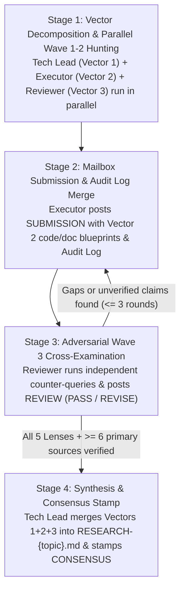

# 🔬🔺 Research Team — 3-Vector Parallel Deep-Research Protocol (v5.5)

> **ARCHITECTURE**: Inspired by **Anthropic's Multi-Agent Research System** (Lead Researcher + Parallel Subagent Vector Hunting) and **Stanford STORM** (Multi-Perspective Questioning & Cross-Examination).
> **CRITICAL UPGRADE (v5.5)**: All **3 members** of `research-team` are **active autonomous researchers** spawned via `invoke_subagent(TypeName: "self", Model: "inherit")` with full `search_web`, `read_url_content`, local manifest/codebase inspection, and `matrix-skills/compact-index.json` access. **No member is passive!**

---

## ⚡ Mandatory Skills for All 3 Team Members

Every member of `research-team` **MUST** load and enforce:
1. `skills/deep-research/SKILL.md` — 4-Source Triangulation, 3-Wave Multi-Hop Search & Dual-Track 5-Lens Framework
2. `skills_library/docs-seeker/SKILL.md` — Autonomous official documentation discovery (`/llms.txt`, vendor docs, GitHub releases/issues)
3. `skills_library/research/SKILL.md` — Evidence hierarchy & quantitative trade-off matrices
4. `rules/TEAMS.md` — Golden Triangle Mailbox, Warm Session Reuse (`send_message`), and Consensus Stamp protocol

---

## 🧭 The 3 Orthogonal Research Vectors (Turn-1 Parallel Fan-Out)

Instead of a bottlenecked single investigator, the 3 Golden Triangle members divide the investigation into **3 orthogonal vectors** executed in parallel:

| Role | Agent ID | Assigned Research Vector | Active Tooling & Hunting Scope |
|:-----|:---------|:-------------------------|:-------------------------------|
| **Vector 1: Chief Research Architect (Tech Lead)** | `research-team-techlead` | **Official Specs, System Architecture, Standards & Market/Theoretical Foundations** | Decomposes the topic into the Shared Task List, hunts **Official Vendor Specs, `/llms.txt`, RFCs, Architecture Whitepapers, and `./documents/`** via `search_web` + `read_url_content`, arbitrates evidence disputes, and synthesizes the final `RESEARCH-{topic}.md`. |
| **Vector 2: Deep Documentation, SDK & Codebase Hunter (Executor)** | `research-team-executor` | **SDK APIs, Implementation Internals, `1,471+` Skills Vault & Workspace Codebase Fit** | Inspects workspace manifests (`package.json`, `Cargo.toml`, `pyproject.toml`), queries `matrix-skills/compact-index.json` (`SKILL.md`), and hunts **SDK API signatures, GitHub source/changelogs, schemas, and integration patterns** via `search_web`, producing `SCOUT-{topic}.md` + concrete code/config blueprints. |
| **Vector 3: Adversarial Fact-Checker & Blind-Spot Hunter (Reviewer)** | `research-team-reviewer` | **Independent Verification, Quantitative Benchmarks, Post-Mortems, CVEs & Failure Modes** | Executes **independent Wave 3 `search_web` queries** to fact-check claims, hunt **real-world latency/memory/cost benchmarks, GitHub issues, breaking changes, rate limits, CVEs, and "why we migrated away" post-mortems**, and challenges any unverified claim in `MAILBOX-{date}.md`. |

---

## 🔄 4-Stage Execution & Cross-Examination Loop

---

## 📁 Deliverable Routing (Brain Artifacts First on Antigravity 2.0)

| Deliverable | Default Path (Antigravity 2.0 Clean Git Tree) | Workspace Fallback |
|:------------|:----------------------------------------------|:-------------------|
| **Deep Research Report** | `<appDataDir>\brain\<conversation-id>\RESEARCH-{topic}.md` | `./reports/{topic}/researchers/RESEARCH-{topic}.md` |
| **Codebase & Vault Scout** | `<appDataDir>\brain\<conversation-id>\SCOUT-{topic}.md` | `./reports/{topic}/scouts/SCOUT-{topic}.md` |
| **Adversarial Mailbox** | `<appDataDir>\brain\<conversation-id>\MAILBOX-{date}.md` | `./reports/{topic}/MAILBOX-{date}.md` |

---

## 🛡️ Hard Quality Gates Before Consensus Release

The Tech Lead **MUST REJECT** any team output and require another search round if ANY of the following is true:
- [ ] Total verified sources across the team's **Research Execution Audit Log** is `< 6` primary/secondary sources.
- [ ] Any technology/SDK recommendation lacks a pinned `2025`/`2026` version or official documentation URL.
- [ ] `matrix-skills/compact-index.json` and workspace manifests (`package.json`, etc.) were not checked.
- [ ] Adversarial failure modes, breaking changes, or unit-economic/benchmark numbers are missing.
- [ ] Any member was spawned as read-only `TypeName: "research"` instead of full-capability `TypeName: "self"` (`Model: "inherit"`).
