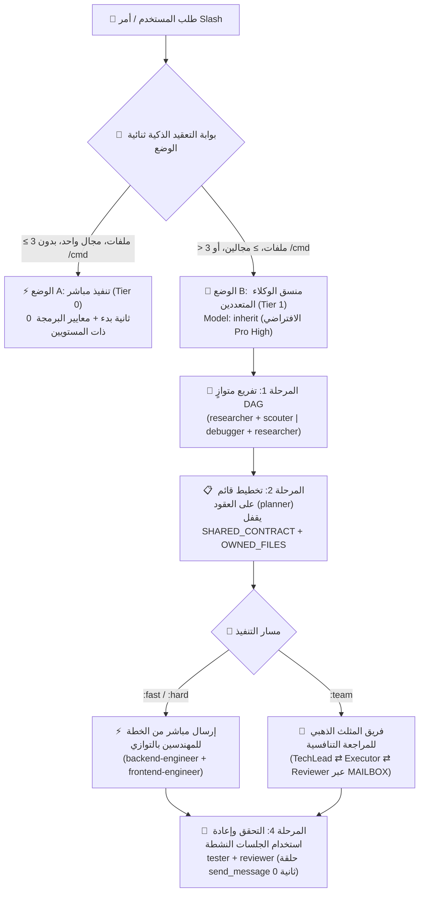

<div align="center">
  <h1>⚡ BoomOpen Workflow Kit v5.5.0</h1>
  <p><strong>نظام تشغيل القوى العاملة بالذكاء الاصطناعي الهجين الذكي متعدد المنصات وإطار عمل تنسيق الوكلاء المتعددين</strong></p>

  [](https://github.com/Kennyboom/BoomOpen-Workflow-Kit/releases)
  [](#)
  [](#)
  [](#)
  [](https://nodejs.org/)
  [](../LICENSE)

  <p>
    [🇬🇧 English](../README.md) • [🇻🇳 Tiếng Việt](./README.vi.md) • [🇨🇳 简体中文](./README.zh-CN.md) • [🇹🇼 繁體中文](./README.zh-TW.md) • [🇯🇵 日本語](./README.ja.md) • [🇰🇷 한국어](./README.ko.md) • [🇪🇸 Español](./README.es.md) • [🇫🇷 Français](./README.fr.md) • [🇩🇪 Deutsch](./README.de.md)<br/>
    [🇧🇷 Português](./README.pt-BR.md) • [🇷🇺 Русский](./README.ru.md) • [🇮🇳 हिन्दी](./README.hi.md) • **🇸🇦 العربية** • [🇮🇩 Bahasa Indonesia](./README.id.md) • [🇹🇭 ไทย](./README.th.md) • [🇹🇷 Türkçe](./README.tr.md) • [🇮🇹 Italiano](./README.it.md)
  </p>
</div>

---

## 🌟 ما هو BoomOpen Workflow Kit v5.5؟

**BoomOpen Workflow Kit v5.5 (الإصدار الموحد متعدد المنصات والهجين الذكي)** هو نظام تشغيل مفتوح المصدر متعدد الوكلاء (Multi-Agent) يحوّل مساعد البرمجة الفردي بالذكاء الاصطناعي إلى منظمة هندسية متكاملة تضم **21 وكيلاً متخصصاً (Specialist Agents)**، و**17 فريقاً تنافسياً بنموذج المثلث الذهبي (Golden Triangle Teams)**، و**48 مهارة أساسية (Core Skills)**، وأكثر من **1,430 مهارة مكتبية متخصصة (`skills_library`)**.

على عكس القوالب الجامدة أو الأطر الثقيلة التي تسبب تأخيراً في التشغيل البارد مع كل سؤال بسيط، يقدم BoomOpen v5.5 **بوابة عتبة التعقيد الذكية ثنائية الوضع (2-Mode Smart Complexity Threshold Gate)**:
- **⚡ الوضع A — التنفيذ المباشر (0 ثانية تشغيل بارد)**: الأسئلة والأجوبة السريعة، شرح الكود، إصلاح الأخطاء في نطاق واحد، أو التعديلات الواضحة التي تلمس **3 ملفات أو أقل** (دون أمر `/cmd`) يتم تنفيذها واختبارها والتحقق منها **مباشرة** بواسطة الوكيل الأساسي مع تطبيق **معايير البرمجة العملية ذات المستويين** و**الاختبار وإصلاح الأخطاء المستمر**.
- **🎻 الوضع B — التنسيق الصارم للوكلاء المتعددين**: الميزات المعقدة (**أكثر من 3 ملفات** أو **مجالين فأكثر**) أو أوامر `/cmd` الصريحة تفعّل وضع المنسق الصارم مع **التفريع المتوازي DAG**، و**الإرسال المباشر من الخطة إلى المنفذ**، و**أقفال ملكية الملفات القائمة على العقود (`SHARED_CONTRACT` + `OWNED_FILES`)**، و**إعادة استخدام الجلسات النشطة للوكلاء الفرعيين (`send_message`)**.

---

## 🏗️ البنية الهجينة الذكية (v5.5)



---

## 🧠 الركائز الست الأساسية للإصدار v5.5

1. **🌐 تكافؤ موحد عبر 5 منصات (`platforms/*`)**:
   - تثبيت أصلي متكامل لكل من **Google Antigravity 2.0 (Gemini)** و**Claude Code** و**OpenAI Codex** و**Cursor** و**GitHub Copilot** من بنية موحدة واحدة.
2. **📏 معايير البرمجة العملية ذات المستويين (منع التجزئة الميكانيكية للملفات)**:
   - **المستوى 1 — قواعد صارمة للجودة والأمان (عدم تسامح مطلق)**: المسؤولية الواحدة (Single Responsibility)، **منع `any` الصريح تماماً**، **منع ترك `console.log` للتصحيح** في كود الإنتاج، إلزامية `try/catch` مع معالجة الأخطاء المحددة بالأنواع عند حدود async/API، الثوابت بصيغة `SCREAMING_SNAKE_CASE`، مبدأ DRY (`≥ 3`)، وترتيب عبارات الاستيراد.
   - **المستوى 2 — إرشادات هيكلية مرنة (الترابط أولاً)**: يستهدف الملف المترابط `~200–350 سطراً` مع سقف مرن يصل إلى `~400–450 سطراً` (التقسيم الإجباري فقط عند تجاوز `500 سطر` أو خلط عدة مجالات؛ وتُستثنى ملفات الاختبارات والأنواع وCLI والوثائق). الدوال المنطقية `~20–40 سطراً` (ودوال واجهة المستخدم/المعالجات `~40–80 سطراً`).
3. **🎯 الإرسال المباشر من الخطة للمنفذ وإعادة استخدام الوكلاء النشطين (`send_message`)**:
   - بمجرد إنشاء `PLAN-{feature}.md`، يرسل المنسق المهام **مباشرة** إلى مهندسي المجال (`backend-engineer`، `frontend-engineer`، `database-architect`، إلخ) دون قفزة وسيطة زائدة عبر `tech-lead`.
   - يتم تسجيل الوكلاء الفرعيين النشطين في **سجل الجلسات النشطة (`Role → conversationId`)** وإعادة استخدامهم عبر `send_message` بزمن بدء **0 ثانية** مع **الاحتفاظ الكامل (100%) بسياق الملفات**.
4. **🤝 التنفيذ المتوازي القائم على العقود (`SHARED_CONTRACT` + `OWNED_FILES`)**:
   - تقفل الخطط متعددة المجالات نقاط نهاية API ومخططات DTO وملكية الكتابة الحصرية للملفات (`OWNED_FILES` مقابل `READ_ONLY_FILES`) قبل إطلاق المهندسين بالتوازي، مما يقضي تماماً على تعارضات الكتابة.
5. **🔍 تشخيص السبب الجذري 5-Whys (SPIE v3.0) وشجرة Git نظيفة 100%**:
   - يتتبع `debugger` كل خطأ عبر 3 فرضيات مرتبة وسلسلة سببية **5-Whys** (`لماذا 1 العرض المباشر` ← `لماذا 5 السبب الجذري النظامي`). تُحفظ جميع المخرجات المؤقتة (`PLAN`، `DEBUG`، `TEST`، `REVIEW`، `MAILBOX`) في `<appDataDir>\brain\<conversation-id>\` للحفاظ على نظافة شجرة عمل Git بنسبة 100%.
6. **🩺 أدوات تشخيص CLI مدمجة (`doctor` & `check`) وفهرس مهارات بسرعة O(1)**:
   - يتحقق `npm run doctor` من حزم المنصات الخمس، و21 وكيلاً، و51 ملف فريق، و72 أمراً، وملف `matrix-skills/compact-index.json` (`1,430+` مهارة مفهرسة). ويفحص `npm run check <dir>` التزام الكود بمعايير المستويين الأول والثاني.

---

## 💻 منصات الذكاء الاصطناعي المدعومة

| المنصة | مستوى الدعم | نقطة الدخول العامة | مسار تثبيت الإطار |
|----------|:-------------:|-------------------|------------------------|
| **Antigravity (Gemini)** | ✅ أصلي v5.5 | `~/.gemini/GEMINI.md` | `~/.gemini/config/skills/boomopen-workflow-kit/` |
| **Claude Code** | ✅ أصلي v5.5 | `~/.claude/CLAUDE.md` | `~/.claude/skills/boomopen-workflow-kit/` |
| **OpenAI Codex** | ✅ أصلي v5.5 | `~/.codex/CODEX.md` & `AGENTS.md` | `~/.codex/skills/boomopen-workflow-kit/` |
| **Cursor** | ✅ أصلي v5.5 | `~/.cursor/rules/boomopen-workflow-kit.mdc` | `~/.cursor/skills/boomopen-workflow-kit/` |
| **GitHub Copilot** | ✅ أصلي v5.5 | `~/.copilot/COPILOT.md` | `~/.copilot/skills/boomopen-workflow-kit/` |

---

## 🚀 البدء السريع والتثبيت

```bash
# 1. استنساخ المستودع
git clone https://github.com/Kennyboom/BoomOpen-Workflow-Kit.git
cd BoomOpen-Workflow-Kit

# 2. التثبيت لمساعد البرمجة الخاص بك (اختر واحداً أو --all للجميع)
npm run install:antigravity   # Google Antigravity 2.0 (Gemini)
npm run install:claude        # Anthropic Claude Code
npm run install:codex         # OpenAI Codex CLI
npm run install:cursor        # Cursor AI Editor
npm run install:copilot       # GitHub Copilot (VS Code)
npm run install:all           # All 5 platforms

# 3. التحقق من سلامة التثبيت ومعايير الكود ومجموعة الاختبارات
npm run doctor
npm run check ./cli
npm test
```

---

## 🎛️ Unified Settings & Mode Selection (`/settings` Control Center)

Switch execution modes (`auto` | `mode_a` | `mode_b` | `team`), 4 one-click presets (`smart-hybrid`, `solo-fast`, `deep-architect`, `adversarial-team`), and 12 system settings across all 5 platforms in `< 10ms` with **0ms Turn-1 latency**:

```bash
# 1. In-Chat Slash Command (Interactive UI Widget or One-Liner)
/settings                                     # Open interactive ask_question menu
/settings preset smart-hybrid                 # Default Recommended (Auto Mode A/B + auto_team)
/settings preset solo-fast                    # Force Mode A Direct Fast Execution
/settings preset deep-architect               # Force Mode B Multi-Agent Orchestrator
/settings preset adversarial-team             # Force Golden Triangle 3-Agent (:team)
/settings mode auto | mode_a | mode_b | team  # Override execution.mode directly

# 2. Local Web Control Center Dashboard (http://127.0.0.1:4567)
npm run settings:ui

# 3. Terminal CLI (Global ~/.boomopen/settings.json & Project ./.boomopen.json)
npm run settings -- status
npm run settings -- preset adversarial-team
npm run settings -- reset
```

---

## 🎯 مرجع أوامر Slash

| الأمر | الأنماط | الغرض الأساسي |
|---------|----------|-----------------|
| **`/cook`** | `:fast`, `:hard`, `:team` | تطوير الميزات المتكامل من البداية للنهاية (بحث/استكشاف ← تخطيط ← برمجة متوازية ← اختبار ← مراجعة) |
| **`/code`** | `:fast`, `:hard`, `:team` | تنفيذ البرمجة مباشرة استناداً إلى ملف خطة `PLAN-{feature}.md` موجود |
| **`/plan`** | `:fast`, `:hard`, `:team` | إنشاء مخططات التنفيذ مع `SHARED_CONTRACT` و`OWNED_FILES` ومعايير Given/When/Then |
| **`/fix`** | `:fast`, `:hard`, `:team` | إصلاح الأخطاء من جذورها مع التحقق الإلزامي باختبارات الانحدار (Regression Tests) |
| **`/debug`** | `:fast`, `:hard`, `:team` | تحقيق عميق في السبب الجذري عبر 3 فرضيات + سلسلة **5-Whys (SPIE v3.0)** (`DEBUG-{issue}.md`) |
| **`/test`** | `:fast`, `:hard`, `:team` | تشغيل متوازٍ DAG لمجموعات الاختبار + اكتشاف الحالات الحدية غير المغطاة (`tester` + `scouter`) |
| **`/review`** | `:fast`, `:hard`, `:team` | تدقيق متوازٍ رباعي الأبعاد (البنية المعمارية، جودة الكود، أمان OWASP، الأداء) |
| **`/design`** | `:fast`, `:hard`, `:team` | تصميم بنية النظام ومخطط قاعدة البيانات ومواصفات واجهة وتجربة المستخدم (`DESIGN.md`) |
| **`/docs`** | `:core`, `:business`, `:audit` | توليد أو مزامنة وثائق البنية المعمارية والأعمال المهيكلة ذات المستويين (`./documents/`) |
| **`/deploy`** | `:check`, `:preview`, `:production`, `:rollback` | بوابات الجاهزية قبل النشر، بيئات المعاينة، الإطلاق للإنتاج والتراجع الآمن |
| **`/brainstorm`** | `:fast`, `:hard`, `:team` | اكتشاف المتطلبات بالطريقة السقراطية، تحليل المفاضلات وتوليد الأفكار |
| **`/report`** | `:fast`, `:hard`, `:team` | تقارير تنفيذية وتقنية شاملة مدعومة بالمقاييس والمخططات |
| **`/orchestrate`** | — | تنسيق خطوط أنابيب مخصصة متعددة الوكلاء عبر عدة مجالات |
| **`/save` / `/recap`** | — | حفظ حالة الجلسة (`SESSION-HANDOVER.md`) واستعادة السياق الكامل في أقل من `< 5 ثوانٍ` |

---

## 🤖 21 وكيلاً متخصصاً و17 فريقاً بنموذج المثلث الذهبي

| الفئة | الوكلاء المتخصصون (`agents/*.md`) | فرق المثلث الذهبي (`agents/teams/*-team/`) |
|----------|-----------------------------------|------------------------------------------------|
| **الهندسة والتنفيذ** | `backend-engineer`, `frontend-engineer`, `mobile-engineer`, `game-engineer`, `database-architect`, `devops-engineer` | `backend-team`, `frontend-team`, `fullstack-team`, `mobile-team`, `game-team`, `database-team`, `devops-team` |
| **البنية المعمارية والتخطيط** | `tech-lead`, `planner`, `brainstormer`, `business-analyst`, `project-manager`, `designer` | `planning-team`, `project-team`, `design-team` |
| **الجودة والأمان وتصحيح الأخطاء** | `debugger`, `tester`, `reviewer`, `security-engineer`, `performance-engineer` | `debug-team`, `qa-team`, `review-team`, `security-team`, `performance-team` |
| **البحث وإدارة المعرفة** | `researcher`, `scouter`, `docs-manager`, `reporter` | `research-team`, `docs-team`, `report-team` |

---

## 📂 هيكل المستودع

```text
BoomOpen-Workflow-Kit/
├── agents/                  # 21 تعريفاً للوكلاء المتخصصين + 17 فريقاً للمثلث الذهبي (51 ملف دور)
├── cli/                     # أداة التثبيت (install.js)، أداة الفحص الطبي (doctor.js)، فاحص الكود ثنائي المستوى (checker.js) والاختبارات
├── commands/                # 72 مسار عمل لأوامر Slash (:fast, :hard, :team) + بروتوكولات _ref/
├── documents/               # وثائق ثنائية المستوى للبنية المعمارية والمجال وقاعدة الكود والمعايير
├── i18n/                    # وثائق متعددة اللغات (16 ترجمة كاملة لملف README)
├── matrix-skills/           # مصفوفات مهارات YAML حسب المجال + ملف compact-index.json المجمّع مسبقاً (1,430+ مهارة)
├── platforms/               # قوالب موحدة للمنصات الخمس (antigravity/, claude/, codex/, copilot/, cursor/)
├── rules/                   # قواعد الوضع B المحملة عند الطلب (CORE, PHASES, AGENTS, TEAMS, SKILLS, ERRORS, REFERENCE)
├── scripts/                 # نصوص Python للأتمتة والتحقق (checklist.py, verify_all.py وغيرها)
├── skills/                  # 48 مهارة أساسية (clean-code, debugger, plan-writing, frontend-design وغيرها)
├── skills_library/          # أكثر من 1,430 مهارة متخصصة تُحمّل عند الطلب عبر بحث سريع من خطوتين
└── GEMINI.md | CLAUDE.md | CODEX.md | COPILOT.md | CURSOR.md | AGENT.md
```

---

## 📄 الترخيص والأمان

- **الترخيص**: موزّع بموجب [رخصة MIT](../LICENSE). جميع الحقوق محفوظة © 2026 **Kennyboom (BoomOpen)**.
- **سياسة الأمان**: يرجى مراجعة [SECURITY.md](../SECURITY.md) للاطلاع على ضوابط الحماية المدمجة وإجراءات الإبلاغ عن الثغرات الأمنية.
