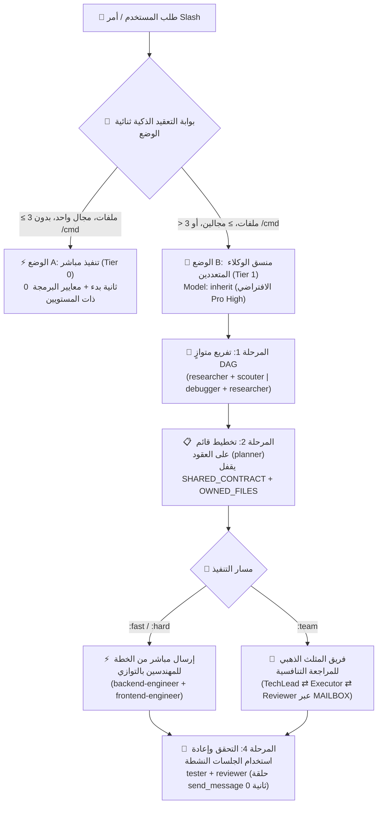

<div align="center">
  <h1>⚡ BoomOpen Workflow Kit v5.5.0</h1>
  <p><strong>نظام تشغيل القوى العاملة الذكية Smart-Hybrid متعدد المنصات — 21 وكيلاً متخصصاً، 17 فريق المثلث الذهبي وخزينة تضم +1,450 مهارة عند الطلب</strong></p>

  <p>
    <a href="https://github.com/Kennyboom/BoomOpen-Workflow-Kit/releases"></a>
    <a href="#platforms"></a>
    <a href="#agents"></a>
    <a href="#pillars"></a>
    <a href="https://nodejs.org/">=18.0.0" /></a>
    <a href="../LICENSE"></a>
  </p>

  <p>
    <a href="../README.md">🇬🇧 English</a> • <a href="./README.vi.md">🇻🇳 Tiếng Việt</a> • <a href="./README.zh-CN.md">🇨🇳 简体中文</a> • <a href="./README.zh-TW.md">🇹🇼 繁體中文</a> • <a href="./README.ja.md">🇯🇵 日本語</a> • <a href="./README.ko.md">🇰🇷 한국어</a> • <a href="./README.es.md">🇪🇸 Español</a> • <a href="./README.fr.md">🇫🇷 Français</a> • <a href="./README.de.md">🇩🇪 Deutsch</a><br/>
    <a href="./README.pt-BR.md">🇧🇷 Português</a> • <a href="./README.ru.md">🇷🇺 Русский</a> • <a href="./README.hi.md">🇮🇳 हिन्दी</a> • <b>🇸🇦 العربية</b> • <a href="./README.id.md">🇮🇩 Bahasa Indonesia</a> • <a href="./README.th.md">🇹🇭 ไทย</a> • <a href="./README.tr.md">🇹🇷 Türkçe</a> • <a href="./README.it.md">🇮🇹 Italiano</a>
  </p>
</div>

---

## 🎬 العرض الرسمي للإطلاق (Full HD 1080p)

<div align="center">
  <a href="https://github.com/Kennyboom/BoomOpen-Workflow-Kit/raw/main/assets/media/boomopen_v55_trailer_en.mp4">
    
  </a>
  <p>
    ▶️ <a href="https://github.com/Kennyboom/BoomOpen-Workflow-Kit/raw/main/assets/media/boomopen_v55_trailer_en.mp4"><b>اضغط هنا لمشاهدة / تشغيل العرض الرسمي بدقة Full HD 1080p (ملف MP4 مع تعليق صوتي احترافي)</b></a>
  </p>
</div>

---

## 🌟 ما هو BoomOpen Workflow Kit v5.5؟

**BoomOpen Workflow Kit v5.5 (الإصدار الموحد متعدد المنصات والهجين الذكي)** هو نظام تشغيل مفتوح المصدر متعدد الوكلاء (Multi-Agent) يحوّل مساعد البرمجة الفردي بالذكاء الاصطناعي إلى منظمة هندسية متكاملة تضم **21 وكيلاً متخصصاً (Specialist Agents)**، و**17 فريقاً تنافسياً بنموذج المثلث الذهبي (Golden Triangle Teams)**، و**48 مهارة أساسية (Core Skills)**، وأكثر من **1,450 مهارة مكتبية متخصصة (`skills_library`)**.

على عكس القوالب الجامدة أو الأطر الثقيلة التي تسبب تأخيراً في التشغيل البارد مع كل سؤال بسيط، يقدم BoomOpen v5.5 **بوابة عتبة التعقيد الذكية ثنائية الوضع (2-Mode Smart Complexity Threshold Gate)**:
- **⚡ الوضع A — التنفيذ المباشر (0 ثانية تشغيل بارد)**: الأسئلة والأجوبة السريعة، شرح الكود، إصلاح الأخطاء في نطاق واحد، أو التعديلات الواضحة التي تلمس **3 ملفات أو أقل** (دون أمر `/cmd`) يتم تنفيذها واختبارها والتحقق منها **مباشرة** بواسطة الوكيل الأساسي مع تطبيق **معايير البرمجة العملية ذات المستويين** و**الاختبار وإصلاح الأخطاء المستمر**.
- **🎻 الوضع B — التنسيق الصارم للوكلاء المتعددين**: الميزات المعقدة (**أكثر من 3 ملفات** أو **مجالين فأكثر**) أو أوامر `/cmd` الصريحة تفعّل وضع المنسق الصارم مع **التفريع المتوازي DAG**، و**الإرسال المباشر من الخطة إلى المنفذ**، و**أقفال ملكية الملفات القائمة على العقود (`SHARED_CONTRACT` + `OWNED_FILES`)**، و**إعادة استخدام الجلسات النشطة للوكلاء الفرعيين (`send_message`)**.

- **📚 خزينة ضخمة تضم +1,450 مهارة بدون تضخم السياق (Zero Context Bloat)**: تجمع بين **48 مهارة أساسية (`skills/`)** و**+1,450 مهارة تخصصية (`skills_library/`)** مُجمَّعة مسبقاً في `matrix-skills/compact-index.json` للبحث الفوري `O(1)` من خطوتين — مما يمنح الذكاء الاصطناعي إتقاناً فورياً في الواجهات الخلفية والأمامية، تطبيقات الجوال، محركات الألعاب (Unity/Unreal/Godot)، الذكاء الاصطناعي والبيانات (BigQuery)، السحابة/DevOps وأمن OWASP دون استهلاك نافذة السياق.

---

## 🏗️ البنية الهجينة الذكية (v5.5)



---

## 🧠 الركائز الست الأساسية للإصدار v5.5

1. **🌐 تكافؤ موحد عبر 5 منصات (`platforms/*`)**:
   - تثبيت أصلي متكامل لكل من **Google Antigravity 2.0 (Gemini)** و**Claude Code** و**OpenAI Codex** و**Cursor** و**GitHub Copilot** من بنية موحدة واحدة.
2. **📏 معايير البرمجة العملية ذات المستويين (منع التجزئة الميكانيكية للملفات)**:
   - **المستوى 1 — قواعد صارمة للجودة والأمان (عدم تسامح مطلق)**: المسؤولية الواحدة (Single Responsibility)، **منع `any` الصريح تماماً**، **منع ترك `console.log` للتصحيح** في كود الإنتاج، إلزامية `try/catch` مع معالجة الأخطاء المحددة بالأنواع عند حدود async/API، الثوابت بصيغة `SCREAMING_SNAKE_CASE`، مبدأ DRY (`≥ 3`)، وترتيب عبارات الاستيراد.
   - **المستوى 2 — إرشادات هيكلية مرنة (الترابط أولاً)**: يستهدف الملف المترابط `~200–350 سطراً` مع سقف مرن يصل إلى `~400–450 سطراً` (التقسيم الإجباري فقط عند تجاوز `500 سطر` أو خلط عدة مجالات؛ وتُستثنى ملفات الاختبارات والأنواع وCLI والوثائق). الدوال المنطقية `~20–40 سطراً` (ودوال واجهة المستخدم/المعالجات `~40–80 سطراً`).
3. **🎯 الإرسال المباشر من الخطة للمنفذ وإعادة استخدام الوكلاء النشطين (`send_message`)**:
   - بمجرد إنشاء `PLAN-{feature}.md`، يرسل المنسق المهام **مباشرة** إلى مهندسي المجال (`backend-engineer`، `frontend-engineer`، `database-architect`، إلخ) دون قفزة وسيطة زائدة عبر `tech-lead`.
   - يتم تسجيل الوكلاء الفرعيين النشطين في **سجل الجلسات النشطة (`Role → conversationId`)** وإعادة استخدامهم عبر `send_message` بزمن بدء **0 ثانية** مع **الاحتفاظ الكامل (100%) بسياق الملفات**.
4. **🤝 التنفيذ المتوازي القائم على العقود (`SHARED_CONTRACT` + `OWNED_FILES`)**:
   - تقفل الخطط متعددة المجالات نقاط نهاية API ومخططات DTO وملكية الكتابة الحصرية للملفات (`OWNED_FILES` مقابل `READ_ONLY_FILES`) قبل إطلاق المهندسين بالتوازي، مما يقضي تماماً على تعارضات الكتابة.
5. **🔍 تشخيص السبب الجذري 5-Whys (SPIE v3.0) وشجرة Git نظيفة 100%**:
   - يتتبع `debugger` كل خطأ عبر 3 فرضيات مرتبة وسلسلة سببية **5-Whys** (`لماذا 1 العرض المباشر` ← `لماذا 5 السبب الجذري النظامي`). تُحفظ جميع المخرجات المؤقتة (`PLAN`، `DEBUG`، `TEST`، `REVIEW`، `MAILBOX`) في `<appDataDir>\brain\<conversation-id>\` للحفاظ على نظافة شجرة عمل Git بنسبة 100%.
6. **🩺 أدوات تشخيص CLI مدمجة (`doctor` & `check`) وفهرس مهارات بسرعة O(1)**:
   - يتحقق `npm run doctor` من حزم المنصات الخمس، و21 وكيلاً، و51 ملف فريق، و72 أمراً، وملف `matrix-skills/compact-index.json` (`1,450+` مهارة مفهرسة). ويفحص `npm run check <dir>` التزام الكود بمعايير المستويين الأول والثاني.

---

## 💻 منصات الذكاء الاصطناعي المدعومة

| المنصة | مستوى الدعم | نقطة الدخول العامة | مسار تثبيت الإطار |
|----------|:-------------:|-------------------|------------------------|
| **Antigravity (Gemini)** | ✅ أصلي v5.5 | `~/.gemini/GEMINI.md` | `~/.gemini/config/skills/boomopen-workflow-kit/` |
| **Claude Code** | ✅ أصلي v5.5 | `~/.claude/CLAUDE.md` | `~/.claude/skills/boomopen-workflow-kit/` |
| **OpenAI Codex** | ✅ أصلي v5.5 | `~/.codex/CODEX.md` & `AGENTS.md` | `~/.codex/skills/boomopen-workflow-kit/` |
| **Cursor** | ✅ أصلي v5.5 | `~/.cursor/rules/boomopen-workflow-kit.mdc` | `~/.cursor/skills/boomopen-workflow-kit/` |
| **GitHub Copilot** | ✅ أصلي v5.5 | `~/.copilot/COPILOT.md` | `~/.copilot/skills/boomopen-workflow-kit/` |

---

## 🚀 البدء السريع والتثبيت

```bash
# 1. استنساخ المستودع
git clone https://github.com/Kennyboom/BoomOpen-Workflow-Kit.git
cd BoomOpen-Workflow-Kit

# 2. التثبيت لمساعد البرمجة الخاص بك (اختر واحداً أو --all للجميع)
npm run install:antigravity   # Google Antigravity 2.0 (Gemini)
npm run install:claude        # Anthropic Claude Code
npm run install:codex         # OpenAI Codex CLI
npm run install:cursor        # Cursor AI Editor
npm run install:copilot       # GitHub Copilot (VS Code)
npm run install:all           # التثبيت لجميع المنصات الخمس دفعة واحدة

# 3. التحقق من سلامة التثبيت ومعايير الكود ومجموعة الاختبارات
npm run doctor
npm run check ./cli
npm test
```

---

## 🎛️ الإعدادات الموحدة واختيار وضع التشغيل (مركز التحكم `/settings`)

يتضمن BoomOpen v5.5 **مركز تحكم موحد بزمن انتقال صفري** يتيح لك تبديل أوضاع التنفيذ (`auto` و`mode_a` و`mode_b` و`team`) و4 ملفات تعريف جاهزة و12 إعداداً للنظام عبر **المنصات الخمس** في أقل من `< 10ms` (**بزمن تأخير 0ms في الجولة الأولى**):

| الملف الجاهز (`Preset`) | وضع التنفيذ (`execution.mode`) | النمط الافتراضي | البحث باللغة الطبيعية (`naturalLanguageResearchTrigger`) | معايير الكود (`codingStandards`) | الاستخدام الأمثل |
|:---|:---|:---:|:---:|:---:|:---|
| **⚡ `smart-hybrid`** *(الموصى به افتراضياً)* | **`auto`** (`≤ 3 ملفات` ← Mode A مباشر؛ `> 3 ملفات` أو `/cmd` ← Mode B) | `auto` | **`auto_team`** *(يوجه البحث والأفكار تلقائياً إلى `/brainstorm:team` المثلث الذهبي)* | `pragmatic` (`400/500` سطر) | الهندسة اليومية الشاملة: سريع في المهام الصغيرة وعميق في المعماريات المعقدة |
| **🚀 `solo-fast`** | **`mode_a`** *(فرض التنفيذ الفردي المباشر بدون وكلاء فرعيين)* | `fast` | `off` *(رد مباشر في المحادثة ما لم يُكتب `/brainstorm`)* | `relaxed` (`600/800` سطر) | الإصلاحات العاجلة، النماذج الأولية السريعة، وتوفير استهلاك الرموز (Tokens) |
| **🧠 `deep-architect`** | **`mode_b`** *(فرض منسق الوكلاء المتعددين Mode B في كل مهمة)* | `hard` | `auto_hard` *(تشغيل `/brainstorm:hard` خماسي العدسات تلقائياً)* | `strict` (`300/400` سطر) | تصميم الأنظمة المعقدة والمشاريع الجديدة وإعادة الهيكلة متعددة النطاقات |
| **🔺 `adversarial-team`** | **`team`** *(فرض فريق المثلث الذهبي من 3 وكلاء `:team` دائماً)* | `team` | **`auto_team`** *(مراجعة ونقاش تنافسي بين 3 وكلاء عبر `MAILBOX`)* | `strict` (`300/400` سطر) | أنظمة الإنتاج الحرجة، التدقيق الأمني، والإصدارات الخالية من العيوب |

### ثلاث طرق لتغيير الوضع (أمر المحادثة `/settings`، لوحة الويب المحلية، وواجهة CLI)

```bash
# 1. أمر سلاش داخل المحادثة (قائمة تفاعلية أو أمر مباشر)
/settings                                     # فتح القائمة التفاعلية (ask_question UI)
/settings preset smart-hybrid                 # التبديل إلى الوضع الافتراضي الموصى به (Auto Mode A/B + auto_team)
/settings preset solo-fast                    # التبديل إلى التنفيذ المباشر السريع (Mode A)
/settings preset deep-architect               # التبديل إلى منسق الوكلاء المتعددين (Mode B)
/settings preset adversarial-team             # التبديل إلى فريق المثلث الذهبي من 3 وكلاء (:team)
/settings mode auto | mode_a | mode_b | team  # تغيير وضع التنفيذ (execution.mode) مباشرة

# 2. لوحة تحكم الويب المحلية (http://127.0.0.1:4567)
npm run settings:ui

# 3. طرفية CLI (عام ~/.boomopen/settings.json وخاص بالمشروع ./.boomopen.json)
npm run settings -- status
npm run settings -- preset adversarial-team
npm run settings -- reset
```

---

## 🎯 مرجع أوامر Slash

| الأمر | الأنماط | الغرض الأساسي |
|---------|----------|-----------------|
| **`/cook`** | `:fast`, `:hard`, `:team` | تطوير الميزات المتكامل من البداية للنهاية (بحث/استكشاف ← تخطيط ← برمجة متوازية ← اختبار ← مراجعة) |
| **`/code`** | `:fast`, `:hard`, `:team` | تنفيذ البرمجة مباشرة استناداً إلى ملف خطة `PLAN-{feature}.md` موجود |
| **`/plan`** | `:fast`, `:hard`, `:team` | إنشاء مخططات التنفيذ مع `SHARED_CONTRACT` و`OWNED_FILES` ومعايير Given/When/Then |
| **`/fix`** | `:fast`, `:hard`, `:team` | إصلاح الأخطاء من جذورها مع التحقق الإلزامي باختبارات الانحدار (Regression Tests) |
| **`/debug`** | `:fast`, `:hard`, `:team` | تحقيق عميق في السبب الجذري عبر 3 فرضيات + سلسلة **5-Whys (SPIE v3.0)** (`DEBUG-{issue}.md`) |
| **`/test`** | `:fast`, `:hard`, `:team` | تشغيل متوازٍ DAG لمجموعات الاختبار + اكتشاف الحالات الحدية غير المغطاة (`tester` + `scouter`) |
| **`/review`** | `:fast`, `:hard`, `:team` | تدقيق متوازٍ رباعي الأبعاد (البنية المعمارية، جودة الكود، أمان OWASP، الأداء) |
| **`/design`** | `:fast`, `:hard`, `:team` | تصميم بنية النظام ومخطط قاعدة البيانات ومواصفات واجهة وتجربة المستخدم (`DESIGN.md`) |
| **`/docs`** | `:core`, `:business`, `:audit` | توليد أو مزامنة وثائق البنية المعمارية والأعمال المهيكلة ذات المستويين (`./documents/`) |
| **`/deploy`** | `:check`, `:preview`, `:production`, `:rollback` | بوابات الجاهزية قبل النشر، بيئات المعاينة، الإطلاق للإنتاج والتراجع الآمن |
| **`/brainstorm`** | `:fast`, `:hard`, `:team` | اكتشاف المتطلبات بالطريقة السقراطية، تحليل المفاضلات وتوليد الأفكار |
| **`/report`** | `:fast`, `:hard`, `:team` | تقارير تنفيذية وتقنية شاملة مدعومة بالمقاييس والمخططات |
| **`/orchestrate`** | — | تنسيق خطوط أنابيب مخصصة متعددة الوكلاء عبر عدة مجالات |
| **`/settings` / `/config`** | `preset`, `mode`, `set`, `ui` | مركز التحكم الموحد: تبديل `Auto` / `Mode A` / `Mode B` / `Team` أو فتح واجهة الويب (`--ui`) |
| **`/save` / `/recap`** | — | حفظ حالة الجلسة (`SESSION-HANDOVER.md`) واستعادة السياق الكامل في أقل من `< 5 ثوانٍ` |

---

## 🤖 21 وكيلاً متخصصاً و17 فريقاً بنموذج المثلث الذهبي

| الفئة | الوكلاء المتخصصون (`agents/*.md`) | فرق المثلث الذهبي (`agents/teams/*-team/`) |
|----------|-----------------------------------|------------------------------------------------|
| **الهندسة والتنفيذ** | `backend-engineer`, `frontend-engineer`, `mobile-engineer`, `game-engineer`, `database-architect`, `devops-engineer` | `backend-team`, `frontend-team`, `fullstack-team`, `mobile-team`, `game-team`, `database-team`, `devops-team` |
| **البنية المعمارية والتخطيط** | `tech-lead`, `planner`, `brainstormer`, `business-analyst`, `project-manager`, `designer` | `planning-team`, `project-team`, `design-team` |
| **الجودة والأمان وتصحيح الأخطاء** | `debugger`, `tester`, `reviewer`, `security-engineer`, `performance-engineer` | `debug-team`, `qa-team`, `review-team`, `security-team`, `performance-team` |
| **البحث وإدارة المعرفة** | `researcher`, `scouter`, `docs-manager`, `reporter` | `research-team`, `docs-team`, `report-team` |

---

## 📚 خزينة +1,450 مهارة (48 مهارة أساسية + 1,450+ مهارة مكتبية)

يأتي BoomOpen مزوداً بواحدة من أكبر منظومات المهارات الهندسية في المصادر المفتوحة، والمصممة لاستهلاك **0 توكن في وضع الخمول** عبر **الاستعلام التدريجي O(1) من خطوتين** (`<skills>` ← `matrix-skills/compact-index.json` ← تحميل ملف `SKILL.md` المطلوب فقط عند الطلب):

| طبقة / مجال المهارات | العدد | أبرز المهارات والقدرات | آلية التحميل |
|:---|:---:|:---|:---|
| **⚡ الطبقة 1: المهارات الأساسية (`skills/`)** | **48** | `clean-code`, `systematic-debugging`, `plan-writing`, `brainstorming`, `frontend-design`, `api-patterns`, `database-design`, `testing-patterns`, `vulnerability-scanner`, `skill-seeker` | مفهرسة مسبقاً في `<skills>` للوصول الفوري في الجولة الأولى |
| **🌐 الويب، الخلفية والأنظمة الموزعة** | **380+** | Next.js/React 19، FastAPI، NestJS، خدمات Go/Rust المصغرة، GraphQL، gRPC، بنية Redis/Kafka الحدثية، أنظمة SaaS متعددة المستأجرين | عند الطلب عبر `compact-index.json` (`skills_library/`) |
| **🤖 الذكاء الاصطناعي، وكلاء LLM وهندسة البيانات** | **310+** | خطوط RAG، خوادم LangGraph/MCP، هندسة الأوامر، Vertex AI، تحليلات BigQuery، dbt، Spark، قواعد البيانات المتجهة | عند الطلب عبر `compact-index.json` (`skills_library/`) |
| **☁️ السحابة، DevOps، Kubernetes والأمن السيبراني** | **290+** | Terraform/OpenTofu، بنية AWS/GCP/Azure، Docker/K8s GitOps، خطوط CI/CD، تدقيق OWASP Top 10، مصادقة Zero-Trust | عند الطلب عبر `compact-index.json` (`skills_library/`) |
| **📱 الجوال، محركات الألعاب والمجالات المتخصصة** | **450+** | iOS Swift/SwiftUI، Android Kotlin، React Native، Flutter، Unity 6، Unreal Engine 5، Godot 4، WebGL/Three.js، التمويل الكمي، Web3 | عند الطلب عبر `compact-index.json` (`skills_library/`) |

---

## 📂 هيكل المستودع

```text
BoomOpen-Workflow-Kit/
├── agents/                  # 21 تعريفاً للوكلاء المتخصصين + 17 فريقاً للمثلث الذهبي (51 ملف دور)
├── cli/                     # أداة التثبيت (install.js)، أداة الفحص الطبي (doctor.js)، فاحص الكود ثنائي المستوى (checker.js) والاختبارات
├── commands/                # 72 مسار عمل لأوامر Slash (:fast, :hard, :team) + بروتوكولات _ref/
├── documents/               # وثائق ثنائية المستوى للبنية المعمارية والمجال وقاعدة الكود والمعايير
├── i18n/                    # وثائق متعددة اللغات (16 ترجمة كاملة لملف README)
├── matrix-skills/           # مصفوفات مهارات YAML حسب المجال + ملف compact-index.json المجمّع مسبقاً (1,450+ مهارة)
├── platforms/               # قوالب موحدة للمنصات الخمس (antigravity/, claude/, codex/, copilot/, cursor/)
├── rules/                   # قواعد الوضع B المحملة عند الطلب (CORE, PHASES, AGENTS, TEAMS, SKILLS, ERRORS, REFERENCE)
├── scripts/                 # نصوص Python للأتمتة والتحقق (checklist.py, verify_all.py وغيرها)
├── skills/                  # 48 مهارة أساسية (clean-code, debugger, plan-writing, frontend-design وغيرها)
├── skills_library/          # أكثر من 1,450 مهارة متخصصة تُحمّل عند الطلب عبر بحث سريع من خطوتين
└── GEMINI.md | CLAUDE.md | CODEX.md | COPILOT.md | CURSOR.md | AGENT.md
```

---

## 📄 الترخيص والأمان

- **الترخيص**: موزّع بموجب [رخصة MIT](../LICENSE). جميع الحقوق محفوظة © 2026 **Kennyboom (BoomOpen)**.
- **سياسة الأمان**: يرجى مراجعة [SECURITY.md](../SECURITY.md) للاطلاع على ضوابط الحماية المدمجة وإجراءات الإبلاغ عن الثغرات الأمنية.
