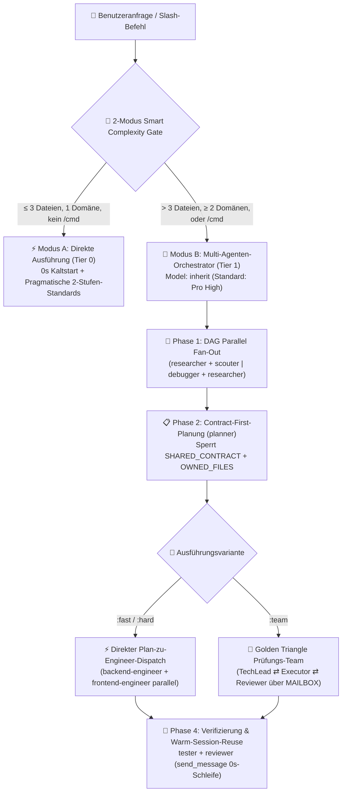

<div align="center">
  <h1>⚡ BoomOpen Workflow Kit v5.5.0</h1>
  <p><strong>Plattformübergreifendes Smart-Hybrid KI-Entwicklungs-OS — 21 Spezial-Agenten, 17 Golden-Triangle-Teams &amp; 1.430+ On-Demand-Skills-Tresor</strong></p>

  <p>
    <a href="https://github.com/Kennyboom/BoomOpen-Workflow-Kit/releases"></a>
    <a href="#platforms"></a>
    <a href="#agents"></a>
    <a href="#pillars"></a>
    <a href="https://nodejs.org/">=18.0.0" /></a>
    <a href="../LICENSE"></a>
  </p>

  <p>
    <a href="../README.md">🇬🇧 English</a> • <a href="./README.vi.md">🇻🇳 Tiếng Việt</a> • <a href="./README.zh-CN.md">🇨🇳 简体中文</a> • <a href="./README.zh-TW.md">🇹🇼 繁體中文</a> • <a href="./README.ja.md">🇯🇵 日本語</a> • <a href="./README.ko.md">🇰🇷 한국어</a> • <a href="./README.es.md">🇪🇸 Español</a> • <a href="./README.fr.md">🇫🇷 Français</a> • <b>🇩🇪 Deutsch</b><br/>
    <a href="./README.pt-BR.md">🇧🇷 Português</a> • <a href="./README.ru.md">🇷🇺 Русский</a> • <a href="./README.hi.md">🇮🇳 हिन्दी</a> • <a href="./README.ar.md">🇸🇦 العربية</a> • <a href="./README.id.md">🇮🇩 Bahasa Indonesia</a> • <a href="./README.th.md">🇹🇭 ไทย</a> • <a href="./README.tr.md">🇹🇷 Türkçe</a> • <a href="./README.it.md">🇮🇹 Italiano</a>
  </p>
</div>

---

## 🎬 Offizieller Launch-Trailer (Full HD 1080p)

<div align="center">
  <a href="https://github.com/Kennyboom/BoomOpen-Workflow-Kit/raw/main/assets/media/boomopen_v55_trailer_en.mp4">
    
  </a>
  <p>
    ▶️ <a href="https://github.com/Kennyboom/BoomOpen-Workflow-Kit/raw/main/assets/media/boomopen_v55_trailer_en.mp4"><b>Hier klicken, um den offiziellen Full HD 1080p Launch-Trailer anzusehen / zu streamen (MP4 mit Studio-Voiceover)</b></a>
  </p>
</div>

---

## 🌟 Was ist das BoomOpen Workflow Kit v5.5?

**BoomOpen Workflow Kit v5.5 (Multi-Platform Unified & Smart-Hybrid Edition)** ist ein quelloffenes Multi-Agenten-Betriebssystem, das einen einzelnen KI-Coding-Assistenten in eine koordinierte Engineering-Organisation aus **21 Spezialisten-Agenten**, **17 kontradiktorischen Golden-Triangle-Teams**, **48 Kernkompetenzen (Core Skills)** und **über 1.430 Nischen-Skills (`skills_library`)** verwandelt.

Im Gegensatz zu starren Einzel-Prompts oder schwerfälligen Agenten-Wrappern, die bei jeder einfachen Frage Kaltstart-Latenz verursachen, führt BoomOpen v5.5 ein **2-Modus Smart Complexity Threshold Gate** ein:
- **⚡ Modus A — Direkte Ausführung (0s Kaltstart)**: Einfache Fragen & Antworten (Q&A), Code-Erklärungen, Bugfixes in einer einzelnen Domäne oder klare Änderungen an **≤ 3 Dateien** (ohne `/cmd`-Befehl) werden vom primären Agenten **direkt** ausgeführt, getestet und verifiziert — unter Einhaltung der **Pragmatischen 2-Stufen-Coding-Standards** und **Persistenter Tests & Fehlerbehebung**.
- **🎻 Modus B — Strikte Multi-Agenten-Orchestrierung**: Komplexe Features (**> 3 Dateien** oder **≥ 2 Domänen**) oder explizite `/cmd`-Workflows aktivieren den strikten Orchestrator-Modus mit **DAG Parallel Fan-Out**, **Direct Plan-to-Executor Dispatch**, **Contract-First Dateisperren (`SHARED_CONTRACT` + `OWNED_FILES`)** und **Warm Sub-agent Reuse (`send_message`)**.

- **📚 Massiver Tresor mit 1.430+ Skills ohne Kontext-Aufblähung**: Vereint **48 Kern-Skills (`skills/`)** und **1.430+ Fach-Skills (`skills_library/`)**, vorkompiliert in `matrix-skills/compact-index.json` für eine `O(1)` 2-Stufen-Suche — für sofortige Expertise in Backend, Frontend, Mobile, Game Dev (Unity/Unreal/Godot), KI/ML, BigQuery/Data Engineering, Cloud/DevOps und OWASP-Sicherheit ohne Prompt-Überlastung.

---

## 🏗️ Smart-Hybrid-Architektur (v5.5)



---

## 🧠 Die 6 Grundpfeiler von v5.5

1. **🌐 Einheitliche Parität auf 5 Plattformen (`platforms/*`)**:
   - Erstklassige native Installation für **Google Antigravity 2.0 (Gemini)**, **Claude Code**, **OpenAI Codex**, **Cursor** und **GitHub Copilot** aus einer einzigen vereinheitlichten Architektur.
2. **📏 Pragmatische 2-Stufen-Coding-Standards (Anti-Fragmentierung)**:
   - **Stufe 1 — Strikte Qualitäts- & Sicherheitsregeln (Null-Toleranz)**: Single Responsibility, **KEIN explizites `any`**, **KEINE vergessenen Debug-`console.log`** im Produktionscode, zwingendes `try/catch` + typisierte Fehlerbehandlung an Async-/API-Grenzen, `SCREAMING_SNAKE_CASE`-Konstanten, DRY (`≥ 3`) und saubere Imports.
   - **Stufe 2 — Flexible Strukturrichtlinien (Kohäsion vor Zeilen-Zerstückelung)**: Kohäsive Dateien zielen auf `~200–350 Zeilen` mit einer flexiblen Obergrenze von `~400–450 Zeilen` (Aufteilung erst ab `>500 Zeilen` oder mehreren Domänen; Tests, Typen, CLI und Docs sind ausgenommen). Logikfunktionen `~20–40 Zeilen` (`~40–80 Zeilen` für UI/Handler).
3. **🎯 Direkter Plan-zu-Executor-Dispatch & Warm Sub-agent Reuse (`send_message`)**:
   - Sobald `PLAN-{feature}.md` vorliegt, verteilt der Orchestrator Aufgaben **direkt** an die Domänen-Ingenieure (`backend-engineer`, `frontend-engineer`, `database-architect` usw.) ohne unnötigen `tech-lead`-Zwischenschritt.
   - Aktive Sub-Agenten werden in einer **Active Session Registry (`Role → conversationId`)** gespeichert und per `send_message` mit **0s Kaltstart** und **100% erhaltenem Dateikontext** wiederverwendet.
4. **🤝 Contract-First Paralleler Dispatch (`SHARED_CONTRACT` + `OWNED_FILES`)**:
   - Domänenübergreifende Pläne sperren API-Endpunkte, DTO-Schemata und exklusive Dateischreibrechte (`OWNED_FILES` vs. `READ_ONLY_FILES`), bevor Ingenieure parallel starten — Schreibkonflikte werden vollständig verhindert.
5. **🔍 5-Whys (SPIE v3.0) Ursachen-Debugging & 100% Sauberer Git-Baum**:
   - `debugger` untersucht jeden Fehler anhand von 3 priorisierten Hypothesen und einer **5-Whys-Kausalkette** (`Why 1 Symptom` → `Why 5 Systemische Grundursache`). Transiente Artefakte (`PLAN`, `DEBUG`, `TEST`, `REVIEW`, `MAILBOX`) werden zuerst unter `<appDataDir>\brain\<conversation-id>\` abgelegt, sodass der Git-Arbeitsbaum 100% sauber bleibt.
6. **🩺 Integrierte CLI-Diagnose (`doctor` & `check`) & O(1) Skill-Index**:
   - `npm run doctor` prüft alle 5 Plattform-Bundles, 21 Agenten, 51 Team-Dateien, 72 Befehle und `matrix-skills/compact-index.json` (`1.430+` indizierte Skills). `npm run check <dir>` prüft automatisch die Einhaltung der Stufe-1- und Stufe-2-Standards.

---

## 💻 Unterstützte KI-Plattformen

| Plattform | Unterstützungsgrad | Globaler Einstiegspunkt | Framework-Installationspfad |
|----------|:-------------:|-------------------|------------------------|
| **Antigravity (Gemini)** | ✅ Nativ v5.5 | `~/.gemini/GEMINI.md` | `~/.gemini/config/skills/boomopen-workflow-kit/` |
| **Claude Code** | ✅ Nativ v5.5 | `~/.claude/CLAUDE.md` | `~/.claude/skills/boomopen-workflow-kit/` |
| **OpenAI Codex** | ✅ Nativ v5.5 | `~/.codex/CODEX.md` & `AGENTS.md` | `~/.codex/skills/boomopen-workflow-kit/` |
| **Cursor** | ✅ Nativ v5.5 | `~/.cursor/rules/boomopen-workflow-kit.mdc` | `~/.cursor/skills/boomopen-workflow-kit/` |
| **GitHub Copilot** | ✅ Nativ v5.5 | `~/.copilot/COPILOT.md` | `~/.copilot/skills/boomopen-workflow-kit/` |

---

## 🚀 Schnellstart & Installation

```bash
# 1. Repository klonen
git clone https://github.com/Kennyboom/BoomOpen-Workflow-Kit.git
cd BoomOpen-Workflow-Kit

# 2. Für Ihren KI-Coding-Assistenten installieren (einzeln wählen oder --all)
npm run install:antigravity   # Google Antigravity 2.0 (Gemini)
npm run install:claude        # Anthropic Claude Code
npm run install:codex         # OpenAI Codex CLI
npm run install:cursor        # Cursor AI Editor
npm run install:copilot       # GitHub Copilot (VS Code)
npm run install:all           # Auf allen 5 Plattformen gleichzeitig installieren

# 3. Installationsstatus, 2-Stufen-Code-Standards & Test-Suite überprüfen
npm run doctor
npm run check ./cli
npm test
```

---

## 🎛️ Einheitliche Einstellungen & Modusauswahl (`/settings` Control Center)

BoomOpen v5.5 enthält ein **Zero-Latency Unified Control Center**, mit dem Sie Ausführungsmodi (`auto`, `mode_a`, `mode_b`, `team`), 4 Ein-Klick-Presets und 12 Systemeinstellungen über alle **5 Plattformen** in `< 10ms` (**0ms Turn-1-Latenz**) umschalten können:

| Preset-Profil (`Preset`) | Ausführungsmodus (`execution.mode`) | Standard-Variante | Natürlichsprachige Recherche (`naturalLanguageResearchTrigger`) | Code-Standards (`codingStandards`) | Empfohlener Einsatzbereich |
|:---|:---|:---:|:---:|:---:|:---|
| **⚡ `smart-hybrid`** *(Standard-Empfehlung)* | **`auto`** (`≤ 3 Dateien` → Mode A Direkt; `> 3 Dateien` oder `/cmd` → Mode B) | `auto` | **`auto_team`** *(Leitet Recherche/Ideen automatisch an `/brainstorm:team` Golden Triangle)* | `pragmatic` (`400/500` Zeilen) | Tägliches Full-Stack-Engineering: blitzschnell bei kleinen Aufgaben, tiefgehend bei komplexer Architektur |
| **🚀 `solo-fast`** | **`mode_a`** *(Erzwingt direkte Solo-Ausführung, 0s Sub-Agent-Latenz)* | `fast` | `off` *(Direkte Chat-Antwort außer bei `/brainstorm`)* | `relaxed` (`600/800` Zeilen) | Dringende Hotfixes, schnelles Prototyping, Skripte & minimaler Token-Verbrauch |
| **🧠 `deep-architect`** | **`mode_b`** *(Erzwingt Mode B Multi-Agent-Orchestrator bei jeder Aufgabe)* | `hard` | `auto_hard` *(Startet automatisch `/brainstorm:hard` 5-Linsen-Recherche)* | `strict` (`300/400` Zeilen) | Komplexe Systemarchitektur, Greenfield-Design & Multi-Domain-Refactoring |
| **🔺 `adversarial-team`** | **`team`** *(Erzwingt das 3-Agenten Golden Triangle `:team` für alle Workflows)* | `team` | **`auto_team`** *(Adversariale 3-Agenten-Prüfung über `MAILBOX`)* | `strict` (`300/400` Zeilen) | Unternehmenskritischer Produktionscode, Sicherheitsaudits & Zero-Defect-Releases |

### Drei Wege zur Modusauswahl (In-Chat `/settings`, Lokales Web-Dashboard & CLI)

```bash
# 1. In-Chat Slash-Befehl (Interaktives Menü oder Einzeiler)
/settings                                     # Interaktives Auswahlmenü öffnen (ask_question UI)
/settings preset smart-hybrid                 # Auf empfohlenen Standard wechseln (Auto Mode A/B + auto_team)
/settings preset solo-fast                    # Auf direkte Solo-Schnellausführung wechseln (Mode A)
/settings preset deep-architect               # Auf Multi-Agent-Orchestrator wechseln (Mode B)
/settings preset adversarial-team             # Auf Golden Triangle 3-Agenten-Team (:team) wechseln
/settings mode auto | mode_a | mode_b | team  # Ausführungsmodus (execution.mode) direkt überschreiben

# 2. Lokales Web Control Center Dashboard starten (http://127.0.0.1:4567)
npm run settings:ui

# 3. Terminal-CLI (Global ~/.boomopen/settings.json & Projekt ./.boomopen.json)
npm run settings -- status
npm run settings -- preset adversarial-team
npm run settings -- reset
```

---

## 🎯 Slash-Befehlsreferenz

| Befehl | Varianten | Hauptzweck |
|---------|----------|-----------------|
| **`/cook`** | `:fast`, `:hard`, `:team` | End-to-End-Feature-Entwicklung (Research/Scout → Plan → Paralleler Code → Test → Review) |
| **`/code`** | `:fast`, `:hard`, `:team` | Implementierung direkt anhand eines bestehenden `PLAN-{feature}.md` ausführen |
| **`/plan`** | `:fast`, `:hard`, `:team` | Implementierungs-Blueprints mit `SHARED_CONTRACT`, `OWNED_FILES` & Given/When/Then-Kriterien erstellen |
| **`/fix`** | `:fast`, `:hard`, `:team` | Ursachenbasierte Fehlerbehebung mit obligatorischer Regressionstest-Verifizierung |
| **`/debug`** | `:fast`, `:hard`, `:team` | Ursachenanalyse mit 3 Hypothesen + **5-Whys (SPIE v3.0)**-Kausalkette (`DEBUG-{issue}.md`) |
| **`/test`** | `:fast`, `:hard`, `:team` | DAG Parallel Fan-Out Test-Ausführung + Suche nach ungetesteten Grenzfällen (`tester` + `scouter`) |
| **`/review`** | `:fast`, `:hard`, `:team` | Paralleles 4-Wege-Audit (Architektur, Code-Qualität, OWASP-Sicherheit, Performance) |
| **`/design`** | `:fast`, `:hard`, `:team` | Systemarchitektur, Datenbankschema und UI/UX-Spezifikation (`DESIGN.md`) |
| **`/docs`** | `:core`, `:business`, `:audit` | Strukturierte 2-stufige Architektur- & Business-Dokumentation generieren oder synchronisieren (`./documents/`) |
| **`/deploy`** | `:check`, `:preview`, `:production`, `:rollback` | Pre-Deployment-Gates, Preview-Umgebungen, Produktions-Rollout & sicherer Rollback |
| **`/brainstorm`** | `:fast`, `:hard`, `:team` | Sokratische Anforderungsanalyse, Trade-off-Bewertung & Ideenfindung |
| **`/report`** | `:fast`, `:hard`, `:team` | Technische & Management-Syntheseberichte mit Metriken und Diagrammen |
| **`/orchestrate`** | — | Benutzerdefinierte Multi-Agenten-Pipeline-Orchestrierung über mehrere Domänen hinweg |
| **`/settings` / `/config`** | `preset`, `mode`, `set`, `ui` | Unified Control Center: `Auto` / `Mode A` / `Mode B` / `Team` wechseln, Presets anwenden oder Web-UI (`--ui`) öffnen |
| **`/save` / `/recap`** | — | Sitzungsstatus (`SESSION-HANDOVER.md`) sichern und gesamten Kontext in `< 5s` wiederherstellen |

---

## 🤖 21 Spezialisten-Agenten & 17 Golden-Triangle-Teams

| Kategorie | Spezialisten-Agenten (`agents/*.md`) | Golden-Triangle-Teams (`agents/teams/*-team/`) |
|----------|-----------------------------------|------------------------------------------------|
| **Engineering & Ausführung** | `backend-engineer`, `frontend-engineer`, `mobile-engineer`, `game-engineer`, `database-architect`, `devops-engineer` | `backend-team`, `frontend-team`, `fullstack-team`, `mobile-team`, `game-team`, `database-team`, `devops-team` |
| **Architektur & Planung** | `tech-lead`, `planner`, `brainstormer`, `business-analyst`, `project-manager`, `designer` | `planning-team`, `project-team`, `design-team` |
| **Qualität, Sicherheit & Debugging** | `debugger`, `tester`, `reviewer`, `security-engineer`, `performance-engineer` | `debug-team`, `qa-team`, `review-team`, `security-team`, `performance-team` |
| **Forschung & Wissen** | `researcher`, `scouter`, `docs-manager`, `reporter` | `research-team`, `docs-team`, `report-team` |

---

## 📚 1.430+ Skills-Tresor (48 Kern-Skills + 1.430+ Bibliotheks-Skills)

BoomOpen bietet eines der größten kuratierten Engineering-Skill-Ökosysteme im Open-Source-Bereich — entwickelt für **0 Token-Overhead im Leerlauf** durch **2-stufige progressive O(1)-Auflösung** (`<skills>` → `matrix-skills/compact-index.json` → gezieltes Laden von `SKILL.md` bei Bedarf):

| Skill-Ebene / Domäne | Anzahl | Repräsentative Skills & Fähigkeiten | Lademechanismus |
|:---|:---:|:---|:---|
| **⚡ Stufe 1: Kern-Skills (`skills/`)** | **48** | `clean-code`, `systematic-debugging`, `plan-writing`, `brainstorming`, `frontend-design`, `api-patterns`, `database-design`, `testing-patterns`, `vulnerability-scanner`, `skill-seeker` | Vorindiziert in `<skills>` für sofortigen Zugriff in Turn 1 |
| **🌐 Web, Backend & Verteilte Systeme** | **380+** | Next.js/React 19, FastAPI, NestJS, Go/Rust-Microservices, GraphQL, gRPC, ereignisgesteuerte Redis/Kafka-Architektur, Multi-Tenant-SaaS | Bei Bedarf über `compact-index.json` (`skills_library/`) |
| **🤖 KI, LLM-Agenten & Data Engineering** | **310+** | RAG-Pipelines, LangGraph/MCP-Server, Prompt Engineering, Vertex AI, BigQuery-Analytik, dbt, Spark, Vektordatenbanken | Bei Bedarf über `compact-index.json` (`skills_library/`) |
| **☁️ Cloud, DevOps, Kubernetes & Sicherheit** | **290+** | Terraform/OpenTofu, AWS/GCP/Azure-Architektur, Docker/K8s GitOps, CI/CD-Pipelines, OWASP Top 10 Audit, Zero-Trust-Auth | Bei Bedarf über `compact-index.json` (`skills_library/`) |
| **📱 Mobile, Game-Engines & Spezialdomänen** | **450+** | iOS Swift/SwiftUI, Android Kotlin, React Native, Flutter, Unity 6, Unreal Engine 5, Godot 4, WebGL/Three.js, Quantitative Finance, Web3 | Bei Bedarf über `compact-index.json` (`skills_library/`) |

---

## 📂 Repository-Struktur

```text
BoomOpen-Workflow-Kit/
├── agents/                  # 21 Spezialisten-Agenten-Definitionen + 17 Golden-Triangle-Teams (51 Rollendateien)
├── cli/                     # Installer (install.js), Health Doctor (doctor.js), 2-Stufen-Checker (checker.js) & Tests
├── commands/                # 72 Slash-Befehl-Workflows (:fast, :hard, :team) + _ref/-Protokolle
├── documents/               # 2-stufige Architektur-, Domänen-, Quellcode- & Coding-Standards-Dokumentation
├── i18n/                    # Internationalisierte Dokumentation (16 vollständige README-Übersetzungen)
├── matrix-skills/           # Domänen-YAML-Skill-Matrizen + vorkompiliertes compact-index.json (1.430+ Skills)
├── platforms/               # Vereinheitlichte Vorlagen für alle 5 Plattformen (antigravity/, claude/, codex/, copilot/, cursor/)
├── rules/                   # On-Demand-Regeln für Modus B (CORE, PHASES, AGENTS, TEAMS, SKILLS, ERRORS, REFERENCE)
├── scripts/                 # Python-Automatisierungs- & Verifizierungsskripte (checklist.py, verify_all.py usw.)
├── skills/                  # 48 Kernkompetenzen (clean-code, debugger, plan-writing, frontend-design usw.)
├── skills_library/          # Über 1.430 Nischen-Skills, bei Bedarf über 2-Stufen-Suche geladen
└── GEMINI.md | CLAUDE.md | CODEX.md | COPILOT.md | CURSOR.md | AGENT.md
```

---

## 📄 Lizenz & Sicherheit

- **Lizenz**: Veröffentlicht unter der [MIT-Lizenz](../LICENSE). Copyright © 2026 **Kennyboom (BoomOpen)**.
- **Sicherheitsrichtlinie**: Informationen zu integrierten Sicherheitsmechanismen und zur Meldung von Schwachstellen finden Sie in [SECURITY.md](../SECURITY.md).
