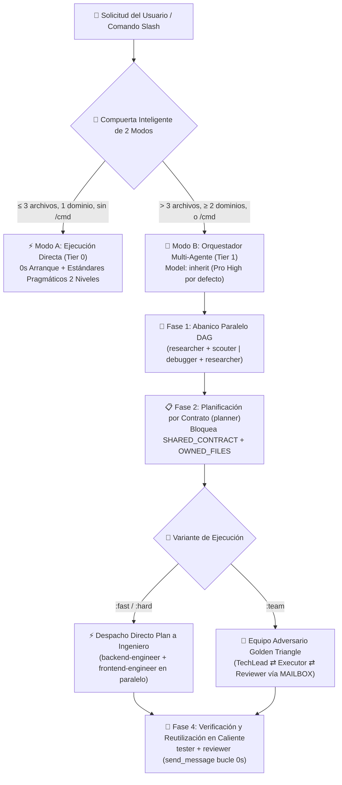

<div align="center">
  <h1>⚡ BoomOpen Workflow Kit v5.5.0</h1>
  <p><strong>Sistema Operativo de Fuerza Laboral IA Smart-Hybrid Multiplataforma — 21 Agentes Especialistas, 17 Equipos Triángulo Dorado y Bóveda de 1,450+ Habilidades Bajo Demanda</strong></p>

  <p>
    <a href="https://github.com/Kennyboom/BoomOpen-Workflow-Kit/releases"></a>
    <a href="#platforms"></a>
    <a href="#agents"></a>
    <a href="#pillars"></a>
    <a href="https://nodejs.org/">=18.0.0" /></a>
    <a href="../LICENSE"></a>
  </p>

  <p>
    <a href="../README.md">🇬🇧 English</a> • <a href="./README.vi.md">🇻🇳 Tiếng Việt</a> • <a href="./README.zh-CN.md">🇨🇳 简体中文</a> • <a href="./README.zh-TW.md">🇹🇼 繁體中文</a> • <a href="./README.ja.md">🇯🇵 日本語</a> • <a href="./README.ko.md">🇰🇷 한국어</a> • <b>🇪🇸 Español</b> • <a href="./README.fr.md">🇫🇷 Français</a> • <a href="./README.de.md">🇩🇪 Deutsch</a><br/>
    <a href="./README.pt-BR.md">🇧🇷 Português</a> • <a href="./README.ru.md">🇷🇺 Русский</a> • <a href="./README.hi.md">🇮🇳 हिन्दी</a> • <a href="./README.ar.md">🇸🇦 العربية</a> • <a href="./README.id.md">🇮🇩 Bahasa Indonesia</a> • <a href="./README.th.md">🇹🇭 ไทย</a> • <a href="./README.tr.md">🇹🇷 Türkçe</a> • <a href="./README.it.md">🇮🇹 Italiano</a>
  </p>
</div>

---

## 🎬 Tráiler Oficial de Lanzamiento (Full HD 1080p)

<div align="center">
  <a href="https://github.com/Kennyboom/BoomOpen-Workflow-Kit/raw/main/assets/media/boomopen_v55_trailer_en.mp4">
    
  </a>
  <p>
    ▶️ <a href="https://github.com/Kennyboom/BoomOpen-Workflow-Kit/raw/main/assets/media/boomopen_v55_trailer_en.mp4"><b>Haz clic aquí para ver / reproducir el Tráiler Oficial de Lanzamiento en Full HD 1080p (MP4 con narración de estudio)</b></a>
  </p>
</div>

---

## 🌟 ¿Qué es BoomOpen Workflow Kit v5.5?

**BoomOpen Workflow Kit v5.5 (Multi-Platform Unified & Smart-Hybrid Edition)** es un sistema operativo multi-agente de código abierto que transforma un asistente de programación IA individual en una organización de ingeniería coordinada compuesta por **21 agentes especialistas**, **17 equipos adversarios Golden Triangle**, **48 habilidades principales (Core Skills)** y **más de 1,450 habilidades especializadas (`skills_library`)**.

A diferencia de las plantillas rígidas o los contenedores pesados que añaden latencia en frío a cada consulta simple, BoomOpen v5.5 introduce una **Compuerta Inteligente de Complejidad de 2 Modos (2-Mode Smart Complexity Threshold Gate)**:
- **⚡ Modo A — Ejecución Directa (0s de Arranque en Frío)**: Preguntas frecuentes (Q&A), explicaciones de código, correcciones de errores de un solo dominio o cambios claros que toquen **≤ 3 archivos** (sin comando `/cmd`) se ejecutan, prueban y verifican **directamente** aplicando los **Estándares de Codificación Pragmáticos de 2 Niveles** y **Pruebas y Corrección Persistente de Errores**.
- **🎻 Modo B — Orquestación Multi-Agente Estricta**: Las funcionalidades complejas (**> 3 archivos** o **≥ 2 dominios**) o los comandos explícitos `/cmd` activan el modo Orquestador estricto con **Abanico Paralelo DAG (Parallel Fan-Out)**, **Despacho Directo del Plan al Ejecutor**, **Bloqueos de Archivos por Contrato (`SHARED_CONTRACT` + `OWNED_FILES`)** y **Reutilización de Sub-agentes en Caliente (`send_message`)**.

- **📚 Bóveda Masiva de 1,450+ Habilidades sin Inflar el Contexto**: Combina **48 Habilidades Principales (`skills/`)** y **1,450+ Habilidades Especializadas (`skills_library/`)** precompiladas en `matrix-skills/compact-index.json` para búsqueda `O(1)` en 2 pasos, brindando dominio instantáneo en Backend, Frontend, Móvil, Videojuegos (Unity/Unreal/Godot), IA/ML, BigQuery/Datos, Cloud/DevOps y Ciberseguridad OWASP sin saturar la ventana de prompt.

---

## 🏗️ Arquitectura Híbrida-Inteligente (v5.5)



---

## 🧠 Los 6 Pilares Principales de v5.5

1. **🌐 Paridad Unificada en 5 Plataformas (`platforms/*`)**:
   - Instalación nativa de primera clase para **Google Antigravity 2.0 (Gemini)**, **Claude Code**, **OpenAI Codex**, **Cursor** y **GitHub Copilot** desde una única arquitectura unificada.
2. **📏 Estándares de Codificación Pragmáticos de 2 Niveles (Anti-Fragmentación)**:
   - **Nivel 1 — Calidad y Seguridad Estrictas (Tolerancia Cero)**: Responsabilidad Única (Single Responsibility), **PROHIBIDO `any` explícito**, **PROHIBIDO dejar `console.log` de depuración** en producción, manejo de errores tipado con `try/catch` en límites async/API, constantes en `SCREAMING_SNAKE_CASE`, DRY (`≥ 3`) e importaciones limpias y ordenadas.
   - **Nivel 2 — Guías Estructurales Flexibles (Cohesión Primero)**: Los archivos cohesivos apuntan a `~200–350 líneas` con un techo flexible de `~400–450 líneas` (división obligatoria solo a `>500 líneas` o múltiples dominios; pruebas, tipos, CLI y docs exentos). Funciones de lógica `~20–40 líneas` (`~40–80 líneas` para UI/Handlers).
3. **🎯 Despacho Directo del Plan al Ejecutor y Reutilización en Caliente (`send_message`)**:
   - Una vez que existe `PLAN-{feature}.md`, el Orquestador envía las tareas **directamente** a los ingenieros de dominio (`backend-engineer`, `frontend-engineer`, `database-architect`, etc.) sin pasar por un intermediario `tech-lead` redundante.
   - Los sub-agentes activos se registran en un **Registro de Sesiones Activas (`Role → conversationId`)** y se reutilizan mediante `send_message` con **0s de arranque en frío** y **100% del contexto preservado**.
4. **🤝 Despacho Paralelo Basado en Contratos (`SHARED_CONTRACT` + `OWNED_FILES`)**:
   - Los planes multidominio bloquean los endpoints API, esquemas DTO y la propiedad exclusiva de archivos (`OWNED_FILES` frente a `READ_ONLY_FILES`) antes de lanzar ingenieros en paralelo, eliminando colisiones de escritura.
5. **🔍 Depuración de Causa Raíz 5-Whys (SPIE v3.0) y Árbol Git 100% Limpio**:
   - `debugger` analiza cada error mediante 3 hipótesis clasificadas y una cadena causal **5-Whys** (`Por qué 1 Síntoma` → `Por qué 5 Causa Raíz Sistémica`). Los artefactos transitorios (`PLAN`, `DEBUG`, `TEST`, `REVIEW`, `MAILBOX`) se guardan en `<appDataDir>\brain\<conversation-id>\` manteniendo el árbol Git 100% limpio.
6. **🩺 Diagnóstico CLI Integrado (`doctor` & `check`) e Índice de Habilidades O(1)**:
   - `npm run doctor` valida los 5 paquetes de plataforma, 21 agentes, 51 archivos de equipo, 72 comandos y `matrix-skills/compact-index.json` (`1,450+` habilidades). `npm run check <dir>` audita los estándares de Nivel 1 y Nivel 2.

---

## 💻 Plataformas de IA Soportadas

| Plataforma | Nivel de Soporte | Punto de Entrada Global | Ruta de Instalación del Framework |
|----------|:-------------:|-------------------|------------------------|
| **Antigravity (Gemini)** | ✅ Nativo v5.5 | `~/.gemini/GEMINI.md` | `~/.gemini/config/skills/boomopen-workflow-kit/` |
| **Claude Code** | ✅ Nativo v5.5 | `~/.claude/CLAUDE.md` | `~/.claude/skills/boomopen-workflow-kit/` |
| **OpenAI Codex** | ✅ Nativo v5.5 | `~/.codex/CODEX.md` & `AGENTS.md` | `~/.codex/skills/boomopen-workflow-kit/` |
| **Cursor** | ✅ Nativo v5.5 | `~/.cursor/rules/boomopen-workflow-kit.mdc` | `~/.cursor/skills/boomopen-workflow-kit/` |
| **GitHub Copilot** | ✅ Nativo v5.5 | `~/.copilot/COPILOT.md` | `~/.copilot/skills/boomopen-workflow-kit/` |

---

## 🚀 Inicio Rápido e Instalación

```bash
# 1. Clonar el repositorio
git clone https://github.com/Kennyboom/BoomOpen-Workflow-Kit.git
cd BoomOpen-Workflow-Kit

# 2. Instalar para tu asistente de IA (elige uno o --all para todos)
npm run install:antigravity   # Google Antigravity 2.0 (Gemini)
npm run install:claude        # Anthropic Claude Code
npm run install:codex         # OpenAI Codex CLI
npm run install:cursor        # Cursor AI Editor
npm run install:copilot       # GitHub Copilot (VS Code)
npm run install:all           # Instalar en las 5 plataformas simultáneamente

# 3. Verificar salud de la instalación, estándares de código de 2 niveles y suite de pruebas
npm run doctor
npm run check ./cli
npm test
```

---

## 🎛️ Configuración Unificada y Selección de Modo (`/settings` Control Center)

BoomOpen v5.5 incluye un **Centro de Control Unificado de Latencia Cero** que permite cambiar los modos de ejecución (`auto`, `mode_a`, `mode_b`, `team`), 4 perfiles preconfigurados y 12 ajustes del sistema en las **5 plataformas** en `< 10ms` con **0ms de latencia en el Turno 1**:

| Perfil Predefinido (`Preset`) | Modo de Ejecución (`execution.mode`) | Variante `/cmd` | Investigación en Lenguaje Natural (`naturalLanguageResearchTrigger`) | Estándares (`codingStandards`) | Uso Recomendado |
|:---|:---|:---:|:---:|:---:|:---|
| **⚡ `smart-hybrid`** *(Recomendado por defecto)* | **`auto`** (`≤ 3 archivos` → Modo A Directo; `> 3 archivos` o `/cmd` → Modo B) | `auto` | **`auto_team`** *(Enruta investigación/ideación a `/brainstorm:team` Golden Triangle)* | `pragmatic` (`400/500` líneas) | Ingeniería full-stack diaria: rápido en tareas pequeñas, profundo en arquitecturas complejas |
| **🚀 `solo-fast`** | **`mode_a`** *(Fuerza Ejecución Directa Solo, 0s de latencia de sub-agentes)* | `fast` | `off` *(Respuesta directa en chat salvo que se escriba `/brainstorm`)* | `relaxed` (`600/800` líneas) | Hotfixes urgentes, prototipado rápido, scripts y ahorro máximo de tokens |
| **🧠 `deep-architect`** | **`mode_b`** *(Fuerza Orquestador Multi-Agente Modo B en cada tarea)* | `hard` | `auto_hard` *(Enruta investigación a `/brainstorm:hard` de 5 lentes)* | `strict` (`300/400` líneas) | Arquitectura de sistemas complejos, diseño desde cero y refactorización multidominio |
| **🔺 `adversarial-team`** | **`team`** *(Fuerza equipo adversario de 3 agentes Golden Triangle `:team`)* | `team` | **`auto_team`** *(Debate y revisión adversaria de 3 agentes vía `MAILBOX`)* | `strict` (`300/400` líneas) | Código de producción crítico, auditorías de seguridad y lanzamientos sin defectos |

### Tres Formas de Cambiar de Modo (Chat `/settings`, Panel Web Local y CLI)

```bash
# 1. Comando Slash en el Chat (Menú interactivo o comando directo)
/settings                                     # Abrir menú interactivo (ask_question UI)
/settings preset smart-hybrid                 # Cambiar al modo recomendado por defecto (Auto Mode A/B + auto_team)
/settings preset solo-fast                    # Cambiar a Ejecución Directa Rápida (Mode A)
/settings preset deep-architect               # Cambiar a Orquestador Multi-Agente (Mode B)
/settings preset adversarial-team             # Cambiar a Equipo Golden Triangle de 3 Agentes (:team)
/settings mode auto | mode_a | mode_b | team  # Sobrescribir directamente el modo de ejecución

# 2. Panel Web Local del Centro de Control (http://127.0.0.1:4567)
npm run settings:ui

# 3. Terminal CLI (Global ~/.boomopen/settings.json y Proyecto ./.boomopen.json)
npm run settings -- status
npm run settings -- preset adversarial-team
npm run settings -- reset
```

---

## 🎯 Referencia de Comandos Slash

| Comando | Variantes | Propósito Principal |
|---------|----------|-----------------|
| **`/cook`** | `:fast`, `:hard`, `:team` | Desarrollo de funcionalidades de extremo a extremo (Investigación/Scout → Plan → Código Paralelo → Test → Revisión) |
| **`/code`** | `:fast`, `:hard`, `:team` | Ejecutar la implementación directamente desde un `PLAN-{feature}.md` existente |
| **`/plan`** | `:fast`, `:hard`, `:team` | Crear planos de implementación con `SHARED_CONTRACT`, `OWNED_FILES` y criterios Given/When/Then |
| **`/fix`** | `:fast`, `:hard`, `:team` | Resolución de errores de causa raíz con verificación obligatoria de pruebas de regresión |
| **`/debug`** | `:fast`, `:hard`, `:team` | Investigación de causa raíz con 3 hipótesis + cadena causal **5-Whys (SPIE v3.0)** (`DEBUG-{issue}.md`) |
| **`/test`** | `:fast`, `:hard`, `:team` | Ejecución paralela DAG de suites de pruebas + exploración de casos límite no cubiertos (`tester` + `scouter`) |
| **`/review`** | `:fast`, `:hard`, `:team` | Auditoría paralela en 4 dimensiones (Arquitectura, Calidad de Código, Seguridad OWASP, Rendimiento) |
| **`/design`** | `:fast`, `:hard`, `:team` | Arquitectura del sistema, esquema de base de datos y especificación UI/UX (`DESIGN.md`) |
| **`/docs`** | `:core`, `:business`, `:audit` | Generar o sincronizar documentación estructurada de arquitectura y negocio de 2 niveles (`./documents/`) |
| **`/deploy`** | `:check`, `:preview`, `:production`, `:rollback` | Puertas de preparación pre-despliegue, entornos preview, despliegue a producción y rollback seguro |
| **`/brainstorm`** | `:fast`, `:hard`, `:team` | Descubrimiento socrático de requisitos, análisis de compensaciones e ideación |
| **`/report`** | `:fast`, `:hard`, `:team` | Informes ejecutivos y técnicos de síntesis con métricas y diagramas |
| **`/orchestrate`** | — | Orquestación personalizada de tuberías multi-agente a través de múltiples dominios |
| **`/settings` / `/config`** | `preset`, `mode`, `set`, `ui` | Centro de Control Unificado: cambiar `Auto` / `Mode A` / `Mode B` / `Team`, perfiles o abrir Web UI (`--ui`) |
| **`/save` / `/recap`** | — | Persistir el estado de la sesión (`SESSION-HANDOVER.md`) y restaurar el contexto completo en `< 5s` |

---

## 🤖 21 Agentes Especialistas y 17 Equipos Golden Triangle

| Categoría | Agentes Especialistas (`agents/*.md`) | Equipos Golden Triangle (`agents/teams/*-team/`) |
|----------|-----------------------------------|------------------------------------------------|
| **Ingeniería y Ejecución** | `backend-engineer`, `frontend-engineer`, `mobile-engineer`, `game-engineer`, `database-architect`, `devops-engineer` | `backend-team`, `frontend-team`, `fullstack-team`, `mobile-team`, `game-team`, `database-team`, `devops-team` |
| **Arquitectura y Planificación** | `tech-lead`, `planner`, `brainstormer`, `business-analyst`, `project-manager`, `designer` | `planning-team`, `project-team`, `design-team` |
| **Calidad, Seguridad y Depuración** | `debugger`, `tester`, `reviewer`, `security-engineer`, `performance-engineer` | `debug-team`, `qa-team`, `review-team`, `security-team`, `performance-team` |
| **Investigación y Conocimiento** | `researcher`, `scouter`, `docs-manager`, `reporter` | `research-team`, `docs-team`, `report-team` |

---

## 📚 Bóveda de 1,450+ Habilidades (48 Principales + 1,450+ de Biblioteca)

BoomOpen incluye uno de los ecosistemas de habilidades de ingeniería más grandes del código abierto, diseñado para **0 consumo de tokens en reposo** mediante **Resolución Progresiva O(1) en 2 Pasos** (`<skills>` → `matrix-skills/compact-index.json` → carga exacta de `SKILL.md` bajo demanda):

| Nivel / Dominio de Habilidad | Cantidad | Habilidades y Capacidades Representativas | Mecanismo de Carga |
|:---|:---:|:---|:---|
| **⚡ Nivel 1: Habilidades Principales (`skills/`)** | **48** | `clean-code`, `systematic-debugging`, `plan-writing`, `brainstorming`, `frontend-design`, `api-patterns`, `database-design`, `testing-patterns`, `vulnerability-scanner`, `skill-seeker` | Preindexado en `<skills>` para acceso instantáneo en Turno 1 |
| **🌐 Web, Backend y Sistemas Distribuidos** | **380+** | Next.js/React 19, FastAPI, NestJS, microservicios Go/Rust, GraphQL, gRPC, arquitectura orientada a eventos Redis/Kafka, SaaS multi-tenant | Bajo demanda vía `compact-index.json` (`skills_library/`) |
| **🤖 IA, Agentes LLM e Ingeniería de Datos** | **310+** | Pipelines RAG, servidores LangGraph/MCP, ingeniería de prompts, Vertex AI, analítica BigQuery, dbt, Spark, bases de datos vectoriales | Bajo demanda vía `compact-index.json` (`skills_library/`) |
| **☁️ Cloud, DevOps, Kubernetes y Seguridad** | **290+** | Terraform/OpenTofu, AWS/GCP/Azure, Docker/K8s GitOps, CI/CD, auditoría OWASP Top 10, autenticación Zero-Trust | Bajo demanda vía `compact-index.json` (`skills_library/`) |
| **📱 Móvil, Motores de Juegos y Dominios Especializados** | **450+** | iOS Swift/SwiftUI, Android Kotlin, React Native, Flutter, Unity 6, Unreal Engine 5, Godot 4, WebGL/Three.js, Finanzas Cuantitativas, Web3 | Bajo demanda vía `compact-index.json` (`skills_library/`) |

---

## 📂 Estructura del Repositorio

```text
BoomOpen-Workflow-Kit/
├── agents/                  # 21 definiciones de Agentes Especialistas + 17 Equipos Golden Triangle (51 archivos de rol)
├── cli/                     # Instalador (install.js), Doctor de Salud (doctor.js), Verificador de 2 Niveles (checker.js) y Tests
├── commands/                # 72 flujos de trabajo de comandos Slash (:fast, :hard, :team) + protocolos _ref/
├── documents/               # Documentación de 2 niveles de Arquitectura, Dominio, Código Base y Estándares
├── i18n/                    # Documentación internacionalizada (16 traducciones completas de README)
├── matrix-skills/           # Matrices YAML de habilidades por dominio + compact-index.json precompilado (1,450+ habilidades)
├── platforms/               # Plantillas unificadas para las 5 plataformas (antigravity/, claude/, codex/, copilot/, cursor/)
├── rules/                   # Reglas bajo demanda del Modo B (CORE, PHASES, AGENTS, TEAMS, SKILLS, ERRORS, REFERENCE)
├── scripts/                 # Ejecutores de verificación y automatización en Python (checklist.py, verify_all.py, etc.)
├── skills/                  # 48 Habilidades Principales (clean-code, debugger, plan-writing, frontend-design, etc.)
├── skills_library/          # Más de 1,450 habilidades especializadas cargadas bajo demanda mediante búsqueda en 2 pasos
└── GEMINI.md | CLAUDE.md | CODEX.md | COPILOT.md | CURSOR.md | AGENT.md
```

---

## 📄 Licencia y Seguridad

- **Licencia**: Distribuido bajo la [Licencia MIT](../LICENSE). Copyright © 2026 **Kennyboom (BoomOpen)**.
- **Política de Seguridad**: Consulta [SECURITY.md](../SECURITY.md) para conocer las protecciones integradas y el procedimiento de reporte de vulnerabilidades.
