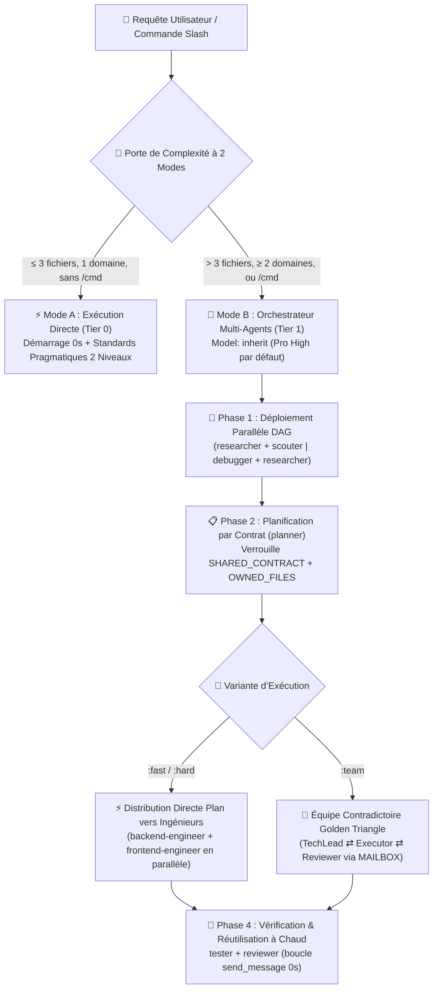

<div align="center">
  <h1>⚡ BoomOpen Workflow Kit v5.5.0</h1>
  <p><strong>Système d&#39;Exploitation IA Smart-Hybrid Multiplateforme — 21 Agents Spécialistes, 17 Équipes Triangle d&#39;Or &amp; Coffre de 1 450+ Compétences à la Demande</strong></p>

  <p>
    <a href="https://github.com/Kennyboom/BoomOpen-Workflow-Kit/releases"></a>
    <a href="#platforms"></a>
    <a href="#agents"></a>
    <a href="#pillars"></a>
    <a href="https://nodejs.org/">=18.0.0" /></a>
    <a href="../LICENSE"></a>
  </p>

  <p>
    <a href="../README.md">🇬🇧 English</a> • <a href="./README.vi.md">🇻🇳 Tiếng Việt</a> • <a href="./README.zh-CN.md">🇨🇳 简体中文</a> • <a href="./README.zh-TW.md">🇹🇼 繁體中文</a> • <a href="./README.ja.md">🇯🇵 日本語</a> • <a href="./README.ko.md">🇰🇷 한국어</a> • <a href="./README.es.md">🇪🇸 Español</a> • <b>🇫🇷 Français</b> • <a href="./README.de.md">🇩🇪 Deutsch</a><br/>
    <a href="./README.pt-BR.md">🇧🇷 Português</a> • <a href="./README.ru.md">🇷🇺 Русский</a> • <a href="./README.hi.md">🇮🇳 हिन्दी</a> • <a href="./README.ar.md">🇸🇦 العربية</a> • <a href="./README.id.md">🇮🇩 Bahasa Indonesia</a> • <a href="./README.th.md">🇹🇭 ไทย</a> • <a href="./README.tr.md">🇹🇷 Türkçe</a> • <a href="./README.it.md">🇮🇹 Italiano</a>
  </p>
</div>

---

## 🎬 Bande-Annonce Officielle de Lancement (Full HD 1080p)

<div align="center">
  <a href="https://github.com/Kennyboom/BoomOpen-Workflow-Kit/raw/main/assets/media/boomopen_v55_trailer_en.mp4">
    
  </a>
  <p>
    ▶️ <a href="https://github.com/Kennyboom/BoomOpen-Workflow-Kit/raw/main/assets/media/boomopen_v55_trailer_en.mp4"><b>Cliquez ici pour regarder / diffuser la Bande-Annonce Officielle en Full HD 1080p (MP4 avec voix-off studio)</b></a>
  </p>
</div>

---

## 🌟 Qu’est-ce que BoomOpen Workflow Kit v5.5 ?

**BoomOpen Workflow Kit v5.5 (Multi-Platform Unified & Smart-Hybrid Edition)** est un système d’exploitation multi-agents open-source qui transforme un simple assistant de codage IA en une véritable organisation d’ingénierie coordonnée réunissant **21 agents spécialistes**, **17 équipes contradictoires Golden Triangle**, **48 compétences clés (Core Skills)** et **plus de 1 450 compétences spécialisées (`skills_library`)**.

Contrairement aux modèles rigides ou aux surcouches lourdes qui imposent une latence de démarrage à froid à chaque question simple, BoomOpen v5.5 introduit une **Porte de Complexité Intelligente à 2 Modes (2-Mode Smart Complexity Threshold Gate)** :
- **⚡ Mode A — Exécution Directe (Démarrage à froid 0s)** : Les questions/réponses (Q&A), explications de code, corrections de bugs mono-domaine ou modifications ciblées touchant **≤ 3 fichiers** (sans commande `/cmd`) sont exécutées, testées et vérifiées **directement** par l’agent principal dans le respect des **Standards de Code Pragmatiques à 2 Niveaux** et des **Tests & Corrections Persistants**.
- **🎻 Mode B — Orchestration Multi-Agents Stricte** : Les fonctionnalités complexes (**> 3 fichiers** ou **≥ 2 domaines**) ou les commandes explicites `/cmd` activent le mode Orchestrateur strict avec **Déploiement Parallèle DAG (Parallel Fan-Out)**, **Distribution Directe du Plan à l’Exécutant**, **Verrouillage de Fichiers par Contrat (`SHARED_CONTRACT` + `OWNED_FILES`)** et **Réutilisation à Chaud des Sous-agents (`send_message`)**.

- **📚 Coffre Massif de 1 450+ Compétences sans Gonflement du Contexte** : Réunit **48 Compétences Clés (`skills/`)** et **1 450+ Compétences Spécialisées (`skills_library/`)** précompilées dans `matrix-skills/compact-index.json` pour une recherche `O(1)` en 2 étapes — offrant une maîtrise instantanée en Backend, Frontend, Mobile, Jeux (Unity/Unreal/Godot), IA/ML, BigQuery/Data, Cloud/DevOps et Cybersécurité OWASP sans saturer la fenêtre de prompt.

---

## 🏗️ Architecture Hybride-Intelligente (v5.5)



---

## 🧠 Les 6 Piliers Fondamentaux de la v5.5

1. **🌐 Parité Unifiée sur 5 Plateformes (`platforms/*`)** :
   - Installation native de premier ordre pour **Google Antigravity 2.0 (Gemini)**, **Claude Code**, **OpenAI Codex**, **Cursor** et **GitHub Copilot** à partir d’une architecture unique.
2. **📏 Standards de Code Pragmatiques à 2 Niveaux (Anti-Fragmentation)** :
   - **Niveau 1 — Qualité & Sécurité Strictes (Tolérance Zéro)** : Responsabilité Unique (Single Responsibility), **AUCUN `any` explicite**, **AUCUN `console.log` de débogage oublié** en production, gestion d’erreurs typée avec `try/catch` aux frontières async/API, constantes en `SCREAMING_SNAKE_CASE`, DRY (`≥ 3`) et imports triés.
   - **Niveau 2 — Directives Structurelles Flexibles (Priorité à la Cohésion)** : Cible de `~200–350 lignes/fichier` avec un plafond souple à `~400–450 lignes` pour un module cohésif (découpage obligatoire uniquement au-delà de `>500 lignes` ou multi-domaines ; tests, types, CLI et docs exemptés). Fonctions logiques `~20–40 lignes` (`~40–80 lignes` pour UI/Handlers).
3. **🎯 Distribution Directe du Plan à l’Exécutant & Réutilisation à Chaud (`send_message`)** :
   - Dès que `PLAN-{feature}.md` existe, l’Orchestrateur assigne les tâches **directement** aux ingénieurs de domaine (`backend-engineer`, `frontend-engineer`, `database-architect`, etc.) sans étape intermédiaire `tech-lead` superflue.
   - Les sous-agents actifs sont enregistrés dans un **Registre de Sessions Actives (`Role → conversationId`)** et réutilisés via `send_message` avec **0s de latence** et **100% du contexte fichier conservé**.
4. **🤝 Distribution Parallèle par Contrat (`SHARED_CONTRACT` + `OWNED_FILES`)** :
   - Les plans multi-domaines verrouillent les endpoints API, schémas DTO et la propriété exclusive des fichiers (`OWNED_FILES` vs `READ_ONLY_FILES`) avant de lancer les ingénieurs en parallèle, éliminant tout conflit d’écriture.
5. **🔍 Débogage Cause Racine 5-Whys (SPIE v3.0) & Arbre Git 100% Propre** :
   - `debugger` analyse chaque bug via 3 hypothèses classées et une chaîne causale **5-Whys** (`Pourquoi 1 Symptôme` → `Pourquoi 5 Cause Racine Systémique`). Les artefacts transitoires (`PLAN`, `DEBUG`, `TEST`, `REVIEW`, `MAILBOX`) sont écrits dans `<appDataDir>\brain\<conversation-id>\` afin de garder l’arbre Git 100% propre.
6. **🩺 Diagnostics CLI Intégrés (`doctor` & `check`) & Index de Compétences O(1)** :
   - `npm run doctor` valide les 5 plateformes, 21 agents, 51 fichiers d’équipe, 72 commandes et `matrix-skills/compact-index.json` (`1 450+` compétences indexées). `npm run check <dir>` audite les standards de code de Niveau 1 et Niveau 2.

---

## 💻 Plateformes IA Supportées

| Plateforme | Niveau de Support | Point d’Entrée Global | Chemin d’Installation du Framework |
|----------|:-------------:|-------------------|------------------------|
| **Antigravity (Gemini)** | ✅ Natif v5.5 | `~/.gemini/GEMINI.md` | `~/.gemini/config/skills/boomopen-workflow-kit/` |
| **Claude Code** | ✅ Natif v5.5 | `~/.claude/CLAUDE.md` | `~/.claude/skills/boomopen-workflow-kit/` |
| **OpenAI Codex** | ✅ Natif v5.5 | `~/.codex/CODEX.md` & `AGENTS.md` | `~/.codex/skills/boomopen-workflow-kit/` |
| **Cursor** | ✅ Natif v5.5 | `~/.cursor/rules/boomopen-workflow-kit.mdc` | `~/.cursor/skills/boomopen-workflow-kit/` |
| **GitHub Copilot** | ✅ Natif v5.5 | `~/.copilot/COPILOT.md` | `~/.copilot/skills/boomopen-workflow-kit/` |

---

## 🚀 Démarrage Rapide & Installation

```bash
# 1. Cloner le dépôt
git clone https://github.com/Kennyboom/BoomOpen-Workflow-Kit.git
cd BoomOpen-Workflow-Kit

# 2. Installer pour votre assistant IA (choisir une plateforme ou --all)
npm run install:antigravity   # Google Antigravity 2.0 (Gemini)
npm run install:claude        # Anthropic Claude Code
npm run install:codex         # OpenAI Codex CLI
npm run install:cursor        # Cursor AI Editor
npm run install:copilot       # GitHub Copilot (VS Code)
npm run install:all           # Installer sur les 5 plateformes simultanément

# 3. Vérifier la santé de l’installation, les standards 2 niveaux et la suite de tests
npm run doctor
npm run check ./cli
npm test
```

---

## 🎛️ Paramètres Unifiés & Sélection du Mode (`/settings` Control Center)

BoomOpen v5.5 intègre un **Centre de Contrôle Unifié à Latence Zéro** permettant de basculer entre les modes d’exécution (`auto`, `mode_a`, `mode_b`, `team`), 4 profils prédéfinis et 12 paramètres système sur les **5 plateformes** en `< 10ms` (**0ms de latence au Tour 1**) :

| Profil Prédéfini (`Preset`) | Mode d’Exécution (`execution.mode`) | Variante `/cmd` | Recherche en Langage Naturel (`naturalLanguageResearchTrigger`) | Standards (`codingStandards`) | Cas d’Usage Idéal |
|:---|:---|:---:|:---:|:---:|:---|
| **⚡ `smart-hybrid`** *(Recommandé par défaut)* | **`auto`** (`≤ 3 fichiers` → Mode A Direct ; `> 3 fichiers` ou `/cmd` → Mode B) | `auto` | **`auto_team`** *(Route automatiquement la recherche vers `/brainstorm:team` Golden Triangle)* | `pragmatic` (`400/500` lignes) | Ingénierie full-stack quotidienne : ultra-rapide sur les petites tâches, profond sur l’architecture |
| **🚀 `solo-fast`** | **`mode_a`** *(Force l’exécution directe en solo, 0s de latence sous-agent)* | `fast` | `off` *(Réponse directe dans le chat sauf si `/brainstorm` est saisi)* | `relaxed` (`600/800` lignes) | Correctifs urgents (hotfixes), prototypage rapide, scripts et économie de tokens |
| **🧠 `deep-architect`** | **`mode_b`** *(Force l’Orchestrateur Multi-Agents Mode B sur chaque tâche)* | `hard` | `auto_hard` *(Route automatiquement vers `/brainstorm:hard` à 5 lentilles)* | `strict` (`300/400` lignes) | Architecture système complexe, conception greenfield et refactorisation multi-domaines |
| **🔺 `adversarial-team`** | **`team`** *(Force le Triangle d’Or à 3 agents `:team` sur tous les workflows)* | `team` | **`auto_team`** *(Idéation et revue contradictoire à 3 agents via `MAILBOX`)* | `strict` (`300/400` lignes) | Code de production critique, audits de sécurité et livraisons zéro défaut |

### Trois Façons de Changer de Mode (Chat `/settings`, Interface Web Locale & CLI)

```bash
# 1. Commande Slash dans le Chat (Menu interactif ou commande directe)
/settings                                     # Ouvrir le menu interactif (ask_question UI)
/settings preset smart-hybrid                 # Passer au mode recommandé par défaut (Auto Mode A/B + auto_team)
/settings preset solo-fast                    # Passer en exécution directe rapide (Mode A)
/settings preset deep-architect               # Passer à l’Orchestrateur Multi-Agents (Mode B)
/settings preset adversarial-team             # Passer à l’équipe Golden Triangle à 3 agents (:team)
/settings mode auto | mode_a | mode_b | team  # Remplacer directement le mode d’exécution

# 2. Tableau de Bord Web Local du Centre de Contrôle (http://127.0.0.1:4567)
npm run settings:ui

# 3. Terminal CLI (Global ~/.boomopen/settings.json & Projet ./.boomopen.json)
npm run settings -- status
npm run settings -- preset adversarial-team
npm run settings -- reset
```

---

## 🎯 Référence des Commandes Slash

| Commande | Variantes | Objectif Principal |
|---------|----------|-----------------|
| **`/cook`** | `:fast`, `:hard`, `:team` | Développement complet de fonctionnalité (Recherche/Scout → Plan → Code Parallèle → Test → Revue) |
| **`/code`** | `:fast`, `:hard`, `:team` | Exécuter l’implémentation directement à partir d’un `PLAN-{feature}.md` existant |
| **`/plan`** | `:fast`, `:hard`, `:team` | Créer des plans d’implémentation avec `SHARED_CONTRACT`, `OWNED_FILES` et critères Given/When/Then |
| **`/fix`** | `:fast`, `:hard`, `:team` | Résolution de bugs à la racine avec vérification obligatoire par test de régression |
| **`/debug`** | `:fast`, `:hard`, `:team` | Investigation de cause racine via 3 hypothèses + chaîne causale **5-Whys (SPIE v3.0)** (`DEBUG-{issue}.md`) |
| **`/test`** | `:fast`, `:hard`, `:team` | Exécution parallèle DAG des suites de tests + détection des cas limites non couverts (`tester` + `scouter`) |
| **`/review`** | `:fast`, `:hard`, `:team` | Audit parallèle à 4 dimensions (Architecture, Qualité du Code, Sécurité OWASP, Performance) |
| **`/design`** | `:fast`, `:hard`, `:team` | Architecture système, schéma de base de données et spécification UI/UX (`DESIGN.md`) |
| **`/docs`** | `:core`, `:business`, `:audit` | Générer ou synchroniser la documentation structurée à 2 niveaux d’architecture et métier (`./documents/`) |
| **`/deploy`** | `:check`, `:preview`, `:production`, `:rollback` | Contrôles pré-déploiement, environnements de prévisualisation, mise en production et rollback sécurisé |
| **`/brainstorm`** | `:fast`, `:hard`, `:team` | Découverte socratique des besoins, analyse des compromis et idéation |
| **`/report`** | `:fast`, `:hard`, `:team` | Rapports de synthèse exécutifs et techniques avec métriques et diagrammes |
| **`/orchestrate`** | — | Orchestration de pipelines multi-agents personnalisés à travers plusieurs domaines |
| **`/settings` / `/config`** | `preset`, `mode`, `set`, `ui` | Centre de Contrôle Unifié : basculer `Auto` / `Mode A` / `Mode B` / `Team`, profils ou ouvrir l’UI Web (`--ui`) |
| **`/save` / `/recap`** | — | Sauvegarder l’état de session (`SESSION-HANDOVER.md`) et restaurer le contexte complet en `< 5s` |

---

## 🤖 21 Agents Spécialistes & 17 Équipes Golden Triangle

| Catégorie | Agents Spécialistes (`agents/*.md`) | Équipes Golden Triangle (`agents/teams/*-team/`) |
|----------|-----------------------------------|------------------------------------------------|
| **Ingénierie & Exécution** | `backend-engineer`, `frontend-engineer`, `mobile-engineer`, `game-engineer`, `database-architect`, `devops-engineer` | `backend-team`, `frontend-team`, `fullstack-team`, `mobile-team`, `game-team`, `database-team`, `devops-team` |
| **Architecture & Planification** | `tech-lead`, `planner`, `brainstormer`, `business-analyst`, `project-manager`, `designer` | `planning-team`, `project-team`, `design-team` |
| **Qualité, Sécurité & Débogage** | `debugger`, `tester`, `reviewer`, `security-engineer`, `performance-engineer` | `debug-team`, `qa-team`, `review-team`, `security-team`, `performance-team` |
| **Recherche & Connaissances** | `researcher`, `scouter`, `docs-manager`, `reporter` | `research-team`, `docs-team`, `report-team` |

---

## 📚 Coffre de 1 450+ Compétences (48 Clés + 1 450+ de Bibliothèque)

BoomOpen intègre l'un des plus vastes écosystèmes de compétences d'ingénierie open source, conçu pour **0 coût de tokens au repos** grâce à la **Résolution Progressive O(1) en 2 Étapes** (`<skills>` → `matrix-skills/compact-index.json` → chargement ciblé de `SKILL.md` à la demande) :

| Niveau / Domaine de Compétence | Nombre | Compétences et Capacités Représentatives | Mécanisme de Chargement |
|:---|:---:|:---|:---|
| **⚡ Niveau 1 : Compétences Clés (`skills/`)** | **48** | `clean-code`, `systematic-debugging`, `plan-writing`, `brainstorming`, `frontend-design`, `api-patterns`, `database-design`, `testing-patterns`, `vulnerability-scanner`, `skill-seeker` | Pré-indexé dans `<skills>` pour un accès immédiat au Tour 1 |
| **🌐 Web, Backend & Systèmes Distribués** | **380+** | Next.js/React 19, FastAPI, NestJS, microservices Go/Rust, GraphQL, gRPC, architecture événementielle Redis/Kafka, SaaS multi-locataire | À la demande via `compact-index.json` (`skills_library/`) |
| **🤖 IA, Agents LLM & Ingénierie des Données** | **310+** | Pipelines RAG, serveurs LangGraph/MCP, prompt engineering, Vertex AI, analytique BigQuery, dbt, Spark, bases vectorielles | À la demande via `compact-index.json` (`skills_library/`) |
| **☁️ Cloud, DevOps, Kubernetes & Sécurité** | **290+** | Terraform/OpenTofu, AWS/GCP/Azure, Docker/K8s GitOps, CI/CD, audit OWASP Top 10, authentification Zero-Trust | À la demande via `compact-index.json` (`skills_library/`) |
| **📱 Mobile, Moteurs de Jeux & Domaines Spécialisés** | **450+** | iOS Swift/SwiftUI, Android Kotlin, React Native, Flutter, Unity 6, Unreal Engine 5, Godot 4, WebGL/Three.js, Finance Quantitative, Web3 | À la demande via `compact-index.json` (`skills_library/`) |

---

## 📂 Structure du Dépôt

```text
BoomOpen-Workflow-Kit/
├── agents/                  # 21 définitions d’Agents Spécialistes + 17 Équipes Golden Triangle (51 fichiers de rôles)
├── cli/                     # Installateur (install.js), Docteur (doctor.js), Vérificateur 2 Niveaux (checker.js) & Tests
├── commands/                # 72 workflows de commandes Slash (:fast, :hard, :team) + protocoles _ref/
├── documents/               # Documentation à 2 niveaux (Architecture, Domaine, Base de Code & Standards)
├── i18n/                    # Documentation multilingue (16 traductions complètes du README)
├── matrix-skills/           # Matrices YAML de compétences par domaine + compact-index.json précompilé (1 450+ compétences)
├── platforms/               # Modèles unifiés pour les 5 plateformes (antigravity/, claude/, codex/, copilot/, cursor/)
├── rules/                   # Règles Mode B chargées à la demande (CORE, PHASES, AGENTS, TEAMS, SKILLS, ERRORS, REFERENCE)
├── scripts/                 # Scripts Python d’automatisation et de vérification (checklist.py, verify_all.py, etc.)
├── skills/                  # 48 Compétences Clés (clean-code, debugger, plan-writing, frontend-design, etc.)
├── skills_library/          # Plus de 1 450 compétences spécialisées chargées à la demande en 2 étapes
└── GEMINI.md | CLAUDE.md | CODEX.md | COPILOT.md | CURSOR.md | AGENT.md
```

---

## 📄 Licence & Sécurité

- **Licence** : Distribué sous [Licence MIT](../LICENSE). Copyright © 2026 **Kennyboom (BoomOpen)**.
- **Politique de Sécurité** : Consultez [SECURITY.md](../SECURITY.md) pour les garde-fous de sécurité intégrés et le signalement de vulnérabilités.
