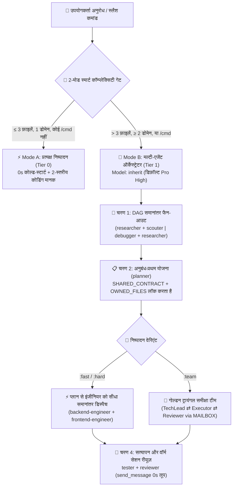

<div align="center">
  <h1>⚡ BoomOpen Workflow Kit v5.5.0</h1>
  <p><strong>मल्टी-प्लेटफ़ॉर्म स्मार्ट-हाइब्रिड AI वर्कफ़ोर्स OS — 21 विशेषज्ञ एजेंट, 17 गोल्डन ट्रायंगल टीमें और 1,450+ ऑन-डिमांड स्किल्स वॉल्ट</strong></p>

  <p>
    <a href="https://github.com/Kennyboom/BoomOpen-Workflow-Kit/releases"></a>
    <a href="#platforms"></a>
    <a href="#agents"></a>
    <a href="#pillars"></a>
    <a href="https://nodejs.org/">=18.0.0" /></a>
    <a href="../LICENSE"></a>
  </p>

  <p>
    <a href="../README.md">🇬🇧 English</a> • <a href="./README.vi.md">🇻🇳 Tiếng Việt</a> • <a href="./README.zh-CN.md">🇨🇳 简体中文</a> • <a href="./README.zh-TW.md">🇹🇼 繁體中文</a> • <a href="./README.ja.md">🇯🇵 日本語</a> • <a href="./README.ko.md">🇰🇷 한국어</a> • <a href="./README.es.md">🇪🇸 Español</a> • <a href="./README.fr.md">🇫🇷 Français</a> • <a href="./README.de.md">🇩🇪 Deutsch</a><br/>
    <a href="./README.pt-BR.md">🇧🇷 Português</a> • <a href="./README.ru.md">🇷🇺 Русский</a> • <b>🇮🇳 हिन्दी</b> • <a href="./README.ar.md">🇸🇦 العربية</a> • <a href="./README.id.md">🇮🇩 Bahasa Indonesia</a> • <a href="./README.th.md">🇹🇭 ไทย</a> • <a href="./README.tr.md">🇹🇷 Türkçe</a> • <a href="./README.it.md">🇮🇹 Italiano</a>
  </p>
</div>

---

## 🎬 आधिकारिक लॉन्च ट्रेलर (Full HD 1080p)

<div align="center">
  <a href="https://github.com/Kennyboom/BoomOpen-Workflow-Kit/raw/main/assets/media/boomopen_v55_trailer_en.mp4">
    
  </a>
  <p>
    ▶️ <a href="https://github.com/Kennyboom/BoomOpen-Workflow-Kit/raw/main/assets/media/boomopen_v55_trailer_en.mp4"><b>Full HD 1080p आधिकारिक लॉन्च ट्रेलर देखने / स्ट्रीम करने के लिए यहाँ क्लिक करें (स्टूडियो वॉयसओवर के साथ MP4)</b></a>
  </p>
</div>

---

## 🌟 BoomOpen Workflow Kit v5.5 क्या है?

**BoomOpen Workflow Kit v5.5 (Multi-Platform Unified & Smart-Hybrid Edition)** एक ओपन-सोर्स मल्टी-एजेंट ऑपरेटिंग सिस्टम है जो एक सिंगल AI कोडिंग असिस्टेंट को **21 विशेषज्ञ एजेंटों (Specialist Agents)**, **17 गोल्डन ट्रायंगल टीमों (Golden Triangle Teams)**, **48 कोर स्किल्स (Core Skills)** और **1,450+ विशिष्ट लाइब्रेरी स्किल्स (`skills_library`)** के एक समन्वित इंजीनियरिंग संगठन में बदल देता है।

हर छोटे सवाल पर कोल्ड-स्टार्ट विलंब पैदा करने वाले भारी-भरकम एजेंट रैपर्स के विपरीत, BoomOpen v5.5 **2-मोड स्मार्ट कॉम्प्लेक्सिटी थ्रेशोल्ड गेट (2-Mode Smart Complexity Threshold Gate)** प्रस्तुत करता है:
- **⚡ Mode A — प्रत्यक्ष निष्पादन (0 सेकंड कोल्ड-स्टार्ट)**: सामान्य प्रश्नोत्तर (Q&A), कोड व्याख्या, सिंगल-डोमेन बग फिक्स, या **≤ 3 फ़ाइलों** (बिना `/cmd` कमांड) को छूने वाले स्पष्ट बदलाव मुख्य एजेंट द्वारा **सीधे** निष्पादित, परीक्षित और सत्यापित किए जाते हैं, जिसमें **व्यावहारिक 2-स्तरीय कोडिंग मानक (Pragmatic 2-Tier Coding Standards)** और **सतत परीक्षण एवं बग निवारण** लागू होते हैं।
- **🎻 Mode B — सख्त मल्टी-एजेंट ऑर्केस्ट्रेशन**: जटिल फ़ीचर्स (**> 3 फ़ाइलें** या **≥ 2 डोमेन**) या स्पष्ट `/cmd` वर्कफ़्लो कमांड **DAG समानांतर फैन-आउट**, **प्लान-टू-एग्जीक्यूटर डायरेक्ट डिस्पैच**, **अनुबंध-प्रथम फ़ाइल लॉक (`SHARED_CONTRACT` + `OWNED_FILES`)** और **वॉर्म सब-एजेंट रीयूज़ (`send_message`)** के साथ सख्त ऑर्केस्ट्रेटर मोड सक्रिय करते हैं।

- **📚 ज़ीरो कॉन्टेक्स्ट ब्लोट के साथ 1,450+ विशाल स्किल्स वॉल्ट**: इसमें **48 कोर स्किल्स (`skills/`)** और **1,450+ विशिष्ट लाइब्रेरी स्किल्स (`skills_library/`)** शामिल हैं, जिन्हें `matrix-skills/compact-index.json` में प्री-कम्पाइल किया गया है ताकि `O(1)` 2-चरणीय लुकअप से प्रॉम्प्ट विंडो को भरे बिना Backend, Frontend, Mobile, Game Dev (Unity/Unreal/Godot), AI/ML, BigQuery/Data, Cloud/DevOps और OWASP सुरक्षा में तुरंत महारत मिल सके।

---

## 🏗️ स्मार्ट-हाइब्रिड आर्किटेक्चर (v5.5)



---

## 🧠 v5.5 के 6 मुख्य स्तंभ

1. **🌐 5 प्लेटफ़ॉर्म पर पूर्ण एकीकृत समानता (`platforms/*`)**:
   - एक ही एकीकृत आर्किटेक्चर से **Google Antigravity 2.0 (Gemini)**, **Claude Code**, **OpenAI Codex**, **Cursor**, और **GitHub Copilot** के लिए प्रथम-श्रेणी का नेटिव इंस्टॉलेशन।
2. **📏 व्यावहारिक 2-स्तरीय कोडिंग मानक (Pragmatic 2-Tier Coding Standards — एंटी-फ्रैगमेंटेशन)**:
   - **स्तर 1 — सख्त गुणवत्ता और सुरक्षा नियम (शून्य सहनशीलता)**: एकल उत्तरदायित्व (Single Responsibility), **स्पष्ट `any` पूरी तरह वर्जित**, **प्रोडक्शन कोड में डीबग `console.log` छोड़ना वर्जित**, async/API सीमाओं पर `try/catch` + टाइप्ड एरर हैंडलिंग अनिवार्य, `SCREAMING_SNAKE_CASE` स्थिरांक, DRY (`≥ 3`), और साफ-सुथरे क्रमबद्ध इम्पोर्ट्स।
   - **स्तर 2 — लचीले संरचनात्मक दिशानिर्देश (सामंजस्य सर्वोपरि)**: एकल जिम्मेदारी वाली फ़ाइलों का लक्ष्य `~200–350 पंक्तियाँ` और लचीली सीमा `~400–450 पंक्तियाँ` है (केवल `>500 पंक्तियों` या कई डोमेन मिलने पर ही विभाजन अनिवार्य; टेस्ट, टाइप्स, CLI और डॉक्स मुक्त हैं)। लॉजिक फ़ंक्शन `~20–40 पंक्तियाँ` (UI/हैंडलर `~40–80 पंक्तियाँ`)।
3. **🎯 प्लान-टू-एग्जीक्यूटर डायरेक्ट डिस्पैच और वॉर्म सब-एजेंट रीयूज़ (`send_message`)**:
   - `PLAN-{feature}.md` बनते ही ऑर्केस्ट्रेटर अनावश्यक `tech-lead` मध्यस्थ के बिना **सीधे** डोमेन इंजीनियरों (`backend-engineer`, `frontend-engineer`, `database-architect` आदि) को कार्य सौंपता है।
   - सक्रिय सब-एजेंट **Active Session Registry (`Role → conversationId`)** में दर्ज होते हैं और `send_message` द्वारा **0 सेकंड कोल्ड-स्टार्ट** तथा **100% फ़ाइल संदर्भ** के साथ पुनः उपयोग किए जाते हैं।
4. **🤝 अनुबंध-प्रथम समानांतर डिस्पैच (`SHARED_CONTRACT` + `OWNED_FILES`)**:
   - मल्टी-डोमेन प्लान समानांतर इंजीनियरों को चलाने से पहले API एंडपॉइंट्स, DTO स्कीमा और अनन्य फ़ाइल स्वामित्व (`OWNED_FILES` बनाम `READ_ONLY_FILES`) को लॉक करते हैं, जिससे ओवरराइट टकराव समाप्त हो जाता है।
5. **🔍 5-Whys (SPIE v3.0) मूल-कारण डीबगिंग और 100% स्वच्छ Git ट्री**:
   - `debugger` 3 क्रमबद्ध परिकल्पनाओं और **5-Whys कारण श्रृंखला** (`Why 1 लक्षण` → `Why 5 प्रणालीगत मूल कारण`) के माध्यम से बग की जांच करता है। सभी अस्थायी रिपोर्ट (`PLAN`, `DEBUG`, `TEST`, `REVIEW`, `MAILBOX`) `<appDataDir>\brain\<conversation-id>\` में सहेजी जाती हैं जिससे Git वर्किंग ट्री 100% साफ रहता है।
6. **🩺 इन-बिल्ट CLI डायग्नोस्टिक्स (`doctor` & `check`) और O(1) स्किल इंडेक्स**:
   - `npm run doctor` सभी 5 प्लेटफ़ॉर्म बंडलों, 21 एजेंटों, 51 टीम फ़ाइलों, 72 कमांड्स और `matrix-skills/compact-index.json` (`1,450+` स्किल्स) की जांच करता है। `npm run check <dir>` टियर 1 और टियर 2 कोडिंग मानकों का ऑडिट करता है।

---

## 💻 समर्थित AI प्लेटफ़ॉर्म

| प्लेटफ़ॉर्म | समर्थन स्तर | ग्लोबल एंट्रीपॉइंट | फ्रेमवर्क इंस्टॉल पथ |
|----------|:-------------:|-------------------|------------------------|
| **Antigravity (Gemini)** | ✅ नेटिव v5.5 | `~/.gemini/GEMINI.md` | `~/.gemini/config/skills/boomopen-workflow-kit/` |
| **Claude Code** | ✅ नेटिव v5.5 | `~/.claude/CLAUDE.md` | `~/.claude/skills/boomopen-workflow-kit/` |
| **OpenAI Codex** | ✅ नेटिव v5.5 | `~/.codex/CODEX.md` & `AGENTS.md` | `~/.codex/skills/boomopen-workflow-kit/` |
| **Cursor** | ✅ नेटिव v5.5 | `~/.cursor/rules/boomopen-workflow-kit.mdc` | `~/.cursor/skills/boomopen-workflow-kit/` |
| **GitHub Copilot** | ✅ नेटिव v5.5 | `~/.copilot/COPILOT.md` | `~/.copilot/skills/boomopen-workflow-kit/` |

---

## 🚀 त्वरित शुरुआत और इंस्टॉलेशन

```bash
# 1. रिपॉजिटरी क्लोन करें
git clone https://github.com/Kennyboom/BoomOpen-Workflow-Kit.git
cd BoomOpen-Workflow-Kit

# 2. अपने AI कोडिंग असिस्टेंट के लिए इंस्टॉल करें (कोई एक चुनें या --all)
npm run install:antigravity   # Google Antigravity 2.0 (Gemini)
npm run install:claude        # Anthropic Claude Code
npm run install:codex         # OpenAI Codex CLI
npm run install:cursor        # Cursor AI Editor
npm run install:copilot       # GitHub Copilot (VS Code)
npm run install:all           # सभी 5 प्लेटफ़ॉर्म पर एक साथ इंस्टॉल करें

# 3. इंस्टॉलेशन स्वास्थ्य, 2-स्तरीय कोड मानक और टेस्ट सूट सत्यापित करें
npm run doctor
npm run check ./cli
npm test
```

---

## 🎛️ एकीकृत सेटिंग्स और मोड चयन (`/settings` कंट्रोल सेंटर)

BoomOpen v5.5 में **ज़ीरो-लेटेंसी यूनिफाइड कंट्रोल सेंटर** शामिल है, जिससे आप सभी **5 प्लेटफ़ॉर्म** पर `< 10ms` (**0ms टर्न-1 लेटेंसी**) में निष्पादन मोड (`auto`, `mode_a`, `mode_b`, `team`), 4 प्रीसेट प्रोफ़ाइल और 12 सिस्टम सेटिंग्स बदल सकते हैं:

| प्रीसेट प्रोफ़ाइल (`Preset`) | निष्पादन मोड (`execution.mode`) | डिफ़ॉल्ट वेरिएंट | प्राकृतिक भाषा रिसर्च (`naturalLanguageResearchTrigger`) | कोडिंग मानक (`codingStandards`) | सर्वोत्तम उपयोग |
|:---|:---|:---:|:---:|:---:|:---|
| **⚡ `smart-hybrid`** *(डिफ़ॉल्ट अनुशंसित)* | **`auto`** (`≤ 3 फ़ाइलें` → Mode A प्रत्यक्ष; `> 3 फ़ाइलें` या `/cmd` → Mode B) | `auto` | **`auto_team`** *(रिसर्च/आइडिया को स्वतः `/brainstorm:team` Golden Triangle पर भेजता है)* | `pragmatic` (`400/500` पंक्तियाँ) | दैनिक फुल-स्टैक इंजीनियरिंग — छोटे कार्यों में तेज़, जटिल आर्किटेक्चर में गहरा |
| **🚀 `solo-fast`** | **`mode_a`** *(प्रत्यक्ष सोलो निष्पादन, 0s सब-एजेंट लेटेंसी)* | `fast` | `off` *(सीधा चैट उत्तर जब तक `/brainstorm` न लिखा जाए)* | `relaxed` (`600/800` पंक्तियाँ) | तत्काल हॉटफ़िक्स, तेज़ प्रोटोटाइपिंग, स्क्रिप्टींग और न्यूनतम टोकन उपयोग |
| **🧠 `deep-architect`** | **`mode_b`** *(प्रत्येक कार्य पर Mode B मल्टी-एजेंट ऑर्केस्ट्रेटर अनिवार्य)* | `hard` | `auto_hard` *(स्वतः `/brainstorm:hard` 5-लेंस रिसर्च चलाता है)* | `strict` (`300/400` पंक्तियाँ) | जटिल सिस्टम आर्किटेक्चर, नए प्रोजेक्ट और मल्टी-डोमेन रिफैक्टरिंग |
| **🔺 `adversarial-team`** | **`team`** *(सभी वर्कफ़्लो पर 3-एजेंट Golden Triangle `:team` अनिवार्य)* | `team` | **`auto_team`** *(`MAILBOX` के माध्यम से 3-एजेंट क्रॉस-रिव्यू और डिबेट)* | `strict` (`300/400` पंक्तियाँ) | मिशन-क्रिटिकल प्रोडक्शन कोड, सुरक्षा ऑडिट और ज़ीरो-डिफेक्ट रिलीज़ |

### मोड बदलने के 3 तरीके (चैट `/settings`, लोकल वेब UI और टर्मिनल CLI)

```bash
# 1. चैट में स्लैश कमांड (इंटरैक्टिव मेनू या वन-लाइनर)
/settings                                     # इंटरैक्टिव चयन मेनू खोलें (ask_question UI)
/settings preset smart-hybrid                 # डिफ़ॉल्ट अनुशंसित मोड चुनें (Auto Mode A/B + auto_team)
/settings preset solo-fast                    # Mode A तेज़ प्रत्यक्ष निष्पादन चुनें
/settings preset deep-architect               # Mode B मल्टी-एजेंट ऑर्केस्ट्रेटर चुनें
/settings preset adversarial-team             # Golden Triangle 3-एजेंट टीम (:team) चुनें
/settings mode auto | mode_a | mode_b | team  # सीधे निष्पादन मोड (execution.mode) बदलें

# 2. लोकल वेब कंट्रोल सेंटर डैशबोर्ड (http://127.0.0.1:4567)
npm run settings:ui

# 3. टर्मिनल CLI (ग्लोबल ~/.boomopen/settings.json और प्रोजेक्ट ./.boomopen.json)
npm run settings -- status
npm run settings -- preset adversarial-team
npm run settings -- reset
```

---

## 🎯 स्लैश कमांड संदर्भ तालिका

| कमांड | वेरिएंट | मुख्य उद्देश्य |
|---------|----------|-----------------|
| **`/cook`** | `:fast`, `:hard`, `:team` | एंड-टू-एंड फ़ीचर विकास (रिसर्च/स्काउट → प्लान → समानांतर कोड → टेस्ट → रिव्यू) |
| **`/code`** | `:fast`, `:hard`, `:team` | मौजूदा `PLAN-{feature}.md` से सीधे कोड कार्यान्वयन और सत्यापन |
| **`/plan`** | `:fast`, `:hard`, `:team` | `SHARED_CONTRACT`, `OWNED_FILES` और Given/When/Then मानदंडों के साथ ब्लूप्रिंट बनाना |
| **`/fix`** | `:fast`, `:hard`, `:team` | अनिवार्य रिग्रेशन टेस्ट सत्यापन के साथ मूल-कारण बग समाधान |
| **`/debug`** | `:fast`, `:hard`, `:team` | 3-परिकल्पना + **5-Whys (SPIE v3.0)** श्रृंखला द्वारा मूल-कारण जांच (`DEBUG-{issue}.md`) |
| **`/test`** | `:fast`, `:hard`, `:team` | DAG समानांतर टेस्ट निष्पादन + छूटे हुए एज-केस की खोज (`tester` + `scouter`) |
| **`/review`** | `:fast`, `:hard`, `:team` | 4-आयामी समानांतर ऑडिट (आर्किटेक्चर, कोड गुणवत्ता, OWASP सुरक्षा, प्रदर्शन) |
| **`/design`** | `:fast`, `:hard`, `:team` | सिस्टम आर्किटेक्चर, डेटाबेस स्कीमा और UI/UX विनिर्देश (`DESIGN.md`) |
| **`/docs`** | `:core`, `:business`, `:audit` | 2-स्तरीय आर्किटेक्चर और बिज़नेस दस्तावेज़ीकरण जनरेट या सिंक करना (`./documents/`) |
| **`/deploy`** | `:check`, `:preview`, `:production`, `:rollback` | प्री-डिप्लॉयमेंट जांच, प्रीव्यू वातावरण, प्रोडक्शन रोलआउट और सुरक्षित रोलबैक |
| **`/brainstorm`** | `:fast`, `:hard`, `:team` | सुकराती आवश्यकता खोज, ट्रेड-ऑफ विश्लेषण और विचार मंथन |
| **`/report`** | `:fast`, `:hard`, `:team` | मेट्रिक्स और आरेखों के साथ कार्यकारी एवं तकनीकी सारांश रिपोर्ट |
| **`/orchestrate`** | — | कई डोमेन में कस्टम मल्टी-एजेंट पाइपलाइन ऑर्केस्ट्रेशन |
| **`/settings` / `/config`** | `preset`, `mode`, `set`, `ui` | यूनिफाइड कंट्रोल सेंटर: `Auto` / `Mode A` / `Mode B` / `Team` बदलें, प्रीसेट चुनें या वेब UI (`--ui`) खोलें |
| **`/save` / `/recap`** | — | सेशन स्थिति (`SESSION-HANDOVER.md`) सहेजें और `< 5s` में पूरा संदर्भ बहाल करें |

---

## 🤖 21 विशेषज्ञ एजेंट और 17 गोल्डन ट्रायंगल टीमें

| श्रेणी | विशेषज्ञ एजेंट (`agents/*.md`) | गोल्डन ट्रायंगल टीमें (`agents/teams/*-team/`) |
|----------|-----------------------------------|------------------------------------------------|
| **इंजीनियरिंग और निष्पादन** | `backend-engineer`, `frontend-engineer`, `mobile-engineer`, `game-engineer`, `database-architect`, `devops-engineer` | `backend-team`, `frontend-team`, `fullstack-team`, `mobile-team`, `game-team`, `database-team`, `devops-team` |
| **आर्किटेक्चर और योजना** | `tech-lead`, `planner`, `brainstormer`, `business-analyst`, `project-manager`, `designer` | `planning-team`, `project-team`, `design-team` |
| **गुणवत्ता, सुरक्षा और डीबगिंग** | `debugger`, `tester`, `reviewer`, `security-engineer`, `performance-engineer` | `debug-team`, `qa-team`, `review-team`, `security-team`, `performance-team` |
| **अनुसंधान और ज्ञान** | `researcher`, `scouter`, `docs-manager`, `reporter` | `research-team`, `docs-team`, `report-team` |

---

## 📚 1,450+ स्किल्स वॉल्ट (48 कोर + 1,450+ लाइब्रेरी स्किल्स)

BoomOpen ओपन-सोर्स के सबसे बड़े इंजीनियरिंग स्किल इकोसिस्टम में से एक के साथ आता है — जो **2-चरणीय O(1) प्रोग्रेसिव स्किल लुकअप** (`<skills>` → `matrix-skills/compact-index.json` → ज़रूरत पड़ने पर सटीक `SKILL.md` लोड) के माध्यम से **0 निष्क्रिय टोकन खर्च** सुनिश्चित करता है:

| स्किल स्तर / डोमेन | संख्या | प्रमुख स्किल्स और क्षमताएँ | लोडिंग तंत्र |
|:---|:---:|:---|:---|
| **⚡ स्तर 1: कोर स्किल्स (`skills/`)** | **48** | `clean-code`, `systematic-debugging`, `plan-writing`, `brainstorming`, `frontend-design`, `api-patterns`, `database-design`, `testing-patterns`, `vulnerability-scanner`, `skill-seeker` | Turn 1 पर त्वरित उपयोग के लिए `<skills>` में प्री-इंडेक्स्ड |
| **🌐 वेब, बैकएंड और डिस्ट्रीब्यूटेड सिस्टम्स** | **380+** | Next.js/React 19, FastAPI, NestJS, Go/Rust माइक्रोसर्विसेज़, GraphQL, gRPC, Redis/Kafka इवेंट-ड्रिवन आर्किटेक्चर, मल्टी-टेनेंट SaaS | `compact-index.json` द्वारा ऑन-डिमांड (`skills_library/`) |
| **🤖 AI, LLM एजेंट्स और डेटा इंजीनियरिंग** | **310+** | RAG पाइपलाइन, LangGraph/MCP सर्वर, प्रॉम्प्ट इंजीनियरिंग, Vertex AI, BigQuery एनालिटिक्स, dbt, Spark, वेक्टर डेटाबेस | `compact-index.json` द्वारा ऑन-डिमांड (`skills_library/`) |
| **☁️ क्लाउड, DevOps, Kubernetes और सुरक्षा** | **290+** | Terraform/OpenTofu, AWS/GCP/Azure आर्किटेक्चर, Docker/K8s GitOps, CI/CD पाइपलाइन, OWASP Top 10 ऑडिट, Zero-Trust ऑथेंटिकेशन | `compact-index.json` द्वारा ऑन-डिमांड (`skills_library/`) |
| **📱 मोबाइल, गेम इंजन और विशेष डोमेन** | **450+** | iOS Swift/SwiftUI, Android Kotlin, React Native, Flutter, Unity 6, Unreal Engine 5, Godot 4, WebGL/Three.js, क्वांट फाइनेंस, Web3 | `compact-index.json` द्वारा ऑन-डिमांड (`skills_library/`) |

---

## 📂 रिपॉजिटरी संरचना

```text
BoomOpen-Workflow-Kit/
├── agents/                  # 21 विशेषज्ञ एजेंट परिभाषाएँ + 17 गोल्डन ट्रायंगल टीमें (51 रोल फ़ाइलें)
├── cli/                     # इंस्टॉलर (install.js), हेल्थ डॉक्टर (doctor.js), 2-स्तरीय चेकर (checker.js) और टेस्ट
├── commands/                # 72 स्लैश कमांड वर्कफ़्लो (:fast, :hard, :team) + _ref/ प्रोटोकॉल
├── documents/               # 2-स्तरीय आर्किटेक्चर, डोमेन, सोर्स-बेस और कोडिंग मानक दस्तावेज़
├── i18n/                    # बहुभाषी दस्तावेज़ीकरण (16 प्रमुख भाषाओं में पूर्ण README अनुवाद)
├── matrix-skills/           # डोमेन YAML स्किल मैट्रिक्स + प्री-कम्पाइल्ड compact-index.json (1,450+ स्किल्स)
├── platforms/               # सभी 5 प्लेटफ़ॉर्म के लिए एकीकृत टेम्पलेट्स (antigravity/, claude/, codex/, copilot/, cursor/)
├── rules/                   # Mode B ऑन-डिमांड नियम (CORE, PHASES, AGENTS, TEAMS, SKILLS, ERRORS, REFERENCE)
├── scripts/                 # Python ऑटोमेशन और सत्यापन स्क्रिप्ट्स (checklist.py, verify_all.py आदि)
├── skills/                  # 48 कोर स्किल्स (clean-code, debugger, plan-writing, frontend-design आदि)
├── skills_library/          # 2-चरण फास्ट लुकअप द्वारा ऑन-डिमांड लोड होने वाली 1,450+ विशिष्ट स्किल्स
└── GEMINI.md | CLAUDE.md | CODEX.md | COPILOT.md | CURSOR.md | AGENT.md
```

---

## 📄 लाइसेंस और सुरक्षा

- **लाइसेंस**: [MIT लाइसेंस](../LICENSE) के अंतर्गत वितरित। कॉपीराइट © 2026 **Kennyboom (BoomOpen)**।
- **सुरक्षा नीति**: अंतर्निहित सुरक्षा गार्डरेल्स और वल्नरेबिलिटी रिपोर्टिंग के लिए [SECURITY.md](../SECURITY.md) देखें।
