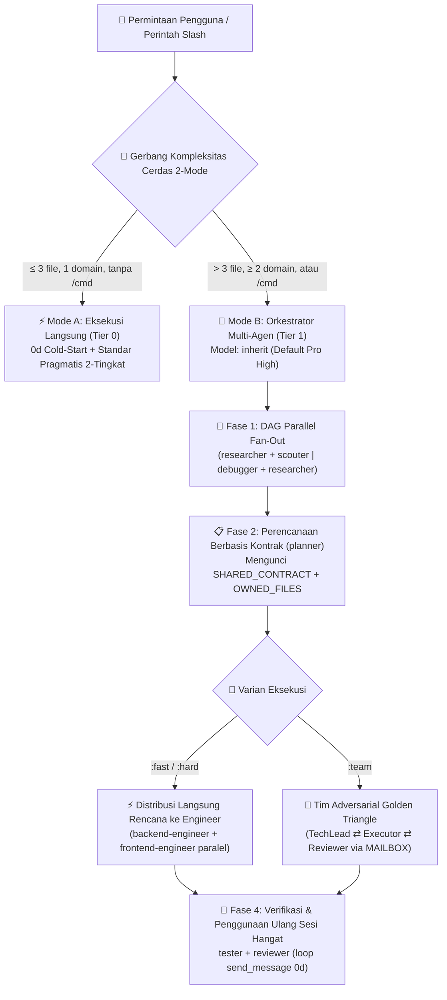

<div align="center">
  <h1>⚡ BoomOpen Workflow Kit v5.5.0</h1>
  <p><strong>Sistem Operasi Tenaga Kerja AI Smart-Hybrid Multi-Platform & Framework Orkestrasi Multi-Agen</strong></p>

  [](https://github.com/Kennyboom/BoomOpen-Workflow-Kit/releases)
  [](#)
  [](#)
  [](#)
  [](https://nodejs.org/)
  [](../LICENSE)

  <p>
    [🇬🇧 English](../README.md) • [🇻🇳 Tiếng Việt](./README.vi.md) • [🇨🇳 简体中文](./README.zh-CN.md) • [🇹🇼 繁體中文](./README.zh-TW.md) • [🇯🇵 日本語](./README.ja.md) • [🇰🇷 한국어](./README.ko.md) • [🇪🇸 Español](./README.es.md) • [🇫🇷 Français](./README.fr.md) • [🇩🇪 Deutsch](./README.de.md)<br/>
    [🇧🇷 Português](./README.pt-BR.md) • [🇷🇺 Русский](./README.ru.md) • [🇮🇳 हिन्दी](./README.hi.md) • [🇸🇦 العربية](./README.ar.md) • **🇮🇩 Bahasa Indonesia** • [🇹🇭 ไทย](./README.th.md) • [🇹🇷 Türkçe](./README.tr.md) • [🇮🇹 Italiano](./README.it.md)
  </p>
</div>

---

## 🌟 Apa itu BoomOpen Workflow Kit v5.5?

**BoomOpen Workflow Kit v5.5 (Multi-Platform Unified & Smart-Hybrid Edition)** adalah sistem operasi multi-agen sumber terbuka (open-source) yang mengubah satu asisten coding AI menjadi organisasi rekayasa perangkat lunak terkoordinasi yang terdiri dari **21 agen spesialis**, **17 tim adversarial Golden Triangle**, **48 keahlian inti (Core Skills)**, dan **1.430+ keahlian pustaka khusus (`skills_library`)**.

Tidak seperti template prompt tunggal yang kaku atau wrapper agen berat yang menimbulkan latensi cold-start pada setiap pertanyaan sederhana, BoomOpen v5.5 menghadirkan **Gerbang Ambang Kompleksitas Cerdas 2-Mode (2-Mode Smart Complexity Threshold Gate)**:
- **⚡ Mode A — Eksekusi Langsung (0d Cold-Start)**: Tanya jawab (Q&A) sederhana, penjelasan kode, perbaikan bug satu domain, atau perubahan jelas yang menyentuh **≤ 3 file** (tanpa perintah `/cmd`) dieksekusi, diuji, dan diverifikasi **secara langsung** oleh agen utama sambil menerapkan **Standar Pengkodean Pragmatis 2-Tingkat** serta **Pengujian & Perbaikan Bug Persisten**.
- **🎻 Mode B — Orkestrasi Multi-Agen Ketat**: Fitur kompleks (**> 3 file** atau **≥ 2 domain**) atau pemanggilan perintah `/cmd` eksplisit mengaktifkan mode Orkestrator ketat dengan **DAG Parallel Fan-Out**, **Direct Plan-to-Executor Dispatch**, **Kunci Kepemilikan File Berbasis Kontrak (`SHARED_CONTRACT` + `OWNED_FILES`)**, dan **Penggunaan Ulang Sub-agen Hangat (`send_message`)**.

---

## 🏗️ Arsitektur Smart-Hybrid (v5.5)



---

## 🧠 6 Pilar Utama v5.5

1. **🌐 Paritas Terpadu di 5 Platform (`platforms/*`)**:
   - Instalasi native kelas satu untuk **Google Antigravity 2.0 (Gemini)**, **Claude Code**, **OpenAI Codex**, **Cursor**, dan **GitHub Copilot** dari satu arsitektur terpadu.
2. **📏 Standar Pengkodean Pragmatis 2-Tingkat (Anti-Fragmentasi)**:
   - **Tingkat 1 — Aturan Kualitas & Keamanan Ketat (Toleransi Nol)**: Tanggung Jawab Tunggal (Single Responsibility), **DILARANG `any` eksplisit**, **DILARANG meninggalkan `console.log` debug** di kode produksi, wajib `try/catch` + penanganan error bertipe pada batas async/API, konstanta `SCREAMING_SNAKE_CASE`, DRY (`≥ 3`), dan import yang rapi.
   - **Tingkat 2 — Panduan Struktural Fleksibel (Kohesi di Atas Pemotongan Baris Mekanis)**: File kohesif menargetkan `~200–350 baris` dengan batas lunak `~400–450 baris` (pemisahan wajib hanya jika `>500 baris` atau mencampur banyak domain; file test, tipe/skema, CLI, dan dokumen dikecualikan). Fungsi logika `~20–40 baris` (`~40–80 baris` untuk UI/Handler).
3. **🎯 Distribusi Langsung Rencana ke Pelaksana & Penggunaan Ulang Sub-agen Hangat (`send_message`)**:
   - Setelah `PLAN-{feature}.md` tersedia, Orkestrator mengirimkan tugas **secara langsung** ke engineer domain (`backend-engineer`, `frontend-engineer`, `database-architect`, dll.) tanpa lompatan perantara `tech-lead` yang berlebihan.
   - Sub-agen aktif dicatat dalam **Registri Sesi Aktif (`Role → conversationId`)** dan digunakan kembali melalui `send_message` dengan **latensi cold-start 0 detik** serta **100% konteks file tetap terjaga**.
4. **🤝 Distribusi Paralel Berbasis Kontrak (`SHARED_CONTRACT` + `OWNED_FILES`)**:
   - Rencana lintas domain mengunci endpoint API, skema DTO, dan kepemilikan penulisan file eksklusif (`OWNED_FILES` vs. `READ_ONLY_FILES`) sebelum menjalankan engineer secara paralel, menghilangkan bentrokan penulisan file.
5. **🔍 Debugging Akar Masalah 5-Whys (SPIE v3.0) & Pohon Git 100% Bersih**:
   - `debugger` melacak setiap bug melalui minimal 3 hipotesis terurut dan rantai kausal **5-Whys** (`Why 1 Gejala Langsung` → `Why 5 Akar Masalah Sistemik`). Artefak sementara (`PLAN`, `DEBUG`, `TEST`, `REVIEW`, `MAILBOX`) diarahkan ke `<appDataDir>\brain\<conversation-id>\` terlebih dahulu agar pohon kerja Git tetap 100% bersih.
6. **🩺 Diagnostik CLI Bawaan (`doctor` & `check`) & Indeks Keahlian O(1)**:
   - `npm run doctor` memvalidasi 5 bundel platform, 21 agen, 51 file tim, 72 perintah, dan `matrix-skills/compact-index.json` (`1.430+` keahlian terindeks). `npm run check <dir>` mengaudit standar kode Tingkat 1 & Tingkat 2 secara otomatis.

---

## 💻 Platform AI yang Didukung

| Platform | Tingkat Dukungan | Entrypoint Global | Jalur Instalasi Framework |
|----------|:-------------:|-------------------|------------------------|
| **Antigravity (Gemini)** | ✅ Native v5.5 | `~/.gemini/GEMINI.md` | `~/.gemini/config/skills/boomopen-workflow-kit/` |
| **Claude Code** | ✅ Native v5.5 | `~/.claude/CLAUDE.md` | `~/.claude/skills/boomopen-workflow-kit/` |
| **OpenAI Codex** | ✅ Native v5.5 | `~/.codex/CODEX.md` & `AGENTS.md` | `~/.codex/skills/boomopen-workflow-kit/` |
| **Cursor** | ✅ Native v5.5 | `~/.cursor/rules/boomopen-workflow-kit.mdc` | `~/.cursor/skills/boomopen-workflow-kit/` |
| **GitHub Copilot** | ✅ Native v5.5 | `~/.copilot/COPILOT.md` | `~/.copilot/skills/boomopen-workflow-kit/` |

---

## 🚀 Mulai Cepat & Instalasi

```bash
# 1. Clone repositori
git clone https://github.com/Kennyboom/BoomOpen-Workflow-Kit.git
cd BoomOpen-Workflow-Kit

# 2. Instal untuk asisten coding AI Anda (pilih satu atau --all)
npm run install:antigravity   # Google Antigravity 2.0 (Gemini)
npm run install:claude        # Anthropic Claude Code
npm run install:codex         # OpenAI Codex CLI
npm run install:cursor        # Cursor AI Editor
npm run install:copilot       # GitHub Copilot (VS Code)
npm run install:all           # All 5 platforms

# 3. Verifikasi kesehatan instalasi, standar kode 2-tingkat & suite pengujian
npm run doctor
npm run check ./cli
npm test
```

---

## 🎛️ Unified Settings & Mode Selection (`/settings` Control Center)

Switch execution modes (`auto` | `mode_a` | `mode_b` | `team`), 4 one-click presets (`smart-hybrid`, `solo-fast`, `deep-architect`, `adversarial-team`), and 12 system settings across all 5 platforms in `< 10ms` with **0ms Turn-1 latency**:

```bash
# 1. In-Chat Slash Command (Interactive UI Widget or One-Liner)
/settings                                     # Open interactive ask_question menu
/settings preset smart-hybrid                 # Default Recommended (Auto Mode A/B + auto_team)
/settings preset solo-fast                    # Force Mode A Direct Fast Execution
/settings preset deep-architect               # Force Mode B Multi-Agent Orchestrator
/settings preset adversarial-team             # Force Golden Triangle 3-Agent (:team)
/settings mode auto | mode_a | mode_b | team  # Override execution.mode directly

# 2. Local Web Control Center Dashboard (http://127.0.0.1:4567)
npm run settings:ui

# 3. Terminal CLI (Global ~/.boomopen/settings.json & Project ./.boomopen.json)
npm run settings -- status
npm run settings -- preset adversarial-team
npm run settings -- reset
```

---

## 🎯 Referensi Perintah Slash

| Perintah | Varian | Tujuan Utama |
|---------|----------|-----------------|
| **`/cook`** | `:fast`, `:hard`, `:team` | Pengembangan fitur ujung-ke-ujung (Riset/Scout → Rencana → Kode Paralel → Uji → Tinjauan) |
| **`/code`** | `:fast`, `:hard`, `:team` | Menjalankan implementasi langsung dari `PLAN-{feature}.md` yang sudah ada |
| **`/plan`** | `:fast`, `:hard`, `:team` | Membuat cetak biru implementasi dengan `SHARED_CONTRACT`, `OWNED_FILES` & kriteria Given/When/Then |
| **`/fix`** | `:fast`, `:hard`, `:team` | Penyelesaian bug akar masalah dengan verifikasi uji regresi wajib |
| **`/debug`** | `:fast`, `:hard`, `:team` | Investigasi akar masalah 3-Hipotesis + rantai kausal **5-Whys (SPIE v3.0)** (`DEBUG-{issue}.md`) |
| **`/test`** | `:fast`, `:hard`, `:team` | Eksekusi paralel DAG suite pengujian + pencarian edge-case yang belum tercakup (`tester` + `scouter`) |
| **`/review`** | `:fast`, `:hard`, `:team` | Audit paralel 4 arah (Arsitektur, Kualitas Kode, Keamanan OWASP, Performa) |
| **`/design`** | `:fast`, `:hard`, `:team` | Arsitektur sistem, skema database, dan spesifikasi UI/UX (`DESIGN.md`) |
| **`/docs`** | `:core`, `:business`, `:audit` | Membuat atau menyinkronkan dokumentasi arsitektur & bisnis terstruktur 2-tingkat (`./documents/`) |
| **`/deploy`** | `:check`, `:preview`, `:production`, `:rollback` | Pemeriksaan kesiapan pra-deploy, lingkungan preview, rilis produksi & rollback aman |
| **`/brainstorm`** | `:fast`, `:hard`, `:team` | Penemuan kebutuhan metode Sokrates, analisis trade-off & pencarian ide |
| **`/report`** | `:fast`, `:hard`, `:team` | Laporan sintesis eksekutif & teknis lengkap dengan metrik dan diagram |
| **`/orchestrate`** | — | Orkestrasi pipeline multi-agen khusus lintas berbagai domain |
| **`/save` / `/recap`** | — | Menyimpan status sesi (`SESSION-HANDOVER.md`) dan memulihkan konteks penuh dalam `< 5 detik` |

---

## 🤖 21 Agen Spesialis & 17 Tim Golden Triangle

| Kategori | Agen Spesialis (`agents/*.md`) | Tim Golden Triangle (`agents/teams/*-team/`) |
|----------|-----------------------------------|------------------------------------------------|
| **Rekayasa & Eksekusi** | `backend-engineer`, `frontend-engineer`, `mobile-engineer`, `game-engineer`, `database-architect`, `devops-engineer` | `backend-team`, `frontend-team`, `fullstack-team`, `mobile-team`, `game-team`, `database-team`, `devops-team` |
| **Arsitektur & Perencanaan** | `tech-lead`, `planner`, `brainstormer`, `business-analyst`, `project-manager`, `designer` | `planning-team`, `project-team`, `design-team` |
| **Kualitas, Keamanan & Debugging** | `debugger`, `tester`, `reviewer`, `security-engineer`, `performance-engineer` | `debug-team`, `qa-team`, `review-team`, `security-team`, `performance-team` |
| **Riset & Pengetahuan** | `researcher`, `scouter`, `docs-manager`, `reporter` | `research-team`, `docs-team`, `report-team` |

---

## 📂 Struktur Repositori

```text
BoomOpen-Workflow-Kit/
├── agents/                  # 21 definisi Agen Spesialis + 17 Tim Golden Triangle (51 file peran)
├── cli/                     # Installer (install.js), Health Doctor (doctor.js), Pemeriksa Kode 2-Tingkat (checker.js) & Pengujian
├── commands/                # 72 alur kerja perintah Slash (:fast, :hard, :team) + protokol _ref/
├── documents/               # Dokumentasi Arsitektur, Domain, Basis Kode & Standar Pengkodean 2-tingkat
├── i18n/                    # Dokumentasi multibahasa (16 terjemahan README lengkap)
├── matrix-skills/           # Matriks keahlian YAML per domain + compact-index.json terkompilasi (1.430+ keahlian)
├── platforms/               # Template terpadu untuk 5 platform (antigravity/, claude/, codex/, copilot/, cursor/)
├── rules/                   # Aturan Mode B sesuai permintaan (CORE, PHASES, AGENTS, TEAMS, SKILLS, ERRORS, REFERENCE)
├── scripts/                 # Skrip otomatisasi & verifikasi Python (checklist.py, verify_all.py, dll.)
├── skills/                  # 48 Keahlian Inti (clean-code, debugger, plan-writing, frontend-design, dll.)
├── skills_library/          # 1.430+ keahlian khusus yang dimuat sesuai permintaan melalui pencarian cepat 2 langkah
└── GEMINI.md | CLAUDE.md | CODEX.md | COPILOT.md | CURSOR.md | AGENT.md
```

---

## 📄 Lisensi & Keamanan

- **Lisensi**: Didistribusikan di bawah [Lisensi MIT](../LICENSE). Hak Cipta © 2026 **Kennyboom (BoomOpen)**.
- **Kebijakan Keamanan**: Lihat [SECURITY.md](../SECURITY.md) untuk perlindungan keamanan bawaan dan panduan pelaporan kerentanan.
