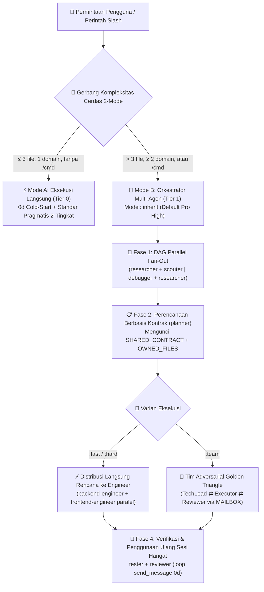

<div align="center">
  <h1>⚡ BoomOpen Workflow Kit v5.5.0</h1>
  <p><strong>Sistem Operasi Workforce AI Smart-Hybrid Multi-Platform — 21 Agen Spesialis, 17 Tim Golden Triangle &amp; Gudang 1.450+ Skill Sesuai Permintaan</strong></p>

  <p>
    <a href="https://github.com/Kennyboom/BoomOpen-Workflow-Kit/releases"></a>
    <a href="#platforms"></a>
    <a href="#agents"></a>
    <a href="#pillars"></a>
    <a href="https://nodejs.org/">=18.0.0" /></a>
    <a href="../LICENSE"></a>
  </p>

  <p>
    <a href="../README.md">🇬🇧 English</a> • <a href="./README.vi.md">🇻🇳 Tiếng Việt</a> • <a href="./README.zh-CN.md">🇨🇳 简体中文</a> • <a href="./README.zh-TW.md">🇹🇼 繁體中文</a> • <a href="./README.ja.md">🇯🇵 日本語</a> • <a href="./README.ko.md">🇰🇷 한국어</a> • <a href="./README.es.md">🇪🇸 Español</a> • <a href="./README.fr.md">🇫🇷 Français</a> • <a href="./README.de.md">🇩🇪 Deutsch</a><br/>
    <a href="./README.pt-BR.md">🇧🇷 Português</a> • <a href="./README.ru.md">🇷🇺 Русский</a> • <a href="./README.hi.md">🇮🇳 हिन्दी</a> • <a href="./README.ar.md">🇸🇦 العربية</a> • <b>🇮🇩 Bahasa Indonesia</b> • <a href="./README.th.md">🇹🇭 ไทย</a> • <a href="./README.tr.md">🇹🇷 Türkçe</a> • <a href="./README.it.md">🇮🇹 Italiano</a>
  </p>
</div>

---

## 🎬 Trailer Peluncuran Resmi (Full HD 1080p)

<div align="center">
  <a href="https://github.com/Kennyboom/BoomOpen-Workflow-Kit/raw/main/assets/media/boomopen_v55_trailer_en.mp4">
    
  </a>
  <p>
    ▶️ <a href="https://github.com/Kennyboom/BoomOpen-Workflow-Kit/raw/main/assets/media/boomopen_v55_trailer_en.mp4"><b>Klik di sini untuk menonton / streaming Trailer Peluncuran Resmi Full HD 1080p (MP4 dengan sulih suara studio)</b></a>
  </p>
</div>

---

## 🌟 Apa itu BoomOpen Workflow Kit v5.5?

**BoomOpen Workflow Kit v5.5 (Multi-Platform Unified & Smart-Hybrid Edition)** adalah sistem operasi multi-agen sumber terbuka (open-source) yang mengubah satu asisten coding AI menjadi organisasi rekayasa perangkat lunak terkoordinasi yang terdiri dari **21 agen spesialis**, **17 tim adversarial Golden Triangle**, **48 keahlian inti (Core Skills)**, dan **1.450+ keahlian pustaka khusus (`skills_library`)**.

Tidak seperti template prompt tunggal yang kaku atau wrapper agen berat yang menimbulkan latensi cold-start pada setiap pertanyaan sederhana, BoomOpen v5.5 menghadirkan **Gerbang Ambang Kompleksitas Cerdas 2-Mode (2-Mode Smart Complexity Threshold Gate)**:
- **⚡ Mode A — Eksekusi Langsung (0d Cold-Start)**: Tanya jawab (Q&A) sederhana, penjelasan kode, perbaikan bug satu domain, atau perubahan jelas yang menyentuh **≤ 3 file** (tanpa perintah `/cmd`) dieksekusi, diuji, dan diverifikasi **secara langsung** oleh agen utama sambil menerapkan **Standar Pengkodean Pragmatis 2-Tingkat** serta **Pengujian & Perbaikan Bug Persisten**.
- **🎻 Mode B — Orkestrasi Multi-Agen Ketat**: Fitur kompleks (**> 3 file** atau **≥ 2 domain**) atau pemanggilan perintah `/cmd` eksplisit mengaktifkan mode Orkestrator ketat dengan **DAG Parallel Fan-Out**, **Direct Plan-to-Executor Dispatch**, **Kunci Kepemilikan File Berbasis Kontrak (`SHARED_CONTRACT` + `OWNED_FILES`)**, dan **Penggunaan Ulang Sub-agen Hangat (`send_message`)**.

- **📚 Gudang 1.450+ Skill Masif Tanpa Pembengkakan Konteks (Zero Context Bloat)**: Menggabungkan **48 Core Skills (`skills/`)** dan **1.450+ Niche Library Skills (`skills_library/`)** yang telah dikompilasi ke `matrix-skills/compact-index.json` untuk pencarian `O(1)` 2 langkah — memberikan penguasaan instan di Backend, Frontend, Mobile, Game Dev (Unity/Unreal/Godot), AI/ML, BigQuery/Data, Cloud/DevOps, dan Keamanan OWASP tanpa memenuhi jendela prompt.

---

## 🏗️ Arsitektur Smart-Hybrid (v5.5)



---

## 🧠 6 Pilar Utama v5.5

1. **🌐 Paritas Terpadu di 5 Platform (`platforms/*`)**:
   - Instalasi native kelas satu untuk **Google Antigravity 2.0 (Gemini)**, **Claude Code**, **OpenAI Codex**, **Cursor**, dan **GitHub Copilot** dari satu arsitektur terpadu.
2. **📏 Standar Pengkodean Pragmatis 2-Tingkat (Anti-Fragmentasi)**:
   - **Tingkat 1 — Aturan Kualitas & Keamanan Ketat (Toleransi Nol)**: Tanggung Jawab Tunggal (Single Responsibility), **DILARANG `any` eksplisit**, **DILARANG meninggalkan `console.log` debug** di kode produksi, wajib `try/catch` + penanganan error bertipe pada batas async/API, konstanta `SCREAMING_SNAKE_CASE`, DRY (`≥ 3`), dan import yang rapi.
   - **Tingkat 2 — Panduan Struktural Fleksibel (Kohesi di Atas Pemotongan Baris Mekanis)**: File kohesif menargetkan `~200–350 baris` dengan batas lunak `~400–450 baris` (pemisahan wajib hanya jika `>500 baris` atau mencampur banyak domain; file test, tipe/skema, CLI, dan dokumen dikecualikan). Fungsi logika `~20–40 baris` (`~40–80 baris` untuk UI/Handler).
3. **🎯 Distribusi Langsung Rencana ke Pelaksana & Penggunaan Ulang Sub-agen Hangat (`send_message`)**:
   - Setelah `PLAN-{feature}.md` tersedia, Orkestrator mengirimkan tugas **secara langsung** ke engineer domain (`backend-engineer`, `frontend-engineer`, `database-architect`, dll.) tanpa lompatan perantara `tech-lead` yang berlebihan.
   - Sub-agen aktif dicatat dalam **Registri Sesi Aktif (`Role → conversationId`)** dan digunakan kembali melalui `send_message` dengan **latensi cold-start 0 detik** serta **100% konteks file tetap terjaga**.
4. **🤝 Distribusi Paralel Berbasis Kontrak (`SHARED_CONTRACT` + `OWNED_FILES`)**:
   - Rencana lintas domain mengunci endpoint API, skema DTO, dan kepemilikan penulisan file eksklusif (`OWNED_FILES` vs. `READ_ONLY_FILES`) sebelum menjalankan engineer secara paralel, menghilangkan bentrokan penulisan file.
5. **🔍 Debugging Akar Masalah 5-Whys (SPIE v3.0) & Pohon Git 100% Bersih**:
   - `debugger` melacak setiap bug melalui minimal 3 hipotesis terurut dan rantai kausal **5-Whys** (`Why 1 Gejala Langsung` → `Why 5 Akar Masalah Sistemik`). Artefak sementara (`PLAN`, `DEBUG`, `TEST`, `REVIEW`, `MAILBOX`) diarahkan ke `<appDataDir>\brain\<conversation-id>\` terlebih dahulu agar pohon kerja Git tetap 100% bersih.
6. **🩺 Diagnostik CLI Bawaan (`doctor` & `check`) & Indeks Keahlian O(1)**:
   - `npm run doctor` memvalidasi 5 bundel platform, 21 agen, 51 file tim, 72 perintah, dan `matrix-skills/compact-index.json` (`1.450+` keahlian terindeks). `npm run check <dir>` mengaudit standar kode Tingkat 1 & Tingkat 2 secara otomatis.

---

## 💻 Platform AI yang Didukung

| Platform | Tingkat Dukungan | Entrypoint Global | Jalur Instalasi Framework |
|----------|:-------------:|-------------------|------------------------|
| **Antigravity (Gemini)** | ✅ Native v5.5 | `~/.gemini/GEMINI.md` | `~/.gemini/config/skills/boomopen-workflow-kit/` |
| **Claude Code** | ✅ Native v5.5 | `~/.claude/CLAUDE.md` | `~/.claude/skills/boomopen-workflow-kit/` |
| **OpenAI Codex** | ✅ Native v5.5 | `~/.codex/CODEX.md` & `AGENTS.md` | `~/.codex/skills/boomopen-workflow-kit/` |
| **Cursor** | ✅ Native v5.5 | `~/.cursor/rules/boomopen-workflow-kit.mdc` | `~/.cursor/skills/boomopen-workflow-kit/` |
| **GitHub Copilot** | ✅ Native v5.5 | `~/.copilot/COPILOT.md` | `~/.copilot/skills/boomopen-workflow-kit/` |

---

## 🚀 Mulai Cepat & Instalasi

```bash
# 1. Clone repositori
git clone https://github.com/Kennyboom/BoomOpen-Workflow-Kit.git
cd BoomOpen-Workflow-Kit

# 2. Instal untuk asisten coding AI Anda (pilih satu atau --all)
npm run install:antigravity   # Google Antigravity 2.0 (Gemini)
npm run install:claude        # Anthropic Claude Code
npm run install:codex         # OpenAI Codex CLI
npm run install:cursor        # Cursor AI Editor
npm run install:copilot       # GitHub Copilot (VS Code)
npm run install:all           # Instal untuk kelima platform sekaligus

# 3. Verifikasi kesehatan instalasi, standar kode 2-tingkat & suite pengujian
npm run doctor
npm run check ./cli
npm test
```

---

## 🎛️ Pengaturan Terpadu & Pemilihan Mode (`/settings` Control Center)

BoomOpen v5.5 menghadirkan **Pusat Kontrol Terpadu Tanpa Latensi** yang memungkinkan Anda mengganti mode eksekusi (`auto`, `mode_a`, `mode_b`, `team`), 4 profil preset sekali klik, dan 12 pengaturan sistem di **5 platform** dalam `< 10ms` (**latensi Turn-1 0ms**):

| Profil Preset (`Preset`) | Mode Eksekusi (`execution.mode`) | Varian Default | Riset Bahasa Alami (`naturalLanguageResearchTrigger`) | Standar Kode (`codingStandards`) | Penggunaan Terbaik |
|:---|:---|:---:|:---:|:---:|:---|
| **⚡ `smart-hybrid`** *(Rekomendasi Default)* | **`auto`** (`≤ 3 file` → Mode A Langsung; `> 3 file` atau `/cmd` → Mode B) | `auto` | **`auto_team`** *(Otomatis mengarahkan riset/ide ke `/brainstorm:team` Golden Triangle)* | `pragmatic` (`400/500` baris) | Rekayasa full-stack harian — cepat untuk tugas kecil, mendalam untuk arsitektur kompleks |
| **🚀 `solo-fast`** | **`mode_a`** *(Paksa Eksekusi Solo Langsung, latensi sub-agen 0 detik)* | `fast` | `off` *(Balasan chat langsung kecuali mengetik `/brainstorm`)* | `relaxed` (`600/800` baris) | Hotfix mendesak, pembuatan prototipe cepat, skrip & hemat token maksimal |
| **🧠 `deep-architect`** | **`mode_b`** *(Paksa Orkestrator Multi-Agen Mode B pada setiap tugas)* | `hard` | `auto_hard` *(Otomatis menjalankan riset 5-Lensa `/brainstorm:hard`)* | `strict` (`300/400` baris) | Arsitektur sistem kompleks, desain proyek baru & refactoring lintas domain |
| **🔺 `adversarial-team`** | **`team`** *(Paksa tim Golden Triangle 3-Agen `:team` di semua workflow)* | `team` | **`auto_team`** *(Debat & tinjauan silang 3-Agen via `MAILBOX`)* | `strict` (`300/400` baris) | Kode produksi kritis, audit keamanan & rilis tanpa cacat (zero-defect) |

### Tiga Cara Mengubah Mode (Chat `/settings`, Dashboard Web Lokal & CLI)

```bash
# 1. Perintah Slash di Chat (Menu interaktif atau perintah satu baris)
/settings                                     # Buka menu pilihan interaktif (ask_question UI)
/settings preset smart-hybrid                 # Beralih ke rekomendasi default (Auto Mode A/B + auto_team)
/settings preset solo-fast                    # Beralih ke Eksekusi Cepat Langsung (Mode A)
/settings preset deep-architect               # Beralih ke Orkestrator Multi-Agen (Mode B)
/settings preset adversarial-team             # Beralih ke Tim Golden Triangle 3-Agen (:team)
/settings mode auto | mode_a | mode_b | team  # Ganti mode eksekusi (execution.mode) secara langsung

# 2. Dashboard Web Control Center Lokal (http://127.0.0.1:4567)
npm run settings:ui

# 3. Terminal CLI (Global ~/.boomopen/settings.json & Proyek ./.boomopen.json)
npm run settings -- status
npm run settings -- preset adversarial-team
npm run settings -- reset
```

---

## 🎯 Referensi Perintah Slash

| Perintah | Varian | Tujuan Utama |
|---------|----------|-----------------|
| **`/cook`** | `:fast`, `:hard`, `:team` | Pengembangan fitur ujung-ke-ujung (Riset/Scout → Rencana → Kode Paralel → Uji → Tinjauan) |
| **`/code`** | `:fast`, `:hard`, `:team` | Menjalankan implementasi langsung dari `PLAN-{feature}.md` yang sudah ada |
| **`/plan`** | `:fast`, `:hard`, `:team` | Membuat cetak biru implementasi dengan `SHARED_CONTRACT`, `OWNED_FILES` & kriteria Given/When/Then |
| **`/fix`** | `:fast`, `:hard`, `:team` | Penyelesaian bug akar masalah dengan verifikasi uji regresi wajib |
| **`/debug`** | `:fast`, `:hard`, `:team` | Investigasi akar masalah 3-Hipotesis + rantai kausal **5-Whys (SPIE v3.0)** (`DEBUG-{issue}.md`) |
| **`/test`** | `:fast`, `:hard`, `:team` | Eksekusi paralel DAG suite pengujian + pencarian edge-case yang belum tercakup (`tester` + `scouter`) |
| **`/review`** | `:fast`, `:hard`, `:team` | Audit paralel 4 arah (Arsitektur, Kualitas Kode, Keamanan OWASP, Performa) |
| **`/design`** | `:fast`, `:hard`, `:team` | Arsitektur sistem, skema database, dan spesifikasi UI/UX (`DESIGN.md`) |
| **`/docs`** | `:core`, `:business`, `:audit` | Membuat atau menyinkronkan dokumentasi arsitektur & bisnis terstruktur 2-tingkat (`./documents/`) |
| **`/deploy`** | `:check`, `:preview`, `:production`, `:rollback` | Pemeriksaan kesiapan pra-deploy, lingkungan preview, rilis produksi & rollback aman |
| **`/brainstorm`** | `:fast`, `:hard`, `:team` | Penemuan kebutuhan metode Sokrates, analisis trade-off & pencarian ide |
| **`/report`** | `:fast`, `:hard`, `:team` | Laporan sintesis eksekutif & teknis lengkap dengan metrik dan diagram |
| **`/orchestrate`** | — | Orkestrasi pipeline multi-agen khusus lintas berbagai domain |
| **`/settings` / `/config`** | `preset`, `mode`, `set`, `ui` | Pusat Kontrol Terpadu: ubah `Auto` / `Mode A` / `Mode B` / `Team`, preset, atau buka Web UI (`--ui`) |
| **`/save` / `/recap`** | — | Menyimpan status sesi (`SESSION-HANDOVER.md`) dan memulihkan konteks penuh dalam `< 5 detik` |

---

## 🤖 21 Agen Spesialis & 17 Tim Golden Triangle

| Kategori | Agen Spesialis (`agents/*.md`) | Tim Golden Triangle (`agents/teams/*-team/`) |
|----------|-----------------------------------|------------------------------------------------|
| **Rekayasa & Eksekusi** | `backend-engineer`, `frontend-engineer`, `mobile-engineer`, `game-engineer`, `database-architect`, `devops-engineer` | `backend-team`, `frontend-team`, `fullstack-team`, `mobile-team`, `game-team`, `database-team`, `devops-team` |
| **Arsitektur & Perencanaan** | `tech-lead`, `planner`, `brainstormer`, `business-analyst`, `project-manager`, `designer` | `planning-team`, `project-team`, `design-team` |
| **Kualitas, Keamanan & Debugging** | `debugger`, `tester`, `reviewer`, `security-engineer`, `performance-engineer` | `debug-team`, `qa-team`, `review-team`, `security-team`, `performance-team` |
| **Riset & Pengetahuan** | `researcher`, `scouter`, `docs-manager`, `reporter` | `research-team`, `docs-team`, `report-team` |

---

## 📚 Gudang 1.450+ Skill (48 Skill Inti + 1.450+ Skill Pustaka)

BoomOpen hadir dengan salah satu ekosistem skill rekayasa perangkat lunak terbesar di open source — dirancang untuk **0 beban token saat idle** melalui **Resolusi Skill Progresif O(1) 2 Langkah** (`<skills>` → `matrix-skills/compact-index.json` → muat `SKILL.md` tepat saat dibutuhkan):

| Tingkatan / Domain Skill | Jumlah | Skill & Kapabilitas Utama | Mekanisme Pemuatan |
|:---|:---:|:---|:---|
| **⚡ Tier 1: Skill Inti (`skills/`)** | **48** | `clean-code`, `systematic-debugging`, `plan-writing`, `brainstorming`, `frontend-design`, `api-patterns`, `database-design`, `testing-patterns`, `vulnerability-scanner`, `skill-seeker` | Terindeks di `<skills>` untuk akses instan di Turn 1 |
| **🌐 Web, Backend & Sistem Terdistribusi** | **380+** | Next.js/React 19, FastAPI, NestJS, microservice Go/Rust, GraphQL, gRPC, arsitektur berbasis event Redis/Kafka, SaaS multi-tenant | Sesuai permintaan via `compact-index.json` (`skills_library/`) |
| **🤖 AI, Agen LLM & Rekayasa Data** | **310+** | Pipeline RAG, server LangGraph/MCP, prompt engineering, Vertex AI, analitik BigQuery, dbt, Spark, database vektor | Sesuai permintaan via `compact-index.json` (`skills_library/`) |
| **☁️ Cloud, DevOps, Kubernetes & Keamanan** | **290+** | Terraform/OpenTofu, arsitektur AWS/GCP/Azure, Docker/K8s GitOps, pipeline CI/CD, audit OWASP Top 10, autentikasi Zero-Trust | Sesuai permintaan via `compact-index.json` (`skills_library/`) |
| **📱 Mobile, Game Engine & Domain Khusus** | **450+** | iOS Swift/SwiftUI, Android Kotlin, React Native, Flutter, Unity 6, Unreal Engine 5, Godot 4, WebGL/Three.js, Keuangan Kuantitatif, Web3 | Sesuai permintaan via `compact-index.json` (`skills_library/`) |

---

## 📂 Struktur Repositori

```text
BoomOpen-Workflow-Kit/
├── agents/                  # 21 definisi Agen Spesialis + 17 Tim Golden Triangle (51 file peran)
├── cli/                     # Installer (install.js), Health Doctor (doctor.js), Pemeriksa Kode 2-Tingkat (checker.js) & Pengujian
├── commands/                # 72 alur kerja perintah Slash (:fast, :hard, :team) + protokol _ref/
├── documents/               # Dokumentasi Arsitektur, Domain, Basis Kode & Standar Pengkodean 2-tingkat
├── i18n/                    # Dokumentasi multibahasa (16 terjemahan README lengkap)
├── matrix-skills/           # Matriks keahlian YAML per domain + compact-index.json terkompilasi (1.450+ keahlian)
├── platforms/               # Template terpadu untuk 5 platform (antigravity/, claude/, codex/, copilot/, cursor/)
├── rules/                   # Aturan Mode B sesuai permintaan (CORE, PHASES, AGENTS, TEAMS, SKILLS, ERRORS, REFERENCE)
├── scripts/                 # Skrip otomatisasi & verifikasi Python (checklist.py, verify_all.py, dll.)
├── skills/                  # 48 Keahlian Inti (clean-code, debugger, plan-writing, frontend-design, dll.)
├── skills_library/          # 1.450+ keahlian khusus yang dimuat sesuai permintaan melalui pencarian cepat 2 langkah
└── GEMINI.md | CLAUDE.md | CODEX.md | COPILOT.md | CURSOR.md | AGENT.md
```

---

## 📄 Lisensi & Keamanan

- **Lisensi**: Didistribusikan di bawah [Lisensi MIT](../LICENSE). Hak Cipta © 2026 **Kennyboom (BoomOpen)**.
- **Kebijakan Keamanan**: Lihat [SECURITY.md](../SECURITY.md) untuk perlindungan keamanan bawaan dan panduan pelaporan kerentanan.
