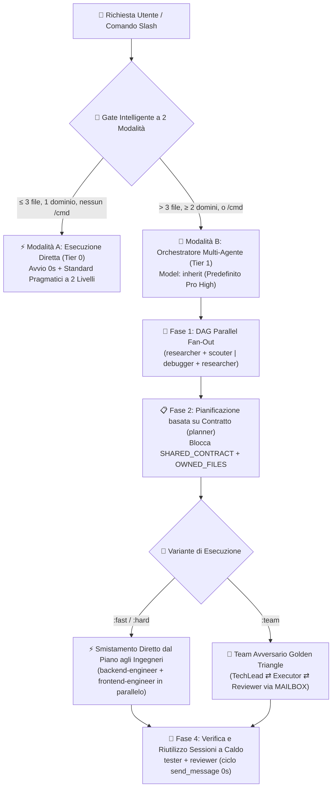

<div align="center">
  <h1>⚡ BoomOpen Workflow Kit v5.5.0</h1>
  <p><strong>Sistema Operativo AI Smart-Hybrid Multipiattaforma e Framework di Orchestrazione Multi-Agente</strong></p>

  [](https://github.com/Kennyboom/BoomOpen-Workflow-Kit/releases)
  [](#)
  [](#)
  [](#)
  [](https://nodejs.org/)
  [](../LICENSE)

  <p>
    [🇬🇧 English](../README.md) • [🇻🇳 Tiếng Việt](./README.vi.md) • [🇨🇳 简体中文](./README.zh-CN.md) • [🇹🇼 繁體中文](./README.zh-TW.md) • [🇯🇵 日本語](./README.ja.md) • [🇰🇷 한국어](./README.ko.md) • [🇪🇸 Español](./README.es.md) • [🇫🇷 Français](./README.fr.md) • [🇩🇪 Deutsch](./README.de.md)<br/>
    [🇧🇷 Português](./README.pt-BR.md) • [🇷🇺 Русский](./README.ru.md) • [🇮🇳 हिन्दी](./README.hi.md) • [🇸🇦 العربية](./README.ar.md) • [🇮🇩 Bahasa Indonesia](./README.id.md) • [🇹🇭 ไทย](./README.th.md) • [🇹🇷 Türkçe](./README.tr.md) • **🇮🇹 Italiano**
  </p>
</div>

---

## 🎬 Official Launch Trailer (Full HD 1080p)

<div align="center">
  <a href="https://github.com/Kennyboom/BoomOpen-Workflow-Kit/raw/main/assets/media/boomopen_v55_trailer_en.mp4">
    
  </a>
  <p>
    ▶️ <a href="https://github.com/Kennyboom/BoomOpen-Workflow-Kit/raw/main/assets/media/boomopen_v55_trailer_en.mp4"><b>Watch / Stream Full HD English Trailer (MP4)</b></a>
    &nbsp;|&nbsp;
    🇻🇳 <a href="https://github.com/Kennyboom/BoomOpen-Workflow-Kit/raw/main/assets/media/boomopen_v55_trailer_vi.mp4"><b>Xem Bản Tiếng Việt</b></a>
  </p>
</div>

---

## 🌟 Cos’è BoomOpen Workflow Kit v5.5?

**BoomOpen Workflow Kit v5.5 (Multi-Platform Unified & Smart-Hybrid Edition)** è un sistema operativo multi-agente open-source che trasforma un singolo assistente di programmazione AI in un’organizzazione di ingegneria del software coordinata composta da **21 agenti specialisti**, **17 team avversari Golden Triangle**, **48 competenze chiave (Core Skills)** e **oltre 1.430 competenze specialistiche di libreria (`skills_library`)**.

A differenza dei template rigidi o dei wrapper pesanti che introducono latenza di avvio a freddo ad ogni semplice domanda, BoomOpen v5.5 introduce un **Gate Intelligente di Complessità a 2 Modalità (2-Mode Smart Complexity Threshold Gate)**:
- **⚡ Modalità A — Esecuzione Diretta (Cold-Start 0s)**: Domande e risposte (Q&A), spiegazioni del codice, bugfix su singolo dominio o modifiche chiare che toccano **≤ 3 file** (senza comandi `/cmd`) vengono eseguite, testate e verificate **direttamente** dall’agente principale applicando gli **Standard di Codifica Pragmatici a 2 Livelli** e **Test e Risoluzione Persistente dei Bug**.
- **🎻 Modalità B — Orchestrazione Multi-Agente Rigorosa**: Funzionalità complesse (**> 3 file** o **≥ 2 domini**) o comandi espliciti `/cmd` attivano la modalità Orchestratore rigorosa con **DAG Parallel Fan-Out**, **Direct Plan-to-Executor Dispatch**, **Blocchi di Proprietà dei File basati su Contratto (`SHARED_CONTRACT` + `OWNED_FILES`)** e **Riutilizzo a Caldo dei Sub-agenti (`send_message`)**.

---

## 🏗️ Architettura Smart-Hybrid (v5.5)



---

## 🧠 I 6 Pilastri Fondamentali della v5.5

1. **🌐 Parità Unificata su 5 Piattaforme (`platforms/*`)**:
   - Installazione nativa di prima classe per **Google Antigravity 2.0 (Gemini)**, **Claude Code**, **OpenAI Codex**, **Cursor** e **GitHub Copilot** da un’unica architettura unificata.
2. **📏 Standard di Codifica Pragmatici a 2 Livelli (Anti-Frammentazione)**:
   - **Livello 1 — Qualità e Sicurezza Rigorose (Tolleranza Zero)**: Singola Responsabilità (Single Responsibility), **VIETATO `any` esplicito**, **VIETATO lasciare `console.log` di debug** nel codice di produzione, gestione errori tipizzata con `try/catch` ai confini async/API, costanti in `SCREAMING_SNAKE_CASE`, DRY (`≥ 3`) e import ordinati.
   - **Livello 2 — Linee Guida Strutturali Flessibili (Coesione Prima del Taglio Meccanico)**: I file coesi puntano a `~200–350 righe` con un tetto flessibile di `~400–450 righe` (divisione obbligatoria solo oltre `>500 righe` o se mescolano più domini; test, tipi, CLI e docs sono esenti). Funzioni logiche `~20–40 righe` (`~40–80 righe` per UI/Handler).
3. **🎯 Smistamento Diretto dal Piano all’Esecutore e Riutilizzo a Caldo (`send_message`)**:
   - Una volta creato `PLAN-{feature}.md`, l’Orchestratore assegna i task **direttamente** agli ingegneri di dominio (`backend-engineer`, `frontend-engineer`, `database-architect`, ecc.) senza passaggi intermedi superflui tramite `tech-lead`.
   - I sub-agenti attivi vengono salvati nel **Registro delle Sessioni Attive (`Role → conversationId`)** e riutilizzati tramite `send_message` con **latenza di avvio 0s** e **100% del contesto file preservato**.
4. **🤝 Esecuzione Parallela basata su Contratto (`SHARED_CONTRACT` + `OWNED_FILES`)**:
   - I piani multidominio bloccano gli endpoint API, gli schemi DTO e la proprietà esclusiva di scrittura dei file (`OWNED_FILES` vs. `READ_ONLY_FILES`) prima di avviare gli ingegneri in parallelo, eliminando ogni conflitto di scrittura.
5. **🔍 Debugging della Causa Radice 5-Whys (SPIE v3.0) e Albero Git Pulito al 100%**:
   - `debugger` analizza ogni bug attraverso almeno 3 ipotesi classificate e una catena causale **5-Whys** (`Perché 1 Sintomo` → `Perché 5 Causa Radice Sistemica`). Gli artefatti temporanei (`PLAN`, `DEBUG`, `TEST`, `REVIEW`, `MAILBOX`) vengono salvati in `<appDataDir>\brain\<conversation-id>\` mantenendo l’albero di lavoro Git pulito al 100%.
6. **🩺 Diagnostica CLI Integrata (`doctor` & `check`) e Indice Competenze O(1)**:
   - `npm run doctor` convalida tutti i 5 pacchetti piattaforma, 21 agenti, 51 file di team, 72 comandi e `matrix-skills/compact-index.json` (`1.430+` competenze indicizzate). `npm run check <dir>` verifica automaticamente gli standard di Livello 1 e Livello 2.

---

## 💻 Piattaforme AI Supportate

| Piattaforma | Livello di Supporto | Entrypoint Globale | Percorso di Installazione del Framework |
|----------|:-------------:|-------------------|------------------------|
| **Antigravity (Gemini)** | ✅ Nativo v5.5 | `~/.gemini/GEMINI.md` | `~/.gemini/config/skills/boomopen-workflow-kit/` |
| **Claude Code** | ✅ Nativo v5.5 | `~/.claude/CLAUDE.md` | `~/.claude/skills/boomopen-workflow-kit/` |
| **OpenAI Codex** | ✅ Nativo v5.5 | `~/.codex/CODEX.md` & `AGENTS.md` | `~/.codex/skills/boomopen-workflow-kit/` |
| **Cursor** | ✅ Nativo v5.5 | `~/.cursor/rules/boomopen-workflow-kit.mdc` | `~/.cursor/skills/boomopen-workflow-kit/` |
| **GitHub Copilot** | ✅ Nativo v5.5 | `~/.copilot/COPILOT.md` | `~/.copilot/skills/boomopen-workflow-kit/` |

---

## 🚀 Avvio Rapido e Installazione

```bash
# 1. Clona il repository
git clone https://github.com/Kennyboom/BoomOpen-Workflow-Kit.git
cd BoomOpen-Workflow-Kit

# 2. Installa per il tuo assistente di programmazione AI (scegline uno o --all)
npm run install:antigravity   # Google Antigravity 2.0 (Gemini)
npm run install:claude        # Anthropic Claude Code
npm run install:codex         # OpenAI Codex CLI
npm run install:cursor        # Cursor AI Editor
npm run install:copilot       # GitHub Copilot (VS Code)
npm run install:all           # All 5 platforms

# 3. Verifica lo stato dell’installazione, gli standard a 2 livelli e la suite di test
npm run doctor
npm run check ./cli
npm test
```

---

## 🎛️ Unified Settings & Mode Selection (`/settings` Control Center)

Switch execution modes (`auto` | `mode_a` | `mode_b` | `team`), 4 one-click presets (`smart-hybrid`, `solo-fast`, `deep-architect`, `adversarial-team`), and 12 system settings across all 5 platforms in `< 10ms` with **0ms Turn-1 latency**:

```bash
# 1. In-Chat Slash Command (Interactive UI Widget or One-Liner)
/settings                                     # Open interactive ask_question menu
/settings preset smart-hybrid                 # Default Recommended (Auto Mode A/B + auto_team)
/settings preset solo-fast                    # Force Mode A Direct Fast Execution
/settings preset deep-architect               # Force Mode B Multi-Agent Orchestrator
/settings preset adversarial-team             # Force Golden Triangle 3-Agent (:team)
/settings mode auto | mode_a | mode_b | team  # Override execution.mode directly

# 2. Local Web Control Center Dashboard (http://127.0.0.1:4567)
npm run settings:ui

# 3. Terminal CLI (Global ~/.boomopen/settings.json & Project ./.boomopen.json)
npm run settings -- status
npm run settings -- preset adversarial-team
npm run settings -- reset
```

---

## 🎯 Riferimento Comandi Slash

| Comando | Varianti | Scopo Principale |
|---------|----------|-----------------|
| **`/cook`** | `:fast`, `:hard`, `:team` | Sviluppo completo di funzionalità end-to-end (Ricerca/Scout → Piano → Codice Parallelo → Test → Revisione) |
| **`/code`** | `:fast`, `:hard`, `:team` | Esegue l’implementazione direttamente a partire da un `PLAN-{feature}.md` esistente |
| **`/plan`** | `:fast`, `:hard`, `:team` | Crea blueprint di implementazione con `SHARED_CONTRACT`, `OWNED_FILES` e criteri Given/When/Then |
| **`/fix`** | `:fast`, `:hard`, `:team` | Risoluzione dei bug alla radice con verifica obbligatoria tramite test di regressione |
| **`/debug`** | `:fast`, `:hard`, `:team` | Indagine della causa radice con 3 ipotesi + catena causale **5-Whys (SPIE v3.0)** (`DEBUG-{issue}.md`) |
| **`/test`** | `:fast`, `:hard`, `:team` | Esecuzione parallela DAG delle suite di test + ricerca di casi limite non coperti (`tester` + `scouter`) |
| **`/review`** | `:fast`, `:hard`, `:team` | Audit parallelo a 4 dimensioni (Architettura, Qualità del Codice, Sicurezza OWASP, Prestazioni) |
| **`/design`** | `:fast`, `:hard`, `:team` | Architettura di sistema, schema del database e specifiche UI/UX (`DESIGN.md`) |
| **`/docs`** | `:core`, `:business`, `:audit` | Genera o sincronizza la documentazione strutturata a 2 livelli di architettura e business (`./documents/`) |
| **`/deploy`** | `:check`, `:preview`, `:production`, `:rollback` | Controlli pre-deploy, ambienti di anteprima, rilascio in produzione e rollback sicuro |
| **`/brainstorm`** | `:fast`, `:hard`, `:team` | Scoperta socratica dei requisiti, analisi dei trade-off e ideazione |
| **`/report`** | `:fast`, `:hard`, `:team` | Report di sintesi esecutivi e tecnici completi di metriche e diagrammi |
| **`/orchestrate`** | — | Orchestrazione personalizzata di pipeline multi-agente attraverso più domini |
| **`/save` / `/recap`** | — | Salva lo stato della sessione (`SESSION-HANDOVER.md`) e ripristina l’intero contesto in `< 5s` |

---

## 🤖 21 Agenti Specialisti e 17 Team Golden Triangle

| Categoria | Agenti Specialisti (`agents/*.md`) | Team Golden Triangle (`agents/teams/*-team/`) |
|----------|-----------------------------------|------------------------------------------------|
| **Ingegneria ed Esecuzione** | `backend-engineer`, `frontend-engineer`, `mobile-engineer`, `game-engineer`, `database-architect`, `devops-engineer` | `backend-team`, `frontend-team`, `fullstack-team`, `mobile-team`, `game-team`, `database-team`, `devops-team` |
| **Architettura e Pianificazione** | `tech-lead`, `planner`, `brainstormer`, `business-analyst`, `project-manager`, `designer` | `planning-team`, `project-team`, `design-team` |
| **Qualità, Sicurezza e Debugging** | `debugger`, `tester`, `reviewer`, `security-engineer`, `performance-engineer` | `debug-team`, `qa-team`, `review-team`, `security-team`, `performance-team` |
| **Ricerca e Conoscenza** | `researcher`, `scouter`, `docs-manager`, `reporter` | `research-team`, `docs-team`, `report-team` |

---

## 📂 Struttura del Repository

```text
BoomOpen-Workflow-Kit/
├── agents/                  # 21 definizioni di Agenti Specialisti + 17 Team Golden Triangle (51 file di ruolo)
├── cli/                     # Installer (install.js), Health Doctor (doctor.js), Verificatore a 2 Livelli (checker.js) e Test
├── commands/                # 72 workflow di comandi Slash (:fast, :hard, :team) + protocolli _ref/
├── documents/               # Documentazione a 2 livelli di Architettura, Dominio, Codice Sorgente e Standard
├── i18n/                    # Documentazione multilingue (16 traduzioni complete del README)
├── matrix-skills/           # Matrici YAML delle competenze per dominio + compact-index.json precompilato (1.430+ competenze)
├── platforms/               # Template unificati per le 5 piattaforme (antigravity/, claude/, codex/, copilot/, cursor/)
├── rules/                   # Regole Modalità B caricate su richiesta (CORE, PHASES, AGENTS, TEAMS, SKILLS, ERRORS, REFERENCE)
├── scripts/                 # Script Python di automazione e verifica (checklist.py, verify_all.py, ecc.)
├── skills/                  # 48 Competenze Chiave (clean-code, debugger, plan-writing, frontend-design, ecc.)
├── skills_library/          # Oltre 1.430 competenze specialistiche caricate su richiesta tramite ricerca rapida in 2 passaggi
└── GEMINI.md | CLAUDE.md | CODEX.md | COPILOT.md | CURSOR.md | AGENT.md
```

---

## 📄 Licenza e Sicurezza

- **Licenza**: Distribuito sotto [Licenza MIT](../LICENSE). Copyright © 2026 **Kennyboom (BoomOpen)**.
- **Politica di Sicurezza**: Consulta [SECURITY.md](../SECURITY.md) per le protezioni di sicurezza integrate e le linee guida sulla segnalazione delle vulnerabilità.
