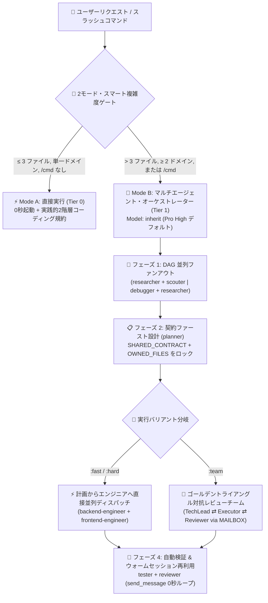

<div align="center">
  <h1>⚡ BoomOpen Workflow Kit v5.5.0</h1>
  <p><strong>マルチプラットフォーム対応 スマートハイブリッド AI 開発 OS — 21 名の専門エージェント、17 組のゴールデントライアングル・チーム &amp; 1,430+ オンデマンドスキル宝庫</strong></p>

  <p>
    <a href="https://github.com/Kennyboom/BoomOpen-Workflow-Kit/releases"></a>
    <a href="#platforms"></a>
    <a href="#agents"></a>
    <a href="#pillars"></a>
    <a href="https://nodejs.org/">=18.0.0" /></a>
    <a href="../LICENSE"></a>
  </p>

  <p>
    <a href="../README.md">🇬🇧 English</a> • <a href="./README.vi.md">🇻🇳 Tiếng Việt</a> • <a href="./README.zh-CN.md">🇨🇳 简体中文</a> • <a href="./README.zh-TW.md">🇹🇼 繁體中文</a> • <b>🇯🇵 日本語</b> • <a href="./README.ko.md">🇰🇷 한국어</a> • <a href="./README.es.md">🇪🇸 Español</a> • <a href="./README.fr.md">🇫🇷 Français</a> • <a href="./README.de.md">🇩🇪 Deutsch</a><br/>
    <a href="./README.pt-BR.md">🇧🇷 Português</a> • <a href="./README.ru.md">🇷🇺 Русский</a> • <a href="./README.hi.md">🇮🇳 हिन्दी</a> • <a href="./README.ar.md">🇸🇦 العربية</a> • <a href="./README.id.md">🇮🇩 Bahasa Indonesia</a> • <a href="./README.th.md">🇹🇭 ไทย</a> • <a href="./README.tr.md">🇹🇷 Türkçe</a> • <a href="./README.it.md">🇮🇹 Italiano</a>
  </p>
</div>

---

## 🎬 公式ローンチトレーラー (Full HD 1080p)

<div align="center">
  <a href="https://github.com/Kennyboom/BoomOpen-Workflow-Kit/raw/main/assets/media/boomopen_v55_trailer_en.mp4">
    
  </a>
  <p>
    ▶️ <a href="https://github.com/Kennyboom/BoomOpen-Workflow-Kit/raw/main/assets/media/boomopen_v55_trailer_en.mp4"><b>ここをクリックして Full HD 1080p 公式トレーラーを再生・ストリーミング (スタジオ音声付き MP4)</b></a>
  </p>
</div>

---

## 🌟 BoomOpen Workflow Kit v5.5 とは？

**BoomOpen Workflow Kit v5.5（Multi-Platform Unified & Smart-Hybrid Edition）** は、単一の AI コーディングアシスタントを **21 名の専門エージェント（Specialist Agents）**、**17 組のゴールデントライアングル・チーム（Golden Triangle Teams）**、**48 個のコアスキル（Core Skills）**、および **1,430 以上の専門ライブラリスキル（`skills_library`）** から成るエンジニアリング組織へと進化させるオープンソースのマルチエージェント OS です。

簡単な質問にも毎回コールドスタート遅延を発生させていた従来の重いエージェントラッパーとは異なり、BoomOpen v5.5 は **2モード・スマート複雑度ゲート（2-Mode Smart Complexity Threshold Gate）** を導入しています：
- **⚡ Mode A — 直接実行モード（コールドスタート 0 秒）**：日常的な Q&A、コード解説、単一ドメインのバグ修正、または **3 ファイル以下**（`/cmd` スラッシュコマンドなし）の明確な変更は、メインエージェントが**直接**実行・テスト・検証し、**実践的 2 階層コーディング規約（Pragmatic 2-Tier Coding Standards）** と **徹底的な検証・バグ修正（Persistent Testing & Bug Fixing）** を適用します。
- **🎻 Mode B — 厳格マルチエージェント・オーケストレーション（Strict Multi-Agent Orchestration）**：複雑な機能開発（**4 ファイル以上** または **2 ドメイン以上**）や明示的な `/cmd` ワークフロー実行時には、**DAG 並列ファンアウト（Parallel Fan-Out）**、**計画から実行役への直接ディスパッチ（Direct Plan-to-Executor Dispatch）**、**契約ファーストのファイルロック（`SHARED_CONTRACT` + `OWNED_FILES`）**、および **ウォームサブエージェント再利用（`send_message`）** を駆使した厳格なオーケストレーターモードを起動します。

- **📚 コンテキスト肥大化ゼロの 1,430+ スキル宝庫**：**48 個のコアスキル (`skills/`)** と **1,430 以上の専門ライブラリスキル (`skills_library/`)** を `matrix-skills/compact-index.json` に事前コンパイル。`O(1)` の 2 ステップ検索により、プロンプトウィンドウを圧迫することなくバックエンド、フロントエンド、モバイル、ゲーム開発 (Unity/Unreal/Godot)、AI/ML、BigQuery/データ基盤、クラウド/DevOps、OWASP セキュリティの専門知識を即座に注入します。

---

## 🏗️ スマートハイブリッド・アーキテクチャ (v5.5)



---

## 🧠 v5.5 の 6 つのコアピラー（柱）

1. **🌐 5 大プラットフォーム完全統合サポート (`platforms/*`)**：
   - 単一の統合アーキテクチャから **Google Antigravity 2.0 (Gemini)**、**Claude Code**、**OpenAI Codex**、**Cursor**、**GitHub Copilot** の 5 大 AI ツールをネイティブサポートします。
2. **📏 実践的 2 階層コーディング規約（Pragmatic 2-Tier Coding Standards — 機械的なファイル細分化の防止）**：
   - **Tier 1 — 厳格な品質・安全ルール（ゼロトレランス）**：単一責任の原則（Single Responsibility）、**明示的な `any` の完全禁止**、**本番コードでのデバッグ用 `console.log` 放置禁止**、非同期/API 境界での `try/catch` と型付きエラー処理の徹底、`SCREAMING_SNAKE_CASE` 定数、DRY（3 回以上の重複を共通化）、クリーンな import 整理。
   - **Tier 2 — 柔軟な構造ガイドライン（凝集度優先）**：ファイル行数の目安は `~200–350 行`、凝集度の高い単一責務モジュールは `~400–450 行` まで許容（`500 行超` または複数ドメイン混在時のみ分割を強制。テスト・型定義・CLI・ドキュメントは除外）。関数はロジック `~20–40 行`、UI/ハンドラ `~40–80 行` が目安です。
3. **🎯 計画から実行者への直接ディスパッチ & ウォームサブエージェント再利用 (`send_message`)**：
   - `PLAN-{feature}.md` が作成された後は、`tech-lead` を中継せずドメインエンジニア（`backend-engineer`、`frontend-engineer`、`database-architect` 等）へ**直接タスクをディスパッチ**します。
   - 起動済みサブエージェントは **アクティブセッション・レジストリ (`Role → conversationId`)** に記録され、`send_message` で **コールドスタート 0 秒**・**ファイル文脈 100% 保持** のまま再利用されます。
4. **🤝 契約ファーストの並列ディスパッチ (`SHARED_CONTRACT` + `OWNED_FILES`)**：
   - 複数ドメインにまたがる計画では、並列実装の前に API エンドポイント・DTO スキーマ（`SHARED_CONTRACT`）と排他的な書き込み許可ファイル（`OWNED_FILES` vs. `READ_ONLY_FILES`）をロックし、競合やインターフェース不整合を完全に防ぎます。
5. **🔍 5-Whys (SPIE v3.0) 根本原因デバッグ & 100% クリーンな Git ツリー**：
   - `debugger` は最低 3 つの仮説検証と **5-Whys 因果チェーン**（`Why 1 直接の症状` → `Why 5 システム的根本原因`）でバグを追跡します。一時成果物（`PLAN`、`DEBUG`、`TEST`、`REVIEW`、`MAILBOX`）は `<appDataDir>\brain\<conversation-id>\` に出力され、Git 作業ツリーを 100% クリーンに保ちます。
6. **🩺 組み込み CLI 診断 (`doctor` & `check`) & O(1) スキルインデックス**：
   - `npm run doctor` は 5 つのプラットフォーム資産、21 エージェント、51 チームファイル、72 コマンド、および `matrix-skills/compact-index.json`（`1,430+` スキル）を検証します。`npm run check <dir>` は Tier 1・Tier 2 コーディング規約を自動監査します。

---

## 💻 サポート対象の AI プラットフォーム

| プラットフォーム | サポートレベル | グローバルエントリーポイント | フレームワークインストールパス |
|----------|:-------------:|-------------------|------------------------|
| **Antigravity (Gemini)** | ✅ ネイティブ v5.5 | `~/.gemini/GEMINI.md` | `~/.gemini/config/skills/boomopen-workflow-kit/` |
| **Claude Code** | ✅ ネイティブ v5.5 | `~/.claude/CLAUDE.md` | `~/.claude/skills/boomopen-workflow-kit/` |
| **OpenAI Codex** | ✅ ネイティブ v5.5 | `~/.codex/CODEX.md` & `AGENTS.md` | `~/.codex/skills/boomopen-workflow-kit/` |
| **Cursor** | ✅ ネイティブ v5.5 | `~/.cursor/rules/boomopen-workflow-kit.mdc` | `~/.cursor/skills/boomopen-workflow-kit/` |
| **GitHub Copilot** | ✅ ネイティブ v5.5 | `~/.copilot/COPILOT.md` | `~/.copilot/skills/boomopen-workflow-kit/` |

---

## 🚀 クイックスタート & インストール

```bash
# 1. リポジトリをクローン
git clone https://github.com/Kennyboom/BoomOpen-Workflow-Kit.git
cd BoomOpen-Workflow-Kit

# 2. お使いの AI コーディングアシスタント向けにインストール（1つ選択、または --all）
npm run install:antigravity   # Google Antigravity 2.0 (Gemini)
npm run install:claude        # Anthropic Claude Code
npm run install:codex         # OpenAI Codex CLI
npm run install:cursor        # Cursor AI Editor
npm run install:copilot       # GitHub Copilot (VS Code)
npm run install:all           # 全 5 プラットフォームに一括インストール

# 3. ヘルスチェック、2階層コード規約チェック、自動テストの実行
npm run doctor
npm run check ./cli
npm test
```

---

## 🎛️ 統合設定と実行モード選択 (`/settings` コントロールセンター)

BoomOpen v5.5 には**ゼロレイテンシ統合コントロールセンター**が搭載されており、実行モード（`auto`、`mode_a`、`mode_b`、`team`）、4 種類のワンクリックプリセット、および 12 個のシステム設定を全 **5 プラットフォーム**へ `< 10ms`（ターン 1 レイテンシ **0ms**）で同期できます：

| プリセット (`Preset`) | 実行モード (`execution.mode`) | 既定バリアント | 自然言語リサーチ (`naturalLanguageResearchTrigger`) | コード規約 (`codingStandards`) | 推奨ユースケース |
|:---|:---|:---:|:---:|:---:|:---|
| **⚡ `smart-hybrid`** *(推奨デフォルト)* | **`auto`**（`≤ 3 ファイル` は Mode A 直接実行、`> 3 ファイル` または `/cmd` は Mode B） | `auto` | **`auto_team`** *(`/brainstorm:team` ゴールデントライアングルへ自動ルーティング)* | `pragmatic` (`400/500` 行) | 日常のフルスタック開発：小規模タスクは高速、複雑な設計は深掘り |
| **🚀 `solo-fast`** | **`mode_a`** *(サブエージェントを起動せず直接ソロ実行を強制)* | `fast` | `off` *(`/brainstorm` 指定時以外はチャットで直接回答)* | `relaxed` (`600/800` 行) | 緊急ホットフィックス、迅速なプロトタイピング、トークン節約 |
| **🧠 `deep-architect`** | **`mode_b`** *(すべてのタスクで Mode B マルチエージェント編成を強制)* | `hard` | `auto_hard` *(`/brainstorm:hard` 5レンズ調査を自動実行)* | `strict` (`300/400` 行) | 大規模アーキテクチャ設計、新規構築、複数ドメインのリファクタリング |
| **🔺 `adversarial-team`** | **`team`** *(全ワークフローで 3 エージェント `:team` 体制を強制)* | `team` | **`auto_team`** *(`MAILBOX` 経由の 3 エージェント相互検証)* | `strict` (`300/400` 行) | ミッションクリティカルな本番コード、セキュリティ監査、ゼロ欠陥リリース |

### モード切り替えの 3 つの方法（チャット `/settings`、ローカル Web UI、CLI）

```bash
# 1. チャット内スラッシュコマンド（対話型メニューまたはワンライナー）
/settings                                     # 対話型選択メニューを開く (ask_question UI)
/settings preset smart-hybrid                 # 推奨デフォルトに切り替え (Auto Mode A/B + auto_team)
/settings preset solo-fast                    # Mode A 直接ソロ高速実行に切り替え
/settings preset deep-architect               # Mode B マルチエージェント編成に切り替え
/settings preset adversarial-team             # ゴールデントライアングル 3 エージェント (:team) に切り替え
/settings mode auto | mode_a | mode_b | team  # 実行モード (execution.mode) を個別指定

# 2. ローカル Web コントロールセンターを起動 (http://127.0.0.1:4567)
npm run settings:ui

# 3. ターミナル CLI（グローバル ~/.boomopen/settings.json & プロジェクト ./.boomopen.json）
npm run settings -- status
npm run settings -- preset adversarial-team
npm run settings -- reset
```

---

## 🎯 スラッシュコマンド一覧

| コマンド | バリアント | 主な用途 |
|---------|----------|-----------------|
| **`/cook`** | `:fast`, `:hard`, `:team` | エンドツーエンドの機能開発（調査/スカウト → 計画 → 並列実装 → テスト → レビュー） |
| **`/code`** | `:fast`, `:hard`, `:team` | 既存の `PLAN-{feature}.md` に基づく直接実装と検証 |
| **`/plan`** | `:fast`, `:hard`, `:team` | `SHARED_CONTRACT`、`OWNED_FILES`、Given/When/Then 基準を含む実装ブループリント作成 |
| **`/fix`** | `:fast`, `:hard`, `:team` | 根本原因のバグ修正と必須回帰テストによる検証 |
| **`/debug`** | `:fast`, `:hard`, `:team` | 3つの仮説検証 + **5-Whys (SPIE v3.0)** による根本原因調査（`DEBUG-{issue}.md`） |
| **`/test`** | `:fast`, `:hard`, `:team` | DAG 並列ファンアウトによるテスト実行 + 未カバー境界ケースの探索（`tester` + `scouter`） |
| **`/review`** | `:fast`, `:hard`, `:team` | 4方向並列監査（アーキテクチャ、コード品質、OWASP セキュリティ、パフォーマンス） |
| **`/design`** | `:fast`, `:hard`, `:team` | システムアーキテクチャ、DB スキーマ、UI/UX 仕様書の策定（`DESIGN.md`） |
| **`/docs`** | `:core`, `:business`, `:audit` | 2階層構造のアーキテクチャ・ビジネスドキュメントの生成と同期（`./documents/`） |
| **`/deploy`** | `:check`, `:preview`, `:production`, `:rollback` | デプロイ前ゲートチェック、プレビュー環境、本番ロールアウト、安全なロールバック |
| **`/brainstorm`** | `:fast`, `:hard`, `:team` | ソクラテス式対話による要件定義、トレードオフ分析、アイデア創出 |
| **`/report`** | `:fast`, `:hard`, `:team` | メトリクスと図表を含む技術・エグゼクティブレポートの作成 |
| **`/orchestrate`** | — | 複数ドメインにまたがるカスタム・マルチエージェントパイプラインの編成 |
| **`/settings` / `/config`** | `preset`, `mode`, `set`, `ui` | 統合コントロールセンター：`Auto` / `Mode A` / `Mode B` / `Team` の切り替え、プリセット適用、Web UI (`--ui`) 起動 |
| **`/save` / `/recap`** | — | セッション状態（`SESSION-HANDOVER.md`）の保存と `< 5秒` での文脈復元 |

---

## 🤖 21 名の専門エージェント & 17 組のゴールデントライアングル・チーム

| カテゴリ | 専門エージェント (`agents/*.md`) | ゴールデントライアングル・チーム (`agents/teams/*-team/`) |
|----------|-----------------------------------|------------------------------------------------|
| **エンジニアリング & 実装** | `backend-engineer`, `frontend-engineer`, `mobile-engineer`, `game-engineer`, `database-architect`, `devops-engineer` | `backend-team`, `frontend-team`, `fullstack-team`, `mobile-team`, `game-team`, `database-team`, `devops-team` |
| **アーキテクチャ & 計画** | `tech-lead`, `planner`, `brainstormer`, `business-analyst`, `project-manager`, `designer` | `planning-team`, `project-team`, `design-team` |
| **品質・セキュリティ & デバッグ** | `debugger`, `tester`, `reviewer`, `security-engineer`, `performance-engineer` | `debug-team`, `qa-team`, `review-team`, `security-team`, `performance-team` |
| **リサーチ & ナレッジ** | `researcher`, `scouter`, `docs-manager`, `reporter` | `research-team`, `docs-team`, `report-team` |

---

## 📚 1,430+ スキル宝庫（48 コアスキル + 1,430+ 専門ライブラリスキル）

BoomOpen は、オープンソース最大級のエンジニアリングスキル体系を搭載しており、**2 ステップ O(1) オンデマンド検索**（`<skills>` コア確認 → `matrix-skills/compact-index.json` 検索 → 必要な `SKILL.md` のみ読み込み）により **待機時トークン消費ゼロ** を実現しています：

| スキル階層 / ドメイン | 数 | 代表的なスキル & 専門領域 | 読み込み方式 |
|:---|:---:|:---|:---|
| **⚡ Tier 1: コアスキル (`skills/`)** | **48** | `clean-code`, `systematic-debugging`, `plan-writing`, `brainstorming`, `frontend-design`, `api-patterns`, `database-design`, `testing-patterns`, `vulnerability-scanner`, `skill-seeker` | `<skills>` に事前登録、Turn 1 で即座に利用可能 |
| **🌐 Web・バックエンド & 分散システム** | **380+** | Next.js/React 19、FastAPI、NestJS、Go/Rust マイクロサービス、GraphQL、gRPC、Redis/Kafka イベント駆動設計、マルチテナント SaaS | `compact-index.json` 経由のオンデマンド読み込み (`skills_library/`) |
| **🤖 AI・LLM エージェント & データ基盤** | **310+** | RAG パイプライン、LangGraph/MCP サーバー、プロンプト設計、Vertex AI、BigQuery 分析、dbt、Spark、ベクトル DB | `compact-index.json` 経由のオンデマンド読み込み (`skills_library/`) |
| **☁️ クラウド・DevOps・K8s & セキュリティ** | **290+** | Terraform/OpenTofu、AWS/GCP/Azure 設計、Docker/K8s GitOps、CI/CD、OWASP Top 10 監査、ゼロトラスト認証 | `compact-index.json` 経由のオンデマンド読み込み (`skills_library/`) |
| **📱 モバイル・ゲームエンジン & 専門領域** | **450+** | iOS Swift/SwiftUI、Android Kotlin、React Native、Flutter、Unity 6、Unreal Engine 5、Godot 4、WebGL/Three.js、クオンツ金融、Web3 | `compact-index.json` 経由のオンデマンド読み込み (`skills_library/`) |

---

## 📂 リポジトリ構成

```text
BoomOpen-Workflow-Kit/
├── agents/                  # 21 の専門エージェント定義 + 17 のゴールデントライアングル・チーム（51 ロールファイル）
├── cli/                     # インストーラー (install.js)、Doctor (doctor.js)、2階層コードチェッカー (checker.js) & テスト
├── commands/                # 72 のスラッシュコマンドワークフロー (:fast, :hard, :team) + _ref/ プロトコル
├── documents/               # 2階層アーキテクチャ、ドメイン、ソースベース、コーディング規約ドキュメント
├── i18n/                    # 多言語ドキュメント（主要 16 言語の完全翻訳版 README）
├── matrix-skills/           # ドメイン別 YAML スキルマトリクス + 事前コンパイル済み compact-index.json (1,430+ スキル)
├── platforms/               # 5大プラットフォーム統合テンプレート (antigravity/, claude/, codex/, copilot/, cursor/)
├── rules/                   # Mode B オンデマンドルール (CORE, PHASES, AGENTS, TEAMS, SKILLS, ERRORS, REFERENCE)
├── scripts/                 # Python 自動検証・補助スクリプト (checklist.py, verify_all.py など)
├── skills/                  # 48 のコアスキル (clean-code, debugger, plan-writing, frontend-design など)
├── skills_library/          # 2ステップ高速検索でオンデマンド読み込みされる 1,430+ の専門スキルライブラリ
└── GEMINI.md | CLAUDE.md | CODEX.md | COPILOT.md | CURSOR.md | AGENT.md
```

---

## 📄 ライセンス & セキュリティ

- **ライセンス**：[MIT License](../LICENSE) の下で配布されています。Copyright © 2026 **Kennyboom (BoomOpen)**。
- **セキュリティポリシー**：組み込みのセキュリティ保護機能と脆弱性の報告手順については、[SECURITY.md](../SECURITY.md) をご覧ください。
