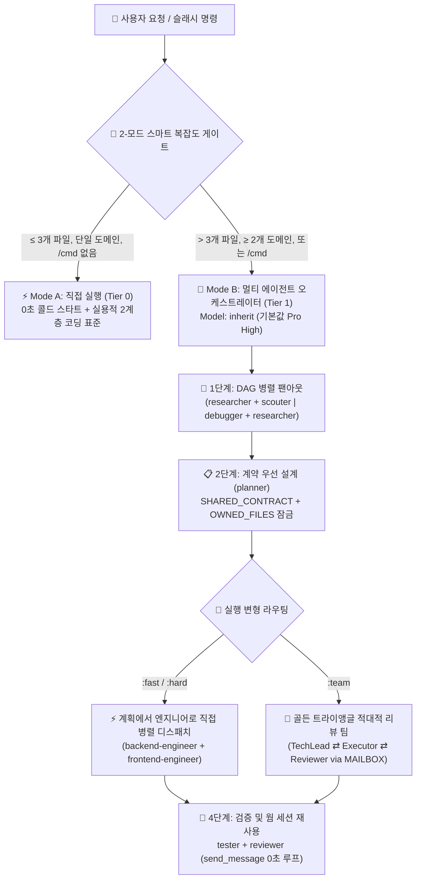

<div align="center">
  <h1>⚡ BoomOpen Workflow Kit v5.5.0</h1>
  <p><strong>멀티 플랫폼 스마트 하이브리드 (Smart-Hybrid) AI 워크포스 운영체제 & 멀티 에이전트 오케스트레이션 프레임워크</strong></p>

  [](https://github.com/Kennyboom/BoomOpen-Workflow-Kit/releases)
  [](#)
  [](#)
  [](#)
  [](https://nodejs.org/)
  [](../LICENSE)

  <p>
    [🇬🇧 English](../README.md) • [🇻🇳 Tiếng Việt](./README.vi.md) • [🇨🇳 简体中文](./README.zh-CN.md) • [🇹🇼 繁體中文](./README.zh-TW.md) • [🇯🇵 日本語](./README.ja.md) • **🇰🇷 한국어** • [🇪🇸 Español](./README.es.md) • [🇫🇷 Français](./README.fr.md) • [🇩🇪 Deutsch](./README.de.md)<br/>
    [🇧🇷 Português](./README.pt-BR.md) • [🇷🇺 Русский](./README.ru.md) • [🇮🇳 हिन्दी](./README.hi.md) • [🇸🇦 العربية](./README.ar.md) • [🇮🇩 Bahasa Indonesia](./README.id.md) • [🇹🇭 ไทย](./README.th.md) • [🇹🇷 Türkçe](./README.tr.md) • [🇮🇹 Italiano](./README.it.md)
  </p>
</div>

---

## 🌟 BoomOpen Workflow Kit v5.5란 무엇인가요?

**BoomOpen Workflow Kit v5.5 (Multi-Platform Unified & Smart-Hybrid Edition)**는 단일 AI 코딩 어시스턴트를 **21명의 전문 에이전트(Specialist Agents)**, **17개의 골든 트라이앵글 팀(Golden Triangle Teams)**, **48개의 코어 스킬(Core Skills)**, 그리고 **1,430개 이상의 전문 라이브러리 스킬(`skills_library`)**로 구성된 체계적인 엔지니어링 조직으로 전환하는 오픈소스 멀티 에이전트 운영체제입니다.

단순한 질문에도 매번 콜드 스타트 지연을 유발하는 무거운 래퍼들과 달리, BoomOpen v5.5는 **2-모드 스마트 복잡도 임계값 게이트(2-Mode Smart Complexity Threshold Gate)**를 도입했습니다:
- **⚡ Mode A — 직접 실행 모드 (콜드 스타트 0초)**: 간단한 Q&A, 코드 설명, 단일 도메인 버그 수정 또는 **3개 이하의 파일**(`/cmd` 슬래시 명령 없음)만 수정하는 명확한 작업은 메인 에이전트가 **직접** 실행·테스트·검증하며, **실용적 2계층 코딩 표준(Pragmatic 2-Tier Coding Standards)**과 **지속적 테스트 및 버그 수정(Persistent Testing & Bug Fixing)**을 엄격히 준수합니다.
- **🎻 Mode B — 엄격한 멀티 에이전트 오케스트레이션 (Strict Multi-Agent Orchestration)**: 복잡한 기능 개발(**4개 이상의 파일** 또는 **2개 이상의 도메인**)이나 명시적인 `/cmd` 워크플로우 호출 시 **DAG 병렬 팬아웃(Parallel Fan-Out)**, **계획-실행자 직접 디스패치(Direct Plan-to-Executor Dispatch)**, **계약 우선 파일 잠금(`SHARED_CONTRACT` + `OWNED_FILES`)**, **웜 서브 에이전트 재사용(`send_message`)**을 갖춘 오케스트레이터 모드를 활성화합니다.

---

## 🏗️ 스마트 하이브리드 아키텍처 (v5.5)



---

## 🧠 v5.5의 6대 핵심 기둥

1. **🌐 5대 플랫폼 완벽 통합 지원 (`platforms/*`)**:
   - 단일 통합 아키텍처에서 **Google Antigravity 2.0 (Gemini)**, **Claude Code**, **OpenAI Codex**, **Cursor**, **GitHub Copilot** 등 5대 AI 코딩 플랫폼을 네이티브로 지원합니다.
2. **📏 실용적 2계층 코딩 표준 (Pragmatic 2-Tier Coding Standards — 기계적 파일 파편화 방지)**:
   - **Tier 1 — 엄격한 품질 및 안전 규칙 (무관용 원칙)**: 단일 책임 원칙(Single Responsibility), **명시적 `any` 절대 금지**, **프로덕션 앱 내 디버그용 `console.log` 방치 금지**, 비동기/API 경계에서 `try/catch` 및 타입 에러 처리 필수, `SCREAMING_SNAKE_CASE` 상수 명명, DRY(3회 이상 반복 시 추출), 깔끔한 import 정렬.
   - **Tier 2 — 유연한 구조 가이드라인 (응집도 우선)**: 단일 책임 모듈의 파일 길이는 `~200–350줄`을 목표로 하며 응집도가 높을 경우 `~400–450줄`까지 유연하게 허용합니다(`500줄 초과` 또는 다중 도메인 혼재 시에만 분할 강제; 테스트, 타입/스키마, CLI, 문서는 제외). 함수는 로직 `~20–40줄`, UI/핸들러 `~40–80줄`을 권장합니다.
3. **🎯 계획-실행자 직접 디스패치 & 웜 서브 에이전트 재사용 (`send_message`)**:
   - `PLAN-{feature}.md`가 생성되면 불필요한 `tech-lead` 중계를 거치지 않고 도메인 엔지니어(`backend-engineer`, `frontend-engineer`, `database-architect` 등)에게 **직접 작업을 할당**합니다.
   - 생성된 서브 에이전트는 **활성 세션 레지스트리(`Role → conversationId`)**에 기록되며, 후속 수정 시 `send_message`를 통해 **콜드 스타트 0초** 및 **파일 컨텍스트 100% 유지** 상태로 즉시 재사용됩니다.
4. **🤝 계약 우선 병렬 디스패치 (`SHARED_CONTRACT` + `OWNED_FILES`)**:
   - 다중 도메인 계획은 병렬 엔지니어를 실행하기 전에 API 엔드포인트, DTO 스키마(`SHARED_CONTRACT`), 그리고 배타적 파일 쓰기 권한(`OWNED_FILES` vs. `READ_ONLY_FILES`)을 먼저 잠가 충돌과 인터페이스 불일치를 원천 차단합니다.
5. **🔍 5-Whys (SPIE v3.0) 근본 원인 디버깅 & 100% 깨끗한 Git 트리**:
   - `debugger`는 최소 3가지 가설 검증과 **5-Whys 인과 관계 체인**(`Why 1 즉각적 증상` → `Why 5 시스템적 근본 원인`)을 통해 버그를 추적합니다. 모든 임시 산출물(`PLAN`, `DEBUG`, `TEST`, `REVIEW`, `MAILBOX`)은 `<appDataDir>\brain\<conversation-id>\`에 우선 저장되어 Git 작업 트리를 100% 깨끗하게 유지합니다.
6. **🩺 내장 CLI 진단 도구 (`doctor` & `check`) 및 O(1) 스킬 인덱스**:
   - `npm run doctor`는 5개 플랫폼 번들, 21개 에이전트, 51개 팀 파일, 72개 명령 및 `matrix-skills/compact-index.json`(`1,430+` 스킬)을 검증하며, `npm run check <dir>`는 Tier 1 & Tier 2 코딩 표준 준수 여부를 자동으로 검사합니다.

---

## 💻 지원되는 AI 플랫폼

| 플랫폼 | 지원 수준 | 글로벌 엔트리포인트 | 프레임워크 설치 경로 |
|----------|:-------------:|-------------------|------------------------|
| **Antigravity (Gemini)** | ✅ 네이티브 v5.5 | `~/.gemini/GEMINI.md` | `~/.gemini/config/skills/boomopen-workflow-kit/` |
| **Claude Code** | ✅ 네이티브 v5.5 | `~/.claude/CLAUDE.md` | `~/.claude/skills/boomopen-workflow-kit/` |
| **OpenAI Codex** | ✅ 네이티브 v5.5 | `~/.codex/CODEX.md` & `AGENTS.md` | `~/.codex/skills/boomopen-workflow-kit/` |
| **Cursor** | ✅ 네이티브 v5.5 | `~/.cursor/rules/boomopen-workflow-kit.mdc` | `~/.cursor/skills/boomopen-workflow-kit/` |
| **GitHub Copilot** | ✅ 네이티브 v5.5 | `~/.copilot/COPILOT.md` | `~/.copilot/skills/boomopen-workflow-kit/` |

---

## 🚀 빠른 시작 및 설치 방법

```bash
# 1. 저장소 클론
git clone https://github.com/Kennyboom/BoomOpen-Workflow-Kit.git
cd BoomOpen-Workflow-Kit

# 2. 사용 중인 AI 코딩 어시스턴트에 맞게 설치 (하나 선택 또는 --all)
npm run install:antigravity   # Google Antigravity 2.0 (Gemini)
npm run install:claude        # Anthropic Claude Code
npm run install:codex         # OpenAI Codex CLI
npm run install:cursor        # Cursor AI Editor
npm run install:copilot       # GitHub Copilot (VS Code)
npm run install:all           # All 5 platforms

# 3. 설치 상태 진단, 2계층 코드 표준 검사 및 자동화 테스트 실행
npm run doctor
npm run check ./cli
npm test
```

---

## 🎯 슬래시 명령어 레퍼런스

| 명령어 | 변형(Variants) | 주요 목적 |
|---------|----------|-----------------|
| **`/cook`** | `:fast`, `:hard`, `:team` | 엔드투엔드 기능 개발 전체 수명 주기 (리서치/스카우트 → 계획 → 병렬 코딩 → 테스트 → 리뷰) |
| **`/code`** | `:fast`, `:hard`, `:team` | 기존 `PLAN-{feature}.md`를 기반으로 즉시 코드 구현 및 검증 수행 |
| **`/plan`** | `:fast`, `:hard`, `:team` | `SHARED_CONTRACT`, `OWNED_FILES` 및 Given/When/Then 기준을 포함한 구현 청사진 작성 |
| **`/fix`** | `:fast`, `:hard`, `:team` | 근본 원인 버그 수정 및 필수 회귀 테스트 검증 |
| **`/debug`** | `:fast`, `:hard`, `:team` | 3대 가설 검증 + **5-Whys (SPIE v3.0)** 인과 사슬 기반 근본 원인 조사 (`DEBUG-{issue}.md`) |
| **`/test`** | `:fast`, `:hard`, `:team` | DAG 병렬 팬아웃 테스트 스위트 실행 + 미적용 엣지 케이스 탐색 (`tester` + `scouter`) |
| **`/review`** | `:fast`, `:hard`, `:team` | 4방향 병렬 코드 감사 (아키텍처, 코드 품질, OWASP 보안, 성능) |
| **`/design`** | `:fast`, `:hard`, `:team` | 시스템 아키텍처, 데이터베이스 스키마 및 UI/UX 명세서 작성 (`DESIGN.md`) |
| **`/docs`** | `:core`, `:business`, `:audit` | 2계층 구조의 아키텍처 및 비즈니스 문서 생성·동기화 (`./documents/`) |
| **`/deploy`** | `:check`, `:preview`, `:production`, `:rollback` | 배포 전 준비 상태 점검, 프리뷰 환경, 프로덕션 롤아웃 및 안전한 롤백 |
| **`/brainstorm`** | `:fast`, `:hard`, `:team` | 소크라테스식 요구사항 탐색, 트레이드오프 분석 및 아이디어 도출 |
| **`/report`** | `:fast`, `:hard`, `:team` | 지표 및 다이어그램이 포함된 기술·경영 종합 보고서 생성 |
| **`/orchestrate`** | — | 여러 도메인에 걸친 맞춤형 멀티 에이전트 파이프라인 오케스트레이션 |
| **`/save` / `/recap`** | — | 세션 상태(`SESSION-HANDOVER.md`) 저장 및 `< 5초` 이내 전체 컨텍스트 복원 |

---

## 🤖 21명의 전문 에이전트 & 17개의 골든 트라이앵글 팀

| 카테고리 | 전문 에이전트 (`agents/*.md`) | 골든 트라이앵글 팀 (`agents/teams/*-team/`) |
|----------|-----------------------------------|------------------------------------------------|
| **엔지니어링 및 실행** | `backend-engineer`, `frontend-engineer`, `mobile-engineer`, `game-engineer`, `database-architect`, `devops-engineer` | `backend-team`, `frontend-team`, `fullstack-team`, `mobile-team`, `game-team`, `database-team`, `devops-team` |
| **아키텍처 및 기획** | `tech-lead`, `planner`, `brainstormer`, `business-analyst`, `project-manager`, `designer` | `planning-team`, `project-team`, `design-team` |
| **품질, 보안 및 디버깅** | `debugger`, `tester`, `reviewer`, `security-engineer`, `performance-engineer` | `debug-team`, `qa-team`, `review-team`, `security-team`, `performance-team` |
| **리서치 및 지식 관리** | `researcher`, `scouter`, `docs-manager`, `reporter` | `research-team`, `docs-team`, `report-team` |

---

## 📂 저장소 구조

```text
BoomOpen-Workflow-Kit/
├── agents/                  # 21개 전문 에이전트 정의 + 17개 골든 트라이앵글 팀 (51개 역할 파일)
├── cli/                     # 설치기(install.js), 헬스 닥터(doctor.js), 2계층 코드 체커(checker.js) 및 테스트
├── commands/                # 72개 슬래시 명령 워크플로우 (:fast, :hard, :team) + _ref/ 프로토콜
├── documents/               # 2계층 아키텍처, 도메인, 소스 베이스 및 코딩 표준 문서
├── i18n/                    # 다국어 문서 디렉토리 (주요 16개 언어 전체 번역 README)
├── matrix-skills/           # 도메인별 YAML 스킬 매트릭스 + 사전 컴파일된 compact-index.json (1,430+ 스킬)
├── platforms/               # 5대 플랫폼 통합 템플릿 (antigravity/, claude/, codex/, copilot/, cursor/)
├── rules/                   # Mode B 온디맨드 규칙 (CORE, PHASES, AGENTS, TEAMS, SKILLS, ERRORS, REFERENCE)
├── scripts/                 # Python 자동화 및 검증 스크립트 (checklist.py, verify_all.py 등)
├── skills/                  # 48개 코어 스킬 (clean-code, debugger, plan-writing, frontend-design 등)
├── skills_library/          # 2단계 고속 조회로 온디맨드 로드되는 1,430+ 전문 스킬 라이브러리
└── GEMINI.md | CLAUDE.md | CODEX.md | COPILOT.md | CURSOR.md | AGENT.md
```

---

## 📄 라이선스 및 보안

- **라이선스**: [MIT 라이선스](../LICENSE)에 따라 배포됩니다. Copyright © 2026 **Kennyboom (BoomOpen)**.
- **보안 정책**: 내장된 보안 가드레일 및 취약점 제보 절차는 [SECURITY.md](../SECURITY.md)를 참조하세요.
