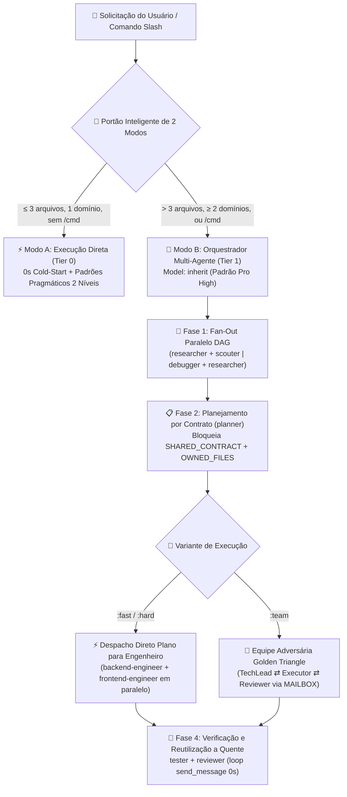

<div align="center">
  <h1>⚡ BoomOpen Workflow Kit v5.5.0</h1>
  <p><strong>Sistema Operacional de Força de Trabalho IA Híbrido-Inteligente Multiplataforma e Framework de Orquestração Multi-Agente</strong></p>

  [](https://github.com/Kennyboom/BoomOpen-Workflow-Kit/releases)
  [](#)
  [](#)
  [](#)
  [](https://nodejs.org/)
  [](../LICENSE)

  <p>
    [🇬🇧 English](../README.md) • [🇻🇳 Tiếng Việt](./README.vi.md) • [🇨🇳 简体中文](./README.zh-CN.md) • [🇹🇼 繁體中文](./README.zh-TW.md) • [🇯🇵 日本語](./README.ja.md) • [🇰🇷 한국어](./README.ko.md) • [🇪🇸 Español](./README.es.md) • [🇫🇷 Français](./README.fr.md) • [🇩🇪 Deutsch](./README.de.md)<br/>
    **🇧🇷 Português** • [🇷🇺 Русский](./README.ru.md) • [🇮🇳 हिन्दी](./README.hi.md) • [🇸🇦 العربية](./README.ar.md) • [🇮🇩 Bahasa Indonesia](./README.id.md) • [🇹🇭 ไทย](./README.th.md) • [🇹🇷 Türkçe](./README.tr.md) • [🇮🇹 Italiano](./README.it.md)
  </p>
</div>

---

## 🎬 Official Launch Trailer (Full HD 1080p)

<div align="center">
  <a href="https://github.com/Kennyboom/BoomOpen-Workflow-Kit/raw/main/assets/media/boomopen_v55_trailer_en.mp4">
    
  </a>
  <p>
    ▶️ <a href="https://github.com/Kennyboom/BoomOpen-Workflow-Kit/raw/main/assets/media/boomopen_v55_trailer_en.mp4"><b>Watch / Stream Full HD English Trailer (MP4)</b></a>
    &nbsp;|&nbsp;
    🇻🇳 <a href="https://github.com/Kennyboom/BoomOpen-Workflow-Kit/raw/main/assets/media/boomopen_v55_trailer_vi.mp4"><b>Xem Bản Tiếng Việt</b></a>
  </p>
</div>

---

## 🌟 O que é o BoomOpen Workflow Kit v5.5?

**BoomOpen Workflow Kit v5.5 (Multi-Platform Unified & Smart-Hybrid Edition)** é um sistema operacional multi-agente de código aberto que transforma um único assistente de programação IA em uma organização de engenharia coordenada composta por **21 agentes especialistas**, **17 equipes adversárias Golden Triangle**, **48 habilidades principais (Core Skills)** e **mais de 1.430 habilidades especializadas (`skills_library`)**.

Ao contrário de templates rígidos ou wrappers pesados que adicionam latência de inicialização a cada pergunta simples, o BoomOpen v5.5 introduz o **Portão Inteligente de Complexidade de 2 Modos (2-Mode Smart Complexity Threshold Gate)**:
- **⚡ Modo A — Execução Direta (0s de Cold-Start)**: Perguntas e respostas (Q&A), explicações de código, correções de bugs em um único domínio ou alterações claras tocando **≤ 3 arquivos** (sem comando `/cmd`) são executadas, testadas e verificadas **diretamente** pelo agente principal, aplicando os **Padrões de Codificação Pragmáticos de 2 Níveis** e **Testes e Correção Persistente de Bugs**.
- **🎻 Modo B — Orquestração Multi-Agente Estrita**: Funcionalidades complexas (**> 3 arquivos** ou **≥ 2 domínios**) ou comandos explícitos `/cmd` ativam o modo Orquestrador estrito com **Fan-Out Paralelo DAG**, **Despacho Direto do Plano para o Executor**, **Bloqueios de Arquivos por Contrato (`SHARED_CONTRACT` + `OWNED_FILES`)** e **Reutilização a Quente de Sub-agentes (`send_message`)**.

---

## 🏗️ Arquitetura Híbrida-Inteligente (v5.5)



---

## 🧠 Os 6 Pilares Principais da v5.5

1. **🌐 Paridade Unificada em 5 Plataformas (`platforms/*`)**:
   - Instalação nativa de primeira classe para **Google Antigravity 2.0 (Gemini)**, **Claude Code**, **OpenAI Codex**, **Cursor** e **GitHub Copilot** a partir de uma única arquitetura unificada.
2. **📏 Padrões de Codificação Pragmáticos de 2 Níveis (Anti-Fragmentação)**:
   - **Nível 1 — Qualidade e Segurança Estritas (Tolerância Zero)**: Responsabilidade Única (Single Responsibility), **PROIBIDO `any` explícito**, **PROIBIDO deixar `console.log` de depuração** em produção, tratamento de erros tipado com `try/catch` em fronteiras async/API, constantes `SCREAMING_SNAKE_CASE`, DRY (`≥ 3`) e imports organizados.
   - **Nível 2 — Diretrizes Estruturais Flexíveis (Coesão em Primeiro Lugar)**: Arquivos coesos têm meta de `~200–350 linhas` com teto flexível de `~400–450 linhas` (divisão obrigatória apenas acima de `>500 linhas` ou múltiplos domínios; testes, tipos, CLI e docs são isentos). Funções lógicas `~20–40 linhas` (`~40–80 linhas` para UI/Handlers).
3. **🎯 Despacho Direto do Plano ao Executor e Reutilização a Quente (`send_message`)**:
   - Assim que `PLAN-{feature}.md` existe, o Orquestrador despacha tarefas **diretamente** para os engenheiros de domínio (`backend-engineer`, `frontend-engineer`, `database-architect`, etc.) sem salto intermediário redundante pelo `tech-lead`.
   - Sub-agentes ativos ficam registrados no **Registro de Sessões Ativas (`Role → conversationId`)** e são reutilizados via `send_message` com **0s de cold-start** e **100% do contexto de arquivos preservado**.
4. **🤝 Despacho Paralelo Baseado em Contratos (`SHARED_CONTRACT` + `OWNED_FILES`)**:
   - Planos multidomínio travam endpoints de API, esquemas DTO e propriedade exclusiva de arquivos (`OWNED_FILES` vs. `READ_ONLY_FILES`) antes de iniciar engenheiros em paralelo, eliminando colisões de escrita.
5. **🔍 Depuração de Causa Raiz 5-Whys (SPIE v3.0) e Árvore Git 100% Limpa**:
   - `debugger` investiga cada bug por meio de 3 hipóteses ranqueadas e uma cadeia causal **5-Whys** (`Por que 1 Sintoma` → `Por que 5 Causa Raiz Sistêmica`). Artefatos transitórios (`PLAN`, `DEBUG`, `TEST`, `REVIEW`, `MAILBOX`) são gravados em `<appDataDir>\brain\<conversation-id>\`, mantendo a árvore Git 100% limpa.
6. **🩺 Diagnóstico CLI Integrado (`doctor` & `check`) e Índice de Habilidades O(1)**:
   - `npm run doctor` valida os 5 pacotes de plataforma, 21 agentes, 51 arquivos de equipe, 72 comandos e `matrix-skills/compact-index.json` (`1.430+` habilidades). `npm run check <dir>` audita automaticamente os padrões de Nível 1 e Nível 2.

---

## 💻 Plataformas de IA Suportadas

| Plataforma | Nível de Suporte | Ponto de Entrada Global | Caminho de Instalação do Framework |
|----------|:-------------:|-------------------|------------------------|
| **Antigravity (Gemini)** | ✅ Nativo v5.5 | `~/.gemini/GEMINI.md` | `~/.gemini/config/skills/boomopen-workflow-kit/` |
| **Claude Code** | ✅ Nativo v5.5 | `~/.claude/CLAUDE.md` | `~/.claude/skills/boomopen-workflow-kit/` |
| **OpenAI Codex** | ✅ Nativo v5.5 | `~/.codex/CODEX.md` & `AGENTS.md` | `~/.codex/skills/boomopen-workflow-kit/` |
| **Cursor** | ✅ Nativo v5.5 | `~/.cursor/rules/boomopen-workflow-kit.mdc` | `~/.cursor/skills/boomopen-workflow-kit/` |
| **GitHub Copilot** | ✅ Nativo v5.5 | `~/.copilot/COPILOT.md` | `~/.copilot/skills/boomopen-workflow-kit/` |

---

## 🚀 Início Rápido e Instalação

```bash
# 1. Clonar o repositório
git clone https://github.com/Kennyboom/BoomOpen-Workflow-Kit.git
cd BoomOpen-Workflow-Kit

# 2. Instalar para o seu assistente de codificação IA (escolha um ou --all)
npm run install:antigravity   # Google Antigravity 2.0 (Gemini)
npm run install:claude        # Anthropic Claude Code
npm run install:codex         # OpenAI Codex CLI
npm run install:cursor        # Cursor AI Editor
npm run install:copilot       # GitHub Copilot (VS Code)
npm run install:all           # All 5 platforms

# 3. Verificar saúde da instalação, padrões de código de 2 níveis e suíte de testes
npm run doctor
npm run check ./cli
npm test
```

---

## 🎛️ Unified Settings & Mode Selection (`/settings` Control Center)

Switch execution modes (`auto` | `mode_a` | `mode_b` | `team`), 4 one-click presets (`smart-hybrid`, `solo-fast`, `deep-architect`, `adversarial-team`), and 12 system settings across all 5 platforms in `< 10ms` with **0ms Turn-1 latency**:

```bash
# 1. In-Chat Slash Command (Interactive UI Widget or One-Liner)
/settings                                     # Open interactive ask_question menu
/settings preset smart-hybrid                 # Default Recommended (Auto Mode A/B + auto_team)
/settings preset solo-fast                    # Force Mode A Direct Fast Execution
/settings preset deep-architect               # Force Mode B Multi-Agent Orchestrator
/settings preset adversarial-team             # Force Golden Triangle 3-Agent (:team)
/settings mode auto | mode_a | mode_b | team  # Override execution.mode directly

# 2. Local Web Control Center Dashboard (http://127.0.0.1:4567)
npm run settings:ui

# 3. Terminal CLI (Global ~/.boomopen/settings.json & Project ./.boomopen.json)
npm run settings -- status
npm run settings -- preset adversarial-team
npm run settings -- reset
```

---

## 🎯 Referência de Comandos Slash

| Comando | Variantes | Propósito Principal |
|---------|----------|-----------------|
| **`/cook`** | `:fast`, `:hard`, `:team` | Desenvolvimento completo de ponta a ponta (Pesquisa/Scout → Plano → Código Paralelo → Teste → Revisão) |
| **`/code`** | `:fast`, `:hard`, `:team` | Executar implementação diretamente a partir de um `PLAN-{feature}.md` existente |
| **`/plan`** | `:fast`, `:hard`, `:team` | Criar blueprints de implementação com `SHARED_CONTRACT`, `OWNED_FILES` e critérios Given/When/Then |
| **`/fix`** | `:fast`, `:hard`, `:team` | Resolução de bugs na causa raiz com verificação obrigatória por teste de regressão |
| **`/debug`** | `:fast`, `:hard`, `:team` | Investigação de causa raiz com 3 hipóteses + cadeia causal **5-Whys (SPIE v3.0)** (`DEBUG-{issue}.md`) |
| **`/test`** | `:fast`, `:hard`, `:team` | Execução paralela DAG da suíte de testes + busca de casos de borda não cobertos (`tester` + `scouter`) |
| **`/review`** | `:fast`, `:hard`, `:team` | Auditoria paralela em 4 dimensões (Arquitetura, Qualidade de Código, Segurança OWASP, Performance) |
| **`/design`** | `:fast`, `:hard`, `:team` | Arquitetura de sistema, esquema de banco de dados e especificação de UI/UX (`DESIGN.md`) |
| **`/docs`** | `:core`, `:business`, `:audit` | Gerar ou sincronizar documentação estruturada de arquitetura e negócios de 2 níveis (`./documents/`) |
| **`/deploy`** | `:check`, `:preview`, `:production`, `:rollback` | Portões de prontidão pré-deploy, ambientes de preview, rollout em produção e rollback seguro |
| **`/brainstorm`** | `:fast`, `:hard`, `:team` | Descoberta socrática de requisitos, análise de trade-offs e ideação |
| **`/report`** | `:fast`, `:hard`, `:team` | Relatórios executivos e técnicos de síntese com métricas e diagramas |
| **`/orchestrate`** | — | Orquestração personalizada de pipelines multi-agente através de múltiplos domínios |
| **`/save` / `/recap`** | — | Persistir estado da sessão (`SESSION-HANDOVER.md`) e restaurar contexto completo em `< 5s` |

---

## 🤖 21 Agentes Especialistas e 17 Equipes Golden Triangle

| Categoria | Agentes Especialistas (`agents/*.md`) | Equipes Golden Triangle (`agents/teams/*-team/`) |
|----------|-----------------------------------|------------------------------------------------|
| **Engenharia e Execução** | `backend-engineer`, `frontend-engineer`, `mobile-engineer`, `game-engineer`, `database-architect`, `devops-engineer` | `backend-team`, `frontend-team`, `fullstack-team`, `mobile-team`, `game-team`, `database-team`, `devops-team` |
| **Arquitetura e Planejamento** | `tech-lead`, `planner`, `brainstormer`, `business-analyst`, `project-manager`, `designer` | `planning-team`, `project-team`, `design-team` |
| **Qualidade, Segurança e Depuração** | `debugger`, `tester`, `reviewer`, `security-engineer`, `performance-engineer` | `debug-team`, `qa-team`, `review-team`, `security-team`, `performance-team` |
| **Pesquisa e Conhecimento** | `researcher`, `scouter`, `docs-manager`, `reporter` | `research-team`, `docs-team`, `report-team` |

---

## 📂 Estrutura do Repositório

```text
BoomOpen-Workflow-Kit/
├── agents/                  # 21 definições de Agentes Especialistas + 17 Equipes Golden Triangle (51 arquivos de função)
├── cli/                     # Instalador (install.js), Health Doctor (doctor.js), Verificador de 2 Níveis (checker.js) e Testes
├── commands/                # 72 fluxos de comandos Slash (:fast, :hard, :team) + protocolos _ref/
├── documents/               # Documentação de 2 níveis de Arquitetura, Domínio, Código-Fonte e Padrões
├── i18n/                    # Documentação internacionalizada (16 traduções completas do README)
├── matrix-skills/           # Matrizes YAML de habilidades por domínio + compact-index.json pré-compilado (1.430+ habilidades)
├── platforms/               # Templates unificados para as 5 plataformas (antigravity/, claude/, codex/, copilot/, cursor/)
├── rules/                   # Regras sob demanda do Modo B (CORE, PHASES, AGENTS, TEAMS, SKILLS, ERRORS, REFERENCE)
├── scripts/                 # Scripts Python de automação e verificação (checklist.py, verify_all.py, etc.)
├── skills/                  # 48 Habilidades Principais (clean-code, debugger, plan-writing, frontend-design, etc.)
├── skills_library/          # Mais de 1.430 habilidades especializadas carregadas sob demanda via busca em 2 etapas
└── GEMINI.md | CLAUDE.md | CODEX.md | COPILOT.md | CURSOR.md | AGENT.md
```

---

## 📄 Licença e Segurança

- **Licença**: Distribuído sob a [Licença MIT](../LICENSE). Copyright © 2026 **Kennyboom (BoomOpen)**.
- **Política de Segurança**: Veja [SECURITY.md](../SECURITY.md) para diretrizes de segurança integradas e relato de vulnerabilidades.
