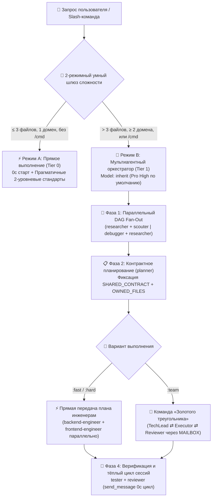

<div align="center">
  <h1>⚡ BoomOpen Workflow Kit v5.5.0</h1>
  <p><strong>Мультиплатформенная гибридная (Smart-Hybrid) операционная система ИИ-разработки и фреймворк мультиагентной оркестрации</strong></p>

  [](https://github.com/Kennyboom/BoomOpen-Workflow-Kit/releases)
  [](#)
  [](#)
  [](#)
  [](https://nodejs.org/)
  [](../LICENSE)

  <p>
    [🇬🇧 English](../README.md) • [🇻🇳 Tiếng Việt](./README.vi.md) • [🇨🇳 简体中文](./README.zh-CN.md) • [🇹🇼 繁體中文](./README.zh-TW.md) • [🇯🇵 日本語](./README.ja.md) • [🇰🇷 한국어](./README.ko.md) • [🇪🇸 Español](./README.es.md) • [🇫🇷 Français](./README.fr.md) • [🇩🇪 Deutsch](./README.de.md)<br/>
    [🇧🇷 Português](./README.pt-BR.md) • **🇷🇺 Русский** • [🇮🇳 हिन्दी](./README.hi.md) • [🇸🇦 العربية](./README.ar.md) • [🇮🇩 Bahasa Indonesia](./README.id.md) • [🇹🇭 ไทย](./README.th.md) • [🇹🇷 Türkçe](./README.tr.md) • [🇮🇹 Italiano](./README.it.md)
  </p>
</div>

---

## 🌟 Что такое BoomOpen Workflow Kit v5.5?

**BoomOpen Workflow Kit v5.5 (Multi-Platform Unified & Smart-Hybrid Edition)** — это мультиагентная операционная система с открытым исходным кодом, превращающая одного ИИ-ассистента по программированию в слаженную инженерную организацию из **21 агента-специалиста**, **17 состязательных команд «Золотого треугольника» (Golden Triangle Teams)**, **48 базовых навыков (Core Skills)** и **более 1 430 узкоспециализированных навыков (`skills_library`)**.

В отличие от громоздких обёрток, создающих задержку холодного старта при каждом простом вопросе, BoomOpen v5.5 внедряет **2-режимный умный шлюз сложности (2-Mode Smart Complexity Threshold Gate)**:
- **⚡ Режим A — Прямое выполнение (0 с холодного старта)**: Вопросы и ответы (Q&A), объяснение кода, локальные исправления багов или понятные изменения в **≤ 3 файлах** (без вызова `/cmd`) выполняются, тестируются и проверяются **напрямую** основным агентом с соблюдением **Прагматичных двухуровневых стандартов кодирования** и **Настойчивого тестирования и исправления ошибок**.
- **🎻 Режим B — Строгая мультиагентная оркестрация**: Сложные задачи (**> 3 файлов** или **≥ 2 домена**) либо явные команды `/cmd` активируют режим строгого Оркестратора с **параллельным DAG-разветвлением (Parallel Fan-Out)**, **прямой передачей плана исполнителям (Direct Plan-to-Executor Dispatch)**, **контрактной блокировкой файлов (`SHARED_CONTRACT` + `OWNED_FILES`)** и **повторным использованием «тёплых» субагентов (`send_message`)**.

---

## 🏗️ Архитектура Smart-Hybrid (v5.5)



---

## 🧠 6 ключевых столпов версии v5.5

1. **🌐 Единый паритет на 5 платформах (`platforms/*`)**:
   - Полноценная нативная поддержка **Google Antigravity 2.0 (Gemini)**, **Claude Code**, **OpenAI Codex**, **Cursor** и **GitHub Copilot** на базе единой унифицированной архитектуры.
2. **📏 Прагматичные двухуровневые стандарты кодирования (Анти-фрагментация)**:
   - **Уровень 1 — Строгое качество и безопасность (Нулевая терпимость)**: Принцип единственной ответственности (Single Responsibility), **ЗАПРЕТ явного `any`**, **ЗАПРЕТ оставленных отладочных `console.log`** в продакшене, обязательный `try/catch` + типизированные ошибки на границах async/API, константы в `SCREAMING_SNAKE_CASE`, DRY (`≥ 3`) и чистый порядок импортов.
   - **Уровень 2 — Гибкие структурные ориентиры (Связность важнее механической нарезки)**: Целевой размер связного файла — `~200–350 строк` с мягким потолком `~400–450 строк` (принудительное разделение только при `>500 строк` или смешении доменов; тесты, типы, CLI и документация освобождены). Функции логики `~20–40 строк` (`~40–80 строк` для UI/обработчиков).
3. **🎯 Прямая передача плана исполнителям и повторное использование тёплых субагентов (`send_message`)**:
   - После создания `PLAN-{feature}.md` Оркестратор направляет задачи **напрямую** профильным инженерам (`backend-engineer`, `frontend-engineer`, `database-architect` и др.) без лишнего промежуточного звена `tech-lead`.
   - Активные субагенты сохраняются в **Реестре активных сессий (`Role → conversationId`)** и повторно вызываются через `send_message` с **0 с холодного старта** и **100% сохранением контекста файлов**.
4. **🤝 Контрактная параллельная разработка (`SHARED_CONTRACT` + `OWNED_FILES`)**:
   - Мультидоменные планы заранее фиксируют API-эндпоинты, DTO-схемы и монопольные права записи файлов (`OWNED_FILES` против `READ_ONLY_FILES`) перед параллельным запуском инженеров, полностью исключая конфликты перезаписи.
5. **🔍 Поиск первопричины 5-Whys (SPIE v3.0) и 100% чистое дерево Git**:
   - `debugger` исследует каждый сбой через 3 ранжированные гипотезы и причинно-следственную цепочку **5-Whys** (`Почему 1 Симптом` → `Почему 5 Системная первопричина`). Временные артефакты (`PLAN`, `DEBUG`, `TEST`, `REVIEW`, `MAILBOX`) сохраняются в `<appDataDir>\brain\<conversation-id>\`, оставляя рабочее дерево Git идеально чистым.
6. **🩺 Встроенная CLI-диагностика (`doctor` & `check`) и O(1) индекс навыков**:
   - `npm run doctor` проверяет все 5 платформ, 21 агента, 51 файл команд, 72 команды и `matrix-skills/compact-index.json` (`1 430+` навыков). `npm run check <dir>` автоматически проверяет код на соответствие стандартам Уровня 1 и Уровня 2.

---

## 💻 Поддерживаемые ИИ-платформы

| Платформа | Уровень поддержки | Глобальная точка входа | Путь установки фреймворка |
|----------|:-------------:|-------------------|------------------------|
| **Antigravity (Gemini)** | ✅ Нативно v5.5 | `~/.gemini/GEMINI.md` | `~/.gemini/config/skills/boomopen-workflow-kit/` |
| **Claude Code** | ✅ Нативно v5.5 | `~/.claude/CLAUDE.md` | `~/.claude/skills/boomopen-workflow-kit/` |
| **OpenAI Codex** | ✅ Нативно v5.5 | `~/.codex/CODEX.md` & `AGENTS.md` | `~/.codex/skills/boomopen-workflow-kit/` |
| **Cursor** | ✅ Нативно v5.5 | `~/.cursor/rules/boomopen-workflow-kit.mdc` | `~/.cursor/skills/boomopen-workflow-kit/` |
| **GitHub Copilot** | ✅ Нативно v5.5 | `~/.copilot/COPILOT.md` | `~/.copilot/skills/boomopen-workflow-kit/` |

---

## 🚀 Быстрый старт и установка

```bash
# 1. Клонировать репозиторий
git clone https://github.com/Kennyboom/BoomOpen-Workflow-Kit.git
cd BoomOpen-Workflow-Kit

# 2. Установить для вашего ИИ-ассистента (выберите один или --all для всех)
npm run install:antigravity   # Google Antigravity 2.0 (Gemini)
npm run install:claude        # Anthropic Claude Code
npm run install:codex         # OpenAI Codex CLI
npm run install:cursor        # Cursor AI Editor
npm run install:copilot       # GitHub Copilot (VS Code)
npm run install:all           # All 5 platforms

# 3. Проверить состояние установки, двухуровневые стандарты кода и запустить тесты
npm run doctor
npm run check ./cli
npm test
```

---

## 🎛️ Unified Settings & Mode Selection (`/settings` Control Center)

Switch execution modes (`auto` | `mode_a` | `mode_b` | `team`), 4 one-click presets (`smart-hybrid`, `solo-fast`, `deep-architect`, `adversarial-team`), and 12 system settings across all 5 platforms in `< 10ms` with **0ms Turn-1 latency**:

```bash
# 1. In-Chat Slash Command (Interactive UI Widget or One-Liner)
/settings                                     # Open interactive ask_question menu
/settings preset smart-hybrid                 # Default Recommended (Auto Mode A/B + auto_team)
/settings preset solo-fast                    # Force Mode A Direct Fast Execution
/settings preset deep-architect               # Force Mode B Multi-Agent Orchestrator
/settings preset adversarial-team             # Force Golden Triangle 3-Agent (:team)
/settings mode auto | mode_a | mode_b | team  # Override execution.mode directly

# 2. Local Web Control Center Dashboard (http://127.0.0.1:4567)
npm run settings:ui

# 3. Terminal CLI (Global ~/.boomopen/settings.json & Project ./.boomopen.json)
npm run settings -- status
npm run settings -- preset adversarial-team
npm run settings -- reset
```

---

## 🎯 Справочник Slash-команд

| Команда | Варианты | Основное назначение |
|---------|----------|-----------------|
| **`/cook`** | `:fast`, `:hard`, `:team` | Полный цикл разработки функции (Исследование/Разведка → План → Параллельный код → Тесты → Ревью) |
| **`/code`** | `:fast`, `:hard`, `:team` | Прямая реализация кода по готовому плану `PLAN-{feature}.md` |
| **`/plan`** | `:fast`, `:hard`, `:team` | Создание технических планов с `SHARED_CONTRACT`, `OWNED_FILES` и критериями Given/When/Then |
| **`/fix`** | `:fast`, `:hard`, `:team` | Устранение первопричины бага с обязательной проверкой регрессионными тестами |
| **`/debug`** | `:fast`, `:hard`, `:team` | Расследование первопричины по 3 гипотезам + цепочке **5-Whys (SPIE v3.0)** (`DEBUG-{issue}.md`) |
| **`/test`** | `:fast`, `:hard`, `:team` | Параллельный DAG-запуск тестов + поиск непокрытых граничных случаев (`tester` + `scouter`) |
| **`/review`** | `:fast`, `:hard`, `:team` | 4-сторонний параллельный аудит (Архитектура, Качество кода, Безопасность OWASP, Производительность) |
| **`/design`** | `:fast`, `:hard`, `:team` | Проектирование системной архитектуры, схемы БД и спецификации UI/UX (`DESIGN.md`) |
| **`/docs`** | `:core`, `:business`, `:audit` | Генерация и синхронизация двухуровневой архитектурной и бизнес-документации (`./documents/`) |
| **`/deploy`** | `:check`, `:preview`, `:production`, `:rollback` | Предрелизные проверки, preview-окружения, выкатка в продакшен и безопасный откат |
| **`/brainstorm`** | `:fast`, `:hard`, `:team` | Сократовское выявление требований, анализ компромиссов и генерация идей |
| **`/report`** | `:fast`, `:hard`, `:team` | Итоговые технические и управленческие отчёты с метриками и диаграммами |
| **`/orchestrate`** | — | Пользовательская оркестрация мультиагентных конвейеров между несколькими доменами |
| **`/save` / `/recap`** | — | Сохранение состояния сессии (`SESSION-HANDOVER.md`) и полное восстановление контекста за `< 5 с` |

---

## 🤖 21 агент-специалист и 17 команд «Золотого треугольника»

| Категория | Агенты-специалисты (`agents/*.md`) | Команды «Золотого треугольника» (`agents/teams/*-team/`) |
|----------|-----------------------------------|------------------------------------------------|
| **Инженерия и реализация** | `backend-engineer`, `frontend-engineer`, `mobile-engineer`, `game-engineer`, `database-architect`, `devops-engineer` | `backend-team`, `frontend-team`, `fullstack-team`, `mobile-team`, `game-team`, `database-team`, `devops-team` |
| **Архитектура и планирование** | `tech-lead`, `planner`, `brainstormer`, `business-analyst`, `project-manager`, `designer` | `planning-team`, `project-team`, `design-team` |
| **Качество, безопасность и отладка** | `debugger`, `tester`, `reviewer`, `security-engineer`, `performance-engineer` | `debug-team`, `qa-team`, `review-team`, `security-team`, `performance-team` |
| **Исследования и знания** | `researcher`, `scouter`, `docs-manager`, `reporter` | `research-team`, `docs-team`, `report-team` |

---

## 📂 Структура репозитория

```text
BoomOpen-Workflow-Kit/
├── agents/                  # 21 профиль агентов-специалистов + 17 команд «Золотого треугольника» (51 файл ролей)
├── cli/                     # Установщик (install.js), Диагностика (doctor.js), 2-уровневый чекер (checker.js) и тесты
├── commands/                # 72 рабочих процесса Slash-команд (:fast, :hard, :team) + протоколы _ref/
├── documents/               # Двухуровневая документация по архитектуре, доменам, кодовой базе и стандартам
├── i18n/                    # Многоязычная документация (16 полных переводов README)
├── matrix-skills/           # YAML-матрицы навыков по доменам + предкомпилированный compact-index.json (1 430+ навыков)
├── platforms/               # Унифицированные шаблоны для 5 платформ (antigravity/, claude/, codex/, copilot/, cursor/)
├── rules/                   # Правила Режима B по требованию (CORE, PHASES, AGENTS, TEAMS, SKILLS, ERRORS, REFERENCE)
├── scripts/                 # Python-скрипты автоматизации и верификации (checklist.py, verify_all.py и др.)
├── skills/                  # 48 базовых навыков (clean-code, debugger, plan-writing, frontend-design и др.)
├── skills_library/          # 1 430+ специализированных навыков, загружаемых за 2 шага по требованию
└── GEMINI.md | CLAUDE.md | CODEX.md | COPILOT.md | CURSOR.md | AGENT.md
```

---

## 📄 Лицензия и безопасность

- **Лицензия**: Распространяется по [лицензии MIT](../LICENSE). Copyright © 2026 **Kennyboom (BoomOpen)**.
- **Политика безопасности**: Ознакомьтесь с [SECURITY.md](../SECURITY.md) для информации о встроенных механизмах защиты и порядке сообщения об уязвимостях.
