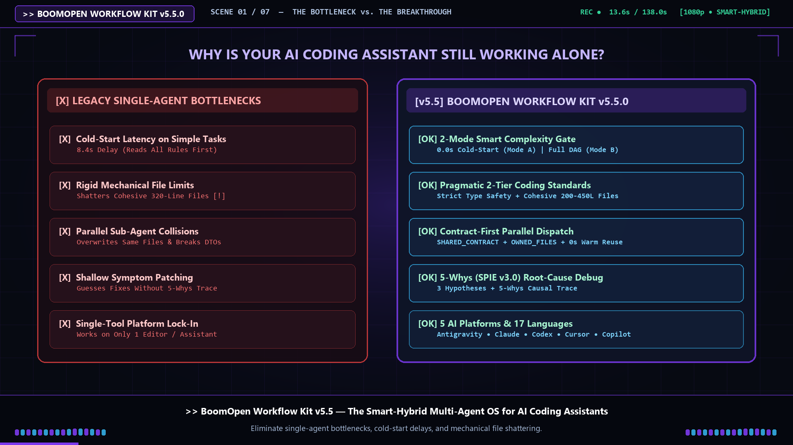
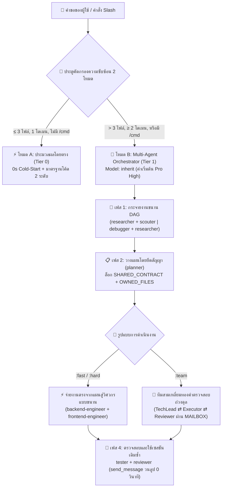

<div align="center">
  <h1>⚡ BoomOpen Workflow Kit v5.5.0</h1>
  <p><strong>ระบบปฏิบัติการกองทัพ AI แบบ Smart-Hybrid ข้ามแพลตฟอร์ม และเฟรมเวิร์กการประสานงานแบบ Multi-Agent</strong></p>

  [](https://github.com/Kennyboom/BoomOpen-Workflow-Kit/releases)
  [](#)
  [](#)
  [](#)
  [](https://nodejs.org/)
  [](../LICENSE)

  <p>
    [🇬🇧 English](../README.md) • [🇻🇳 Tiếng Việt](./README.vi.md) • [🇨🇳 简体中文](./README.zh-CN.md) • [🇹🇼 繁體中文](./README.zh-TW.md) • [🇯🇵 日本語](./README.ja.md) • [🇰🇷 한국어](./README.ko.md) • [🇪🇸 Español](./README.es.md) • [🇫🇷 Français](./README.fr.md) • [🇩🇪 Deutsch](./README.de.md)<br/>
    [🇧🇷 Português](./README.pt-BR.md) • [🇷🇺 Русский](./README.ru.md) • [🇮🇳 हिन्दी](./README.hi.md) • [🇸🇦 العربية](./README.ar.md) • [🇮🇩 Bahasa Indonesia](./README.id.md) • **🇹🇭 ไทย** • [🇹🇷 Türkçe](./README.tr.md) • [🇮🇹 Italiano](./README.it.md)
  </p>
</div>

---

## 🎬 Official Launch Trailer (Full HD 1080p)

<div align="center">
  <a href="https://github.com/Kennyboom/BoomOpen-Workflow-Kit/raw/main/assets/media/boomopen_v55_trailer_en.mp4">
    
  </a>
  <p>
    ▶️ <a href="https://github.com/Kennyboom/BoomOpen-Workflow-Kit/raw/main/assets/media/boomopen_v55_trailer_en.mp4"><b>Watch / Stream Full HD English Trailer (MP4)</b></a>
    &nbsp;|&nbsp;
    🇻🇳 <a href="https://github.com/Kennyboom/BoomOpen-Workflow-Kit/raw/main/assets/media/boomopen_v55_trailer_vi.mp4"><b>Xem Bản Tiếng Việt</b></a>
  </p>
</div>

---

## 🌟 BoomOpen Workflow Kit v5.5 คืออะไร?

**BoomOpen Workflow Kit v5.5 (Multi-Platform Unified & Smart-Hybrid Edition)** คือระบบปฏิบัติการแบบหลายเอเจนต์ (Multi-Agent) โอเพนซอร์สที่เปลี่ยนผู้ช่วยเขียนโค้ด AI เดี่ยวๆ ให้กลายเป็นองค์กรวิศวกรรมซอฟต์แวร์ที่ทำงานประสานกันประกอบด้วย **เอเจนต์ผู้เชี่ยวชาญ 21 บทบาท (Specialist Agents)**, **ทีมตรวจสอบถ่วงดุลสามเหลี่ยมทองคำ 17 ทีม (Golden Triangle Teams)**, **ทักษะหลัก 48 รายการ (Core Skills)** และ **คลังทักษะเฉพาะทางกว่า 1,430+ รายการ (`skills_library`)**

แตกต่างจากเทมเพลตคำสั่งแบบตายตัวหรือเฟรมเวิร์กขนาดใหญ่ที่ทำให้เกิดความหน่วง (Cold-Start) ในทุกคำถามง่ายๆ BoomOpen v5.5 ได้เปิดตัว **ประตูคัดกรองความซับซ้อนอัจฉริยะ 2 โหมด (2-Mode Smart Complexity Threshold Gate)**:
- **⚡ โหมด A — ประมวลผลโดยตรง (Cold-Start 0 วินาที)**: คำถาม-คำตอบทั่วไป (Q&A), การอธิบายโค้ด, การแก้บั๊กในโดเมนเดียว หรือการแก้ไขที่ชัดเจนซึ่งกระทบไฟล์ **≤ 3 ไฟล์** (และไม่ได้เรียกคำสั่ง `/cmd`) จะถูกดำเนินการ ทดสอบ และตรวจสอบ **โดยตรง** โดยเอเจนต์หลัก พร้อมบังคับใช้ **มาตรฐานการเขียนโค้ดเชิงปฏิบัติ 2 ระดับ (Pragmatic 2-Tier Coding Standards)** และ **การทดสอบและแก้ไขบั๊กอย่างต่อเนื่อง**
- **🎻 โหมด B — การประสานงาน Multi-Agent อย่างเคร่งครัด**: ฟีเจอร์ที่ซับซ้อน (**> 3 ไฟล์** หรือ **≥ 2 โดเมน**) หรือการเรียกใช้คำสั่ง `/cmd` จะเปิดใช้งานโหมด Orchestrator เต็มรูปแบบ พร้อม **การกระจายงานขนานแบบ DAG (Parallel Fan-Out)**, **การจ่ายงานตรงจากแผนสู่วิศวกร (Direct Plan-to-Executor Dispatch)**, **การล็อกสิทธิ์ไฟล์ตามสัญญา (`SHARED_CONTRACT` + `OWNED_FILES`)** และ **การนำซับเอเจนต์ที่พร้อมใช้งานกลับมาใช้ซ้ำ (`send_message`)**

---

## 🏗️ สถาปัตยกรรม Smart-Hybrid (v5.5)



---

## 🧠 6 เสาหลักสำคัญของ v5.5

1. **🌐 รองรับ 5 แพลตฟอร์มอย่างสมบูรณ์แบบ (`platforms/*`)**:
   - ติดตั้งแบบ Native ชั้นหนึ่งสำหรับ **Google Antigravity 2.0 (Gemini)**, **Claude Code**, **OpenAI Codex**, **Cursor** และ **GitHub Copilot** จากสถาปัตยกรรมเดียวที่รวมเป็นหนึ่ง
2. **📏 มาตรฐานการเขียนโค้ดเชิงปฏิบัติ 2 ระดับ (ป้องกันการหั่นไฟล์แบบไร้เหตุผล)**:
   - **ระดับที่ 1 — กฎคุณภาพและความปลอดภัยที่เข้มงวด (Zero Tolerance)**: หนึ่งไฟล์หรือฟังก์ชันรับผิดชอบหนึ่งหน้าที่ (Single Responsibility), **ห้ามใช้ `any` โดยเด็ดขาด**, **ห้ามทิ้ง `console.log` ดีบักไว้ในโค้ด Production**, ต้องมี `try/catch` และจัดการชนิดข้อผิดพลาดที่ขอบเขต async/API, ค่าคงที่ใช้ `SCREAMING_SNAKE_CASE`, DRY (`≥ 3`) และจัดเรียง import ให้สะอาด
   - **ระดับที่ 2 — แนวทางโครงสร้างที่ยืดหยุ่น (เน้นความสอดคล้อง)**: ไฟล์ที่ทำงานหน้าที่เดียวอย่างสมบูรณ์มีเป้าหมายที่ `~200–350 บรรทัด` และยืดหยุ่นได้ถึง `~400–450 บรรทัด` (บังคับแยกเฉพาะเมื่อเกิน `>500 บรรทัด` หรือปนหลายโดเมน; ยกเว้นไฟล์ Test, Types/Schema, CLI และเอกสาร) ฟังก์ชันลอจิก `~20–40 บรรทัด` (`~40–80 บรรทัด` สำหรับ UI/Handler)
3. **🎯 จ่ายงานตรงจากแผนสู่ผู้ปฏิบัติ & นำซับเอเจนต์ที่อุ่นอยู่กลับมาใช้ซ้ำ (`send_message`)**:
   - เมื่อมี `PLAN-{feature}.md` แล้ว Orchestrator จะจ่ายงาน **โดยตรง** ไปยังวิศวกรประจำโดเมน (`backend-engineer`, `frontend-engineer`, `database-architect` ฯลฯ) โดยไม่ต้องผ่าน `tech-lead` ซ้ำซ้อน
   - ซับเอเจนต์ที่เปิดใช้งานอยู่จะถูกบันทึกไว้ใน **ทะเบียนเซสชันที่ใช้งานอยู่ (`Role → conversationId`)** และเรียกใช้ซ้ำผ่าน `send_message` ด้วย **เวลาเริ่มต้น 0 วินาที** และ **รักษาบริบทของไฟล์ไว้ได้ 100%**
4. **🤝 การทำงานขนานโดยยึดสัญญาเป็นหลัก (`SHARED_CONTRACT` + `OWNED_FILES`)**:
   - แผนงานข้ามโดเมนจะล็อก API endpoints, โครงสร้าง DTO และแบ่งสิทธิ์การเขียนไฟล์อย่างชัดเจน (`OWNED_FILES` เทียบกับ `READ_ONLY_FILES`) ก่อนสั่งรันวิศวกรพร้อมกัน เพื่อป้องกันการเขียนทับไฟล์โดยสมบูรณ์
5. **🔍 การวิเคราะห์รากเหง้าของปัญหาด้วย 5-Whys (SPIE v3.0) & Git Tree สะอาด 100%**:
   - `debugger` วิเคราะห์บั๊กผ่านสมมติฐานอย่างน้อย 3 ข้อและห่วงโซ่สาเหตุ **5-Whys** (`ทำไมที่ 1 อาการเริ่มต้น` → `ทำไมที่ 5 รากเหง้าเชิงระบบ`) ไฟล์รายงานชั่วคราว (`PLAN`, `DEBUG`, `TEST`, `REVIEW`, `MAILBOX`) จะถูกบันทึกไว้ที่ `<appDataDir>\brain\<conversation-id>\` เพื่อให้ Git working tree สะอาด 100%
6. **🩺 เครื่องมือวินิจฉัย CLI ในตัว (`doctor` & `check`) & ดัชนีทักษะความเร็ว O(1)**:
   - `npm run doctor` ตรวจสอบทั้ง 5 แพลตฟอร์ม, 21 เอเจนต์, 51 ไฟล์ทีม, 72 คำสั่ง และ `matrix-skills/compact-index.json` (`1,430+` ทักษะ) ส่วน `npm run check <dir>` ตรวจสอบมาตรฐานโค้ดระดับที่ 1 และ 2 โดยอัตโนมัติ

---

## 💻 แพลตฟอร์ม AI ที่รองรับ

| แพลตฟอร์ม | ระดับการรองรับ | ไฟล์เริ่มต้นระดับ Global | พาธติดตั้งเฟรมเวิร์ก |
|----------|:-------------:|-------------------|------------------------|
| **Antigravity (Gemini)** | ✅ Native v5.5 | `~/.gemini/GEMINI.md` | `~/.gemini/config/skills/boomopen-workflow-kit/` |
| **Claude Code** | ✅ Native v5.5 | `~/.claude/CLAUDE.md` | `~/.claude/skills/boomopen-workflow-kit/` |
| **OpenAI Codex** | ✅ Native v5.5 | `~/.codex/CODEX.md` & `AGENTS.md` | `~/.codex/skills/boomopen-workflow-kit/` |
| **Cursor** | ✅ Native v5.5 | `~/.cursor/rules/boomopen-workflow-kit.mdc` | `~/.cursor/skills/boomopen-workflow-kit/` |
| **GitHub Copilot** | ✅ Native v5.5 | `~/.copilot/COPILOT.md` | `~/.copilot/skills/boomopen-workflow-kit/` |

---

## 🚀 เริ่มต้นอย่างรวดเร็วและการติดตั้ง

```bash
# 1. โคลนรีพอสิทอรี
git clone https://github.com/Kennyboom/BoomOpen-Workflow-Kit.git
cd BoomOpen-Workflow-Kit

# 2. ติดตั้งสำหรับผู้ช่วย AI ของคุณ (เลือกหนึ่งรายการ หรือ --all สำหรับทั้งหมด)
npm run install:antigravity   # Google Antigravity 2.0 (Gemini)
npm run install:claude        # Anthropic Claude Code
npm run install:codex         # OpenAI Codex CLI
npm run install:cursor        # Cursor AI Editor
npm run install:copilot       # GitHub Copilot (VS Code)
npm run install:all           # All 5 platforms

# 3. ตรวจสอบความสมบูรณ์ของการติดตั้ง มาตรฐานโค้ด 2 ระดับ และรันชุดทดสอบ
npm run doctor
npm run check ./cli
npm test
```

---

## 🎛️ Unified Settings & Mode Selection (`/settings` Control Center)

Switch execution modes (`auto` | `mode_a` | `mode_b` | `team`), 4 one-click presets (`smart-hybrid`, `solo-fast`, `deep-architect`, `adversarial-team`), and 12 system settings across all 5 platforms in `< 10ms` with **0ms Turn-1 latency**:

```bash
# 1. In-Chat Slash Command (Interactive UI Widget or One-Liner)
/settings                                     # Open interactive ask_question menu
/settings preset smart-hybrid                 # Default Recommended (Auto Mode A/B + auto_team)
/settings preset solo-fast                    # Force Mode A Direct Fast Execution
/settings preset deep-architect               # Force Mode B Multi-Agent Orchestrator
/settings preset adversarial-team             # Force Golden Triangle 3-Agent (:team)
/settings mode auto | mode_a | mode_b | team  # Override execution.mode directly

# 2. Local Web Control Center Dashboard (http://127.0.0.1:4567)
npm run settings:ui

# 3. Terminal CLI (Global ~/.boomopen/settings.json & Project ./.boomopen.json)
npm run settings -- status
npm run settings -- preset adversarial-team
npm run settings -- reset
```

---

## 🎯 ตารางอ้างอิงคำสั่ง Slash

| คำสั่ง | ตัวเลือกย่อย (Variants) | วัตถุประสงค์หลัก |
|---------|----------|-----------------|
| **`/cook`** | `:fast`, `:hard`, `:team` | พัฒนาฟีเจอร์ครบวงจร (วิจัย/สำรวจ → วางแผน → เขียนโค้ดแบบขนาน → ทดสอบ → รีวิว) |
| **`/code`** | `:fast`, `:hard`, `:team` | ลงมือเขียนโค้ดโดยตรงจากแผน `PLAN-{feature}.md` ที่มีอยู่ |
| **`/plan`** | `:fast`, `:hard`, `:team` | สร้างพิมพ์เขียวการพัฒนาพร้อม `SHARED_CONTRACT`, `OWNED_FILES` และเกณฑ์ Given/When/Then |
| **`/fix`** | `:fast`, `:hard`, `:team` | แก้ไขบั๊กที่ต้นตอพร้อมบังคับตรวจสอบด้วย Regression Test |
| **`/debug`** | `:fast`, `:hard`, `:team` | สืบสวนหาสาเหตุรากเหง้าด้วย 3 สมมติฐาน + ห่วงโซ่ **5-Whys (SPIE v3.0)** (`DEBUG-{issue}.md`) |
| **`/test`** | `:fast`, `:hard`, `:team` | รันชุดทดสอบแบบขนาน DAG + ค้นหากรณีขอบเขตที่ยังไม่ได้ทดสอบ (`tester` + `scouter`) |
| **`/review`** | `:fast`, `:hard`, `:team` | ตรวจสอบโค้ดแบบขนาน 4 มิติ (สถาปัตยกรรม, คุณภาพโค้ด, ความปลอดภัย OWASP, ประสิทธิภาพ) |
| **`/design`** | `:fast`, `:hard`, `:team` | ออกแบบสถาปัตยกรรมระบบ โครงสร้างฐานข้อมูล และข้อกำหนด UI/UX (`DESIGN.md`) |
| **`/docs`** | `:core`, `:business`, `:audit` | สร้างหรือซิงค์เอกสารสถาปัตยกรรมและเอกสารธุรกิจแบบ 2 ระดับ (`./documents/`) |
| **`/deploy`** | `:check`, `:preview`, `:production`, `:rollback` | ตรวจสอบความพร้อมก่อนดีพลอย, สภาพแวดล้อมพรีวิว, การขึ้นระบบจริง และการย้อนกลับอย่างปลอดภัย |
| **`/brainstorm`** | `:fast`, `:hard`, `:team` | ค้นหาความต้องการด้วยวิธีโสกราตีส วิเคราะห์ข้อดีข้อเสีย และระดมสมอง |
| **`/report`** | `:fast`, `:hard`, `:team` | สร้างรายงานสรุปเชิงบริหารและเชิงเทคนิคพร้อมตัวชี้วัดและแผนภาพ |
| **`/orchestrate`** | — | ประสานงานไปป์ไลน์ Multi-Agent แบบกำหนดเองข้ามหลายโดเมน |
| **`/save` / `/recap`** | — | บันทึกสถานะเซสชัน (`SESSION-HANDOVER.md`) และกู้คืนบริบททั้งหมดภายใน `< 5 วินาที` |

---

## 🤖 21 เอเจนต์ผู้เชี่ยวชาญ & 17 ทีมสามเหลี่ยมทองคำ

| หมวดหมู่ | เอเจนต์ผู้เชี่ยวชาญ (`agents/*.md`) | ทีมสามเหลี่ยมทองคำ (`agents/teams/*-team/`) |
|----------|-----------------------------------|------------------------------------------------|
| **วิศวกรรมและการลงมือปฏิบัติ** | `backend-engineer`, `frontend-engineer`, `mobile-engineer`, `game-engineer`, `database-architect`, `devops-engineer` | `backend-team`, `frontend-team`, `fullstack-team`, `mobile-team`, `game-team`, `database-team`, `devops-team` |
| **สถาปัตยกรรมและการวางแผน** | `tech-lead`, `planner`, `brainstormer`, `business-analyst`, `project-manager`, `designer` | `planning-team`, `project-team`, `design-team` |
| **คุณภาพ ความปลอดภัย และการดีบัก** | `debugger`, `tester`, `reviewer`, `security-engineer`, `performance-engineer` | `debug-team`, `qa-team`, `review-team`, `security-team`, `performance-team` |
| **การวิจัยและจัดการความรู้** | `researcher`, `scouter`, `docs-manager`, `reporter` | `research-team`, `docs-team`, `report-team` |

---

## 📂 โครงสร้างรีพอสิทอรี

```text
BoomOpen-Workflow-Kit/
├── agents/                  # คำนิยามเอเจนต์ผู้เชี่ยวชาญ 21 บทบาท + 17 ทีมสามเหลี่ยมทองคำ (51 ไฟล์บทบาท)
├── cli/                     # ตัวติดตั้ง (install.js), ตัวตรวจสุขภาพ (doctor.js), ตัวตรวจโค้ด 2 ระดับ (checker.js) และชุดทดสอบ
├── commands/                # เวิร์กโฟลว์คำสั่ง Slash 72 รายการ (:fast, :hard, :team) + โปรโตคอล _ref/
├── documents/               # เอกสารสถาปัตยกรรม โดเมน โครงสร้างโค้ด และมาตรฐานการเขียนโค้ดแบบ 2 ระดับ
├── i18n/                    # เอกสารหลายภาษา (คำแปล README ฉบับสมบูรณ์ใน 16 ภาษาหลัก)
├── matrix-skills/           # เมทริกซ์ทักษะ YAML ตามโดเมน + compact-index.json ที่คอมไพล์ล่วงหน้า (1,430+ ทักษะ)
├── platforms/               # เทมเพลตรวมสำหรับทั้ง 5 แพลตฟอร์ม (antigravity/, claude/, codex/, copilot/, cursor/)
├── rules/                   # กฎโหมด B โหลดตามความต้องการ (CORE, PHASES, AGENTS, TEAMS, SKILLS, ERRORS, REFERENCE)
├── scripts/                 # สคริปต์ Python สำหรับทำงานอัตโนมัติและตรวจสอบ (checklist.py, verify_all.py ฯลฯ)
├── skills/                  # ทักษะหลัก 48 รายการ (clean-code, debugger, plan-writing, frontend-design ฯลฯ)
├── skills_library/          # คลังทักษะเฉพาะทางกว่า 1,430+ รายการที่โหลดตามความต้องการด้วยการค้นหา 2 ขั้นตอน
└── GEMINI.md | CLAUDE.md | CODEX.md | COPILOT.md | CURSOR.md | AGENT.md
```

---

## 📄 สัญญาอนุญาตและความปลอดภัย

- **สัญญาอนุญาต**: เผยแพร่ภายใต้ [สัญญาอนุญาต MIT](../LICENSE) ลิขสิทธิ์ © 2026 **Kennyboom (BoomOpen)**
- **นโยบายความปลอดภัย**: โปรดดู [SECURITY.md](../SECURITY.md) สำหรับระบบป้องกันความปลอดภัยในตัวและแนวทางการรายงานช่องโหว่
