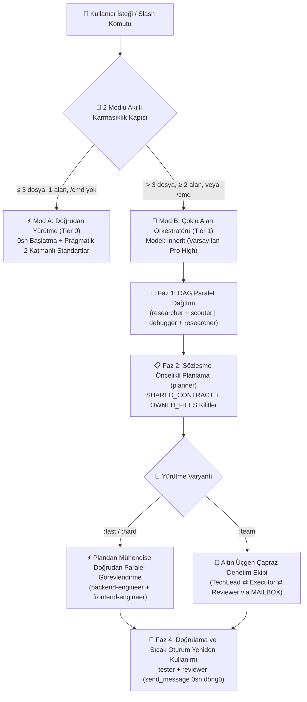

<div align="center">
  <h1>⚡ BoomOpen Workflow Kit v5.5.0</h1>
  <p><strong>Çok Platformlu Smart-Hybrid Yapay Zeka İş Gücü İS — 21 Uzman Ajan, 17 Altın Üçgen Ekibi ve 1.430+ İsteğe Bağlı Yetenek Kasası</strong></p>

  <p>
    <a href="https://github.com/Kennyboom/BoomOpen-Workflow-Kit/releases"></a>
    <a href="#platforms"></a>
    <a href="#agents"></a>
    <a href="#pillars"></a>
    <a href="https://nodejs.org/">=18.0.0" /></a>
    <a href="../LICENSE"></a>
  </p>

  <p>
    <a href="../README.md">🇬🇧 English</a> • <a href="./README.vi.md">🇻🇳 Tiếng Việt</a> • <a href="./README.zh-CN.md">🇨🇳 简体中文</a> • <a href="./README.zh-TW.md">🇹🇼 繁體中文</a> • <a href="./README.ja.md">🇯🇵 日本語</a> • <a href="./README.ko.md">🇰🇷 한국어</a> • <a href="./README.es.md">🇪🇸 Español</a> • <a href="./README.fr.md">🇫🇷 Français</a> • <a href="./README.de.md">🇩🇪 Deutsch</a><br/>
    <a href="./README.pt-BR.md">🇧🇷 Português</a> • <a href="./README.ru.md">🇷🇺 Русский</a> • <a href="./README.hi.md">🇮🇳 हिन्दी</a> • <a href="./README.ar.md">🇸🇦 العربية</a> • <a href="./README.id.md">🇮🇩 Bahasa Indonesia</a> • <a href="./README.th.md">🇹🇭 ไทย</a> • <b>🇹🇷 Türkçe</b> • <a href="./README.it.md">🇮🇹 Italiano</a>
  </p>
</div>

---

## 🎬 Resmi Lansman Fragmanı (Full HD 1080p)

<div align="center">
  <a href="https://github.com/Kennyboom/BoomOpen-Workflow-Kit/raw/main/assets/media/boomopen_v55_trailer_en.mp4">
    
  </a>
  <p>
    ▶️ <a href="https://github.com/Kennyboom/BoomOpen-Workflow-Kit/raw/main/assets/media/boomopen_v55_trailer_en.mp4"><b>Full HD 1080p Resmi Lansman Fragmanını izlemek / oynatmak için buraya tıklayın (Stüdyo seslendirmeli MP4)</b></a>
  </p>
</div>

---

## 🌟 BoomOpen Workflow Kit v5.5 Nedir?

**BoomOpen Workflow Kit v5.5 (Multi-Platform Unified & Smart-Hybrid Edition)**, tek bir yapay zeka kodlama asistanını **21 uzman ajan (Specialist Agents)**, **17 çapraz denetimli Altın Üçgen ekibi (Golden Triangle Teams)**, **48 temel yetenek (Core Skills)** ve **1.430’dan fazla niş kütüphane yeteneğinden (`skills_library`)** oluşan koordine bir mühendislik organizasyonuna dönüştüren açık kaynaklı bir çoklu ajan işletim sistemidir.

Her basit soruda soğuk başlatma gecikmesine yol açan hantal ajan sarmalayıcılarının aksine, BoomOpen v5.5 **2 Modlu Akıllı Karmaşıklık Eşik Kapısını (2-Mode Smart Complexity Threshold Gate)** sunar:
- **⚡ Mod A — Doğrudan Yürütme (0 sn Soğuk Başlatma)**: Basit soru-cevaplar (Q&A), kod açıklamaları, tek alanlı hata düzeltmeleri veya **≤ 3 dosyaya** dokunan net değişiklikler (`/cmd` komutu olmadan), **Pragmatik 2 Katmanlı Kodlama Standartları** ve **Kalıcı Test ve Hata Düzeltme** kuralları uygulanarak ana ajan tarafından **doğrudan** yürütülür, test edilir ve doğrulanır.
- **🎻 Mod B — Katı Çoklu Ajan Orkestrasyonu**: Karmaşık özellikler (**> 3 dosya** veya **≥ 2 alan**) ya da açık `/cmd` iş akışı komutları; **DAG Paralel Dağıtım (Parallel Fan-Out)**, **Plandan Uygulayıcıya Doğrudan Görevlendirme**, **Sözleşme Öncelikli Dosya Kilitleri (`SHARED_CONTRACT` + `OWNED_FILES`)** ve **Sıcak Alt Ajan Yeniden Kullanımı (`send_message`)** özelliklerine sahip katı Orkestratör modunu etkinleştirir.

- **📚 Sıfır Bağlam Şişkinliği ile 1.430+ Devasa Yetenek Kasası**: `matrix-skills/compact-index.json` içinde önceden derlenmiş **48 Çekirdek Yetenek (`skills/`)** ve **1.430+ Niş Kütüphane Yeteneği (`skills_library/`)** ile 2 adımlı `O(1)` arama sunar — istem penceresini kirletmeden Backend, Frontend, Mobil, Oyun Geliştirme (Unity/Unreal/Godot), AI/ML, BigQuery/Veri, Bulut/DevOps ve OWASP Siber Güvenlik alanlarında anında uzmanlık sağlar.

---

## 🏗️ Akıllı-Hibrit Mimari (v5.5)



---

## 🧠 v5.5 Sürümünün 6 Temel Sütunu

1. **🌐 5 Platformda Tam Birleşik Uyum (`platforms/*`)**:
   - Tek bir birleşik mimariden **Google Antigravity 2.0 (Gemini)**, **Claude Code**, **OpenAI Codex**, **Cursor** ve **GitHub Copilot** için birinci sınıf yerel (native) kurulum.
2. **📏 Pragmatik 2 Katmanlı Kodlama Standartları (Parçalanmayı Önleme)**:
   - **Katman 1 — Katı Kalite ve Güvenlik Kuralları (Sıfır Tolerans)**: Tek Sorumluluk İlkesi (Single Responsibility), **açık `any` kullanımına KESİNLİKLE İZİN VERİLMEZ**, **üretim kodunda unutulmuş debug `console.log` yasaktır**, async/API sınırlarında `try/catch` + tipli hata yönetimi zorunludur, sabitler `SCREAMING_SNAKE_CASE` olmalıdır, DRY (`≥ 3`) ve temiz sıralanmış importlar.
   - **Katman 2 — Esnek Yapısal Yönergeler (Mekanik Satır Bölme Yerine Bütünlük)**: Bütünlüklü dosyalar `~200–350 satır` hedefler ve `~400–450 satır` esnek üst sınıra sahiptir (yalnızca `>500 satırı` aşan veya birden fazla alanı karıştıran dosyalar bölünür; test, tip, CLI ve dokümanlar muaftır). Mantık fonksiyonları `~20–40 satır` (UI/Handler `~40–80 satır`).
3. **🎯 Plandan Uygulayıcıya Doğrudan Görevlendirme ve Sıcak Alt Ajan Yeniden Kullanımı (`send_message`)**:
   - `PLAN-{feature}.md` oluşturulduktan sonra Orkestratör, gereksiz bir `tech-lead` ara adımına ihtiyaç duymadan görevleri **doğrudan** alan mühendislerine (`backend-engineer`, `frontend-engineer`, `database-architect` vb.) iletir.
   - Aktif alt ajanlar **Aktif Oturum Kayıt Defterine (`Role → conversationId`)** kaydedilir ve `send_message` aracılığıyla **0 sn soğuk başlatma** ve **%100 korunan dosya bağlamıyla** yeniden kullanılır.
4. **🤝 Sözleşme Öncelikli Paralel Görevlendirme (`SHARED_CONTRACT` + `OWNED_FILES`)**:
   - Çok alanlı planlar, paralel mühendisleri başlatmadan önce API uç noktalarını, DTO şemalarını ve özel dosya yazma sahipliğini (`OWNED_FILES` ve `READ_ONLY_FILES`) kilitleyerek yazma çakışmalarını tamamen ortadan kaldırır.
5. **🔍 5-Whys (SPIE v3.0) Kök Neden Hata Ayıklama ve %100 Temiz Git Ağacı**:
   - `debugger`, her hatayı en az 3 derecelendirilmiş hipotez ve **5-Whys nedensellik zinciri** (`Neden 1 Belirti` → `Neden 5 Sistemik Kök Neden`) üzerinden izler. Geçici çıktılar (`PLAN`, `DEBUG`, `TEST`, `REVIEW`, `MAILBOX`) öncelikle `<appDataDir>\brain\<conversation-id>\` dizinine yazılarak Git çalışma ağacı %100 temiz tutulur.
6. **🩺 Yerleşik CLI Tanılama (`doctor` & `check`) ve O(1) Yetenek İndeksi**:
   - `npm run doctor` tüm 5 platform paketini, 21 ajanı, 51 ekip dosyasını, 72 komutu ve `matrix-skills/compact-index.json` (`1.430+` yetenek) dosyasını doğrular. `npm run check <dir>` Katman 1 ve Katman 2 standartlarını otomatik olarak denetler.

---

## 💻 Desteklenen Yapay Zeka Platformları

| Platform | Destek Düzeyi | Küresel Giriş Noktası | Framework Kurulum Yolu |
|----------|:-------------:|-------------------|------------------------|
| **Antigravity (Gemini)** | ✅ Yerel v5.5 | `~/.gemini/GEMINI.md` | `~/.gemini/config/skills/boomopen-workflow-kit/` |
| **Claude Code** | ✅ Yerel v5.5 | `~/.claude/CLAUDE.md` | `~/.claude/skills/boomopen-workflow-kit/` |
| **OpenAI Codex** | ✅ Yerel v5.5 | `~/.codex/CODEX.md` & `AGENTS.md` | `~/.codex/skills/boomopen-workflow-kit/` |
| **Cursor** | ✅ Yerel v5.5 | `~/.cursor/rules/boomopen-workflow-kit.mdc` | `~/.cursor/skills/boomopen-workflow-kit/` |
| **GitHub Copilot** | ✅ Yerel v5.5 | `~/.copilot/COPILOT.md` | `~/.copilot/skills/boomopen-workflow-kit/` |

---

## 🚀 Hızlı Başlangıç ve Kurulum

```bash
# 1. Depoyu klonlayın
git clone https://github.com/Kennyboom/BoomOpen-Workflow-Kit.git
cd BoomOpen-Workflow-Kit

# 2. Yapay zeka kodlama asistanınız için kurun (birini seçin veya --all)
npm run install:antigravity   # Google Antigravity 2.0 (Gemini)
npm run install:claude        # Anthropic Claude Code
npm run install:codex         # OpenAI Codex CLI
npm run install:cursor        # Cursor AI Editor
npm run install:copilot       # GitHub Copilot (VS Code)
npm run install:all           # Tüm 5 platform için tek seferde kurulum

# 3. Kurulum sağlığını, 2 katmanlı kod standartlarını ve test paketini doğrulayın
npm run doctor
npm run check ./cli
npm test
```

---

## 🎛️ Birleşik Ayarlar ve Mod Seçimi (`/settings` Kontrol Merkezi)

BoomOpen v5.5, çalışma modlarını (`auto`, `mode_a`, `mode_b`, `team`), 4 hazır profili ve 12 sistem ayarını **5 platformun** tamamında `< 10ms` içinde (**Turn-1 gecikmesi 0ms**) değiştirmenizi sağlayan **Sıfır Gecikmeli Birleşik Kontrol Merkezi** içerir:

| Hazır Profil (`Preset`) | Çalışma Modu (`execution.mode`) | Varsayılan Varyant | Doğal Dil Araştırması (`naturalLanguageResearchTrigger`) | Kod Standartları (`codingStandards`) | En Uygun Kullanım |
|:---|:---|:---:|:---:|:---:|:---|
| **⚡ `smart-hybrid`** *(Varsayılan Önerilen)* | **`auto`** (`≤ 3 dosya` → Mode A Doğrudan; `> 3 dosya` veya `/cmd` → Mode B) | `auto` | **`auto_team`** *(Araştırma/fikirleri otomatik olarak `/brainstorm:team` Golden Triangle ekibine yönlendirir)* | `pragmatic` (`400/500` satır) | Günlük full-stack geliştirme: küçük görevlerde anında, karmaşık mimarilerde derinlemesine |
| **🚀 `solo-fast`** | **`mode_a`** *(Doğrudan tekli çalışmayı zorlar, 0 sn alt-ajan gecikmesi)* | `fast` | `off` *(`/brainstorm` yazılmadıkça sohbette doğrudan yanıt verir)* | `relaxed` (`600/800` satır) | Acil hotfix’ler, hızlı prototipleme, betikler ve maksimum token tasarrufu |
| **🧠 `deep-architect`** | **`mode_b`** *(Her görevde Mode B Çoklu-Ajan Orkestrasyonunu zorlar)* | `hard` | `auto_hard` *(Otomatik `/brainstorm:hard` 5-Mercekli araştırma çalıştırır)* | `strict` (`300/400` satır) | Karmaşık sistem mimarisi, sıfırdan tasarım ve çoklu-alan (multi-domain) refaktör |
| **🔺 `adversarial-team`** | **`team`** *(Tüm iş akışlarında 3-Ajanlı Golden Triangle `:team` modunu zorlar)* | `team` | **`auto_team`** *(`MAILBOX` üzerinden 3-Ajanlı çapraz inceleme ve tartışma)* | `strict` (`300/400` satır) | Kritik prodüksiyon kodu, güvenlik denetimleri ve sıfır hatalı sürümler |

### Mod Değiştirmenin 3 Yolu (Sohbet İçi `/settings`, Yerel Web Paneli ve CLI)

```bash
# 1. Sohbet İçi Slash Komutu (Etkileşimli menü veya tek satır komut)
/settings                                     # Etkileşimli seçim menüsünü aç (ask_question UI)
/settings preset smart-hybrid                 # Varsayılan önerilen moda geç (Auto Mode A/B + auto_team)
/settings preset solo-fast                    # Mode A Doğrudan Hızlı Çalıştırma moduna geç
/settings preset deep-architect               # Mode B Çoklu-Ajan Orkestratör moduna geç
/settings preset adversarial-team             # Golden Triangle 3-Ajanlı Ekip (:team) moduna geç
/settings mode auto | mode_a | mode_b | team  # Çalışma modunu (execution.mode) doğrudan değiştir

# 2. Yerel Web Kontrol Merkezi Paneli (http://127.0.0.1:4567)
npm run settings:ui

# 3. Terminal CLI (Global ~/.boomopen/settings.json ve Proje ./.boomopen.json)
npm run settings -- status
npm run settings -- preset adversarial-team
npm run settings -- reset
```

---

## 🎯 Slash Komutları Başvuru Tablosu

| Komut | Varyantlar | Temel Amaç |
|---------|----------|-----------------|
| **`/cook`** | `:fast`, `:hard`, `:team` | Uçtan uca özellik geliştirme (Araştırma/Keşif → Plan → Paralel Kod → Test → İnceleme) |
| **`/code`** | `:fast`, `:hard`, `:team` | Mevcut bir `PLAN-{feature}.md` üzerinden doğrudan kodlama ve doğrulama yürütme |
| **`/plan`** | `:fast`, `:hard`, `:team` | `SHARED_CONTRACT`, `OWNED_FILES` ve Given/When/Then kriterleriyle uygulama planları oluşturma |
| **`/fix`** | `:fast`, `:hard`, `:team` | Zorunlu regresyon testi doğrulamasıyla kök neden hata çözümü |
| **`/debug`** | `:fast`, `:hard`, `:team` | 3 Hipotez + **5-Whys (SPIE v3.0)** nedensellik zinciriyle kök neden araştırması (`DEBUG-{issue}.md`) |
| **`/test`** | `:fast`, `:hard`, `:team` | DAG Paralel Fan-Out test yürütme + kapsanmayan uç durumların keşfi (`tester` + `scouter`) |
| **`/review`** | `:fast`, `:hard`, `:team` | 4 yönlü paralel kod denetimi (Mimari, Kod Kalitesi, OWASP Güvenliği, Performans) |
| **`/design`** | `:fast`, `:hard`, `:team` | Sistem mimarisi, veritabanı şeması ve UI/UX teknik şartnamesi (`DESIGN.md`) |
| **`/docs`** | `:core`, `:business`, `:audit` | 2 katmanlı yapılandırılmış mimari ve iş dokümantasyonu oluşturma veya senkronize etme (`./documents/`) |
| **`/deploy`** | `:check`, `:preview`, `:production`, `:rollback` | Dağıtım öncesi hazırlık kapıları, önizleme ortamları, canlıya alma ve güvenli geri alma (rollback) |
| **`/brainstorm`** | `:fast`, `:hard`, `:team` | Sokratik gereksinim keşfi, ödünleşim (trade-off) analizi ve fikir geliştirme |
| **`/report`** | `:fast`, `:hard`, `:team` | Metrikler ve diyagramlar içeren yönetici ve teknik sentez raporları |
| **`/orchestrate`** | — | Birden fazla alanda özel çoklu ajan iş hattı orkestrasyonu |
| **`/settings` / `/config`** | `preset`, `mode`, `set`, `ui` | Birleşik Kontrol Merkezi: `Auto` / `Mode A` / `Mode B` / `Team` geçişi, hazır profiller veya Web UI (`--ui`) |
| **`/save` / `/recap`** | — | Oturum durumunu (`SESSION-HANDOVER.md`) kaydetme ve `< 5 sn` içinde tüm bağlamı geri yükleme |

---

## 🤖 21 Uzman Ajan ve 17 Altın Üçgen Ekibi

| Kategori | Uzman Ajanlar (`agents/*.md`) | Altın Üçgen Ekipleri (`agents/teams/*-team/`) |
|----------|-----------------------------------|------------------------------------------------|
| **Mühendislik ve Uygulama** | `backend-engineer`, `frontend-engineer`, `mobile-engineer`, `game-engineer`, `database-architect`, `devops-engineer` | `backend-team`, `frontend-team`, `fullstack-team`, `mobile-team`, `game-team`, `database-team`, `devops-team` |
| **Mimari ve Planlama** | `tech-lead`, `planner`, `brainstormer`, `business-analyst`, `project-manager`, `designer` | `planning-team`, `project-team`, `design-team` |
| **Kalite, Güvenlik ve Hata Ayıklama** | `debugger`, `tester`, `reviewer`, `security-engineer`, `performance-engineer` | `debug-team`, `qa-team`, `review-team`, `security-team`, `performance-team` |
| **Araştırma ve Bilgi Yönetimi** | `researcher`, `scouter`, `docs-manager`, `reporter` | `research-team`, `docs-team`, `report-team` |

---

## 📚 1.430+ Yetenek Kasası (48 Çekirdek + 1.430+ Kütüphane Yeteneği)

BoomOpen, **2 Adımlı O(1) Aşamalı Yetenek Çözümlemesi** (`<skills>` → `matrix-skills/compact-index.json` → yalnızca gereken `SKILL.md` dosyasını yükleme) sayesinde **boşta 0 token maliyeti** sunan en büyük açık kaynaklı mühendislik yetenek ekosistemlerinden birine sahiptir:

| Yetenek Katmanı / Alanı | Sayı | Temsili Yetenekler ve Yetkinlikler | Yükleme Mekanizması |
|:---|:---:|:---|:---|
| **⚡ Katman 1: Çekirdek Yetenekler (`skills/`)** | **48** | `clean-code`, `systematic-debugging`, `plan-writing`, `brainstorming`, `frontend-design`, `api-patterns`, `database-design`, `testing-patterns`, `vulnerability-scanner`, `skill-seeker` | Turn 1'de anında erişim için `<skills>` içinde önceden indekslenmiştir |
| **🌐 Web, Backend & Dağıtık Sistemler** | **380+** | Next.js/React 19, FastAPI, NestJS, Go/Rust mikroservisleri, GraphQL, gRPC, Redis/Kafka olay güdümlü mimari, çok kiracılı SaaS | `compact-index.json` üzerinden isteğe bağlı (`skills_library/`) |
| **🤖 Yapay Zeka, LLM Ajanları & Veri Mühendisliği** | **310+** | RAG boru hatları, LangGraph/MCP sunucuları, istem mühendisliği, Vertex AI, BigQuery analitiği, dbt, Spark, vektör veritabanları | `compact-index.json` üzerinden isteğe bağlı (`skills_library/`) |
| **☁️ Bulut, DevOps, Kubernetes & Güvenlik** | **290+** | Terraform/OpenTofu, AWS/GCP/Azure mimarisi, Docker/K8s GitOps, CI/CD hatları, OWASP Top 10 denetimi, Zero-Trust kimlik doğrulama | `compact-index.json` üzerinden isteğe bağlı (`skills_library/`) |
| **📱 Mobil, Oyun Motorları & Özel Alanlar** | **450+** | iOS Swift/SwiftUI, Android Kotlin, React Native, Flutter, Unity 6, Unreal Engine 5, Godot 4, WebGL/Three.js, Kantitatif Finans, Web3 | `compact-index.json` üzerinden isteğe bağlı (`skills_library/`) |

---

## 📂 Depo Yapısı

```text
BoomOpen-Workflow-Kit/
├── agents/                  # 21 Uzman Ajan tanımı + 17 Altın Üçgen Ekibi (51 rol dosyası)
├── cli/                     # Kurucu (install.js), Sağlık Doktoru (doctor.js), 2 Katmanlı Kod Denetleyici (checker.js) ve Testler
├── commands/                # 72 Slash komutu iş akışı (:fast, :hard, :team) + _ref/ protokolleri
├── documents/               # 2 katmanlı Mimari, Alan, Kaynak Kod ve Kodlama Standartları dokümantasyonu
├── i18n/                    # Çok dilli dokümantasyon (16 dilde eksiksiz README çevirisi)
├── matrix-skills/           # Alan bazlı YAML yetenek matrisleri + önceden derlenmiş compact-index.json (1.430+ yetenek)
├── platforms/               # 5 platform için birleşik şablonlar (antigravity/, claude/, codex/, copilot/, cursor/)
├── rules/                   # İsteğe bağlı yüklenen Mod B kuralları (CORE, PHASES, AGENTS, TEAMS, SKILLS, ERRORS, REFERENCE)
├── scripts/                 # Python otomasyon ve doğrulama betikleri (checklist.py, verify_all.py vb.)
├── skills/                  # 48 Temel Yetenek (clean-code, debugger, plan-writing, frontend-design vb.)
├── skills_library/          # 2 adımlı hızlı arama ile isteğe bağlı yüklenen 1.430+ niş yetenek kütüphanesi
└── GEMINI.md | CLAUDE.md | CODEX.md | COPILOT.md | CURSOR.md | AGENT.md
```

---

## 📄 Lisans ve Güvenlik

- **Lisans**: [MIT Lisansı](../LICENSE) altında dağıtılmaktadır. Telif Hakkı © 2026 **Kennyboom (BoomOpen)**.
- **Güvenlik Politikası**: Yerleşik güvenlik korumaları ve güvenlik açığı bildirim yönergeleri için [SECURITY.md](../SECURITY.md) dosyasına bakın.
