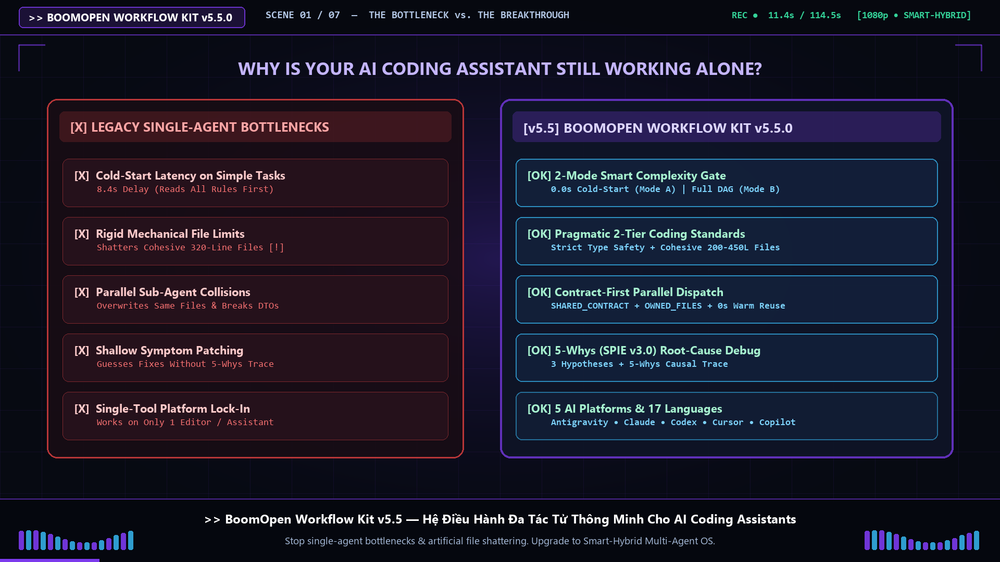
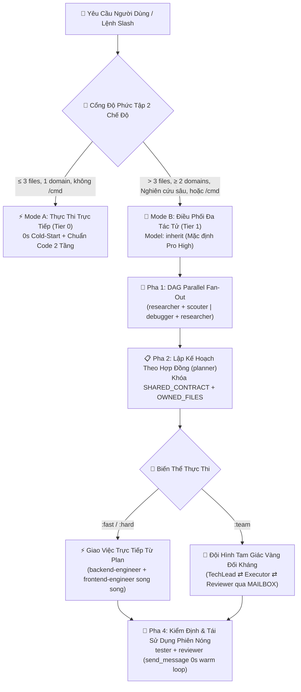

<div align="center">
  <h1>⚡ BoomOpen Workflow Kit v5.5.0</h1>
  <p><strong>Hệ Điều Hành Nhân Sự AI Đa Nền Tảng — 21 Đặc Vụ Chuyên Gia, 17 Đội Hình Tam Giác Vàng &amp; Kho Hơn 1.450+ Kỹ Năng Chuyên Sâu</strong></p>

  <p>
    <a href="https://github.com/Kennyboom/BoomOpen-Workflow-Kit/releases"></a>
    <a href="#-các-nền-tảng-ai-được-hỗ-trợ"></a>
    <a href="#-21-đặc-vụ-chuyên-gia--17-đội-hình-tam-giác-vàng"></a>
    <a href="#-kho-hơn-1450-kỹ-năng-chuyên-sâu-48-kỹ-năng-lõi--1450-kỹ-năng-thư-viện"></a>
    <a href="https://nodejs.org/">=18.0.0" /></a>
    <a href="../LICENSE"></a>
  </p>

  <p>
    <a href="../README.md">🇬🇧 English</a> •
    <b>🇻🇳 Tiếng Việt</b> •
    <a href="./README.zh-CN.md">🇨🇳 简体中文</a> •
    <a href="./README.zh-TW.md">🇹🇼 繁體中文</a> •
    <a href="./README.ja.md">🇯🇵 日本語</a> •
    <a href="./README.ko.md">🇰🇷 한국어</a> •
    <a href="./README.es.md">🇪🇸 Español</a> •
    <a href="./README.fr.md">🇫🇷 Français</a> •
    <a href="./README.de.md">🇩🇪 Deutsch</a><br/>
    <a href="./README.pt-BR.md">🇧🇷 Português</a> •
    <a href="./README.ru.md">🇷🇺 Русский</a> •
    <a href="./README.hi.md">🇮🇳 हिन्दी</a> •
    <a href="./README.ar.md">🇸🇦 العربية</a> •
    <a href="./README.id.md">🇮🇩 Bahasa Indonesia</a> •
    <a href="./README.th.md">🇹🇭 ไทย</a> •
    <a href="./README.tr.md">🇹🇷 Türkçe</a> •
    <a href="./README.it.md">🇮🇹 Italiano</a>
  </p>

  <p>
    <a href="#-video-giới-thiệu-chính-thức-full-hd-1080p"><b>🎬 Video Giới Thiệu</b></a> •
    <a href="#-boomopen-workflow-kit-v55-là-gì"><b>🌟 Tổng Quan</b></a> •
    <a href="#-kiến-trúc-smart-hybrid-v55"><b>🏗️ Kiến Trúc</b></a> •
    <a href="#-cài-đặt-nhanh--kiểm-định"><b>🚀 Cài Đặt Nhanh</b></a> •
    <a href="#-hướng-dẫn-lựa-chọn-chế-độ--bảng-cài-đặt-settings-control-center"><b>🎛️ Chế Độ &amp; Cài Đặt</b></a> •
    <a href="#-bảng-tham-chiếu-lệnh-slash"><b>🎯 Lệnh Slash</b></a> •
    <a href="#-21-đặc-vụ-chuyên-gia--17-đội-hình-tam-giác-vàng"><b>🤖 21 Agents &amp; 17 Teams</b></a> •
    <a href="#-kho-hơn-1450-kỹ-năng-chuyên-sâu-48-kỹ-năng-lõi--1450-kỹ-năng-thư-viện"><b>📚 Kho 1.450+ Kỹ Năng</b></a>
  </p>
</div>

---

## 🎬 Video Giới Thiệu Chính Thức (Full HD 1080p)

<div align="center">
  <a href="https://github.com/Kennyboom/BoomOpen-Workflow-Kit/raw/main/assets/media/boomopen_v55_trailer_vi.mp4">
    
  </a>
  <p>
    ▶️ <a href="https://github.com/Kennyboom/BoomOpen-Workflow-Kit/raw/main/assets/media/boomopen_v55_trailer_vi.mp4"><b>Bấm Vào Đây Để Xem / Tải Video Giới Thiệu Chính Thức (Full HD 1080p — Thuyết Minh Studio)</b></a>
  </p>
</div>

---

## 🌟 BoomOpen Workflow Kit v5.5 là gì?

**BoomOpen Workflow Kit v5.5 (Multi-Platform Unified & Smart-Hybrid Edition)** là hệ điều hành đa tác tử (Multi-Agent) mã nguồn mở giúp biến một AI Coding Assistant đơn lẻ thành một tổ chức kỹ thuật hoàn chỉnh gồm **21 Đặc vụ Chuyên gia (Specialist Agents)**, **17 Đội hình Tam Giác Vàng (Golden Triangle Teams)**, **48 Kỹ năng Lõi (`skills/`)** và **Kho Hơn 1.450+ Kỹ Năng Chuyên Sâu (`skills_library/`)**.

Khác với các bộ prompt đơn lẻ hoặc các wrapper nặng nề gây lãng phí ngữ cảnh ở mọi lượt hội thoại, BoomOpen v5.5 kết hợp **Cổng Ưu Tiên Sub-agent Ngay Từ Turn 1 (Proactive Sub-agent First Gate)** cùng **Cơ Chế Nạp Kỹ Năng O(1) Không Gây Phình Ngữ Cảnh**:
- **🚀 Phân Tán Sub-agent Song Song Ngay Turn 1 & Điều Phối Đa Tác Tử Mode B**: Khi cần khám phá codebase (`> 2 files`), phát triển tính năng đa tầng (`≥ 2 domains`), nghiên cứu/phân tích chuyên sâu bằng ngôn ngữ tự nhiên (`auto_team` → `/brainstorm:team`), hoặc gọi lệnh `/cmd`, hệ thống lập tức khởi chạy song song các sub-agent ngay ở Turn 1 với **DAG Parallel Fan-Out**, **Direct Plan-to-Executor Dispatch**, **Khóa Hợp Đồng & Quyền Ghi File (`SHARED_CONTRACT` + `OWNED_FILES`)**, và **Tái Sử Dụng Sub-agent Nóng (`send_message`)**.
- **⚡ Mode A — Thực Thi Vi Mô Đích Danh**: Các câu hỏi Q&A, giải thích code, hoặc chỉnh sửa nhỏ khi đã biết chính xác `≤ 2 files` ngay từ Turn 1 được thực thi trực tiếp, tuân thủ nghiêm ngặt **Chuẩn Code Thực Dụng 2 Tầng (Pragmatic 2-Tier Coding Standards)** và **Kiểm Thử & Sửa Lỗi Bền Bỉ**.
- **📚 Kho Hơn 1.450+ Kỹ Năng Chuyên Sâu Với 0% Phình Bộ Nhớ Ngữ Cảnh**: Được biên dịch sẵn vào chỉ mục `matrix-skills/compact-index.json` (`1.452` kỹ năng) giúp tra cứu 2 bước `O(1)` — trang bị cho AI tri thức chuyên gia tức thì về Backend (Cloudflare D1/R2/DO, Hono RPC, Supabase RLS, Drizzle, Rust Axum), Frontend (React 19/Next.js 15, Tailwind v4, TanStack Start), Mobile (Tauri v2, React Native, Flutter), Game Dev (Unity 6 DOTS, Godot 4, WebGPU/Three.js TSL, Colyseus Netcode), AI/ML & Agent SDKs (MCP FastMCP 2025, OpenAI/Claude/Google ADK), Cloud/DevOps (Terraform/OpenTofu) và Bảo mật OWASP LLM 2025 **mà không làm đầy cửa sổ prompt**.

---

## 🏗️ Kiến Trúc Smart-Hybrid (v5.5)



---

## 🧠 6 Trụ Cột Cốt Lõi Của v5.5

1. **🌐 Đồng Bộ Toàn Diện 5 Nền Tảng (`platforms/*`)**:
   - Hỗ trợ cài đặt gốc (native) đồng nhất 100% cho **Google Antigravity 2.0 (Gemini)**, **Claude Code**, **OpenAI Codex**, **Cursor**, và **GitHub Copilot** từ một kiến trúc duy nhất.
2. **📏 Chuẩn Code Thực Dụng 2 Tầng (Pragmatic 2-Tier Coding Standards — Chống Cắt Vụn File)**:
   - **Tầng 1 — Bắt Buộc Tuyệt Đối (Zero Tolerance)**: Single Responsibility (1 trách nhiệm/file hoặc hàm), **CẤM `any` tường minh**, **CẤM để sót `console.log` tạm** trong ứng dụng production, bắt buộc `try/catch` + typed error ở biên async/API, hằng số `SCREAMING_SNAKE_CASE`, DRY (`≥ 3`), và sắp xếp imports sạch sẽ.
   - **Tầng 2 — Ngưỡng Cấu Trúc Linh Hoạt (Ưu Tiên Tính Mạch Lạc)**: File gắn kết hướng tới `~200–350 dòng` với trần mềm `~400–450 dòng` (chỉ bắt buộc tách khi `>500 dòng` hoặc ôm nhiều domain; miễn trừ cho Test, Schema/Types, CLI, Docs). Hàm logic `~20–40 dòng` (`~40–80 dòng` cho UI/Handlers).
3. **🎯 Giao Việc Trực Tiếp Từ Plan & Tái Sử Dụng Sub-agent Nóng (`send_message`)**:
   - Khi đã có `PLAN-{feature}.md`, Orchestrator giao việc **trực tiếp** cho các kỹ sư chuyên môn (`backend-engineer`, `frontend-engineer`, `database-architect`,...) mà không qua bước trung gian `tech-lead` dư thừa.
   - Các sub-agent đang hoạt động được lưu trong **Danh Bạ Phiên Nóng (`Role → conversationId`)** và tái sử dụng qua `send_message` với **độ trễ khởi động = 0 giây** và **giữ nguyên 100% ngữ cảnh file**.
4. **🤝 Giao Việc Song Song Theo Hợp Đồng (`SHARED_CONTRACT` + `OWNED_FILES`)**:
   - Bản kế hoạch đa domain khóa trước API endpoints, DTO schemas và phân tách quyền sở hữu file (`OWNED_FILES` vs. `READ_ONLY_FILES`) trước khi khởi chạy song song các kỹ sư, loại bỏ hoàn toàn xung đột ghi đè file.
5. **🔍 Truy Nguyên Nhân Gốc Rễ 5-Whys (SPIE v3.0) & Giữ Sạch Git Tree 100%**:
   - `debugger` phân tích tối thiểu 3 giả thuyết và chuỗi nhân quả **5-Whys** (`Why 1 Triệu chứng` → `Why 5 Nguyên nhân hệ thống`). Các tài liệu trung gian (`PLAN`, `DEBUG`, `TEST`, `REVIEW`, `MAILBOX`) được ưu tiên lưu vào `<appDataDir>\brain\<conversation-id>\` để giữ sạch cây Git.
6. **🩺 Chẩn Đoán CLI Tích Hợp (`doctor` & `check`) & Chỉ Mục Kỹ Năng O(1)**:
   - `npm run doctor` kiểm tra toàn bộ 5 nền tảng, 21 agents, 51 file đội hình, 72 lệnh và `matrix-skills/compact-index.json` (`1.450+` kỹ năng). `npm run check <dir>` kiểm định tự động chuẩn code Tầng 1 & Tầng 2.

---

## 💻 Các Nền Tảng AI Được Hỗ Trợ

| Nền Tảng | Mức Hỗ Trợ | Entrypoint Toàn Cục | Đường Dẫn Cài Đặt Framework |
|----------|:-------------:|-------------------|------------------------|
| **Antigravity (Gemini)** | ✅ Native v5.5 | `~/.gemini/GEMINI.md` | `~/.gemini/config/skills/boomopen-workflow-kit/` |
| **Claude Code** | ✅ Native v5.5 | `~/.claude/CLAUDE.md` | `~/.claude/skills/boomopen-workflow-kit/` |
| **OpenAI Codex** | ✅ Native v5.5 | `~/.codex/CODEX.md` & `AGENTS.md` | `~/.codex/skills/boomopen-workflow-kit/` |
| **Cursor** | ✅ Native v5.5 | `~/.cursor/rules/boomopen-workflow-kit.mdc` | `~/.cursor/skills/boomopen-workflow-kit/` |
| **GitHub Copilot** | ✅ Native v5.5 | `~/.copilot/COPILOT.md` | `~/.copilot/skills/boomopen-workflow-kit/` |

---

## 🚀 Cài Đặt Nhanh & Kiểm Định

```bash
# 1. Clone kho mã nguồn
git clone https://github.com/Kennyboom/BoomOpen-Workflow-Kit.git
cd BoomOpen-Workflow-Kit

# 2. Cài đặt cho trợ lý lập trình AI của bạn (chọn 1 hoặc --all)
npm run install:antigravity   # Google Antigravity 2.0 (Gemini)
npm run install:claude        # Anthropic Claude Code
npm run install:codex         # OpenAI Codex CLI
npm run install:cursor        # Cursor AI Editor
npm run install:copilot       # GitHub Copilot (VS Code)
npm run install:all           # Cài đặt đồng loạt cho cả 5 nền tảng

# 3. Kiểm tra sức khỏe cài đặt, chuẩn code 2 tầng & bộ test tự động
npm run doctor
npm run check ./cli
npm test
```

---

## 🎛️ Hướng Dẫn Lựa Chọn Chế Độ & Bảng Cài Đặt (`/settings` Control Center)

Mặc định ngay sau khi cài đặt, BoomOpen v5.5 tự động kích hoạt cấu hình **Recommended (`⚡ smart-hybrid`)** lưu tại `~/.boomopen/settings.json` và nhúng trực tiếp vào `~/.gemini/GEMINI.md` (cùng 4 nền tảng còn lại) với **độ trễ Turn 1 = 0ms**. Bạn có thể tùy ý chuyển đổi giữa **4 Chế Độ Vận Hành (Presets)** hoặc tinh chỉnh **12 thông số hệ thống** qua 3 cách:

### 1️⃣ Bảng 4 Chế Độ Vận Hành (Preset Profiles)

| Bộ Cấu Hình (`Preset`) | Chế Độ Thực Thi (`execution.mode`) | Biến Thể Lệnh Mặc Định | Khi Hỏi "Nghiên cứu / Ý tưởng" Tự Nhiên (`naturalLanguageResearchTrigger`) | Chuẩn Code (`codingStandards`) | Khi Nào Nên Dùng? |
|:-----------------------|:-----------------------------------|:----------------------:|:-------------------------------------------------------------------------:|:------------------------------:|:------------------|
| **⚡ `smart-hybrid`** *(Mặc định Recommended)* | **`auto`** (Việc nhỏ `≤ 3 files` chạy **Mode A** siêu tốc; việc lớn `> 3 files` hoặc `/cmd` chạy **Mode B Multi-Agent**) | `auto` | **`auto_team`** *(Tự động kích hoạt hội đồng 3-Agent `/brainstorm:team` Golden Triangle)* | `pragmatic` (`400/500` dòng) | Chế độ cân bằng hoàn hảo cho công việc hàng ngày: nhanh ở task nhỏ, cực sâu khi nghiên cứu & làm tính năng lớn |
| **🚀 `solo-fast`** | **`mode_a`** *(Ép chạy trực tiếp 1 Agent, tắt gọi sub-agent để phản hồi tức thì)* | `fast` | `off` *(Trả lời trực tiếp trong chat trừ khi gõ `/brainstorm`)* | `relaxed` (`600/800` dòng) | Khi cần sửa gấp hotfix, làm prototype nhanh, viết script nhỏ hoặc tiết kiệm tối đa token |
| **🧠 `deep-architect`** | **`mode_b`** *(Luôn bật điều phối Đa Tác Tử Mode B cho mọi tác vụ)* | `hard` | `auto_hard` *(Tự động chạy `/brainstorm:hard` 5-Lens Research)* | `strict` (`300/400` dòng) | Khi thiết kế kiến trúc hệ thống phức tạp, dự án mới hoặc refactor đa tầng |
| **🔺 `adversarial-team`** | **`team`** *(Luôn bật hội đồng 3-Agent đối kháng Golden Triangle `:team`)* | `team` | **`auto_team`** *(Hội đồng 3-Agent phản biện chéo qua `MAILBOX`)* | `strict` (`300/400` dòng) | Dự án trọng điểm (Fintech, Core Platform, Game 3D lớn) đòi hỏi chất lượng & bảo mật tuyệt đối |

### 2️⃣ Ba Cách Chuyển Đổi Chế Độ (Chat, Web UI, CLI)

1. **💬 Cách 1 — Gõ trực tiếp `/settings` ngay trong khung Chat (Nhanh & Tiện nhất)**:
   ```text
   /settings                                     # Mở bảng trạng thái + Menu chọn tương tác (ask_question UI)
   /settings preset smart-hybrid                 # Chuyển về chế độ Mặc định Recommended (Auto Mode A/B + auto_team)
   /settings preset solo-fast                    # Chuyển sang Mode A (Chạy trực tiếp siêu nhanh)
   /settings preset deep-architect               # Chuyển sang Mode B (Chuyên sâu Multi-Agent)
   /settings preset adversarial-team             # Chuyển sang Golden Triangle 3-Agent (:team)
   /settings mode auto | mode_a | mode_b | team  # Đổi riêng chế độ thực thi (Execution Mode)
   /settings ui                                  # Khởi chạy giao diện Web Control Center trên trình duyệt
   ```
2. **🌐 Cách 2 — Mở Bảng Điều Khiển Giao Diện Web (`http://127.0.0.1:4567`)**:
   > **Lưu ý**: Để mở trang Web local `http://127.0.0.1:4567`, bạn cần chạy lệnh khởi động server bên dưới trong Terminal (hoặc gõ `/settings ui` trong chat):
   ```bash
   npm run settings:ui
   # Hoặc chạy trực tiếp từ bất kỳ thư mục nào:
   node ~/.gemini/config/skills/boomopen-workflow-kit/cli/install.js settings --ui
   ```
3. **⌨️ Cách 3 — Chạy lệnh Terminal CLI (Hỗ trợ cả Global `~/.boomopen/settings.json` & từng Project `./.boomopen.json`)**:
   ```bash
   npm run settings -- status                                  # Xem bảng 12 thông số đang kích hoạt
   npm run settings -- preset adversarial-team                 # Đổi preset toàn cục & đồng bộ cả 5 IDE trong <10ms
   npm run settings -- set execution.mode mode_a --project     # Ghi đè chế độ riêng cho thư mục dự án hiện tại
   npm run settings -- reset                                   # Khôi phục về mặc định Recommended (smart-hybrid)
   ```

---

## 🎯 Bảng Tham Chiếu Lệnh Slash

| Lệnh | Biến Thể | Mục Đích Chính |
|---------|----------|-----------------|
| **`/cook`** | `:fast`, `:hard`, `:team` | Phát triển tính năng trọn vẹn (Research/Scout → Plan → Code song song → Test → Review) |
| **`/code`** | `:fast`, `:hard`, `:team` | Thực thi lập trình trực tiếp từ bản kế hoạch `PLAN-{feature}.md` đã có |
| **`/plan`** | `:fast`, `:hard`, `:team` | Thiết lập bản vẽ kỹ thuật với `SHARED_CONTRACT`, `OWNED_FILES` & tiêu chí Given/When/Then |
| **`/fix`** | `:fast`, `:hard`, `:team` | Sửa lỗi tận gốc kèm kiểm thử hồi quy bắt buộc |
| **`/debug`** | `:fast`, `:hard`, `:team` | Điều tra nguyên nhân gốc rễ theo 3 giả thuyết + chuỗi nhân quả **5-Whys (SPIE v3.0)** (`DEBUG-{issue}.md`) |
| **`/test`** | `:fast`, `:hard`, `:team` | Chạy DAG Parallel Fan-Out bộ test hiện có + rà soát edge-case chưa phủ (`tester` + `scouter`) |
| **`/review`** | `:fast`, `:hard`, `:team` | Kiểm định 4 chiều song song (Kiến trúc, Chất lượng Code, Bảo mật OWASP, Hiệu năng) |
| **`/design`** | `:fast`, `:hard`, `:team` | Thiết kế kiến trúc hệ thống, lược đồ CSDL và đặc tả UI/UX (`DESIGN.md`) |
| **`/docs`** | `:core`, `:business`, `:audit` | Khởi tạo và đồng bộ tài liệu kiến trúc & nghiệp vụ chuẩn 2 tầng (`./documents/`) |
| **`/deploy`** | `:check`, `:preview`, `:production`, `:rollback` | Kiểm tra điều kiện triển khai, môi trường preview, rollout production & rollback an toàn |
| **`/brainstorm`** | `:fast`, `:hard`, `:team` | Khám phá yêu cầu theo phương pháp Socratic, phân tích đánh đổi & ý tưởng |
| **`/report`** | `:fast`, `:hard`, `:team` | Tổng hợp báo cáo kỹ thuật và điều hành kèm số liệu & sơ đồ |
| **`/orchestrate`** | — | Điều phối đường ống đa tác tử tùy chỉnh xuyên suốt nhiều miền (domains) |
| **`/settings` / `/config`** | `preset`, `mode`, `set`, `ui` | Trung tâm điều khiển: đổi chế độ `Auto` / `Mode A` / `Mode B` / `Team`, chọn Preset, hoặc mở Web UI (`--ui`) |
| **`/save` / `/recap`** | — | Lưu trạng thái phiên (`SESSION-HANDOVER.md`) và khôi phục ngữ cảnh trong `< 5 giây` |

---

## 🤖 21 Đặc Vụ Chuyên Gia & 17 Đội Hình Tam Giác Vàng

| Nhóm Chuyên Môn | Đặc Vụ Chuyên Gia (`agents/*.md`) | Đội Hình Tam Giác Vàng (`agents/teams/*-team/`) |
|----------|-----------------------------------|------------------------------------------------|
| **Kỹ Thuật & Thực Thi** | `backend-engineer`, `frontend-engineer`, `mobile-engineer`, `game-engineer`, `database-architect`, `devops-engineer` | `backend-team`, `frontend-team`, `fullstack-team`, `mobile-team`, `game-team`, `database-team`, `devops-team` |
| **Kiến Trúc & Hoạch Định** | `tech-lead`, `planner`, `brainstormer`, `business-analyst`, `project-manager`, `designer` | `planning-team`, `project-team`, `design-team` |
| **Chất Lượng, Bảo Mật & Gỡ Lỗi** | `debugger`, `tester`, `reviewer`, `security-engineer`, `performance-engineer` | `debug-team`, `qa-team`, `review-team`, `security-team`, `performance-team` |
| **Nghiên Cứu & Tri Thức** | `researcher`, `scouter`, `docs-manager`, `reporter` | `research-team`, `docs-team`, `report-team` |

---

## 📚 Kho Hơn 1.450+ Kỹ Năng Chuyên Sâu (48 Kỹ Năng Lõi + 1.450+ Kỹ Năng Thư Viện)

BoomOpen tích hợp một trong những kho kỹ năng kỹ thuật phần mềm lớn nhất thế giới mã nguồn mở (`1.462` kỹ năng trên 19 domains) — được thiết kế với **chi phí token nhàn rỗi bằng 0 (Zero Context Bloat)** nhờ cơ chế **Tra Cứu Kỹ Năng 2 Bước O(1)** (Kiểm tra `<skills>` Lõi → Tra chỉ mục `matrix-skills/compact-index.json` → Chỉ nạp đúng file `SKILL.md` cần thiết):

| Phân Tầng / Miền Kỹ Năng | Số Lượng | Kỹ Năng & Năng Lực Tiêu Biểu (Chuẩn Công Nghệ 2026) | Cơ Chế Nạp Ngữ Cảnh |
|:-------------------------|:--------:|:----------------------------------------------------|:--------------------|
| **⚡ Tầng 1: Kỹ Năng Lõi (`skills/`)** | **48** | `clean-code`, `systematic-debugging`, `plan-writing`, `brainstorming`, `frontend-design`, `frontend-architecture`, `design-spec`, `api-patterns`, `database-design`, `testing-patterns`, `skill-seeker` | Nạp sẵn chỉ mục trong `<skills>`, truy cập tức thì ở Turn 1 |
| **🎨 Thiết Kế UI/UX, Motion & Design Systems** | **42** | Anti-AI-Slop Visual Craft, Hệ màu OKLCH & Bento Grid, Motion v12 + CSS View Transitions & Scroll-Driven Animations, AI-Native Generative UI UX, Headless Primitives (`cmdk`/`vaul`/`sonner`), Figma MCP + W3C DTCG Tokens, WCAG 2.2 AA/AAA, iOS 18 HIG & Material 3 Expressive | Nạp theo yêu cầu qua `compact-index.json` (`matrix-skills/design.yaml`) |
| **🌐 Web, Backend & Edge Data Stack** | **390+** | React 19 & Next.js 15 RSC, Tailwind v4 + `shadcn/ui`, TanStack Start/Router/Query, SaaS Dashboards & TanStack Table v8, Hono RPC + Zod OpenAPI, Rust Axum/Tokio/SQLx, Supabase RLS/Realtime, Drizzle + Neon/Turso | Nạp theo yêu cầu qua `compact-index.json` (`skills_library/`) |
| **🤖 AI, Agentic SDKs, MCP & Dữ Liệu** | **320+** | MCP FastMCP 2025 (`StreamableHTTP`), OpenAI Agents SDK, Claude Agent SDK, Google ADK (Gemini), Vercel AI SDK v4 & Mastra, AI IDE Plugin Authoring, RAG, BigQuery, dbt | Nạp theo yêu cầu qua `compact-index.json` (`skills_library/`) |
| **☁️ Cloud, DevOps, Kiểm Thử & Bảo Mật** | **300+** | Cloudflare Workers/D1/R2/Durable Objects, Terraform/OpenTofu, Docker/K8s GitOps, kiểm thử Vitest + MSW v2, Better Auth (Passkeys/2FA), OWASP Top 10 cho LLM & Agentic Apps 2025 | Nạp theo yêu cầu qua `compact-index.json` (`skills_library/`) |
| **🎮 Game Engines, 3D Web & Mobile** | **410+** | Unity 6 DOTS/ECS & `.asmdef`, Godot 4 GDScript/Shaders, WebGPU/WGSL & Three.js TSL, React Three Fiber + Rapier 3D, Colyseus Multiplayer Netcode, PixiJS v8/Phaser, Tauri v2 (Rust Desktop/Mobile), SwiftUI, Kotlin, React Native, Flutter | Nạp theo yêu cầu qua `compact-index.json` (`skills_library/`) |

---

## 📂 Cấu Trúc Kho Mã Nguồn

```text
BoomOpen-Workflow-Kit/
├── agents/                  # 21 Đặc vụ Chuyên gia + 17 Đội hình Tam Giác Vàng (51 file vai trò)
├── cli/                     # Trình cài đặt (install.js), Doctor (doctor.js), Code Checker 2 tầng (checker.js) & Tests
├── commands/                # 72 quy trình lệnh Slash (:fast, :hard, :team) + giao thức _ref/
├── documents/               # Tài liệu Kiến trúc, Domain, Source-Base & Chuẩn Code 2 tầng
├── i18n/                    # Tài liệu đa ngôn ngữ (16 bản dịch đầy đủ cho các ngôn ngữ phổ biến)
├── matrix-skills/           # Ma trận kỹ năng YAML theo miền + chỉ mục nén compact-index.json (1.450+ kỹ năng)
├── platforms/               # Bản mẫu hợp nhất cho 5 nền tảng (antigravity/, claude/, codex/, copilot/, cursor/)
├── rules/                   # Quy tắc Mode B nạp theo yêu cầu (CORE, PHASES, AGENTS, TEAMS, SKILLS, ERRORS, REFERENCE)
├── scripts/                 # Các script Python tự động hóa & kiểm định (checklist.py, verify_all.py,...)
├── skills/                  # 48 Kỹ năng Lõi (clean-code, debugger, plan-writing, frontend-design,...)
├── skills_library/          # 1.450+ kỹ năng chuyên sâu nạp theo yêu cầu qua tra cứu 2 bước
└── GEMINI.md | CLAUDE.md | CODEX.md | COPILOT.md | CURSOR.md | AGENT.md
```

---

## 📄 Giấy Phép & Bảo Mật

- **Giấy phép**: Phân phối theo [Giấy phép MIT](../LICENSE). Bản quyền © 2026 **Kennyboom (BoomOpen)**.
- **Chính sách Bảo mật**: Xem chi tiết tại [SECURITY.md](../SECURITY.md) về các rào chắn bảo mật tích hợp và quy trình báo cáo lỗ hổng.
