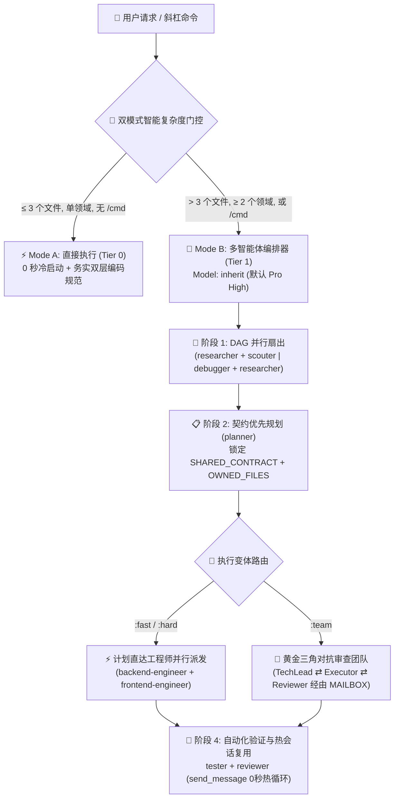

<div align="center">
  <h1>⚡ BoomOpen Workflow Kit v5.5.0</h1>
  <p><strong>跨平台智能混合 (Smart-Hybrid) AI 研发操作系统 — 21 位专家级智能体、17 支黄金三角团队与 1,430+ 按需技能宝库</strong></p>

  <p>
    <a href="https://github.com/Kennyboom/BoomOpen-Workflow-Kit/releases"></a>
    <a href="#platforms"></a>
    <a href="#agents"></a>
    <a href="#pillars"></a>
    <a href="https://nodejs.org/">=18.0.0" /></a>
    <a href="../LICENSE"></a>
  </p>

  <p>
    <a href="../README.md">🇬🇧 English</a> • <a href="./README.vi.md">🇻🇳 Tiếng Việt</a> • <b>🇨🇳 简体中文</b> • <a href="./README.zh-TW.md">🇹🇼 繁體中文</a> • <a href="./README.ja.md">🇯🇵 日本語</a> • <a href="./README.ko.md">🇰🇷 한국어</a> • <a href="./README.es.md">🇪🇸 Español</a> • <a href="./README.fr.md">🇫🇷 Français</a> • <a href="./README.de.md">🇩🇪 Deutsch</a><br/>
    <a href="./README.pt-BR.md">🇧🇷 Português</a> • <a href="./README.ru.md">🇷🇺 Русский</a> • <a href="./README.hi.md">🇮🇳 हिन्दी</a> • <a href="./README.ar.md">🇸🇦 العربية</a> • <a href="./README.id.md">🇮🇩 Bahasa Indonesia</a> • <a href="./README.th.md">🇹🇭 ไทย</a> • <a href="./README.tr.md">🇹🇷 Türkçe</a> • <a href="./README.it.md">🇮🇹 Italiano</a>
  </p>
</div>

---

## 🎬 官方发布宣传片 (Full HD 1080p)

<div align="center">
  <a href="https://github.com/Kennyboom/BoomOpen-Workflow-Kit/raw/main/assets/media/boomopen_v55_trailer_en.mp4">
    
  </a>
  <p>
    ▶️ <a href="https://github.com/Kennyboom/BoomOpen-Workflow-Kit/raw/main/assets/media/boomopen_v55_trailer_en.mp4"><b>点击此处在线观看 / 播放 Full HD 1080p 官方宣传片 (MP4 专业配音版)</b></a>
  </p>
</div>

---

## 🌟 什么是 BoomOpen Workflow Kit v5.5？

**BoomOpen Workflow Kit v5.5（跨平台统一与智能混合版）** 是一个开源的多智能体（Multi-Agent）研发操作系统，能够将单一的 AI 编程助手升级为由 **21 位专家级智能体（Specialist Agents）**、**17 支黄金三角对抗团队（Golden Triangle Teams）**、**48 项核心技能（Core Skills）** 以及 **1,430+ 项垂直领域技能库（`skills_library`）** 组成的协同工程团队。

不同于每次简单提问都会带来冷启动延迟的笨重代理框架，BoomOpen v5.5 引入了 **双模式智能复杂度阈值门控（2-Mode Smart Complexity Threshold Gate）**：
- **⚡ Mode A — 直接执行模式（0 秒冷启动）**：针对日常问答、代码解释、单领域缺陷修复或仅涉及 **≤ 3 个文件**（且未调用 `/cmd` 斜杠命令）的明确修改，由主智能体**直接**执行、测试与验证，同时严格执行 **务实双层编码规范（Pragmatic 2-Tier Coding Standards）** 与 **持续测试与缺陷修复（Persistent Testing & Bug Fixing）**。
- **🎻 Mode B — 严格多智能体编排模式（Strict Multi-Agent Orchestration）**：针对复杂功能开发（**> 3 个文件** 或 **≥ 2 个领域**）或显式调用 `/cmd` 工作流命令时，激活严格编排器模式，支持 **DAG 并行扇出（Parallel Fan-Out）**、**计划直达执行者派发（Direct Plan-to-Executor Dispatch）**、**契约优先文件锁（`SHARED_CONTRACT` + `OWNED_FILES`）** 以及 **有状态热会话复用（`send_message`）**。

- **📚 1,430+ 巨型专业技能库（零上下文膨胀）**：包含 **48 项核心技能 (`skills/`)** 与 **1,430+ 项垂直领域技能 (`skills_library/`)**，预编译至 `matrix-skills/compact-index.json` 实现 `O(1)` 两步按需加载，让 AI 瞬间掌握后端、前端、移动端、游戏开发 (Unity/Unreal/Godot)、AI/ML、BigQuery/数据工程、云原生/DevOps 与 OWASP 网络安全，且绝不污染上下文窗口。

---

## 🏗️ 智能混合架构图 (v5.5)



---

## 🧠 v5.5 的 6 大核心支柱

1. **🌐 五大平台 100% 统一支持 (`platforms/*`)**：
   - 基于统一架构原生支持 **Google Antigravity 2.0 (Gemini)**、**Claude Code**、**OpenAI Codex**、**Cursor** 和 **GitHub Copilot** 五大主流 AI 编程工具。
2. **📏 务实双层编码规范（Pragmatic 2-Tier Coding Standards — 拒绝机械拆碎文件）**：
   - **第一层（Tier 1 — 严苛质量与安全底线，零容忍）**：单一职责原则（Single Responsibility）、**严禁显式 `any`**、**严禁在生产代码中遗留调试 `console.log`**、异步与 API 边界必须包含 `try/catch` 与强类型错误处理、常量采用 `SCREAMING_SNAKE_CASE`、DRY（重复 ≥ 3 次抽离）、清理并排序导入语句。
   - **第二层（Tier 2 — 弹性结构指南，内聚优先）**：单文件软目标为 `~200–350 行`，高内聚模块软上限可达 `~400–450 行`（仅当 `>500 行` 或混杂多个领域职责时才强制拆分；测试、Schema/Types、CLI 与文档免除行数限制）。逻辑函数目标 `~20–40 行`（UI/处理函数 `~40–80 行`）。
3. **🎯 计划直达执行者派发 & 有状态热子代理复用 (`send_message`)**：
   - 一旦生成 `PLAN-{feature}.md`，编排器将任务**直接派发**给领域工程师（`backend-engineer`、`frontend-engineer`、`database-architect` 等），彻底消除多余的 `tech-lead` 中转跳数。
   - 已启动的子代理保存在 **活动会话注册表 (`Role → conversationId`)** 中，后续修复与迭代通过 `send_message` 直接唤醒，实现 **0 秒冷启动** 与 **100% 上下文保留**。
4. **🤝 契约优先并行派发 (`SHARED_CONTRACT` + `OWNED_FILES`)**：
   - 跨领域计划在启动并行开发前，预先锁定 API 接口契约、DTO 数据结构及互斥的文件写入所有权（`OWNED_FILES` 与 `READ_ONLY_FILES`），彻底杜绝并行覆写冲突与接口不匹配。
5. **🔍 5-Whys (SPIE v3.0) 根因调试与 100% 洁净 Git 树**：
   - `debugger` 通过 3 个优先级假设与 **5-Whys 因果链**（`Why 1 直接症状` → `Why 5 系统性根因`）定位问题。所有过程产物（`PLAN`、`DEBUG`、`TEST`、`REVIEW`、`MAILBOX`）默认写入 `<appDataDir>\brain\<conversation-id>\`，保持项目 Git 工作区 100% 洁净。
6. **🩺 内置 CLI 诊断工具 (`doctor` & `check`) 与 O(1) 技能索引**：
   - `npm run doctor` 自动校验五大平台配置、21 个智能体、51 个团队文件、72 个命令及 `matrix-skills/compact-index.json`（索引 `1,430+` 项技能）。`npm run check <dir>` 自动执行双层代码规范检查。

---

## 💻 支持的 AI 编程平台

| 平台名称 | 支持级别 | 全局入口文件 | 框架安装路径 |
|----------|:-------------:|-------------------|------------------------|
| **Antigravity (Gemini)** | ✅ 原生 v5.5 | `~/.gemini/GEMINI.md` | `~/.gemini/config/skills/boomopen-workflow-kit/` |
| **Claude Code** | ✅ 原生 v5.5 | `~/.claude/CLAUDE.md` | `~/.claude/skills/boomopen-workflow-kit/` |
| **OpenAI Codex** | ✅ 原生 v5.5 | `~/.codex/CODEX.md` & `AGENTS.md` | `~/.codex/skills/boomopen-workflow-kit/` |
| **Cursor** | ✅ 原生 v5.5 | `~/.cursor/rules/boomopen-workflow-kit.mdc` | `~/.cursor/skills/boomopen-workflow-kit/` |
| **GitHub Copilot** | ✅ 原生 v5.5 | `~/.copilot/COPILOT.md` | `~/.copilot/skills/boomopen-workflow-kit/` |

---

## 🚀 快速开始与安装指南

```bash
# 1. 克隆代码仓库
git clone https://github.com/Kennyboom/BoomOpen-Workflow-Kit.git
cd BoomOpen-Workflow-Kit

# 2. 为您使用的 AI 编程助手安装（任选其一或使用 --all 全部安装）
npm run install:antigravity   # Google Antigravity 2.0 (Gemini)
npm run install:claude        # Anthropic Claude Code
npm run install:codex         # OpenAI Codex CLI
npm run install:cursor        # Cursor AI Editor
npm run install:copilot       # GitHub Copilot (VS Code)
npm run install:all           # 一键安装全部 5 大平台

# 3. 运行健康诊断、双层编码规范检查与自动化测试套件
npm run doctor
npm run check ./cli
npm test
```

---

## 🎛️ 统一设置与执行模式选择 (`/settings` 控制中心)

BoomOpen v5.5 内置**零延迟统一控制中心**，支持在 `< 10ms` 内跨全部 **5 大平台**切换执行模式（`auto`、`mode_a`、`mode_b`、`team`）、4 套一键预设与 12 项系统参数（首轮对话延迟为 **0ms**）：

| 预设配置 (`Preset`) | 执行模式 (`execution.mode`) | 默认变体 | 自然语言深度调研 (`naturalLanguageResearchTrigger`) | 代码规范 (`codingStandards`) | 适用场景 |
|:---|:---|:---:|:---:|:---:|:---|
| **⚡ `smart-hybrid`** *(默认推荐)* | **`auto`**（`≤ 3 个文件` 走 Mode A 极速直连；`> 3 个文件` 或 `/cmd` 走 Mode B 多智能体） | `auto` | **`auto_team`** *(自动路由至 `/brainstorm:team` 黄金三角三人组)* | `pragmatic` (`400/500` 行) | 日常全栈研发首选：小任务零延迟，大架构深度协同 |
| **🚀 `solo-fast`** | **`mode_a`** *(强制单智能体直接执行，0 秒子代理开销)* | `fast` | `off` *(直接回复，除非显式输入 `/brainstorm`)* | `relaxed` (`600/800` 行) | 紧急热修复、快速原型验证、小型脚本与极致节省 Token |
| **🧠 `deep-architect`** | **`mode_b`** *(所有任务强制启用 Mode B 多智能体编排)* | `hard` | `auto_hard` *(自动运行 `/brainstorm:hard` 五维深度调研)* | `strict` (`300/400` 行) | 复杂系统架构设计、从零新建项目与跨领域重构 |
| **🔺 `adversarial-team`** | **`team`** *(所有工作流强制启用 3 智能体黄金三角 `:team`)* | `team` | **`auto_team`** *(3 智能体经由 `MAILBOX` 交叉对抗评审)* | `strict` (`300/400` 行) | 核心生产系统、金融级安全审计与零缺陷交付 |

### 三种切换方式（聊天框 `/settings`、本地 Web 面板、终端 CLI）

```bash
# 1. 聊天框内直接输入斜杠命令（弹出交互式选择菜单或单行速设）
/settings                                     # 打开交互式选择菜单 (ask_question UI)
/settings preset smart-hybrid                 # 切换为默认推荐模式 (Auto Mode A/B + auto_team)
/settings preset solo-fast                    # 切换为 Mode A 极速单代理直接执行
/settings preset deep-architect               # 切换为 Mode B 多智能体深度编排
/settings preset adversarial-team             # 切换为黄金三角 3 智能体对抗团队 (:team)
/settings mode auto | mode_a | mode_b | team  # 单独覆盖执行模式 (execution.mode)

# 2. 启动本地 Web 可视化控制中心 (http://127.0.0.1:4567)
npm run settings:ui

# 3. 终端 CLI 命令（支持全局 ~/.boomopen/settings.json 与项目级 ./.boomopen.json）
npm run settings -- status
npm run settings -- preset adversarial-team
npm run settings -- reset
```

---

## 🎯 斜杠命令参考手册

| 命令 | 支持变体 | 核心用途说明 |
|---------|----------|-----------------|
| **`/cook`** | `:fast`, `:hard`, `:team` | 端到端功能研发全流程（调研/侦察 → 规划 → 并行编码 → 测试 → 审查） |
| **`/code`** | `:fast`, `:hard`, `:team` | 基于现有 `PLAN-{feature}.md` 直接执行代码实现与验证 |
| **`/plan`** | `:fast`, `:hard`, `:team` | 生成包含 `SHARED_CONTRACT`、`OWNED_FILES` 与 Given/When/Then 验收标准的实施蓝图 |
| **`/fix`** | `:fast`, `:hard`, `:team` | 根因缺陷修复并强制执行回归测试验证 |
| **`/debug`** | `:fast`, `:hard`, `:team` | 基于 3 假设验证 + **5-Whys (SPIE v3.0)** 因果链的深度根因调查（`DEBUG-{issue}.md`） |
| **`/test`** | `:fast`, `:hard`, `:team` | DAG 并行扇出执行测试套件 + 扫描未覆盖边界场景（`tester` + `scouter`） |
| **`/review`** | `:fast`, `:hard`, `:team` | 四维并行代码审计（架构合规、代码质量、OWASP 安全、性能瓶颈） |
| **`/design`** | `:fast`, `:hard`, `:team` | 系统架构、数据库模式与 UI/UX 设计规范生成（`DESIGN.md`） |
| **`/docs`** | `:core`, `:business`, `:audit` | 生成或同步双层结构化架构文档与业务文档（`./documents/`） |
| **`/deploy`** | `:check`, `:preview`, `:production`, `:rollback` | 部署前质量门禁检查、预览环境发布、生产环境上线与安全回滚 |
| **`/brainstorm`** | `:fast`, `:hard`, `:team` | 苏格拉底式需求澄清、架构权衡分析与方案头脑风暴 |
| **`/report`** | `:fast`, `:hard`, `:team` | 生成包含指标统计与架构图表的技术及管理总结报告 |
| **`/orchestrate`** | — | 跨多个领域的自定义多智能体流水线协同编排 |
| **`/settings` / `/config`** | `preset`, `mode`, `set`, `ui` | 统一控制中心：切换 `Auto` / `Mode A` / `Mode B` / `Team`、应用预设或打开本地 Web 界面 (`--ui`) |
| **`/save` / `/recap`** | — | 保存会话交接状态（`SESSION-HANDOVER.md`）并在 `< 5秒` 内快速恢复项目上下文 |

---

## 🤖 21 位专家级智能体 & 17 支黄金三角团队

| 领域分类 | 专家级智能体 (`agents/*.md`) | 黄金三角对抗团队 (`agents/teams/*-team/`) |
|----------|-----------------------------------|------------------------------------------------|
| **工程实现与交付** | `backend-engineer`, `frontend-engineer`, `mobile-engineer`, `game-engineer`, `database-architect`, `devops-engineer` | `backend-team`, `frontend-team`, `fullstack-team`, `mobile-team`, `game-team`, `database-team`, `devops-team` |
| **架构设计与规划** | `tech-lead`, `planner`, `brainstormer`, `business-analyst`, `project-manager`, `designer` | `planning-team`, `project-team`, `design-team` |
| **质量、安全与调试** | `debugger`, `tester`, `reviewer`, `security-engineer`, `performance-engineer` | `debug-team`, `qa-team`, `review-team`, `security-team`, `performance-team` |
| **技术调研与知识管理** | `researcher`, `scouter`, `docs-manager`, `reporter` | `research-team`, `docs-team`, `report-team` |

---

## 📚 1,430+ 专业技能宝库（48 项核心技能 + 1,430+ 项领域技能）

BoomOpen 内置开源界规模最大的 AI 工程技能矩阵之一，通过 **两步 O(1) 渐进式检索**（`<skills>` 核心匹配 → `matrix-skills/compact-index.json` 索引检索 → 按需加载 `SKILL.md`）实现 **0 空闲 Token 消耗**：

| 技能层级 / 领域 | 数量 | 代表性技能与核心能力 | 加载机制 |
|:---|:---:|:---|:---|
| **⚡ Tier 1：核心技能 (`skills/`)** | **48** | `clean-code`, `systematic-debugging`, `plan-writing`, `brainstorming`, `frontend-design`, `api-patterns`, `database-design`, `testing-patterns`, `vulnerability-scanner`, `skill-seeker` | 预加载于 `<skills>`，首轮零延迟调用 |
| **🌐 Web、后端与分布式系统** | **380+** | Next.js/React 19、FastAPI、NestJS、Go/Rust 微服务、GraphQL、gRPC、Redis/Kafka 事件驱动架构、多租户 SaaS | 经由 `compact-index.json` 按需加载 (`skills_library/`) |
| **🤖 AI、LLM 智能体与数据工程** | **310+** | RAG 流水线、LangGraph/MCP 服务、提示词工程、Vertex AI、BigQuery 分析、dbt、Spark、向量数据库 | 经由 `compact-index.json` 按需加载 (`skills_library/`) |
| **☁️ 云原生、DevOps、K8s 与网络安全** | **290+** | Terraform/OpenTofu、AWS/GCP/Azure 架构、Docker/K8s GitOps、CI/CD 流水线、OWASP Top 10 安全审计、零信任鉴权 | 经由 `compact-index.json` 按需加载 (`skills_library/`) |
| **📱 移动端、游戏引擎与垂直行业** | **450+** | iOS Swift/SwiftUI、Android Kotlin、React Native、Flutter、Unity 6、Unreal Engine 5、Godot 4、WebGL/Three.js、量化金融、Web3 | 经由 `compact-index.json` 按需加载 (`skills_library/`) |

---

## 📂 仓库目录结构

```text
BoomOpen-Workflow-Kit/
├── agents/                  # 21 个专家智能体定义 + 17 支黄金三角团队（51 个角色文件）
├── cli/                     # 安装器 (install.js)、健康诊断 (doctor.js)、双层代码检查器 (checker.js) 与单元测试
├── commands/                # 72 个斜杠命令工作流 (:fast, :hard, :team) + _ref/ 共享协议
├── documents/               # 双层架构、领域模型、源码底座与编码规范文档
├── i18n/                    # 多语言国际化文档目录（包含 16 种主流语言的完整译本）
├── matrix-skills/           # 领域技能矩阵 YAML + 预编译 compact-index.json (1,430+ 项技能)
├── platforms/               # 五大平台统一配置模板 (antigravity/, claude/, codex/, copilot/, cursor/)
├── rules/                   # Mode B 按需加载核心规则 (CORE, PHASES, AGENTS, TEAMS, SKILLS, ERRORS, REFERENCE)
├── scripts/                 # Python 自动化校验与辅助脚本 (checklist.py, verify_all.py 等)
├── skills/                  # 48 项核心技能 (clean-code, debugger, plan-writing, frontend-design 等)
├── skills_library/          # 1,430+ 项垂直领域按需加载技能库（通过两步快速检索加载）
└── GEMINI.md | CLAUDE.md | CODEX.md | COPILOT.md | CURSOR.md | AGENT.md
```

---

## 📄 开源许可与安全策略

- **开源协议**：本项目基于 [MIT 许可证](../LICENSE) 开源发布。版权所有 © 2026 **Kennyboom (BoomOpen)**。
- **安全策略**：请参阅 [SECURITY.md](../SECURITY.md) 了解内置安全防护机制及漏洞私密报告流程。
