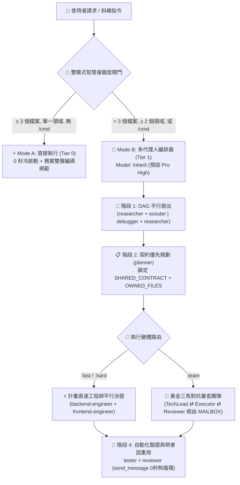

<div align="center">
  <h1>⚡ BoomOpen Workflow Kit v5.5.0</h1>
  <p><strong>跨平台智慧混合 (Smart-Hybrid) AI 研發作業系統與多代理人協同編排框架</strong></p>

  [](https://github.com/Kennyboom/BoomOpen-Workflow-Kit/releases)
  [](#)
  [](#)
  [](#)
  [](https://nodejs.org/)
  [](../LICENSE)

  <p>
    [🇬🇧 English](../README.md) • [🇻🇳 Tiếng Việt](./README.vi.md) • [🇨🇳 简体中文](./README.zh-CN.md) • **🇹🇼 繁體中文** • [🇯🇵 日本語](./README.ja.md) • [🇰🇷 한국어](./README.ko.md) • [🇪🇸 Español](./README.es.md) • [🇫🇷 Français](./README.fr.md) • [🇩🇪 Deutsch](./README.de.md)<br/>
    [🇧🇷 Português](./README.pt-BR.md) • [🇷🇺 Русский](./README.ru.md) • [🇮🇳 हिन्दी](./README.hi.md) • [🇸🇦 العربية](./README.ar.md) • [🇮🇩 Bahasa Indonesia](./README.id.md) • [🇹🇭 ไทย](./README.th.md) • [🇹🇷 Türkçe](./README.tr.md) • [🇮🇹 Italiano](./README.it.md)
  </p>
</div>

---

## 🌟 什麼是 BoomOpen Workflow Kit v5.5？

**BoomOpen Workflow Kit v5.5（跨平台統一與智慧混合版）** 是一套開源的多代理人（Multi-Agent）研發作業系統，能將單一 AI 程式設計助手升級為由 **21 位專家級代理人（Specialist Agents）**、**17 支黃金三角對抗團隊（Golden Triangle Teams）**、**48 項核心技能（Core Skills）** 以及 **1,430+ 項專業領域技能庫（`skills_library`）** 組成的協同工程團隊。

不同於每次簡單提問都會產生冷啟動延遲的笨重框架，BoomOpen v5.5 引入了 **雙模式智慧複雜度閾值閘門（2-Mode Smart Complexity Threshold Gate）**：
- **⚡ Mode A — 直接執行模式（0 秒冷啟動）**：針對日常問答、程式碼解釋、單一領域錯誤修復或僅觸及 **≤ 3 個檔案**（且未呼叫 `/cmd` 斜線指令）的明確修改，由主代理人**直接**執行、測試與驗證，同時嚴格執行 **務實雙層編碼規範（Pragmatic 2-Tier Coding Standards）** 與 **持續測試與除錯（Persistent Testing & Bug Fixing）**。
- **🎻 Mode B — 嚴格多代理人編排模式（Strict Multi-Agent Orchestration）**：針對複雜功能開發（**> 3 個檔案** 或 **≥ 2 個領域**）或明確呼叫 `/cmd` 工作流指令時，啟動嚴格編排器模式，支援 **DAG 平行扇出（Parallel Fan-Out）**、**計畫直達執行者派發（Direct Plan-to-Executor Dispatch）**、**契約優先檔案鎖（`SHARED_CONTRACT` + `OWNED_FILES`）** 以及 **有狀態熱會話重用（`send_message`）**。

---

## 🏗️ 智慧混合架構圖 (v5.5)



---

## 🧠 v5.5 的 6 大核心支柱

1. **🌐 五大平台 100% 統一支援 (`platforms/*`)**：
   - 基於統一架構原生支援 **Google Antigravity 2.0 (Gemini)**、**Claude Code**、**OpenAI Codex**、**Cursor** 與 **GitHub Copilot** 五大主流 AI 研發工具。
2. **📏 務實雙層編碼規範（Pragmatic 2-Tier Coding Standards — 拒絕機械式切碎檔案）**：
   - **第一層（Tier 1 — 嚴格品質與安全底線，零容忍）**：單一職責原則（Single Responsibility）、**嚴禁顯式 `any`**、**嚴禁在正式環境程式碼遺留除錯 `console.log`**、非同步與 API 邊界必須包含 `try/catch` 與強型別錯誤處理、常數採用 `SCREAMING_SNAKE_CASE`、DRY（重複 ≥ 3 次抽離）、清理並排序匯入語句。
   - **第二層（Tier 2 — 彈性結構指南，內聚優先）**：單一檔案軟目標為 `~200–350 行`，高內聚模組軟上限可達 `~400–450 行`（僅當 `>500 行` 或混雜多個領域職責時才強制拆分；測試、Schema/Types、CLI 與文件免除行數限制）。邏輯函式目標 `~20–40 行`（UI/處理函式 `~40–80 行`）。
3. **🎯 計畫直達執行者派發 & 有狀態熱子代理人重用 (`send_message`)**：
   - 一旦產出 `PLAN-{feature}.md`，編排器會將任務**直接派發**給領域工程師（`backend-engineer`、`frontend-engineer`、`database-architect` 等），徹底消除多餘的 `tech-lead` 中轉步驟。
   - 已啟動的子代理人會記錄在 **活動會話註冊表 (`Role → conversationId`)** 中，後續修復與迭代透過 `send_message` 直接喚醒，實現 **0 秒冷啟動** 與 **100% 上下文保留**。
4. **🤝 契約優先平行派發 (`SHARED_CONTRACT` + `OWNED_FILES`)**：
   - 跨領域計畫在啟動平行開發前，預先鎖定 API 介面契約、DTO 資料結構及互斥的檔案寫入所有權（`OWNED_FILES` 與 `READ_ONLY_FILES`），徹底杜絕平行覆寫衝突與介面不匹配。
5. **🔍 5-Whys (SPIE v3.0) 根因除錯與 100% 潔淨 Git 樹**：
   - `debugger` 透過 3 個優先級假設與 **5-Whys 因果鏈**（`Why 1 直接症狀` → `Why 5 系統性根因`）定位問題。所有暫態產物（`PLAN`、`DEBUG`、`TEST`、`REVIEW`、`MAILBOX`）預設寫入 `<appDataDir>\brain\<conversation-id>\`，保持專案 Git 工作區 100% 潔淨。
6. **🩺 內建 CLI 診斷工具 (`doctor` & `check`) 與 O(1) 技能索引**：
   - `npm run doctor` 自動檢驗五大平台配置、21 個代理人、51 個團隊檔案、72 個指令及 `matrix-skills/compact-index.json`（索引 `1,430+` 項技能）。`npm run check <dir>` 自動執行雙層程式碼規範檢查。

---

## 💻 支援的 AI 程式設計平台

| 平台名稱 | 支援級別 | 全域入口檔案 | 框架安裝路徑 |
|----------|:-------------:|-------------------|------------------------|
| **Antigravity (Gemini)** | ✅ 原生 v5.5 | `~/.gemini/GEMINI.md` | `~/.gemini/config/skills/boomopen-workflow-kit/` |
| **Claude Code** | ✅ 原生 v5.5 | `~/.claude/CLAUDE.md` | `~/.claude/skills/boomopen-workflow-kit/` |
| **OpenAI Codex** | ✅ 原生 v5.5 | `~/.codex/CODEX.md` & `AGENTS.md` | `~/.codex/skills/boomopen-workflow-kit/` |
| **Cursor** | ✅ 原生 v5.5 | `~/.cursor/rules/boomopen-workflow-kit.mdc` | `~/.cursor/skills/boomopen-workflow-kit/` |
| **GitHub Copilot** | ✅ 原生 v5.5 | `~/.copilot/COPILOT.md` | `~/.copilot/skills/boomopen-workflow-kit/` |

---

## 🚀 快速開始與安裝指南

```bash
# 1. 複製程式碼儲存庫
git clone https://github.com/Kennyboom/BoomOpen-Workflow-Kit.git
cd BoomOpen-Workflow-Kit

# 2. 為您使用的 AI 程式設計助手安裝（任選其一或使用 --all 全部安裝）
npm run install:antigravity   # Google Antigravity 2.0 (Gemini)
npm run install:claude        # Anthropic Claude Code
npm run install:codex         # OpenAI Codex CLI
npm run install:cursor        # Cursor AI Editor
npm run install:copilot       # GitHub Copilot (VS Code)
npm run install:all           # All 5 platforms

# 3. 執行健康診斷、雙層編碼規範檢查與自動化測試套件
npm run doctor
npm run check ./cli
npm test
```

---

## 🎛️ Unified Settings & Mode Selection (`/settings` Control Center)

Switch execution modes (`auto` | `mode_a` | `mode_b` | `team`), 4 one-click presets (`smart-hybrid`, `solo-fast`, `deep-architect`, `adversarial-team`), and 12 system settings across all 5 platforms in `< 10ms` with **0ms Turn-1 latency**:

```bash
# 1. In-Chat Slash Command (Interactive UI Widget or One-Liner)
/settings                                     # Open interactive ask_question menu
/settings preset smart-hybrid                 # Default Recommended (Auto Mode A/B + auto_team)
/settings preset solo-fast                    # Force Mode A Direct Fast Execution
/settings preset deep-architect               # Force Mode B Multi-Agent Orchestrator
/settings preset adversarial-team             # Force Golden Triangle 3-Agent (:team)
/settings mode auto | mode_a | mode_b | team  # Override execution.mode directly

# 2. Local Web Control Center Dashboard (http://127.0.0.1:4567)
npm run settings:ui

# 3. Terminal CLI (Global ~/.boomopen/settings.json & Project ./.boomopen.json)
npm run settings -- status
npm run settings -- preset adversarial-team
npm run settings -- reset
```

---

## 🎯 斜線指令參考手冊

| 指令 | 支援變體 | 核心用途說明 |
|---------|----------|-----------------|
| **`/cook`** | `:fast`, `:hard`, `:team` | 端到端功能研發全流程（調研/偵察 → 規劃 → 平行編碼 → 測試 → 審查） |
| **`/code`** | `:fast`, `:hard`, `:team` | 基於現有 `PLAN-{feature}.md` 直接執行程式碼實作與驗證 |
| **`/plan`** | `:fast`, `:hard`, `:team` | 產生包含 `SHARED_CONTRACT`、`OWNED_FILES` 與 Given/When/Then 驗收標準的實作藍圖 |
| **`/fix`** | `:fast`, `:hard`, `:team` | 根因錯誤修復並強制執行回歸測試驗證 |
| **`/debug`** | `:fast`, `:hard`, `:team` | 基於 3 假設驗證 + **5-Whys (SPIE v3.0)** 因果鏈的深度根因調查（`DEBUG-{issue}.md`） |
| **`/test`** | `:fast`, `:hard`, `:team` | DAG 平行扇出執行測試套件 + 掃描未覆蓋邊界情境（`tester` + `scouter`） |
| **`/review`** | `:fast`, `:hard`, `:team` | 四維平行程式碼審計（架構合規、程式碼品質、OWASP 安全、效能瓶頸） |
| **`/design`** | `:fast`, `:hard`, `:team` | 系統架構、資料庫結構與 UI/UX 設計規範生成（`DESIGN.md`） |
| **`/docs`** | `:core`, `:business`, `:audit` | 產生或同步雙層結構化架構文件與業務文件（`./documents/`） |
| **`/deploy`** | `:check`, `:preview`, `:production`, `:rollback` | 部署前品質閘門檢查、預覽環境發布、正式環境上線與安全回滾 |
| **`/brainstorm`** | `:fast`, `:hard`, `:team` | 蘇格拉底式需求釐清、架構權衡分析與方案腦力激盪 |
| **`/report`** | `:fast`, `:hard`, `:team` | 產生包含指標統計與架構圖表的技術及管理總結報告 |
| **`/orchestrate`** | — | 跨多個領域的自訂多代理人管線協同編排 |
| **`/save` / `/recap`** | — | 儲存會話交接狀態（`SESSION-HANDOVER.md`）並在 `< 5秒` 內快速恢復專案上下文 |

---

## 🤖 21 位專家級代理人 & 17 支黃金三角團隊

| 領域分類 | 專家級代理人 (`agents/*.md`) | 黃金三角對抗團隊 (`agents/teams/*-team/`) |
|----------|-----------------------------------|------------------------------------------------|
| **工程實作與交付** | `backend-engineer`, `frontend-engineer`, `mobile-engineer`, `game-engineer`, `database-architect`, `devops-engineer` | `backend-team`, `frontend-team`, `fullstack-team`, `mobile-team`, `game-team`, `database-team`, `devops-team` |
| **架構設計與規劃** | `tech-lead`, `planner`, `brainstormer`, `business-analyst`, `project-manager`, `designer` | `planning-team`, `project-team`, `design-team` |
| **品質、安全與除錯** | `debugger`, `tester`, `reviewer`, `security-engineer`, `performance-engineer` | `debug-team`, `qa-team`, `review-team`, `security-team`, `performance-team` |
| **技術調研與知識管理** | `researcher`, `scouter`, `docs-manager`, `reporter` | `research-team`, `docs-team`, `report-team` |

---

## 📂 儲存庫目錄結構

```text
BoomOpen-Workflow-Kit/
├── agents/                  # 21 個專家代理人定義 + 17 支黃金三角團隊（51 個角色檔案）
├── cli/                     # 安裝器 (install.js)、健康診斷 (doctor.js)、雙層程式碼檢查器 (checker.js) 與單元測試
├── commands/                # 72 個斜線指令工作流 (:fast, :hard, :team) + _ref/ 共享協定
├── documents/               # 雙層架構、領域模型、原始碼底座與編碼規範文件
├── i18n/                    # 多語言國際化文件目錄（包含 16 種主流語言的完整譯本）
├── matrix-skills/           # 領域技能矩陣 YAML + 預編譯 compact-index.json (1,430+ 項技能)
├── platforms/               # 五大平台統一配置範本 (antigravity/, claude/, codex/, copilot/, cursor/)
├── rules/                   # Mode B 按需載入核心規則 (CORE, PHASES, AGENTS, TEAMS, SKILLS, ERRORS, REFERENCE)
├── scripts/                 # Python 自動化檢驗與輔助腳本 (checklist.py, verify_all.py 等)
├── skills/                  # 48 項核心技能 (clean-code, debugger, plan-writing, frontend-design 等)
├── skills_library/          # 1,430+ 項專業領域按需載入技能庫（透過兩步快速檢索載入）
└── GEMINI.md | CLAUDE.md | CODEX.md | COPILOT.md | CURSOR.md | AGENT.md
```

---

## 📄 開源授權與安全政策

- **開源授權**：本專案基於 [MIT 授權條款](../LICENSE) 開源發布。版權所有 © 2026 **Kennyboom (BoomOpen)**。
- **安全政策**：請參閱 [SECURITY.md](../SECURITY.md) 了解內建安全防護機制及漏洞私密通報流程。
