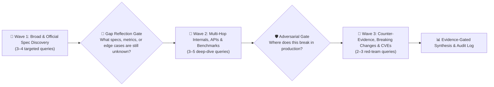

# 🔬 Autonomous Deep-Research Engine (2026 SOTA)

> **Zero-Guesswork, Multi-Hop Autonomous Research Protocol**
> Never rely on stale training-cutoff memory or single-pass search summaries. Execute structured multi-wave triangulation across workspace manifests, the `1,471+` local skills vault, official `/llms.txt` & vendor specifications, and empirical production benchmarks.

---

## 1. When to Activate This Skill

Activate `deep-research` whenever a task involves:
- Deep technical discovery, architecture evaluation, or SDK/API comparison (`/research`, `/research:hard`, `/research:team`)
- Product, market, SaaS, or game ideation and competitive teardowns (`/brainstorm:hard`, `/brainstorm:team`)
- Investigating unfamiliar libraries, 2025–2026 breaking changes, RFCs, or CVE advisories
- Resolving high-stakes architectural trade-offs before `/plan` or `/cook`

---

## 2. Engine 1: The 4-Source Triangulation Protocol

Every deep-research execution MUST triangulate across four authoritative evidence tiers before synthesizing conclusions:

| Tier | Source Category | How to Query / Inspect | Purpose |
|:----:|-----------------|------------------------|---------|
| **1** | **Workspace Manifests & `./documents/`** | Read `package.json`, `tsconfig.json`, `pyproject.toml`, `Cargo.toml`, `go.mod`, and `./documents/*.md` | Pin exact installed framework/runtime versions and architectural constraints so recommendations fit the repo. |
| **2** | **`1,471+` Local Skills Vault** | Lookup `matrix-skills/compact-index.json` → read matching `skills/*/SKILL.md` or `skills_library/*/SKILL.md` | Harvest battle-tested 2026 architectural blueprints and anti-patterns in milliseconds. |
| **3** | **Official Docs, `/llms.txt`, RFCs & Changelogs** | `search_web` with `domain` filter + `docs-seeker` patterns (`llms.txt`, `llms-full.txt`, `site:github.com/<org>/<repo>/releases`) | Verify ground-truth APIs, exact configuration schemas, deprecation notices, and latest stable versions. |
| **4** | **Empirical Benchmarks & Production Post-Mortems** | `search_web` targeting TechEmpower, Artificial Analysis, LMArena, CVEs/GHSA, and engineering post-mortems | Validate real-world p95/p99 latency, memory overhead, throughput, token/cloud costs, and failure modes. |

> **Triangulation Law**: Any architectural claim supported by only 1 source must be marked `[Confidence: LOW — Single-Source]`. Critical recommendations require `≥ 2` independent tiers (`[Confidence: HIGH]`).

---

## 3. Engine 2: The 3-Wave Iterative Multi-Hop Search Loop

Never stop after a single generic search query. Execute a disciplined **3-Wave Multi-Hop Loop** with an explicit **Gap Reflection Gate** between waves:



### Wave 1 — Broad Landscape & Official Spec Discovery (`3–4 queries`)
- Identify the current **2026 latest stable release**, official vendor documentation domain, and core architectural model.
- Check for `/llms.txt` or `/llms-full.txt` indexes and official migration guides.
- Example Wave 1 batch:
  1. `search_web(query: "<tech> latest release version architecture 2026", domain: "<vendor-domain>")`
  2. `search_web(query: "site:<vendor-domain> llms.txt OR changelog 2025 2026")`
  3. `search_web(query: "<tech A> vs <tech B> vs <tech C> architecture comparison 2026")`

### 🧠 Gap Reflection Gate (Mandatory Checkpoint)
Before launching Wave 2, pause and explicitly evaluate:
1. **Unresolved Technical Unknowns**: Which API signatures, lifecycle hooks, or config flags were missing from Wave 1?
2. **Missing Quantitative Data**: What latency, memory, bundle size, or pricing numbers are still unverified?
3. **Version Drift**: Did any Wave 1 result reference deprecated pre-2025 syntax?

### Wave 2 — Multi-Hop Internals, Schemas & Benchmarks (`3–5 queries`)
- Follow specific symbols, RFC numbers, GitHub issues/PRs, or benchmark suites discovered in Wave 1.
- Extract concrete TypeScript/Python/Rust/Go signatures, schema definitions, and quantitative benchmark metrics.
- Example Wave 2 batch:
  1. `search_web(query: "<library> <exact function/hook> TypeScript signature parameters", domain: "<vendor-domain>")`
  2. `search_web(query: "site:github.com/<org>/<repo>/releases breaking changes migration")`
  3. `search_web(query: "<tech> p99 latency memory throughput benchmark 2025 2026")`

### Wave 3 — Adversarial Counter-Evidence & Failure Modes (`2–3 queries`)
- Actively try to **disprove** your preferred option:
  1. `search_web(query: "<library/tech> (\"breaking changes\" OR \"memory leak\" OR \"bottleneck\" OR \"limitations\") 2025 2026")`
  2. `search_web(query: "<library A> vs <library B> (\"switched from\" OR \"post-mortem\" OR \"why we moved\")")`
  3. `search_web(query: "<library/tech> (CVE OR GHSA OR \"security advisory\" OR \"vulnerability\")")`

---

## 4. Engine 3: Stanford STORM Multi-Perspective Decomposition

When running `/research:hard`, `/research:team`, or `/brainstorm:team`, decompose the topic into **3 orthogonal specialist vectors** executed in parallel via `invoke_subagent(TypeName: "self", Model: "inherit")`:

| Vector | Specialist Persona | Core Investigation Mandate |
|--------|--------------------|----------------------------|
| **Vector 1** | **Official Specs & Systems Architect** | Authoritative specifications, RFCs, distributed systems trade-offs, scalability ceilings, and long-term vendor/OSS health. |
| **Vector 2** | **SDK, Codebase & Integration Engineer** | Exact API contracts, type safety, local workspace compatibility, minimal reproducible code patterns, and migration friction. |
| **Vector 3** | **Adversarial Fact-Checker & Red-Team Critic** | Counter-evidence, production failure stories, hidden cloud/token costs, lock-in traps, CVEs, and edge-case bottlenecks. |

### 5-Field Handoff Packet for Parallel Research Sub-Agents
When spawning the 3 STORM vectors on Turn 1, include:
1. **`MISSION & ACCEPTANCE CRITERIA`**: Exact research vector, required quantitative metrics, and 3-Wave search mandate.
2. **`SHARED_CONTRACT`**: Target topic, workspace runtime constraints (from Tier 1 manifests), and evaluation criteria.
3. **`OWNED_FILES`**: `<appDataDir>\brain\<conversation-id>\RESEARCH-{topic}-{vector}.md` (or return structured findings via `send_message`).
4. **`READ_ONLY_FILES`**: Workspace source files and `./documents/*`.
5. **`VERIFICATION & DELIVERABLE`**: Mandatory `Research Execution Audit Log` with `≥ 2` independent source tiers per claim.

---

## 5. Engine 4: Dual-Track 5-Lens Analysis Framework

Select the analytical track that matches user intent (or combine both for full-stack product engineering):

### Track A — Product, Market & Game Ideation (`5 Lenses`)
1. **Core Value & User/Player Loop**: Compelling hook, retention loop, UX ergonomics, and jobs-to-be-done.
2. **Market & Competitor Teardown**: Direct/indirect competitors, feature parity matrix, and differentiation wedge.
3. **Technical Feasibility & Stack Fit**: Architecture blueprint, build vs. buy decisions, and latency/platform constraints.
4. **Monetization, Unit Economics & Growth**: Pricing tiers, COGS/inference cost per user, viral/distribution mechanics.
5. **Execution Risks & Phased MVP Scope**: Top 3 existential risks, mitigations, and strict Day-1 MVP vs. Phase-2 cutline.

### Track B — Deep Technical, SDK & System Architecture (`5 Lenses`)
1. **Architectural Fit & Trade-off Matrix**: Weighted comparison across candidate solutions (Throughput, DX, Ecosystem, Lock-in).
2. **API / Schema Contract & Type Safety**: Concrete interfaces, data models, validation rules, and error semantics.
3. **Performance, Latency & Resource Profile**: Empirical p50/p95/p99 latency, memory footprint, cold-start, and bundle impact.
4. **Security, Compliance & Supply-Chain Posture**: Authn/Authz model, OWASP/CVE history, sandboxing, and data privacy.
5. **Day-2 Operations, Observability & Migration Path**: Upgrade path, rollback safety, OpenTelemetry hooks, and CI/CD testability.

---

## 6. Evidence-Gated Report Schema (Mandatory Output Structure)

Write transient research deliverables to `<appDataDir>\brain\<conversation-id>\RESEARCH-{topic}.md` (or `./reports/{topic}/` only when explicitly requested):

```markdown
# 🔬 Deep Research Report: [Topic]
**Date**: YYYY-MM-DD | **Track**: [Track A / Track B / Hybrid] | **Confidence**: [HIGH / MEDIUM / LOW]

## 1. Executive Verdict & TL;DR Recommendation
- **Primary Recommendation**: [Clear decision + 3-bullet justification]
- **When NOT to Use**: [Explicit boundary conditions where an alternative wins]

## 2. 4-Source Triangulation & Comparative Matrix
| Criterion / Metric | Option A (Recommended) | Option B | Option C | Source Tier & Evidence |
|--------------------|------------------------|----------|----------|------------------------|
| Latest 2026 Version | `vX.Y.Z` | `vA.B.C` | `vM.N.P` | Tier 3 (Official Releases) |
| p99 Latency / Perf | `...` | `...` | `...` | Tier 4 (Benchmarks) |
| DX & Workspace Fit | `...` | `...` | `...` | Tier 1 & Tier 2 |

## 3. Deep-Dive 5-Lens Analysis
### Lens 1 .. Lens 5
[Concrete technical/product analysis, architecture Mermaid diagram, and verified 2026 code/config snippets]

## 4. Adversarial Risks, Breaking Changes & Failure Modes
| Risk / Edge Case | Severity | Empirical Evidence / CVE / Post-Mortem | Concrete Mitigation |
|------------------|----------|----------------------------------------|---------------------|

## 5. Actionable Implementation Blueprint
- **Exact Packages & Versions**: `...`
- **Step-by-Step Integration / Migration Plan**: `...`

## 6. Research Execution Audit Log (Mandatory)
| Wave | Query / Source Target | Tier (`1–4`) | Key Evidence & Quantitative Fact Extracted | Confidence |
|:----:|-----------------------|:------------:|--------------------------------------------|:----------:|
| W1 | `...` | Tier 3 | `...` | HIGH |
| W2 | `...` | Tier 2/3 | `...` | HIGH |
| W3 | `...` | Tier 4 | `...` | MEDIUM |
```
