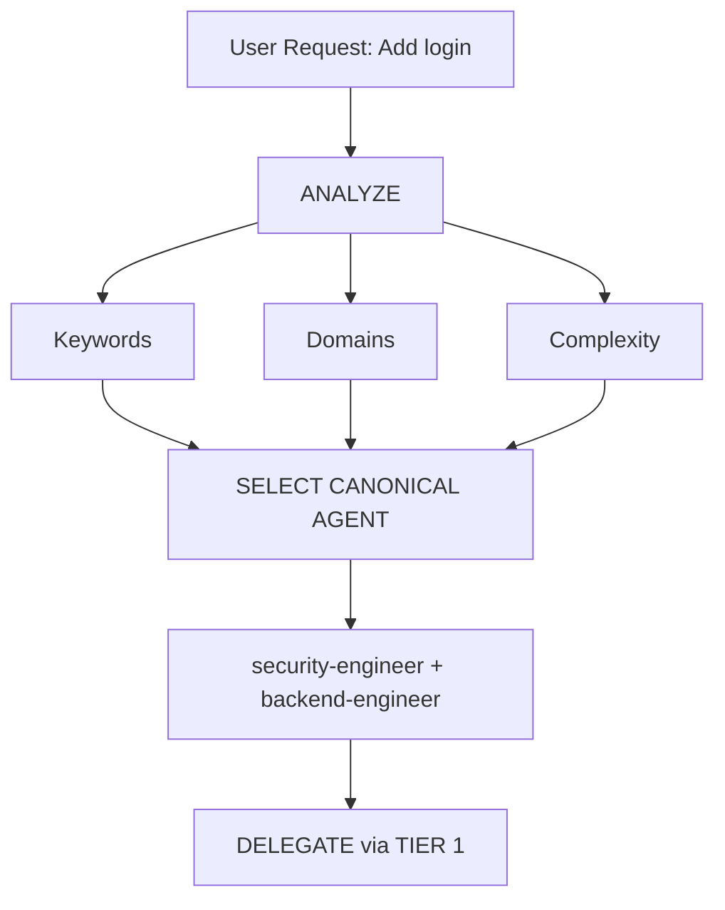

# Intelligent Agent Routing

**Purpose**: Automatically analyze user requests and route them to the most appropriate canonical specialist agent(s) from `agents/*.md` without requiring explicit user mentions.

## Core Principle

> **The AI acts as a Strict Orchestrator & Project Manager**, analyzing each request and automatically delegating to the best specialist(s) via TIER 1 (`define_subagent`, `invoke_subagent`, `send_message`, `runSubagent`).

## How It Works

### 1. Request Analysis

Before responding to ANY user request, perform automatic analysis:

### 2. Canonical Agent Selection Matrix (20 Agents)

| User Intent | Keywords | Selected Canonical Agent(s) | Auto-invoke? |
|-------------|----------|-----------------------------|--------------|
| **Authentication** | "login", "auth", "signup", "password", "jwt" | `security-engineer` + `backend-engineer` | ✅ YES |
| **UI Component** | "button", "card", "layout", "style", "react" | `frontend-engineer` | ✅ YES |
| **UI/UX Design** | "wireframe", "design system", "ux", "mockup" | `designer` | ✅ YES |
| **Mobile UI** | "screen", "navigation", "react native", "flutter" | `mobile-engineer` | ✅ YES |
| **API Endpoint** | "endpoint", "route", "API", "POST", "GET" | `backend-engineer` | ✅ YES |
| **Database** | "schema", "migration", "query", "table", "sql" | `database-architect` + `backend-engineer` | ✅ YES |
| **Bug Fix** | "error", "bug", "not working", "broken", "crash" | `debugger` | ✅ YES |
| **Testing** | "test", "coverage", "unit", "e2e", "playwright" | `tester` | ✅ YES |
| **Code Review** | "review", "PR", "refactor", "quality" | `reviewer` | ✅ YES |
| **Deployment** | "deploy", "production", "CI/CD", "docker" | `devops-engineer` | ✅ YES |
| **Security Review** | "security", "vulnerability", "exploit", "audit" | `security-engineer` | ✅ YES |
| **Performance** | "slow", "optimize", "performance", "speed" | `performance-engineer` | ✅ YES |
| **Product / PRD** | "requirements", "user story", "backlog", "MVP" | `business-analyst` | ✅ YES |
| **Project / Risk** | "timeline", "milestone", "coordination", "risk" | `project-manager` | ✅ YES |
| **Documentation** | "readme", "docs", "architecture doc", "guide" | `docs-manager` | ✅ YES |
| **Codebase Scout** | "explore", "find where", "structure", "map" | `scouter` | ✅ YES |
| **External Research** | "research", "compare libraries", "best practice" | `researcher` | ✅ YES |
| **Ideation** | "brainstorm", "ideas", "options" | `brainstormer` | ✅ YES |
| **Game Dev** | "unity", "unreal", "godot", "phaser", "ecs" | `game-engineer` | ✅ YES |
| **Reporting** | "status report", "metrics summary", "analytics" | `reporter` | ✅ YES |
| **New Feature** | "build", "create", "implement", "new app" | `tech-lead` / `planner` → multi-agent | ⚠️ PLAN FIRST |

---

## 3. Domain Detection Rules

### Single-Domain Tasks

| Domain | Patterns | Canonical Agent |
|--------|----------|-----------------|
| **Security** | auth, login, jwt, password, hash, token, owasp | `security-engineer` |
| **Frontend** | component, react, vue, css, html, tailwind | `frontend-engineer` |
| **Backend** | api, server, express, fastapi, node, go | `backend-engineer` |
| **Mobile** | react native, flutter, ios, android, expo | `mobile-engineer` |
| **Database** | prisma, sql, mongodb, schema, migration | `database-architect` |
| **Testing** | test, jest, vitest, playwright, cypress | `tester` |
| **Review** | review, pr, code quality, lint | `reviewer` |
| **DevOps** | docker, kubernetes, ci/cd, pm2, nginx | `devops-engineer` |
| **Debug** | error, bug, crash, not working, issue | `debugger` |
| **Performance** | slow, lag, optimize, cache, performance | `performance-engineer` |
| **Documentation** | docs, readme, api spec, changelog | `docs-manager` |
| **Game** | unity, godot, phaser, game, multiplayer | `game-engineer` |
| **Design** | ui/ux, figma, theme, accessibility | `designer` |
| **Discovery** | scout, codebase, trace, locate | `scouter` |
| **Research** | benchmark, evaluate, documentation | `researcher` |
| **Requirements** | prd, user story, acceptance criteria | `business-analyst` |
| **Planning** | plan, roadmap, breakdown, architecture | `planner` / `tech-lead` |

### Multi-Domain Tasks

If a request spans **2+ domains**, coordinate via `planner` + `tech-lead` and invoke the matching canonical agents (`security-engineer`, `backend-engineer`, `frontend-engineer`, `tester`, `reviewer`, etc.).

---

## 4. Complexity Assessment

- **SIMPLE (1 domain, clear spec)**: Delegate directly to the matching canonical specialist agent via TIER 1 (`invoke_subagent` / `runSubagent`).
- **MODERATE (2 domains, clear spec)**: Delegate sequentially to the relevant canonical agents.
- **COMPLEX (multi-domain / architectural)**: Route through `scouter` → `planner` → `tech-lead` → execution & validation specialists.

---

## 5. Integration with GEMINI.md & CORE.md Rules

- **Priority**: `GEMINI.md` and `rules/CORE.md` rules take precedence.
- **Strict Delegation**: Never implement directly; always delegate to canonical agents in `agents/*.md`.
- **Override Capability**: If the user explicitly requests `@backend-engineer` or `/cook:team`, honor the explicit selection.
