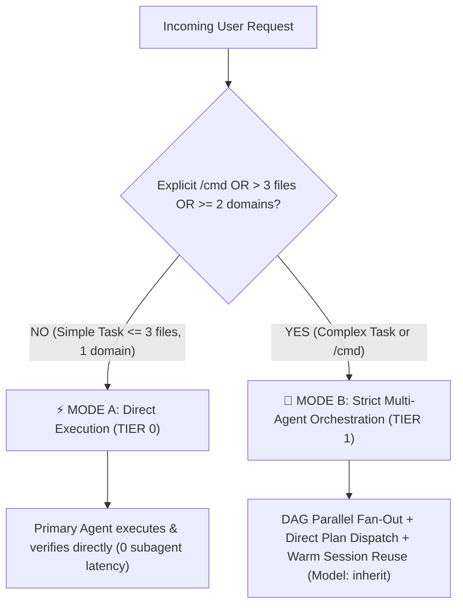

# 🧭 Intelligent Agent Routing (v5.5 — Smart-Hybrid Edition)

**Purpose**: Automatically classify incoming requests through the **2-Mode Smart Complexity Threshold Gate (Mode A vs. Mode B)** and route complex tasks to the right canonical specialist agent(s) from `agents/*.md` with **Quality-First Model Policy (`Model: "inherit"`)**, **DAG Parallel Fan-Out**, **Direct Plan-to-Executor Dispatch**, and **Warm Sub-agent Reuse (`send_message`)**.

---

## 1. 2-Mode Smart Complexity Threshold Gate (Evaluate First!)

### ⚡ MODE A — Direct Execution (`TIER 0` Fast Path)
- **When**: Q&A, code explanation, single-domain bug fixes, or clear changes touching **≤ 3 files**, AND no explicit slash command (`/cook`, `/fix:hard`, `/cook:team`, `/orchestrate`, etc.) was invoked.
- **Action**: Primary agent executes, tests, and verifies **directly** (0 sub-agent cold-start latency, 0 report file clutter), enforcing **Pragmatic 2-Tier Coding Standards** and **Persistent Testing & Bug Fixing**.

### 🎻 MODE B — Strict Multi-Agent Orchestration (`TIER 1` Deep Path)
- **When ANY is true**:
  1. User explicitly invokes a BoomOpen command (`/cook`, `/fix`, `/plan:hard`, `/review:team`, `/docs:core`, `/orchestrate`, etc.).
  2. Task spans **> 3 files** or **≥ 2 domains** (e.g., DB + Backend + Frontend + Security).
  3. Task requires architectural design, cross-module debugging, or Golden Triangle review (`:hard` / `:team`).
- **Action**: Activate **Strict Orchestrator Mode** and delegate to canonical specialists using `Model: "inherit"` (Pro High default; NEVER `flash_lite`).

---

## 2. Canonical Agent Selection Matrix (21 Specialist Agents — `Model: "inherit"`)

| User Intent | Keywords | Selected Canonical Agent(s) | Dispatch Mode |
|-------------|----------|-----------------------------|---------------|
| **Authentication / Authz** | "login", "auth", "jwt", "oauth", "rbac" | `security-engineer` + `backend-engineer` | Mode B (≥ 2 domains) |
| **UI Component / Styling** | "button", "card", "layout", "tailwind", "react" | `frontend-engineer` | Mode A (≤3 files) or Mode B |
| **UI/UX Design Spec** | "wireframe", "design system", "ux", "mockup" | `designer` | Mode B (`DESIGN-{feature}.md`) |
| **Mobile App** | "react native", "flutter", "ios", "android", "expo" | `mobile-engineer` | Mode A or Mode B |
| **API / Server Logic** | "endpoint", "route", "controller", "service", "rest" | `backend-engineer` | Mode A (≤3 files) or Mode B |
| **Database / Schema** | "schema", "migration", "query", "index", "prisma", "sql" | `database-architect` | Mode A or Mode B |
| **Root-Cause Debugging** | "error", "bug", "crash", "race condition", "5 whys" | `debugger` | Mode A (simple) or Mode B |
| **Testing / QA** | "test", "coverage", "unit", "e2e", "playwright" | `tester` | Mode A or Mode B |
| **Code / Arch Review** | "review", "PR", "audit", "quality" | `reviewer` (+ `tech-lead`, `security-engineer`, `performance-engineer` in `:hard`) | Mode B (Parallel Fan-Out) |
| **CI/CD & Deployment** | "deploy", "docker", "kubernetes", "github actions" | `devops-engineer` | Mode A or Mode B |
| **Security Audit** | "vulnerability", "owasp", "xss", "csrf", "pentest" | `security-engineer` | Mode B |
| **Performance Tuning** | "slow", "profil", "latency", "memory leak", "bundle" | `performance-engineer` | Mode B |
| **Business Requirements** | "prd", "user story", "acceptance criteria", "kpi" | `business-analyst` | Mode B |
| **Project Coordination** | "roadmap", "milestone", "risk register", "timeline" | `project-manager` | Mode B |
| **Documentation Suite** | "readme", "architecture docs", "/docs:core" | `docs-manager` | Mode B |
| **Codebase Discovery** | "scout", "explore", "map architecture", "locate" | `scouter` | Mode B (Parallel with `researcher`) |
| **External Research** | "research", "compare libraries", "best practices" | `researcher` | Mode B (Parallel with `scouter`) |
| **Ideation / Discovery** | "brainstorm", "options", "trade-offs" | `brainstormer` | Mode B (`ask_question` widget) |
| **Game Development** | "unity", "unreal", "godot", "phaser", "ecs" | `game-engineer` | Mode A or Mode B |
| **Status / Analytics Report**| "status report", "executive summary", "metrics" | `reporter` | Mode B |
| **Full Feature / App** | "build feature", "end-to-end", "new module" | `scouter` + `researcher` → `planner` → Direct Engineer Dispatch | Mode B (Full DAG) |

---

## 3. Intelligent Work Distribution Rules (Mode B)

1. **DAG Parallel Fan-Out**: Launch independent phases concurrently in a single turn (`researcher` + `scouter`; 4-way `/review:hard`; `backend-engineer` + `frontend-engineer` when `SHARED_CONTRACT` and disjoint `OWNED_FILES` are locked).
2. **Direct Plan-to-Executor Dispatch**: Once `PLAN-{feature}.md` exists in `:fast`, `:hard`, or `/orchestrate`, dispatch tasks **directly** from `PLAN` to domain engineers without a middleman `tech-lead` hop. Reserve `tech-lead` for Architecture Review and `:team` Golden Triangle arbitration.
3. **Warm Sub-agent Session Reuse (`send_message`)**: Record each spawned sub-agent's `conversationId` in the **Active Sub-agent Session Registry**. Reuse warm sessions via `send_message(Recipient: conversationId)` for follow-up tasks, review/test fixes, and debate rounds (0s cold-start, 100% context retained).
