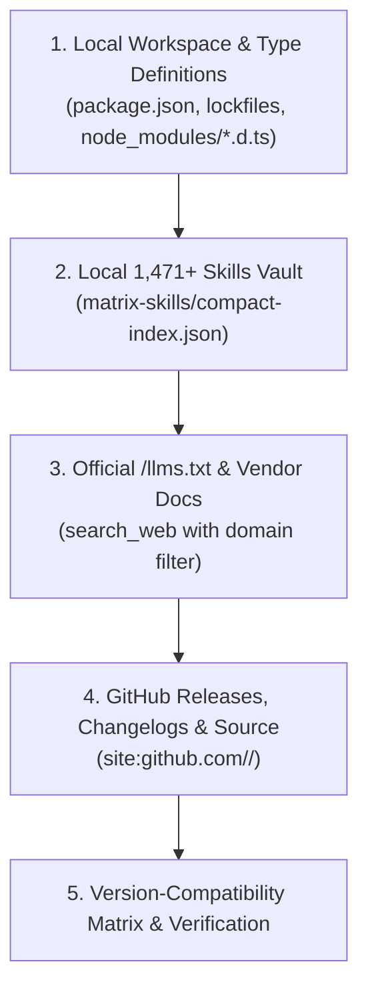

# 📚 Docs-Seeker — Autonomous Technical Documentation & `/llms.txt` Hunter (2026)

> **Never ask the user to paste documentation links when you can hunt them down autonomously.**
> Combine local SDK type inspection (`node_modules/**/*.d.ts`, `pyproject.toml`), `/llms.txt` discovery, domain-scoped `search_web` queries, and GitHub release/changelog archaeology to extract exact 2026 APIs.

---

## 1. The 5-Step Autonomous Documentation Hunt Waterfall

Execute these steps in order to resolve any library, SDK, framework, or cloud API question with zero hallucinated syntax:



---

## 2. Step 1: Local Workspace & SDK Type-Definition Inspection (Fastest Ground Truth)

If a library is already installed in the workspace, **its exact TypeScript `.d.ts` or Python/Rust source definitions are already on disk**—faster and more accurate than any web search:

| Ecosystem | Manifest / Lockfile to Read | Ground-Truth Type / Symbol Location |
|-----------|-----------------------------|-------------------------------------|
| **TypeScript / Node / Bun** | `package.json`, `pnpm-lock.yaml`, `bun.lock` | `node_modules/<pkg>/dist/*.d.ts` or `node_modules/<pkg>/package.json` (`"types"` / `"exports"`) |
| **Python (`uv` / Poetry)** | `pyproject.toml`, `uv.lock`, `requirements.txt` | `.venv/Lib/site-packages/<pkg>/__init__.py` or `.pyi` type stubs |
| **Rust (`Cargo`)** | `Cargo.toml`, `Cargo.lock` | `src/` imports, `cargo metadata`, or `docs.rs/<crate>/latest` |
| **Go** | `go.mod`, `go.sum` | `pkg.go.dev/<module>` or local vendor/module cache |

### Local Inspection Playbook
1. **Check Exact Installed Version**: Read `package.json` or `pyproject.toml` before writing a single line of integration code.
2. **Inspect Exported Subpaths**: Read `node_modules/<pkg>/package.json` (`"exports"` field) to see valid ESM/CJS import subpaths (e.g., `@ai-sdk/google`, `better-auth/react`, `drizzle-orm/pg-core`).
3. **Read `.d.ts` Signatures**: Read the `.d.ts` file referenced by `"types"` to confirm exact function parameters, return types, and generic constraints.

> **Rule**: Never mix v3 syntax into a v4 project (e.g., Tailwind v4 vs v3, Zod v4/v3, AI SDK v4/v5, React 19 vs 18).

---

## 3. Step 2: `/llms.txt` & `/llms-full.txt` Discovery Protocol

Modern 2025–2026 developer platforms publish machine-readable documentation indexes at `/llms.txt` and `/llms-full.txt` (and via `context7.com`):

### High-Value `/llms.txt` & Official Documentation Domains
| Ecosystem / Vendor | Official Domain (`domain` parameter in `search_web`) | `/llms.txt` / Primary Docs Pattern |
|--------------------|------------------------------------------------------|------------------------------------|
| **Next.js / Vercel / AI SDK** | `nextjs.org`, `sdk.vercel.ai`, `vercel.com` | `nextjs.org/docs`, `sdk.vercel.ai/llms.txt` |
| **Anthropic / Claude / MCP** | `docs.anthropic.com`, `modelcontextprotocol.io` | `modelcontextprotocol.io/llms-full.txt` |
| **Google Gemini / Vertex AI** | `ai.google.dev`, `cloud.google.com` | `ai.google.dev/gemini-api/docs` |
| **OpenAI Platform / Agents** | `platform.openai.com`, `openai.github.io` | `platform.openai.com/docs` |
| **Cloudflare Workers / Agents**| `developers.cloudflare.com` | `developers.cloudflare.com/llms.txt` |
| **Supabase / Drizzle / Prisma**| `supabase.com`, `orm.drizzle.team`, `prisma.io` | `supabase.com/llms.txt`, `orm.drizzle.team/llms.txt` |
| **Hono / Better Auth / TanStack**| `hono.dev`, `better-auth.com`, `tanstack.com` | `hono.dev/llms.txt`, `better-auth.com/llms.txt` |
| **Stripe / Clerk / Auth0** | `docs.stripe.com`, `clerk.com`, `auth0.com` | `docs.stripe.com/llms.txt`, `clerk.com/docs` |
| **FastAPI / Pydantic / LangGraph**| `fastapi.tiangolo.com`, `docs.pydantic.dev`, `langchain-ai.github.io` | Official API & concepts docs |
| **Unity 6 / Godot 4 / WebGPU** | `docs.unity3d.com`, `docs.godotengine.org`, `gpuweb.github.io` | Official manual & scripting API |

### Query Templates for `/llms.txt` & Official Docs
```text
1. search_web(query: "<library> <feature/API> official documentation 2026", domain: "<official-domain>")
2. search_web(query: "site:<official-domain> llms.txt OR llms-full.txt <topic>")
3. search_web(query: "<library> migration guide breaking changes v<X> to v<Y>", domain: "<official-domain>")
```

---

## 4. Step 3: GitHub Source, Changelog & Issue Archaeology

When official documentation is incomplete or a bleeding-edge 2026 release just shipped, query GitHub directly via `search_web(domain: "github.com")`:

| Investigation Goal | Targeted Query Pattern (`domain: "github.com"`) |
|--------------------|-------------------------------------------------|
| **Latest Release & Breaking Changes** | `site:github.com/<org>/<repo>/releases "<version>" OR "Breaking Changes"` |
| **CHANGELOG & Migration Notes** | `site:github.com/<org>/<repo> ("CHANGELOG.md" OR "MIGRATION.md" OR "UPGRADING.md") "<symbol>"` |
| **Exact TypeScript Interface / Exports** | `site:github.com/<org>/<repo> "export interface <Name>" OR "export function <name>"` |
| **Example Apps & Official Templates** | `site:github.com/<org>/<repo>/tree/main/examples "<feature>"` |
| **Known Bug / Workaround in Issues** | `site:github.com/<org>/<repo>/issues "<exact error message>"` |
| **Merged PR Introducing Feature** | `site:github.com/<org>/<repo>/pull "<feature or config key>"` |

---

## 5. Step 4: Multi-Agent Documentation Distribution Strategy

When researching a large framework or multi-module SDK (e.g., migrating an entire app to Next.js 15 + React 19 + Better Auth + Drizzle), split documentation hunting across parallel sub-agents:

| Scope Size | Sub-Agent Strategy | Assignment Pattern |
|------------|--------------------|--------------------|
| **Single API / Hook** (`1–2 docs`) | **1 Researcher** | Direct `search_web` + local `.d.ts` verification. |
| **Multi-Module SDK** (`3–6 docs`) | **2–3 Parallel Researchers** | Agent 1: Core Config & Schema; Agent 2: Auth/Middleware; Agent 3: Breaking Changes & Edge Cases. |
| **Full Ecosystem Migration** (`7+ docs`) | **Phased STORM Fan-Out** | Wave 1: Map `/llms.txt` & release notes → Wave 2: Parallel domain deep dives → Wave 3: Compatibility synthesis. |

---

## 6. Step 5: Version-Compatibility & Deprecation Matrix

Whenever documenting or recommending an SDK or API, verify and record its **Version-Compatibility Matrix**:

```markdown
| Package / SDK | Workspace Version | Latest Stable (2026) | Peer Dependencies / Runtime Floor | Deprecated APIs to Avoid | Replacement API (2026) |
|---------------|-------------------|----------------------|-----------------------------------|--------------------------|------------------------|
| `next` | `15.2.x` | `15.x` | `react >= 19.0.0`, `Node >= 20` | Sync `params`/`cookies()` | `await params`, `await cookies()` |
| `tailwindcss` | `4.0.x` | `4.x` | `@tailwindcss/vite` or `@tailwindcss/postcss` | `tailwind.config.js` | CSS-first `@import "tailwindcss"; @theme {}` |
| `@tanstack/react-query` | `5.x` | `5.x` | `react >= 18` | `onSuccess` in `useQuery`, `cacheTime` | `gcTime`, handle side effects in `useMutation` / render |
| `vitest` + `msw` | `3.x` / `2.x` | `3.x` / `2.x` | `Node >= 20` | `rest.get(url, (req, res, ctx))` | `http.get(url, () => HttpResponse.json(...))` |
```

---

## 7. Anti-Patterns to Avoid (Zero Tolerance)

1. **NEVER invent CLI flags or config keys**: Verify every flag (`--flag`) and configuration property against official docs or `.d.ts` schemas.
2. **NEVER mix major versions silently**: Explicitly state which major version (`vX.Y`) a code snippet targets.
3. **NEVER stop at secondary blog tutorials when official docs exist**: Secondary Medium/Dev.to posts frequently lag behind breaking releases; always cross-check against Tier-3 Official Docs or GitHub source.
4. **NEVER ask the user for URLs you can find in 1 tool call**: Use `search_web` with `domain` filtering immediately.
5. **NEVER copy unverified `.env` variable names**: Confirm exact environment variable names from official SDK docs or source code.

---

## 8. Worked Examples: Autonomous 2026 Documentation Hunts

### Example A — Hunting Bleeding-Edge Framework APIs (`Next.js 15` + `Better Auth` + `Drizzle`)
1. **Step 1 (Local Manifests)**: Read `package.json` → confirm `next@^15.2.0`, `better-auth@^1.2.0`, `drizzle-orm@^0.40.0`.
2. **Step 2 (Local `.d.ts` Inspection)**: Check `node_modules/better-auth/dist/plugins/*.d.ts` for exact plugin options (`twoFactor`, `passkey`, `organization`).
3. **Step 3 (`/llms.txt` & Official Docs)**:
   - `search_web(query: "site:better-auth.com llms.txt OR drizzle adapter schema 2026", domain: "better-auth.com")`
   - `search_web(query: "Next.js 15 async headers cookies middleware Better Auth session", domain: "better-auth.com")`
4. **Step 4 (GitHub Changelog Check)**:
   - `search_web(query: "site:github.com/better-auth/better-auth/releases breaking changes", domain: "github.com")`
5. **Step 5 (Synthesize Contract)**: Output verified TypeScript imports, schema table definitions, and route handlers with zero deprecated APIs.

### Example B — Hunting Cloud & AI Agent SDK Specs (`MCP FastMCP` + `Gemini 2.5`)
1. **Step 1 (Local Vault)**: Read `skills_library/mcp-server-fastmcp-2025/SKILL.md` and `skills_library/google-adk-gemini-agents/SKILL.md`.
2. **Step 2 (Official Protocol Specs)**:
   - `search_web(query: "Model Context Protocol Streamable HTTP transport specification 2025 2026", domain: "modelcontextprotocol.io")`
   - `search_web(query: "Gemini 2.5 Pro structured outputs thinking_config API reference", domain: "ai.google.dev")`
3. **Step 3 (Verify Parameter Schema)**: Confirm exact JSON Schema / Zod tool input definitions and transport headers before implementation.

---

## 9. Documentation Verification Checklist (Before Returning Results)

- [ ] **Exact Version Pinned?** Every code snippet states the target library major.minor version.
- [ ] **Imports Verified?** Every `import { ... } from '...'` path matches the package's `exports` map or official 2026 docs.
- [ ] **Zero Hallucinated Options?** Every configuration key or CLI flag was verified in `.d.ts`, `/llms.txt`, or official reference docs.
- [ ] **Breaking Changes Flagged?** Known deprecations between the previous major version and the current 2026 version are explicitly called out.
- [ ] **Sources Linked?** Official documentation URLs and GitHub release references are included in the audit log.

### Related Research Skills
- **`deep-research` (`skills/deep-research/SKILL.md`)**: 4-Source Triangulation, 3-Wave Iterative Search Loop, Stanford STORM decomposition, and Dual-Track 5-Lens synthesis.
- **`research` (`skills_library/research/SKILL.md`)**: Advanced search query operators, benchmark extraction, and conflict resolution across sources.
- **`api-patterns` (`skills/api-patterns/SKILL.md`)**: OpenAPI 3.1, Hono RPC, tRPC, GraphQL, and Better Auth contract patterns.
- **`skill-seeker` (`skills/skill-seeker/SKILL.md`)**: Millisecond lookup across the `1,471+` local skills indexed in `matrix-skills/compact-index.json`.

> **Remember**: Ground-truth code lives in local `.d.ts` definitions, `/llms.txt` indexes, and GitHub release tags—never in guesswork.
