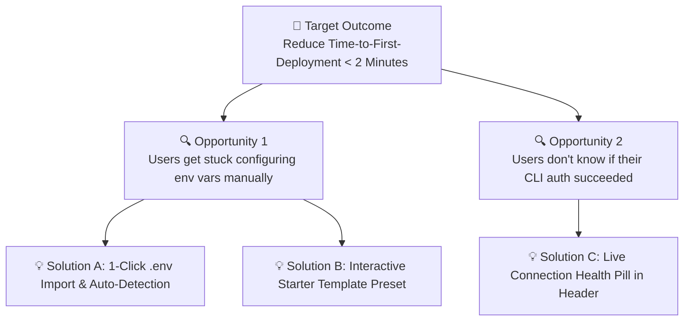

# End-to-End Product Design Framework: Discovery to Delivery (2026)

## 1. When to Use This Skill
Use this skill when leading **end-to-end product feature design (`/design`, `/cook`, `/plan`)**, translating ambiguous business goals into concrete user flows, specifying complete UI screen states, or running structured **Design Critiques**, including:
- Framing product initiatives with **Outcome-Driven Problem Statements** and **Opportunity Solution Trees (OST)**.
- Enforcing the **Mandatory 5-State UI Matrix (`Empty`, `Loading`, `Partial`, `Ideal`, `Error`)** on every screen and data widget.
- Authoring developer-ready design specifications that bridge UX intent, visual hierarchy, and technical constraints.

---

## 2. Phase 1: Problem Framing & Opportunity Solution Tree (OST)

Never jump straight from a feature request (*"Add a custom report builder"*) to pixels. Anchor the design in a measurable user and business outcome:

```markdown
### Product Design Brief Header
1. **Target Persona & Context**: Who is experiencing this friction, and what triggers the workflow?
2. **Core Problem Statement**: What is broken, slow, or error-prone in their current workflow?
3. **Target Outcome Metric**: How will we measure success? (e.g., Reduce incident triage time from 8m → 90s; increase onboarding completion from 42% → 70%).
4. **Non-Goals (Scope Guardrails)**: What are we explicitly NOT building in this iteration?
```



---

## 3. Phase 2: The Mandatory 5-State UI Matrix

The #1 cause of front-end rework during engineering implementation is designing only the **"Ideal State"** (when the user has 12 perfectly formatted items). Every view, card, and table in a product design specification MUST define all **5 canonical UI states**:

| UI State | Trigger Condition | Mandatory UX & Visual Specification |
|:---------|:------------------|:------------------------------------|
| **1. Empty (First-Run / Zero-Results)** | `items.length === 0` (either brand-new workspace OR filter returned 0 matches) | Distinguish **First-Run Empty** (show value preview + primary creation CTA + `Load Sample Data` button) from **Zero Filter Matches** (show `No results for "xyz"` + `Clear Filters` button) |
| **2. Loading (Initial & Incremental)** | Initial fetch (`> 150ms`), pagination, or background mutation | Render geometry-matched shimmer skeletons (matching exact row/card heights to guarantee `CLS = 0.00`); use inline button spinners (`aria-busy="true"`) for mutations |
| **3. Partial / Sparse / Overflow** | `1` item on screen, missing optional fields, or `500-char` unbroken strings | Verify layout does not collapse when only `1` card exists; enforce `truncate` / `line-clamp-2` with tooltip for long user-generated titles |
| **4. Ideal (High-Density Production)** | Normal operational load (`10–1,000+` items) | Clear visual hierarchy: primary metric/title (`font-semibold`), secondary metadata (`text-muted`), `tabular-nums` alignment, and keyboard accelerators |
| **5. Error / Degraded / Offline** | Network timeout, `403 Forbidden`, `422 Validation`, or `500` upstream outage | Preserve user input (never wipe a form on submit error!); display human-readable cause + trace ID + `Retry` button |

---

## 4. Production TypeScript Pattern: Type-Safe 5-State View Switcher

```tsx
import React from 'react';

export type AsyncViewState<T> =
  | { status: 'loading' }
  | { status: 'error'; message: string; onRetry: () => void }
  | { status: 'empty'; isFiltered: boolean; onResetFilters?: () => void; onCreateNew: () => void }
  | { status: 'ready'; data: T };

export function FiveStateViewContainer<T>({
  state,
  loadingSkeleton,
  emptyTitle,
  emptyDescription,
  emptyCtaLabel,
  children,
}: {
  state: AsyncViewState<T>;
  loadingSkeleton: React.ReactNode;
  emptyTitle: string;
  emptyDescription: string;
  emptyCtaLabel: string;
  children: (data: T) => React.ReactNode;
}) {
  if (state.status === 'loading') {
    return <div aria-busy="true" aria-live="polite">{loadingSkeleton}</div>;
  }

  if (state.status === 'error') {
    return (
      <div
        role="alert"
        className="rounded-xl border border-rose-500/30 bg-rose-950/20 p-6 text-center"
      >
        <h3 className="text-sm font-semibold text-rose-200">Unable to load view</h3>
        <p className="mt-1 text-xs text-rose-300/80">{state.message}</p>
        <button
          type="button"
          onClick={state.onRetry}
          className="mt-4 min-h-9 rounded-lg bg-rose-600 px-4 py-1.5 text-xs font-semibold text-white hover:bg-rose-500"
        >
          Retry Request
        </button>
      </div>
    );
  }

  if (state.status === 'empty') {
    return (
      <div className="rounded-xl border border-dashed border-slate-800 bg-slate-900/40 p-10 text-center">
        <h3 className="text-base font-semibold text-slate-100">
          {state.isFiltered ? 'No matching items found' : emptyTitle}
        </h3>
        <p className="mx-auto mt-1.5 max-w-md text-xs text-slate-400">
          {state.isFiltered
            ? 'Try adjusting your search query or clearing active filter facets.'
            : emptyDescription}
        </p>
        <div className="mt-5 flex items-center justify-center gap-3">
          {state.isFiltered && state.onResetFilters ? (
            <button
              type="button"
              onClick={state.onResetFilters}
              className="min-h-9 rounded-lg border border-slate-700 px-4 py-1.5 text-xs font-medium text-slate-200 hover:bg-slate-800"
            >
              Clear All Filters
            </button>
          ) : (
            <button
              type="button"
              onClick={state.onCreateNew}
              className="min-h-9 rounded-lg bg-indigo-600 px-4 py-1.5 text-xs font-semibold text-white hover:bg-indigo-500"
            >
              {emptyCtaLabel}
            </button>
          )}
        </div>
      </div>
    );
  }

  return <>{children(state.data)}</>;
}
```

---

## 5. Phase 3: Design Critique & Handoff Rubric

Before approving any product design for implementation, evaluate these 4 dimensions:
1. **Value & Friction (`UX Lead`)**: Can a first-time user complete the core job without reading external documentation? Can a daily power user complete it via keyboard in `< 5 seconds`?
2. **Visual Craft & Hierarchy (`UI Architect`)**: If you squint at the screen, is the #1 primary action and #1 focal metric immediately unmistakable? Are all colors, radii, and spacings bound to semantic tokens?
3. **Edge-Case Completeness (`Product Engineer`)**: Are all 5 states (`Empty`, `Loading`, `Partial`, `Ideal`, `Error`) explicitly specified? What happens on a `375px` mobile screen or when a title is `180 characters` long?
4. **Inclusive Ergonomics (`A11y Critic`)**: Does every interactive control meet `WCAG 2.2 AA` (`>= 24x24px` web / `44x44pt` touch, `>= 4.5:1` text contrast, full keyboard + screen-reader parity)?

---

## 6. Verification Checklist
- [ ] Problem statement, target user job, and measurable outcome metric are documented before UI layout.
- [ ] Every screen and data widget defines all 5 UI states (`Empty`, `Loading`, `Partial`, `Ideal`, `Error`).
- [ ] First-run empty states are differentiated from zero-match filter states.
- [ ] Responsive behavior (`375px` mobile, `768px` tablet, `1440px` desktop) and text-overflow truncation rules are specified.
