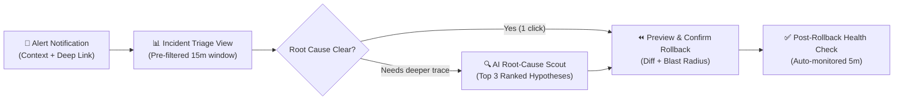

# UX Research, Jobs-to-be-Done (JTBD) & Information Architecture Guide (2026)

## 1. When to Use This Skill
Use this skill during **product discovery, UX audits, workflow redesigns, navigation restructuring, or before authoring a `DESIGN.md` specification**, including:
- Framing user needs using **Jobs-to-be-Done (JTBD)** and **4-Forces Switching Analysis** instead of demographic-only personas.
- Mapping end-to-end **User Journey Maps & Task Flows** with friction heatmaps and cognitive load budgets.
- Designing **Information Architecture (IA)**, navigation hierarchies, and progressive disclosure tiers.
- Conducting **Heuristic Usability Audits** combining Nielsen's 10 Heuristics with 2026 AI-Era UX Heuristics.

---

## 2. Jobs-to-be-Done (JTBD) & Behavioral Archetype Framework

Demographic personas (*"Marketing Mary, 34, likes lattes"*) fail to predict software usage. Frame every feature around **Behavioral Job Stories** and **Switching Forces**:

```markdown
### Canonical Job Story Template
- **When [Situation / Trigger Context]**: "When a production deployment triggers a 5xx latency spike at 2:00 AM..."
- **I want to [Motivation / Action]**: "...correlate the exact commit diff with the failing database query in under 60 seconds..."
- **So I can [Expected Outcome / Metric]**: "...decide whether to roll back or hotfix without waking up 4 other engineers."
```

| JTBD Force | Question to Answer in UX Design | Product UX Implication |
|:-----------|:--------------------------------|:-----------------------|
| **1. Push of the Status Quo** | What manual pain or error rate forces the user to seek a new workflow today? | Highlight the eliminated manual steps right in the onboarding / empty state |
| **2. Pull of the New Solution** | What "aha" outcome makes the new workflow 10x faster or safer? | Compress Time-to-First-Value (`TTFV`) to `< 90 seconds` |
| **3. Anxiety of the New** | What makes the user afraid to click (`Will this overwrite prod?`)? | Add dry-run previews, undo toasts, and explicit confirmation diffs |
| **4. Habit of the Present** | What muscle memory (`Cmd+K`, Vim keys, Excel copy-paste) do they already have? | Support standard keyboard shortcuts and paste-from-clipboard imports |

### TypeScript Schema for Structured JTBD & User Friction Synthesis

```typescript
export interface JtbdJobStory {
  id: string;
  actorRole: string;
  triggerSituation: string;
  desiredMotivation: string;
  measurableOutcome: string;
  currentWorkaroundPain: string;
  anxietyBarrier: string;
  targetTtfvSeconds: number;
}

export interface JourneyStepFriction {
  stepOrder: number;
  stepName: string;
  userGoal: string;
  interactionCount: number; // Clicks + keystrokes required
  cognitiveLoadScore: 1 | 2 | 3 | 4 | 5; // 1 = effortless, 5 = high abandonment risk
  failureMode: string;
  uxMitigationPattern: string;
}

export function calculateFlowFrictionScore(steps: readonly JourneyStepFriction[]): {
  totalSteps: number;
  highRiskSteps: JourneyStepFriction[];
  averageCognitiveLoad: number;
} {
  const highRiskSteps = steps.filter((s) => s.cognitiveLoadScore >= 4);
  const sum = steps.reduce((acc, s) => acc + s.cognitiveLoadScore, 0);
  return {
    totalSteps: steps.length,
    highRiskSteps,
    averageCognitiveLoad: steps.length > 0 ? Number((sum / steps.length).toFixed(2)) : 0,
  };
}
```

---

## 3. Information Architecture (IA) & Navigation Selection Matrix

| Application Complexity | Primary Navigation Pattern | IA Guardrails & Depth Limits |
|:-----------------------|:---------------------------|:-----------------------------|
| **Focused Utility (`1–5` top-level views)** | Top Horizontal Header Bar (`h-14`) + `Cmd+K` Command Palette | Max `5` top-level links; zero nested dropdown menus |
| **Multi-Module SaaS Workspace (`6–15` views)** | Collapsible Left Sidebar (`240px` expanded / `56px` rail) + Context Breadcrumbs | Max `2` levels of hierarchy (`Section Group → Item`); use tabs inside the page for 3rd level |
| **Multi-Tenant Enterprise Suite (`15+` views)** | Workspace Switcher + Left Sidebar + Global `Cmd+K` Omnibar | Pin top `5` daily workflows; progressive-disclose admin/settings routes |
| **Mobile / Touch Companion (`< 768px`)** | Sticky Bottom Tab Bar (`3–5` primary destinations) + Sheet Drawer | Never put primary navigation inside a top-left hamburger menu alone (`40%` lower discoverability) |

### Progressive Disclosure 3-Layer Rule
1. **Layer 1 (Always Visible — 80% Use Case)**: Core status, primary data table/cards, and the single primary CTA.
2. **Layer 2 (1-Click Reveal — Secondary Filters & Details)**: Slide-over inspector drawer (`420px–560px`), expandable accordion rows, or filter popover.
3. **Layer 3 (Advanced / Destructive Settings)**: Dedicated modal dialog or advanced settings route with explicit confirmation guardrails.

### Card Sorting & Tree Testing IA Validation Protocol
When restructuring navigation for applications with `> 10` modules, validate mental models using a structured IA tree specification:

```typescript
export interface NavigationNode {
  id: string;
  label: string;
  shortcut?: string; // e.g. "G then D"
  badgeCount?: number;
  children?: readonly NavigationNode[]; // Strictly max depth = 2
}

export function validateNavigationHierarchy(rootNodes: readonly NavigationNode[]): string[] {
  const violations: string[] = [];
  if (rootNodes.length > 7) {
    violations.push(`Top-level navigation has ${rootNodes.length} items (exceeds Miller's 7±2 ceiling).`);
  }
  for (const node of rootNodes) {
    for (const child of node.children ?? []) {
      if (child.children && child.children.length > 0) {
        violations.push(`Node "${node.label} > ${child.label}" has 3rd-level children; use in-page tabs instead.`);
      }
    }
  }
  return violations;
}
```

---

## 4. End-to-End Task Flow & Cognitive Load Modeling (Mermaid Blueprint)

Before designing high-fidelity screens, map the **Task Flow** with explicit decision branches, error recovery paths, and step counts:



### Hick's Law, Fitts's Law & Miller's Law Guardrails
1. **1 Primary Action per Screen Viewport (Hick's Law)**: Every screen must have exactly **one** visually dominant primary CTA (`variant="primary"`). Secondary actions use `secondary` or `ghost` treatments.
2. **Chunk Dense Forms into `3–5` Related Fields (Miller's Law)**: Group inputs into logical fieldsets with clear subheadings; prefer smart defaults over forcing users to configure 15 optional toggles up front.
3. **Minimize Pointer Distance Between Related Actions (Fitts's Law)**: Place inline row actions, confirmation popovers, and contextual toolbars adjacent to the selected element (`>= 24x24px` web / `44x44pt` mobile target size).

---

## 5. 12-Point Usability & Cognitive Ergonomics Audit Rubric

Score every user flow from `0` (Broken) to `3` (Exemplary) across these 12 criteria before shipping:

| # | Heuristic Criterion | Pass Condition (`Score = 3`) |
|:--|:--------------------|:-----------------------------|
| 1 | **Visibility of System Status** | Every async action (`> 150ms`) displays progress feedback; background saves show `Saved just now` |
| 2 | **Match Between System & Domain Mental Model** | Labels use the user's domain vocabulary, never internal database table names (`Workspaces`, not `tenant_org_v2`) |
| 3 | **User Control & Freedom (`Undo` / `Cancel`)** | Every modal closes on `Escape`; non-destructive deletions offer a `5-second Undo` toast |
| 4 | **Consistency & Platform Standards** | Destructive actions are always red/rose on the right/bottom; `Cmd+K` / `/` focus search |
| 5 | **Error Prevention Over Error Messages** | Invalid dates/options are disabled or constrained before submission; destructive actions require confirmation |
| 6 | **Recognition Rather Than Recall** | Recent items, autocomplete suggestions, and inline parameter hints eliminate memory burden |
| 7 | **Flexibility & Keyboard Accelerators** | Novice users have clear buttons; power users have `Cmd+Enter`, `j/k`, and command palette shortcuts |
| 8 | **Signal-to-Noise Ratio (Minimalist Density)** | Zero decorative chrome that competes with primary data or task completion |
| 9 | **Actionable Error Recovery** | Errors state *(1) what failed, (2) why, and (3) a 1-click recovery button* — never raw HTTP `500` codes |
| 10 | **Contextual Inline Help (`WCAG 3.2.6`)** | Complex fields include concise helper text or popover examples right next to the label |
| 11 | **AI Transparency & Controllability (2026)** | AI-generated outputs show grounding sources, confidence, and `Edit / Regenerate / Revert` controls |
| 12 | **Zero Redundant Data Entry (`WCAG 3.3.7`)** | Previously entered session data is pre-filled automatically across steps |

---

## 6. Anti-Patterns to Avoid
- ❌ **Designing the "Happy Path" Only**: Leaving empty states, 0-search-result views, network timeouts, and partial permission states unspecified.
- ❌ **Mystery-Meat Icon-Only Toolbars**: Rendering a row of 8 unlabeled icons without visible text labels or instant tooltips.
- ❌ **Deeply Nested 4-Level Navigation Trees**: If a user must click `Settings → Advanced → Integrations → Webhooks → Edit` to perform a core task, flatten the IA.
- ❌ **Modal-Over-Modal Stacking**: Opening a second modal dialog on top of an existing modal dialog instead of using an inline step or slide-over sheet.

---

## 7. Verification Checklist
- [ ] Every core feature is backed by a concrete JTBD Job Story (`When... I want to... So I can...`).
- [ ] Navigation hierarchy is `<= 2` levels deep and exposes a keyboard command palette (`Cmd+K`) for multi-module apps.
- [ ] Task flows document both the happy path and explicit error/cancel recovery branches.
- [ ] All screens pass the 12-Point Usability & Cognitive Ergonomics Audit Rubric with zero `0` or `1` scores.
